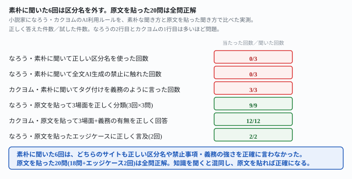
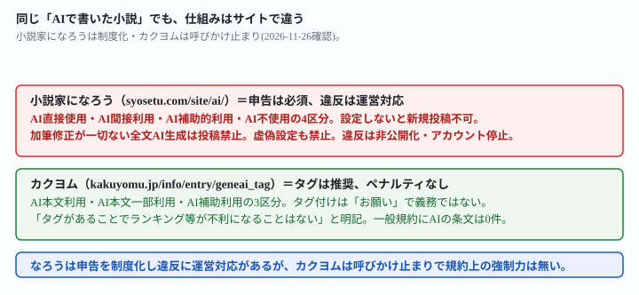

## これで何ができるか {: .what }

AIで書いた小説を「小説家になろう」「カクヨム」に出せるかは、**プラットフォームによって仕組みがまったく違います。**

- **小説家になろう**：AI利用状況の申告が新規投稿時に**必須**。4区分（AI直接使用・AI間接利用・AI補助的利用・AI不使用）から選ぶ。加筆・修正が一切ない全文AI生成作品は**投稿禁止**
- **カクヨム**：AI利用のタグ付けは**推奨のみ**（努力義務・ペナルティなし）。公式お知らせは3区分（AI本文利用・AI本文一部利用・AI補助利用）を挙げるが、一般の利用規約にAI関連の条文は見当たらない

<mark>この記事は、AIに素朴に聞いた6回・原文を貼って聞いた23問の結果をもとに、この違いを整理したものです。</mark>素朴に聞いた6回は、両サイトとも「投稿できます」とだけ答えました。<mark class="warn">ただし、なろうの正しい区分名（AI直接使用等）を使った回は6回中0回で、カクヨムの区分名と混同した回もありました。</mark>原文を貼って聞いた23問（なろう9問・カクヨム12問・エッジケース2問）は、全問正解でした。

<figure class="figure">

<figcaption>素朴に聞いた回は区分名を外す。原文を貼った回は全問正解でした。</figcaption>
</figure>

## 前提 {: .need }

| | |
|---|---|
| かかる時間 | 15分 |
| 費用 | 無料。公式サイトとAIとの会話だけ |
| 必要なもの | 投稿したい小説への、自分のAIの使い方のメモ |
| プログラミング | **不要** |

⚠️ **この記事は運営者がAI小説を投稿した記録ではありません。**公式ページに書かれていることの確認と、AIに聞いたときの返り方の実測です。規約・ガイドラインは変わります。この記事の日付は2026-11-26に原文を開いて確認したもので、使う前にご自身でも開いて確かめてください。

<figure class="figure">

<figcaption>なろうは申告を制度化。カクヨムは呼びかけ止まりでした。</figcaption>
</figure>

## AIへの頼み方 {: .ask }

### 1. まず、小説家になろうについて素朴に聞く

AIで書いた小説を「小説家になろう」に投稿してもいいですか。条件があれば教えてください。

**3回**通しました。3回とも「投稿できます」と答え、AI利用を示す仕組みがあることにも触れました。

<mark class="warn">ただし3回とも、なろうの正しい区分名を1つも使いませんでした。</mark>正しい区分は「AI直接使用・AI間接利用・AI補助的利用・AI不使用」の4つです。「加筆・修正が一切ない全文AI生成作品の投稿は禁止」という条文にも触れませんでした。2回は「AI本文利用」「AI補助利用」という、**カクヨムの区分名**をなろうの名前として答えました。原文はこうです。

> AI利用状況を設定しない新規作品の投稿は行えない仕様となっております。（[AI利用状況に関して](https://syosetu.com/site/ai/)・2026-11-26確認）

条件を「申告すればよい」という程度でぼかして答えており、禁止事項には触れていません。

### 2. 次に、カクヨムについて素朴に聞く

AIで書いた小説を「カクヨム」に投稿してもいいですか。条件があれば教えてください。

**3回**通しました。3回とも「投稿できます」と答えました。今度は3回とも「AI本文利用」「AI補助利用」という**カクヨムの実際の区分名に近い言葉**を使いました。ただし「AI本文一部利用」には触れませんでした。

🚨 <mark class="warn">ただし3回とも、カクヨムのタグ付けを実質的な義務のように書きました。</mark>「表示せずに投稿すると、規約違反になる可能性があります」「タグなしで投稿するのは避けてください」のような言い方です。原文はこうです。

> 生成AIを使用した作品については、使用状況に応じて以下のタグ付けを推奨いたします。（略）タグがあることによってランキング等で不利になることはありません。（[【重要】作品投稿に生成AIを利用している方へ、推奨タグ利用のお願い](https://kakuyomu.jp/info/entry/geneai_tag)・2025-11-19・2026-11-26確認）

「推奨」であり、付けなくてもランキング等の不利益は無いと原文が明記しているのに、3回とも実質的な強制のように伝えています。

### 3. なろうの原文を貼って、3つの場面を分類させる

なろうの4区分の原文をそのまま貼り、3つの場面がどれに当たるかを聞きました。

以下は「小説家になろう」の公式ガイドライン「AI利用状況に関して」からの抜粋です。これだけを根拠に答えてください。

【区分】
AI直接使用: 作品の本文において、AIが生成したテキストをそのまま直接的に使用している箇所がある場合に設定します。対象範囲については、単一の文章を超えた「連続する文章のまとまり」としてAIが生成したテキストをそのまま使用している場合からが対象となります。
AI間接利用: 作品の本文において、作者自身の表現に置き換えるための下書きや素材として「間接的」にAI生成物を利用している場合に設定します。例: AIが作成したプロットに基づき自身で執筆・編集を行った場合。
AI補助的利用: 作品のアイデア出し・資料調査・誤字脱字やスペルチェック等、AIが作品本文の執筆そのものに関与しない、補助的な利用に留まる場合に設定します。例: 自身で執筆した文章の誤字・脱字、スペルチェックにAIを使用した場合。作品のアイデア出しの相談などでAIを使用した場合。
AI不使用: 作品の創作工程（構想、プロット、執筆、校正の全て）で一切AIを使用していない場合に設定します。

次の3つの場面は、それぞれどの区分に当たりますか。場面ごとに区分名だけ短く答えてください。
場面1: AIにプロットを考えてもらい、本文は全部自分で書いた。
場面2: 自分で書いた文章の誤字脱字のチェックと、あらすじの構想の相談にAIを使った。
場面3: AIに書かせた文章を、段落ごとそのまま本文に貼り付けた。

**3回**通しました。<mark>3回とも、3問全部（場面1＝AI間接利用／場面2＝AI補助的利用／場面3＝AI直接使用）を正しく答えました。</mark>合計9問、全問正解です。1番の素朴な聞き方では一度も出なかった正しい区分名が、原文を貼った途端にすべて正確になりました。

### 4. カクヨムの原文を貼って、3つの場面を分類させる

同じ形でカクヨムのお知らせの抜粋を貼りました。

以下は「カクヨム」の公式お知らせ「作品投稿に生成AIを利用している方へ、推奨タグ利用のお願い」（2025-11-19）からの抜粋です。これだけを根拠に答えてください。

【使用状況とタグ（あくまで推奨であり義務ではありません）】
AI本文利用: 本文の大半（目安50%以上）がAIによって生成された文章。またはそれらの文章に作者が軽微な修正を加えたもの。
AI本文一部利用: 本文の一部（目安50%未満）がAIによって生成された文章。またはそれらの文章に作者が軽微な修正を加えたもの。
AI補助利用: AIのアイデアや資料をもとに、作者自身が本文を書いたもの。または作者自身が書いた文章の校正をAIに行わせるなど、創作の補助的に利用したもの。
タグがあることによってランキング等で不利になることはありません。

次の3つの場面は、それぞれどのタグに当たりますか。場面ごとにタグ名だけ短く答えてください。タグ付けは義務かどうかも最後に一言で添えてください。
場面1: AIのアイデアや資料をもとに、本文は自分で書いた。自分の文章の校正にもAIを使った。
場面2: 本文の半分以上をAIに生成させて、軽く手直しした。
場面3: 本文の3割程度をAIが生成し、残りは自分で書いた。

**3回**通しました。<mark>カクヨムでも3回とも3問全部を正しく答えました</mark>（場面1＝AI補助利用／場面2＝AI本文利用／場面3＝AI本文一部利用）。「義務ではなく推奨」とも3回とも明記しました。こちらも合計9問＋義務確認3回、全問正解です。

## うまくいかないときの言い直し方 {: .fix }

### 「少しだけ手直しすれば大丈夫」と思っていないか {: .trouble }

なろうの禁止条文には、加筆・修正が極めて限定的なケースへの言及もあります。これをAIが読み分けられるかを確かめました。

以下は「小説家になろう」の公式ガイドライン「AI利用状況に関して」からの抜粋です。これだけを根拠に答えてください。

【区分】
AI直接使用: 作品の本文において、AIが生成したテキストをそのまま直接的に使用している箇所がある場合に設定します。
【禁止事項】
全編AI生成作品の投稿: 作者による加筆・修正が一切ない、本文全てがAIによって生成したテキストのみで構成された作品の投稿は、利用規約で定める「作品」の定義のうち、「ユーザが構想及び執筆した情報」を満たさないものとして、投稿を禁止しています。また「AI直接使用」が設定されていても、加筆・修正が極めて限定的であるなど、実質的に全編AI生成と判断できる場合は運営対応の対象となる恐れがあります。

次の場面は投稿してよいですか。理由も教えてください。
場面: 本文はすべてAIに生成させ、誤字を1か所だけ自分で直して投稿した。

**2回**通しました。<mark>2回とも、「誤字を1か所だけ直した全文AI生成」について原文のニュアンスどおりの答えを返しました。</mark>「文字どおりの禁止には当たらないが、実質的に全編AI生成と判断され、運営対応の対象になりうる」という内容です。「誤字1つを直した」程度では、条文が言う「加筆・修正が極めて限定的」に当てはまる、という判断です。

→ **「一応直した」は、なろうの条文上は免罪符になりません。**原文のこの一文を自分の原稿に当てて、AIに判定させてから投稿してください。

### 「義務か推奨か」だけを直接聞いてみても、答えは変わらない {: .trouble }

1番・2番の素朴な聞き方は義務の強さを見誤りました。**「義務ですか推奨ですか」とだけ単刀直入に聞くとどうなるか**も確かめました。

「小説家になろう」のAI利用状況の設定と、「カクヨム」のAI利用タグは、それぞれ義務ですか推奨ですか。公式に書かれている言葉のとおりに、サイトごとに分けて答えてください。分からなければ「分からない」と書いてください。

**2回**通しました。<mark>原文を貼らないこの聞き方では、2回とも両サイトとも「分からない」と正直に答え、断定しませんでした。</mark>1番・2番のように誤った方向へ断定するよりは安全ですが、**知りたいことには答えてもらえません。**「分からない」と答えさせられても、原文を貼った3番・4番の代わりにはならないということです。

## 応用・次の一手 {: .next }

**自分の原稿がどの区分に当たるか迷ったら、原文を貼ってから聞いてください。**原文なしで聞くと、両サイトの区分名が混同されたり、義務の強さが逆に伝わったりします（1番・2番・上の「言い直し方」）。

「小説家になろう」と「カクヨム」、それぞれでAIの使い方に応じてどの区分・タグを選べばいいか、自分で判断するためのチェックリストを作ってください。プログラミングはできません。示されていない条件（規約の細部など）は補わず、「原文で確認」と書いてください。番号を振った短い手順にしてください。

**2回**試しました。<mark>2回とも、この記事で原文を貼っていない部分はすべて「原文で確認」とだけ書きました。</mark>区分名や義務の有無を、材料に無いまま作り話で埋めませんでした。この手順に、3番・4番で使った原文の抜粋を自分の原稿用に差し替えて使ってください。

📌 **同じ「原文で確かめる」型は、[GPTsで稼ぐ門は閉じた](/recipes/gpts-retirement-check-the-source/)・[Kindle出版のAI申告を原文で確かめる](/recipes/kindle-ai-disclosure-check/)にもあります。**収入そのものの仕組みを知りたい方は、[副業のお金は3つの流れで届く](/tools/money-map-three-routes/)もあわせてご覧ください。

⚠️ **コンテストごとに応募要項が別に決まっている場合があります。**カクヨムの公式お知らせ自身も「カクヨムコンテスト」への応募作品には、上の条件に該当すればタグ付けを**必ず**行うよう求めています。サイト全体のルール（推奨）と、コンテストのルール（必須）が異なることがあります。応募前に個別の要項も確認してください。

⚠️ **この結果は、2026-11-26に確認した原文と、計18回の実測です（原文を貼った回の判定は、場面ごとに数えて計23問）。**規約・ガイドラインは変更されることがあるので、投稿前に必ずご自身で[なろうの原文](https://syosetu.com/site/ai/)と[カクヨムの原文](https://kakuyomu.jp/info/entry/geneai_tag)を開いて確かめてください。今回の生の返りと集計は `docs/evidence/ai-novel-narou-vs-kakuyomu-disclosure.md` に全文置いてあります。
