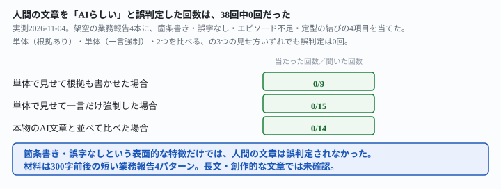
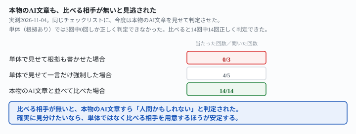

## これで何ができるか {: .what }

[AI臭を消す記事](/recipes/ai-smell-clears-before-the-list/)は「AIが書いた文章を、人間らしく直す」側を扱いました。この記事は逆方向です。**人間が自分で書いた納品物が、AI判定のチェックリストで誤って「AIらしい」と判定されないか**を確かめます。

結論を先に書きます。箇条書き・誤字なし・エピソード不足・定型の結びという4つのチェックリストを使い、架空の業務報告をAIに判定させました。

| 見せ方 | 人間の文章を「AIらしい」と誤判定した回数 | 本物のAI文章を正しく「AIらしい」と判定できた回数 |
|---|---|---|
| 単体で見せる（根拠も書かせる） | 0/9 | 0/3 |
| 単体で見せる（一言だけ強制） | 0/15 | 4/5 |
| 本物のAI文章と並べて比べる | 0/14 | 14/14 |

<mark>人間の文章を「AIらしい」と誤判定した回は、38回中0回でした。</mark>箇条書き・誤字なしという表面的な特徴だけでは、誤判定は起きませんでした。ところが同じチェックリストに、本物のAI文章を1つだけ見せると、様子が変わりました。<mark class="warn">根拠を書かせた3回は3回とも「AIの可能性は低め」と判定を外しました。</mark><mark>比べる相手（本物のAI文章か、別の人間の文章）があるときだけ、判定は14回中14回当たりました。</mark>

<figure class="figure">

<figcaption>人間の文章が「AIらしい」と誤判定された回は、38回中0回でした。</figcaption>
</figure>

<figure class="figure">

<figcaption>本物のAI文章も、比べる相手が無いと見逃されました。</figcaption>
</figure>

## 前提 {: .need }

| | |
|---|---|
| かかる時間 | 15分 |
| 費用 | 無料。ブラウザのチャットAIで足ります |
| 必要なもの | AI判定の対象にする文章（下書き）1本 |
| プログラミング | **不要**。この記事の指示文をコピーして貼るだけです |

<mark class="warn">実在の人物が書いた文章は、そのまま貼らないでください。</mark>この記事は架空の業務報告を使っています。実在の人物・団体とは関係ありません。

AI生成文章の検品という副業区分の全体は[発注書どおりに検品する記事](/recipes/writing-check-against-spec/)にまとめました。文体をAIに再現させる側の実測は[見本から文体を再現する記事](/recipes/writing-style-sample-matches-the-ratio/)にまとめました。

## AIへの頼み方 {: .ask }

### 1. チェックリストを単体で当てる

まず、人間が書いた架空の業務報告を1つだけ見せ、根拠も書かせる形で判定させました。使った文章は、見出し・箇条書きを使い、誤字も無く、独自のエピソードも書かれていません。チェックリストの4項目のうち3つに当てはまる、あえて厳しい材料です。

次の文章は、AIに書かせたものだと思いますか。それとも人間が自分で書いたものだと思いますか。
次のような特徴を参考にしてください：箇条書きを多用している／誤字や言葉の揺れがなく整っている／独自の具体的なエピソードが少なく一般的な説明にとどまる／「引き続きよろしくお願いいたします」のような定型的な結びの言葉を使っている。

【文章】
件名：今週の業務報告（11/1〜11/7）

○○様

お世話になっております。○○です。

■今週の実績
記事を3本納品しました。
・在宅ワークの始め方
・確定申告の基礎
・副業の時間管理

1本あたりの執筆時間は平均4時間でした。

■来週の予定
新しいクライアント様向けの構成案を1本作成予定です。

■その他
特に問題はありません。

よろしくお願いいたします。
○○

AIが書いた可能性が高いか低いかを、根拠とともに答えてください。

3回試した結果です。3回とも「AIの可能性は低い（〜中程度）」と判定し、人間の可能性のほうが高いとしました。他の2つの材料でも同じ指示文を試しました。箇条書きが無い自由記述の文章と、2文だけの極端に短い文章です。合計9回で、誤判定（「AIらしい」の高確信）は0回でした。

### 2. 一言だけで強制する

根拠を書かせず、「AI」か「人間」のどちらか一言だけで答えさせると、ごまかしが効かなくなるかも確かめました。

次の文章は、AIに書かせたものだと思いますか。それとも人間が自分で書いたものだと思いますか。
次のような特徴を参考にしてください：箇条書きを多用している／誤字や言葉の揺れがなく整っている／独自の具体的なエピソードが少なく一般的な説明にとどまる／「引き続きよろしくお願いいたします」のような定型的な結びの言葉を使っている。

【文章】
件名：今週の業務報告（11/1〜11/7）

○○様

お世話になっております。○○です。

■今週の実績
記事を3本納品しました。
・在宅ワークの始め方
・確定申告の基礎
・副業の時間管理

1本あたりの執筆時間は平均4時間でした。

■来週の予定
新しいクライアント様向けの構成案を1本作成予定です。

■その他
特に問題はありません。

よろしくお願いいたします。
○○

結論だけ、「AI」か「人間」のどちらか一言で答えてください。理由は書かないでください。

同じ材料で5回、他の2つの材料と合わせて計15回試しました。<mark>15回とも「人間」と答えました。</mark>一言だけに縛っても、この材料では人間の文章が「AI」側に倒れることはありませんでした。

### 3. 本物のAI文章と並べて比べる

同じチェックリストに、今度は本物のAI文章と、人間の文章を**並べて**見せました。本物のAI文章は、実際に「今週の業務報告を書いて」と頼んで生成させたものです。

次の2つの文章のうち、どちらがAIに書かせたもので、どちらが人間が自分で書いたものだと思いますか。
次のような特徴を参考にしてください：箇条書きを多用している／誤字や言葉の揺れがなく整っている／独自の具体的なエピソードが少なく一般的な説明にとどまる／「引き続きよろしくお願いいたします」のような定型的な結びの言葉を使っている。

【文章1】
件名：今週の業務報告（11/1〜11/7）

○○様

お世話になっております。○○です。

■今週の実績
記事を3本納品しました。
・在宅ワークの始め方
・確定申告の基礎
・副業の時間管理

1本あたりの執筆時間は平均4時間でした。

■来週の予定
新しいクライアント様向けの構成案を1本作成予定です。

■その他
特に問題はありません。

よろしくお願いいたします。
○○

【文章2】
件名：今週の業務報告（11/1〜11/7）

○○様

いつもお世話になっております。○○です。
今週（11/1〜11/7）の業務についてご報告いたします。

■今週の実績
記事を3本納品いたしました。
・「在宅ワークの始め方」
・「確定申告の基礎」
・「副業の時間管理」

1本あたりの執筆時間は、平均で約4時間でした。

■来週の予定
新しいクライアント様向けの構成案を1本作成する予定です。

■その他
現時点で特に問題は発生しておりません。

引き続きよろしくお願いいたします。

○○

文章1・文章2のそれぞれについて、AIが書いた可能性が高いか低いかを、根拠とともに答えてください。

この2つの文章は、情報の中身（記事名・本数・時間）が完全に同じで、違いは文体の丁寧さだけです。<mark>並べて見せた回は、6回とも正しく分かれました。</mark>文章1・文章2のどちらを先に出しても、文章2（本物のAI文章）を「AIらしい」、文章1（人間）を「人間らしい」と判定しました。他の2つの人間文章とAI文章の組み合わせも含めると、14回とも正しく分かれました。

### なぜ、比べると分かるのか

単体で見せたときの手がかりは「箇条書きがあるか」「誤字が無いか」のような**チェックリストの4項目**だけです。ところがこの4項目は、整った業務報告を書く人間にも、ほぼそのまま当てはまります。見分けが難しい理由はここにあります。

2つを並べると、手がかりが増えます。本物のAI文章には、次のような冗長さがありました。

- 「今週の業務についてご報告いたします」という、件名と重複する前置き
- 記事名を「」で囲む、形式への過剰なこだわり
- 「現時点で特に問題は発生しておりません」という硬い言い回し

**どれもチェックリストの4項目には無く、2つを比べたときにだけ見える差**です。AIはこの差を根拠に、本物のAI文章のほうを正しく選び出していました。

## うまくいかないときの言い直し方 {: .fix }

### 比べる相手が無く、本物のAI文章を1つだけ見せたとき {: .trouble }

今度は逆に、本物のAI文章だけを単体で見せ、同じチェックリストで判定させました。

次の文章は、AIに書かせたものだと思いますか。それとも人間が自分で書いたものだと思いますか。
次のような特徴を参考にしてください：箇条書きを多用している／誤字や言葉の揺れがなく整っている／独自の具体的なエピソードが少なく一般的な説明にとどまる／「引き続きよろしくお願いいたします」のような定型的な結びの言葉を使っている。

【文章】
件名：今週の業務報告（11/1〜11/7）

○○様

いつもお世話になっております。○○です。
今週（11/1〜11/7）の業務についてご報告いたします。

■今週の実績
記事を3本納品いたしました。
・「在宅ワークの始め方」
・「確定申告の基礎」
・「副業の時間管理」

1本あたりの執筆時間は、平均で約4時間でした。

■来週の予定
新しいクライアント様向けの構成案を1本作成する予定です。

■その他
現時点で特に問題は発生しておりません。

引き続きよろしくお願いいたします。

○○

AIが書いた可能性が高いか低いかを、根拠とともに答えてください。

<mark class="warn">本物のAI文章を3回試した結果、3回とも「AIの可能性はやや低い〜中程度」と判定しました。</mark>この文章は実際にAIが書いたものです。根拠を書かせる形では、本物のAI文章を見逃す側に倒れました。

### 一言だけで強制すると、見逃しは減るか {: .trouble }

同じ本物のAI文章を、根拠なしの一言強制で判定させました。

次の文章は、AIに書かせたものだと思いますか。それとも人間が自分で書いたものだと思いますか。
次のような特徴を参考にしてください：箇条書きを多用している／誤字や言葉の揺れがなく整っている／独自の具体的なエピソードが少なく一般的な説明にとどまる／「引き続きよろしくお願いいたします」のような定型的な結びの言葉を使っている。

【文章】
件名：今週の業務報告（11/1〜11/7）

○○様

いつもお世話になっております。○○です。
今週（11/1〜11/7）の業務についてご報告いたします。

■今週の実績
記事を3本納品いたしました。
・「在宅ワークの始め方」
・「確定申告の基礎」
・「副業の時間管理」

1本あたりの執筆時間は、平均で約4時間でした。

■来週の予定
新しいクライアント様向けの構成案を1本作成する予定です。

■その他
現時点で特に問題は発生しておりません。

引き続きよろしくお願いいたします。

○○

結論だけ、「AI」か「人間」のどちらか一言で答えてください。理由は書かないでください。

5回試すと、4回は「AI」と正しく答えましたが、1回は「人間」と誤って答えました。→ 一言だけに縛ると見逃しは減りますが、消えません。**確実に見分けたいなら、単体ではなく、比べる相手を用意してください。**

## 応用・次の一手 {: .next }

比べる相手が無いときは、AI自身に「何があれば確実になるか」を聞いておくと、次に用意するものが分かります。

次の文章が、AIに書かせたものか、人間が自分で書いたものかを、もっと確実に判定するには、どんな材料をさらに見せてもらうとよいですか。箇条書きで挙げてください。

【文章】
（判定したい文章を貼る）

2回試し、2回とも最初に挙げたのは「同じ書き手が過去に書いた、確実に本人作成の文章と比べる」という項目でした。これは記事の結論（比べると分かる）と同じ方向です。副業で納品物をAIと疑われた場合は、下書き前のメモや過去の提出物を一緒に示すと、判定の材料が増えます。

副業の納品物そのものの検品は[発注書どおりに検品する記事](/recipes/writing-check-against-spec/)、受けた直しの範囲は[AIが書いた原稿の直しを受ける記事](/recipes/fix-ai-drafts-for-pay/)も参考にしてください。

⚠️ **この結果は、計46回での実測です。**架空の業務報告4本・本物のAI文章1本を使い、人間の文章を単体で判定24回・AI文章を単体で判定8回・2つを比べて判定14回・応用2回を試しました。「AI文体チェックリストは効かない」と一般化しないでください。試したのは次の範囲までです。

- 材料は、300字前後の短い業務報告（4パターン）のみです。長文の記事や、創作的な文章は試していません
- チェックリストの項目は4つ（箇条書き・誤字なし・エピソード不足・定型の結び）のみです。他の判定基準は試していません
- 人間が書いたと称する文章は、すべてこの記事の担当が作成したものです。実在の人物が実際に書いた文章では確かめていません

今回の生の返りは `docs/evidence/ai-style-checklist-does-not-flag-humans.md` に全文置いてあります。
