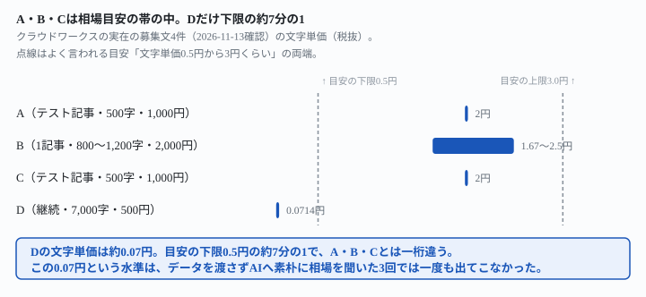
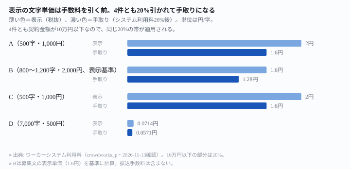

## これで何ができるか {: .what }

副業でAI使用可のライティング案件を受けるとき、「文字単価は結局いくらなのか」が最初の疑問です。クラウドワークスで実際に「AI使用可」と明記された募集文を4件開いて確認した結果が、この記事の結論です。

| 求人 | 条件 | 文字単価（税抜） |
|---|---|---|
| A（テスト記事・500字・1,000円） | 「AIツールの活用OK」 | **2.0円** |
| B（1記事・800〜1,200字・2,000円） | 「生成AIは使用可能」 | **1.67〜2.5円**（範囲表記のため割れる） |
| C（テスト記事・500字・1,000円） | AIツール利用が必須 | **2.0円** |
| D（1記事・7,000字・500円、継続月30〜60記事） | 「AIの使用は問題ない」 | **0.07円** |

<figure class="figure">

<figcaption>A・B・Cは目安の帯の中。Dだけが下限0.5円の約7分の1まで下回る。</figcaption>
</figure>

<mark>ライティングの文字単価は「0.5円から3円くらい」とよく言われます。4件のうち3件はこの目安に収まりますが、Dだけは目安の下限の約7分の1（0.07円）でした。</mark>この記事は、AIに文字単価の目安を聞いたときにこの0.07円という水準が出てくるか、実際の4件を渡すと何が分かるかを、7つの指示文で確かめた結果です。試した記録は[こちら](https://github.com/invest-ai-info/ai-tsukaikata/blob/main/docs/evidence/ai-writing-rate-below-the-rule-of-thumb.md)に全文置いています。

## 前提 {: .need }

| | |
|---|---|
| かかる時間 | 20分 |
| 費用 | 無料。無料のチャットAIで足ります |
| 必要なもの | ブラウザで使えるAI（ChatGPT・Claude・Geminiなど） |
| プログラミング | **不要**。この記事の指示文をコピーして貼るだけです |

この記事の実データは、2026年11月13日にクラウドワークスの公開ページを開いて確認した、4件の募集文の抜粋です。<mark class="warn">表示価格は募集ごと・時期ごとに変わります。</mark>この記事は特定の相場を保証するものではなく、**「文字単価という1つの数字をそのまま信じてよいか」を確かめるための実測**です。

🚨 この記事は収入を保証する書き方はしていません。実際にいくらで受けられるかは、応募時点の募集文と自分の交渉で変わります。

## AIへの頼み方 {: .ask }

### 1. まず、データ無しで文字単価の目安を聞く

<div class="prompt">クラウドワークスやランサーズで、AIツールの利用を認めているライティング案件の文字単価は、だいたいいくらくらいですか。</div>

**3回**試しました。3回とも、作業内容ごとに段階分けした表が返りましたが、いちばん安い帯の下限は毎回**0.1円以上**でした。

- 1回目: 「AI生成記事の修正・リライト・校正」が**0.1〜0.5円**、ボリュームゾーンは0.5〜1円前後
- 2回目: 「AI生成文の簡易リライト・加筆修正」が**0.3〜0.8円**
- 3回目: 「AI生成文の加筆・リライト・校正中心」が**0.3〜1円**。末尾で「0.1〜0.2円台の案件は避けるのが無難です」と自分から注意を足した

<mark>データを渡さず「だいたいいくら」と聞いた3回は、いちばん安い帯の下限がどれも0.1円以上でした。</mark>実際のD（0.07円）をカバーする帯は、3回のうち一度も出ませんでした。

### 2. 実際の4件のデータを渡して、文字単価を計算させる

実際の募集文の抜粋を渡します。

```
【実際の募集文の抜粋（クラウドワークス、2026-11-13確認）】
A. 求人ID 13282047（2026-07-03掲載）: 「AIツールの活用OK。AIで作成した文章をそのまま納品ではなく、自然な文章へ調整をお願いします」。テスト記事500文字程度、報酬1,000円（源泉徴収なし）、契約金額表示は1,100円（税込）。
B. 求人ID 13422784（2026-09-02掲載）: 「ChatGPTなどの生成AIは使用可能です。AIが生成した文章をそのままコピーして提出することは禁止しています」。1記事800〜1,200文字程度、報酬2,000円（文字単価表示1.6円）。
C. 求人ID 13037340（2026-04-03掲載）: 「ChatGPTなどのAIツールで記事の土台を作成し、ご自身の言葉で編集して頂きます」（AI利用必須）。テスト記事500文字程度、報酬1,000円（税抜）/1,100円（税込）。
D. 求人ID 13015555（2026-03-25掲載）: 「AIの使用は問題ありませんが、一定のクオリティで制作できるのが条件」。1記事7,000文字、報酬500円（制作〜入稿まで）、継続で月30〜60記事（月1.5〜3万円の固定報酬）。
```

<div class="prompt">【実際の募集文の抜粋（クラウドワークス、2026-11-13確認）】
A. 求人ID 13282047（2026-07-03掲載）: 「AIツールの活用OK。AIで作成した文章をそのまま納品ではなく、自然な文章へ調整をお願いします」。テスト記事500文字程度、報酬1,000円（源泉徴収なし）、契約金額表示は1,100円（税込）。
B. 求人ID 13422784（2026-09-02掲載）: 「ChatGPTなどの生成AIは使用可能です。AIが生成した文章をそのままコピーして提出することは禁止しています」。1記事800〜1,200文字程度、報酬2,000円（文字単価表示1.6円）。
C. 求人ID 13037340（2026-04-03掲載）: 「ChatGPTなどのAIツールで記事の土台を作成し、ご自身の言葉で編集して頂きます」（AI利用必須）。テスト記事500文字程度、報酬1,000円（税抜）/1,100円（税込）。
D. 求人ID 13015555（2026-03-25掲載）: 「AIの使用は問題ありませんが、一定のクオリティで制作できるのが条件」。1記事7,000文字、報酬500円（制作〜入稿まで）、継続で月30〜60記事（月1.5〜3万円の固定報酬）。

この4件それぞれについて、文字単価（1文字あたりの金額）を計算してください。</div>

**2回**試しました。**2回とも**、A＝2.0円・C＝2.0円・D≒0.071円を正しく計算しました。

<mark>文字数が「800〜1,200字程度」と範囲で書かれた求人だけ、2回とも文字単価が2通りに割れました。</mark>「800〜1,200文字程度」という範囲表記のせいで、2,000円÷800字＝2.5円、2,000円÷1,200字≒1.67円という2つの計算が返ります。しかも1回目・2回目とも、募集文の表示「1.6円」はこの範囲と一致しないと自分から指摘しました。2,000÷1.6＝1,250字で、表に書かれた上限1,200文字をわずかに超えるからです。

🔑 **1つの文字数ではなく「◯〜◯字程度」と書く募集文は、文字単価という1つの数字では比べられません。**基準をどちらに取るかで答えが変わります。

### 3. 税込み・税抜きの基準を確認する

<div class="prompt">【実際の募集文の抜粋（クラウドワークス、2026-11-13確認）】
A. 求人ID 13282047（2026-07-03掲載）: 「AIツールの活用OK。AIで作成した文章をそのまま納品ではなく、自然な文章へ調整をお願いします」。テスト記事500文字程度、報酬1,000円（源泉徴収なし）、契約金額表示は1,100円（税込）。
B. 求人ID 13422784（2026-09-02掲載）: 「ChatGPTなどの生成AIは使用可能です。AIが生成した文章をそのままコピーして提出することは禁止しています」。1記事800〜1,200文字程度、報酬2,000円（文字単価表示1.6円）。
C. 求人ID 13037340（2026-04-03掲載）: 「ChatGPTなどのAIツールで記事の土台を作成し、ご自身の言葉で編集して頂きます」（AI利用必須）。テスト記事500文字程度、報酬1,000円（税抜）/1,100円（税込）。
D. 求人ID 13015555（2026-03-25掲載）: 「AIの使用は問題ありませんが、一定のクオリティで制作できるのが条件」。1記事7,000文字、報酬500円（制作〜入稿まで）、継続で月30〜60記事（月1.5〜3万円の固定報酬）。

AとCの報酬には「税込」「税抜」の表記が混在しています。4件の文字単価を比べるとき、税込・税抜はどちらで揃えるべきですか。揃えた場合の数値も教えてください。</div>

**2回**試し、**2回とも「税抜で揃える」**という同じ結論でした。A＝2.0円・C＝2.0円・D≒0.07円は、前の計算とそろっています。2回目は、聞いていないのに「クラウドワークスのシステム手数料は計算に入れていません。4件とも同じ仕組みで差し引かれるため、案件同士の順位は変わりません」と、次の論点を自分から補足しました。

### 4. 手数料を引く前か後かを確認する

<div class="prompt">【実際の募集文の抜粋（クラウドワークス、2026-11-13確認）】
A. 求人ID 13282047（2026-07-03掲載）: 「AIツールの活用OK。AIで作成した文章をそのまま納品ではなく、自然な文章へ調整をお願いします」。テスト記事500文字程度、報酬1,000円（源泉徴収なし）、契約金額表示は1,100円（税込）。
B. 求人ID 13422784（2026-09-02掲載）: 「ChatGPTなどの生成AIは使用可能です。AIが生成した文章をそのままコピーして提出することは禁止しています」。1記事800〜1,200文字程度、報酬2,000円（文字単価表示1.6円）。
C. 求人ID 13037340（2026-04-03掲載）: 「ChatGPTなどのAIツールで記事の土台を作成し、ご自身の言葉で編集して頂きます」（AI利用必須）。テスト記事500文字程度、報酬1,000円（税抜）/1,100円（税込）。
D. 求人ID 13015555（2026-03-25掲載）: 「AIの使用は問題ありませんが、一定のクオリティで制作できるのが条件」。1記事7,000文字、報酬500円（制作〜入稿まで）、継続で月30〜60記事（月1.5〜3万円の固定報酬）。

これらの文字単価は、クラウドワークスのシステム利用料（報酬から引かれる仲介手数料）を引く前と後のどちらの金額ですか。</div>

**2回**試し、**2回とも「引く前」**と答えました。料率も、公式ページ（[ワーカーシステム利用料](https://crowdworks.jp/pages/guides/employee/fee)・2026-11-13確認）どおりでした。

| 報酬のうち | 利用料 |
|---|---|
| 10万円以下の部分 | 20% |
| 10万円超20万円以下の部分 | 10% |
| 20万円超の部分 | 5% |

4件とも契約金額が10万円以下なので、全額20%が引かれます。

<figure class="figure">

<figcaption>表示の文字単価は手数料を引く前。4件とも20%引かれて手取りになる。</figcaption>
</figure>

🔑 **募集文に出ている文字単価は、手数料を引く前の金額です。**この記事の計算（税抜・20%引いた後）では、A・Cは1.6円、Bは表示基準で1.28円、Dは0.057円まで下がります。

### 5. テスト記事と継続契約を分けて聞く

<div class="prompt">【実際の募集文の抜粋（クラウドワークス、2026-11-13確認）】
A. 求人ID 13282047（2026-07-03掲載）: 「AIツールの活用OK。AIで作成した文章をそのまま納品ではなく、自然な文章へ調整をお願いします」。テスト記事500文字程度、報酬1,000円（源泉徴収なし）、契約金額表示は1,100円（税込）。
B. 求人ID 13422784（2026-09-02掲載）: 「ChatGPTなどの生成AIは使用可能です。AIが生成した文章をそのままコピーして提出することは禁止しています」。1記事800〜1,200文字程度、報酬2,000円（文字単価表示1.6円）。
C. 求人ID 13037340（2026-04-03掲載）: 「ChatGPTなどのAIツールで記事の土台を作成し、ご自身の言葉で編集して頂きます」（AI利用必須）。テスト記事500文字程度、報酬1,000円（税抜）/1,100円（税込）。
D. 求人ID 13015555（2026-03-25掲載）: 「AIの使用は問題ありませんが、一定のクオリティで制作できるのが条件」。1記事7,000文字、報酬500円（制作〜入稿まで）、継続で月30〜60記事（月1.5〜3万円の固定報酬）。

この4件には、単発のテスト記事と、継続的な契約の両方が混ざっています。それぞれを分けて、文字単価の傾向を教えてください。</div>

**2回**試しました。A・Cは「テスト記事」と明記されているのでそちらに分類し、Dは「継続」と明記されているので継続側に分類しました。<mark>「テスト」とも「継続」とも書かれていない求人では、2回とも「断定はできません」「抜粋だけでは確定できない」と、分類を推定にとどめました。</mark>

🔑 **2回とも同じ指摘がありました。**「今回の4件では、テスト記事の単価が継続案件と同じかそれ以上でした。『テストは安く、継続で上がる』という形にはなっていません」。テスト記事2件はどちらも2.0円で、継続のDは0.07円です。テストのほうが高い側にあります。

### 6. 相場の目安「0.5〜3円」と比べさせる

<div class="prompt">ライティングの文字単価は「0.5円から3円くらい」とよく言われます。

【実際の募集文の抜粋（クラウドワークス、2026-11-13確認）】
A. 求人ID 13282047（2026-07-03掲載）: 「AIツールの活用OK。AIで作成した文章をそのまま納品ではなく、自然な文章へ調整をお願いします」。テスト記事500文字程度、報酬1,000円（源泉徴収なし）、契約金額表示は1,100円（税込）。
B. 求人ID 13422784（2026-09-02掲載）: 「ChatGPTなどの生成AIは使用可能です。AIが生成した文章をそのままコピーして提出することは禁止しています」。1記事800〜1,200文字程度、報酬2,000円（文字単価表示1.6円）。
C. 求人ID 13037340（2026-04-03掲載）: 「ChatGPTなどのAIツールで記事の土台を作成し、ご自身の言葉で編集して頂きます」（AI利用必須）。テスト記事500文字程度、報酬1,000円（税抜）/1,100円（税込）。
D. 求人ID 13015555（2026-03-25掲載）: 「AIの使用は問題ありませんが、一定のクオリティで制作できるのが条件」。1記事7,000文字、報酬500円（制作〜入稿まで）、継続で月30〜60記事（月1.5〜3万円の固定報酬）。

この4件の中で、この目安から外れているものはありますか。</div>

**2回**試し、**2回とも「外れているのはDだけ」**でした。「下限の0.5円と比べても約7分の1です」（0.5÷0.0714≒7.0で、この記事の計算と一致）。2回目は、Dの月額報酬（30記事で15,000円・60記事で30,000円）まで検算し、「募集文の記載と合っています。そのため誤記ではなく、この単価で募集されていると考えられます」と結論づけました。

## うまくいかないときの言い直し方 {: .fix }

### 「だいたいいくら」と聞くと、実物の下限より高い帯しか出てこない {: .trouble }

1番の聞き方では、3回とも最低帯の下限が0.1円以上で、実物Dの0.07円を一度もカバーしませんでした。聞き方を「下限そのもの」に変えると変わります。

<div class="prompt">AIの利用を認めているライティング案件で、文字単価が特に低いものは、どのくらいまで下がり得ますか。</div>

**2回**試し、**2回とも「0.05円/字以下」**まで下がり得ると答えました。これは実物Dの0.0714円をカバーする帯です（0.05 < 0.0714）。<mark>「だいたいいくら」という平均を求める聞き方と、「どのくらいまで下がり得るか」という下限を求める聞き方では、同じAIでも出てくる最低値が変わります。</mark>相場を聞くときは、目安だけでなく下限を別に聞いてください。

### 「テスト記事だから安いはず」と決めつけてしまう {: .trouble }

5番の実測が示すとおり、この4件ではテスト記事（A・C）のほうが継続案件のDより単価が高くなっています。テスト記事だから安い・継続だから高いという順番を前提に案件を選ぶと、実際の条件を見落とします。案件を比べるときは、テストか継続かという分類ではなく、4番の聞き方で手取りの文字単価まで出してから比べてください。

## 応用・次の一手 {: .next }

<mark>「文字単価は0.5円から3円くらい」という目安は、多くの案件には当たっていても、下限のすべてを覆っているとは限りません。</mark>案件を選ぶときは、目安の数字だけで判断しないでください。募集文の文字数・金額・税込み表記を、2番〜4番の指示文のようにAIへ整理させ、手取りの文字単価を出してから比べてください。

AIがAI利用を条件として認めているかどうかは、この記事とは別の軸です。[案件のAI利用ルールを確かめる](/recipes/job-ai-policy-check/)・[ランサーズのライティングも「要確認」](/recipes/lancers-writing-contest-still-needs-confirmation/)で、AI可否の確認そのものの実測をまとめています。

手数料を引いた後の実際の受取額を計算する方法は、[副業の手取りを、契約額から出す](/recipes/take-home-from-the-contract-amount/)が各論です。お金の流れ全体を見るなら、[副業のお金は3つの流れで届く](/tools/money-map-three-routes/)も合わせて読んでください。クラウドワークスのシステム利用料の料率は、この記事と同じ出典です。

⚠️ <mark class="warn">この記事の実測は、実在の募集文4件・7つの聞き方・のべ15回の範囲です。</mark>一般法則として「AI使用可の案件は必ず0.07円まで下がる」と書くつもりはありません。試したのは次の範囲までです。

- 確認した募集文は4件のみです。すべて2026年に掲載されたクラウドワークスの募集で、ランサーズなど他のプラットフォームは開いていません
- 4件とも「AI使用可」の案件の中から選びましたが、ランキングや検索条件を変えて広く集めたものではありません
- 使ったAIは1種類（Claude）です。他のAIでも同じ傾向になるかは確かめていません

次に文字単価の案件を比べるときは、相場の目安をそのまま信じず、募集文そのものを開いてください。確認する点は3つです。

- 文字数が範囲表記なら、基準をどちらに取るか
- 税込みか税抜きか
- 手数料を引く前か後か

同じ「文字単価2.0円」という表示でも、この3点次第で手取りは案件ごとに大きく変わります。

確認した4件は、[A](https://crowdworks.jp/public/jobs/13282047)・[B](https://crowdworks.jp/public/jobs/13422784)・[C](https://crowdworks.jp/public/jobs/13037340)・[D](https://crowdworks.jp/public/jobs/13015555)（いずれもクラウドワークス・2026-11-13確認。募集は終了していますが、ページは閲覧できます）です。
