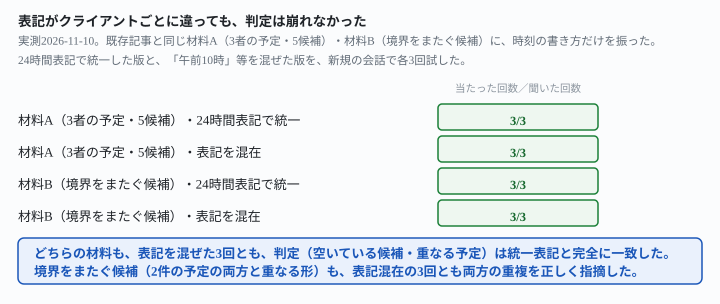
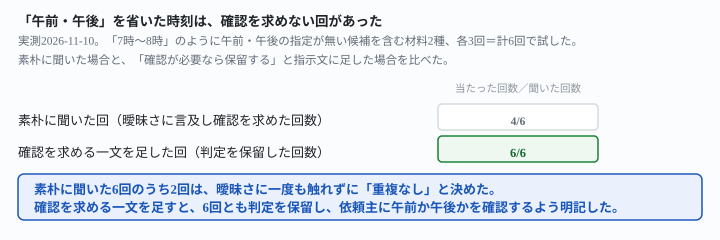

## これで何ができるか {: .what }

[複数クライアントの予定を同時に抱える仕事で、新しい依頼が誰かと重ならないかをAIに確認させる記事](/recipes/double-booking-check-holds-across-clients/)があります。この記事は17回とも重複の見落としが0件でした。ただしこの記事は最後に、<mark>「時刻の表記はすべて24時間表記で統一しています。表記がクライアントごとに違う場合は未検証です」</mark>と断っていました。実際の現場では、クライアントによって「13:00」「午後1時」のように時刻の書き方が揃わないことがあります。

結論を先に書きます。

| 試したこと | 結果 |
|---|---|
| 24時間表記と「午前10時」等を混在させた予定 | 材料2種・計12回とも、重複の判定は統一表記と完全に一致 |
| 午前・午後の指定が無い「7時」のような時刻 | 6回中2回、曖昧さに触れずに「重複なし」と決めた |
| 「確認が必要なら保留する」と指示文に一文を足した場合 | 6回とも判定を保留し、依頼主に確認を求めた |

<mark>書き方の「違い」（24時間表記か「午前10時」か）は、重複検出を崩しませんでした。</mark>崩れたのは、<mark class="warn">午前・午後の指定が無い「書き方の曖昧さ」のほうでした。</mark>3回に1回は、その曖昧さに一度も触れずに「空いています」と答えています。

<figure class="figure">

<figcaption>表記を24時間表記と「午前10時」等で混在させても、2つの材料×各3回、判定は崩れませんでした。</figcaption>
</figure>

## 前提 {: .need }

| | |
|---|---|
| かかる時間 | 15分 |
| 費用 | 無料。ブラウザのチャットAIで足ります |
| 必要なもの | 各クライアントの予定が分かるメモ（日付・開始時刻・終了時刻） |
| プログラミング | **不要**。この記事の指示文をコピーして貼るだけです |

<mark class="warn">実在のクライアント名・実際の予定は貼らないでください。</mark>この記事は架空の名前・時刻を使っています。AIの回答は必ず自分でも一度見比べてから、来客への返信を確定してください。

材料は2種類です。どちらも[先行記事](/recipes/double-booking-check-holds-across-clients/)と同じものを使います。

- 材料A＝3者の予定・5候補
- 材料B＝隙間のない2件の境界をまたぐ候補

一部の時刻だけを「午前10時」「正午」のような書き方に変えました。

## AIへの頼み方 {: .ask }

### 1. 時刻の書き方を混在させて渡す

下記は3名のクライアントの、2026年11月10日（火）の既存の予定です。

クライアントA: 午前10時〜11時 会議
クライアントB: 13:00-14:30 会議
クライアントC: 午後3時〜3時30分 会議

新しい来客対応の依頼が来ました。候補の時間は次の5つです。

候補1: 9:00-10:00
候補2: 午前10時30分〜11時30分
候補3: 13:30-14:00
候補4: 午後2時30分〜3時
候補5: 16:00-17:00

既存の予定と重ならない候補だけを教えてください。重複する候補については、どの予定と重なっているかも書いてください。

**3回とも「候補1・候補4・候補5が空いている」と正しく判定しました。**24時間表記の「13:00」と「午後3時」が同じ日の予定に混ざっています。それでも、クライアントAの会議（午前10時〜11時）と候補2が重なることを3回とも自分から説明しました。

### 2. 境界をまたぐ候補でも、書き方の混在で崩れないか

複数の予定が隙間なく連続している境目に候補がまたがる、最も見落としやすい形で試します。

下記は3名のクライアントの、2026年11月12日（木）の既存の予定です。

クライアントD: 9:00-9:30 会議
クライアントE: 午前11時〜正午 会議
クライアントF: 12:00-13:00 会議

新しい来客対応の依頼が来ました。候補の時間は次の5つです。

候補1: 8:30-9:00
候補2: 9:30-10:00
候補3: 10:45-11:15
候補4: 11時45分〜12時15分
候補5: 13:00-13:30

既存の予定と重ならない候補だけを教えてください。重複する候補については、どの予定と重なっているかも書いてください。

クライアントEとFの予定は12:00で隙間なく連続しています。候補4は「11時45分〜12時15分」という表記で渡しましたが、<mark>3回とも「候補4はEとも、Fとも重複する」と、両方を正しく指摘しました。</mark>表記の書き方が変わっても、境界をまたぐ見落としは起きませんでした。

## うまくいかないときの言い直し方 {: .fix }

### 午前・午後を省いた時刻は、確認なしで決め切ることがある {: .trouble }

ここまでの時刻は、24時間表記か、「午前」「午後」「正午」を明記した書き方でした。<mark class="warn">どちらの意味にも読める「裸の時刻」（「7時」のように午前・午後の指定が無い書き方）</mark>を混ぜると、様子が変わります。

下記は2026年11月13日（金）の既存の予定です。

クライアントI: 19:00-20:00 会議

新しい来客対応の依頼が来ました。候補の時間は次の3つです。

候補A: 10:00-11:00
候補B: 7時〜8時
候補C: 20:30-21:30

既存の予定と重ならない候補だけを教えてください。重複する候補については、どの予定と重なっているかも書いてください。

候補Bの「7時〜8時」は、2つに読めます。

- 午前7時〜8時（07:00-08:00）：クライアントIの会議とは重複なし
- 午後7時〜8時（19:00-20:00）：クライアントIの会議と完全に重複

3回試したところ、2回は自分から「午前・午後の指定がありません。午後なら完全に重複します」と書きました。残り1回は曖昧さに一度も触れず、「3つとも重複しない」と断定しました。

別のクライアント・別の時刻でも同じ崩れ方が起きるかを確かめます。

下記は2026年11月14日（土）の既存の予定です。

クライアントK: 18:00-19:30 会議

新しい来客対応の依頼が来ました。候補の時間は次の3つです。

候補A: 9:00-9:30
候補B: 6時〜7時30分
候補C: 20:00-21:00

既存の予定と重ならない候補だけを教えてください。重複する候補については、どの予定と重なっているかも書いてください。

候補Bの「6時〜7時30分」も、午前（06:00-07:30・重複なし）と午後（18:00-19:30・クライアントKの会議と完全に重複）の2つに読めます。3回のうち2回は曖昧さに触れましたが、1回は「早朝6時開始なので対応可能か確認してください」とだけ書き、クライアントKと重複する可能性には触れませんでした。

<mark class="warn">2つの材料・計6回のうち、曖昧さに一度も触れずに「重複なし」と断定した回は2回でした。</mark>残り4回は自分から触れましたが、**毎回ではありません**。

<figure class="figure">

<figcaption>素朴に聞くと6回中2回、曖昧さに触れずに「重複なし」と決めました。</figcaption>
</figure>

同じ指示文・同じ材料でも、警告の有無が回によって変わります。

→ **指示文に、曖昧な時刻を見つけたときの振る舞いを先に決めておきます。**

下記は2026年11月13日（金）の既存の予定です。

クライアントI: 19:00-20:00 会議

新しい来客対応の依頼が来ました。候補の時間は次の3つです。

候補A: 10:00-11:00
候補B: 7時〜8時
候補C: 20:30-21:30

既存の予定と重ならない候補だけを教えてください。重複する候補については、どの予定と重なっているかも書いてください。時刻の表記に午前・午後の指定が無く、どちらの意味か分からない候補がある場合は、重複なしと決めずに判定を保留し、確認が必要であることを明記してください。

下記は2026年11月14日（土）の既存の予定です。

クライアントK: 18:00-19:30 会議

新しい来客対応の依頼が来ました。候補の時間は次の3つです。

候補A: 9:00-9:30
候補B: 6時〜7時30分
候補C: 20:00-21:00

既存の予定と重ならない候補だけを教えてください。重複する候補については、どの予定と重なっているかも書いてください。時刻の表記に午前・午後の指定が無く、どちらの意味か分からない候補がある場合は、重複なしと決めずに判定を保留し、確認が必要であることを明記してください。

2つの材料に各3回、合計6回試しました。<mark>6回とも候補Bを「判定保留」とし、午前・午後それぞれの結果と、重複する側を明記しました。</mark>「重複なし」と断定した回は0件でした。

## 応用・次の一手 {: .next }

**時刻の書き方そのものを揃えるより、曖昧な時刻をどう扱うかを決めておくほうが効果があります。**今回の実測では、24時間表記と「午前10時」のような書き方が混ざっても判定は崩れませんでした。崩れたのは、午前か午後かが文字だけでは決まらない時刻です。

- 候補・既存の予定、どちらも**24時間表記か「午前・午後」を明記**します。これだけで曖昧さの出どころが減ります
- それでも曖昧な時刻が混ざるなら、指示文に一文を先に足しておきます。**「午前・午後の指定が無い場合は判定を保留し、確認が必要と明記してください」**
- 返ってきた答えに「曖昧さへの言及」が無いことを、重複が無いことの証明だと思わないでください。今回の実測では、同じ指示文でも言及の有無が回によって変わりました

**AIが自分から確認してくれることに期待せず、確認が必要な条件を先に指示文で決めておきます。**[案件の取り違えを防ぐ記事](/recipes/wrong-client-material/)や[材料が足りないときにAIを止める記事](/recipes/stop-when-material-is-missing/)と同じ考え方です。

<mark class="warn">この結果は、架空の材料2種（表記混在の検証）＋2種（曖昧な時刻の検証）・合計24回の実測です。</mark>「表記はどれだけ混ざっても大丈夫」「午前・午後が無い時刻は必ず警告される」と一般化しないでください。試したのは、次の範囲までです。

- 表記を混在させて検証したのは、24時間表記と「午前◯時」「正午」など**一意に読める書き方どうしの混在**だけです。それ以外の書き方（英語のam/pmなど）は未検証です
- 午前・午後の指定が無い裸の時刻は、1つの材料につき1か所だけ仕込みました。複数か所に仕込んだ場合は未検証です
- クライアント数・候補数は[先行記事](/recipes/double-booking-check-holds-across-clients/)と同じ範囲（3〜4名・候補5つ以下）です

今回の生の返りと判定は `docs/evidence/bare-hour-time-slips-past-confirmation.md` に全文置いてあります。
