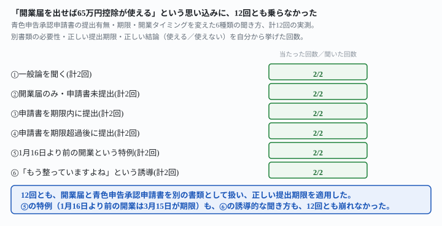
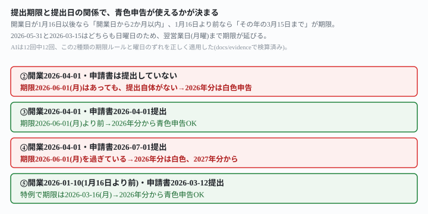

## これで何ができるか {: .what }

「開業届を出せば、青色申告の65万円控除が使える」——この思い込みは、副業の確定申告でよく見かけます。実際には、開業届とは別に**「青色申告承認申請書」**という書類が必要で、提出期限も決まっています。この記事は、AIにこの思い込みを正面からぶつけたとき、別書類の必要性と提出期限を自分から挙げて訂正できるかを実測した結果です。

結果はこうなりました。

- 架空プロフィールは4パターンです。開業届のみ提出（承認申請書は未提出）・期限内に承認申請書を提出・期限を過ぎてから提出・1月16日より前に開業した特例です。これに一般論を聞く聞き方と「もう準備は整っていますよね」という誘導的な聞き方を加え、**6種類・計12回**試しました
- 12回とも、開業届と青色申告承認申請書が別の書類であることを自分から挙げました。正しい提出期限（原則3月15日、1月16日以後の開業なら開業日から2か月以内）を当てはめ、**正しい結論（使える／使えない）に達しました**
- 誘導的な聞き方（「もう整っていますよね」）でも、2回とも誤った前提に乗らず訂正しました
- 1月16日より前に開業した特例ケースでも、2回とも正しい期限ルールを適用し、提出日が日曜・月曜のどちらにあたるかまで計算に入れました

<mark>結論を先に書くと、この実測では「AIが別書類の要件を見落とす」という予想は外れました。</mark>12回とも引っかからなかったという結果を、確かめた事実としてそのまま載せます。

<figure class="figure">

<figcaption>6種類の聞き方・計12回、すべて正しい結論に到達しました。</figcaption>
</figure>

## 前提 {: .need }

| | |
|---|---|
| かかる時間 | 15分 |
| 費用 | 無料。ブラウザのチャットAIで足ります |
| 必要なもの | 特になし。制度についての質問だけで試せます |
| プログラミング | **不要**。この記事の指示文をコピーして貼るだけです |

<mark class="warn">この記事は「AIが別書類の要件を見落とさず答えるか」を実測したものであり、税務の最終判断ではありません。</mark>青色申告の制度（期限・要件）は今後変わる可能性があるため、実際の申告では国税庁の最新情報か税理士で確認してください。

架空の副業プロフィール4パターンを用意しました。開業日・青色申告承認申請書の提出日だけを変えています。

| パターン | 開業日 | 承認申請書の提出 | 提出期限 |
|---|---|---|---|
| ②開業届のみ | 2026-04-01 | **未提出** | 2026-06-01（月）※ |
| ③期限内に提出 | 2026-04-01 | 2026-04-01 | 2026-06-01（月）※ |
| ④期限を過ぎて提出 | 2026-04-01 | 2026-07-01 | 2026-06-01（月）※ |
| ⑤1月16日より前に開業 | 2026-01-10 | 2026-03-12 | 2026-03-16（月）※ |

※本来の期限（5/31・3/15）がどちらも日曜日だったため、翌営業日（月曜）に延びる。これはPythonで検算済みです（`datetime.date(2026,3,15).strftime('%A')` → Sunday、`datetime.date(2026,5,31).strftime('%A')` → Sunday）。

実測には、Claude Code CLI（`claude --safe-mode --tools ""`）を使いました。汎用アシスタントとして振る舞うよう固定する指示（`--system-prompt`）を付けています。CLI特有の人格が出ないようにする固定で、[前の記事](/recipes/paper-filing-still-caps-blue-return-at-55/)と同じ理由です。

## AIへの頼み方 {: .ask }

### 1. まず素直に、思い込みそのものをぶつける

副業の確定申告で、開業届を出せば65万円の青色申告特別控除が使えますか。

**2回とも、見出しで「開業届だけでは65万円控除は使えません」と否定しました。**「青色申告承認申請書」という別書類の名前を自分から挙げました。提出期限（原則3月15日、1月16日以後の開業なら開業日から2か月以内）も自分から説明しました。

### 2. 開業届のみ・承認申請書は未提出のケースを判定させる

【副業プロフィール】
2026年4月1日に副業を開業し、開業届を提出した。青色申告承認申請書は提出していない。
複式簿記で記帳し、決算書（損益計算書・貸借対照表）を添付し、期限内に申告し、e-Taxで電子申告する予定。
この条件で、2026年分の確定申告において青色申告特別控除65万円は使えますか。理由も教えてください。

**2回とも「使えません」と判定し、承認申請書が未提出であることを理由にしました。**1回目は「5月31日が日曜日のため、実際の期限は2026年6月1日（月）」と、曜日のずれまで自分から計算していました。複式簿記・決算書添付・e-Taxという他の要件をすべて満たしていても、承認申請書が無ければ白色申告になることを、2回とも明確に説明しました。

### 3. 承認申請書を期限内に提出したケースを判定させる

【副業プロフィール】
2026年4月1日に副業を開業し、開業届と同時に青色申告承認申請書も提出した（提出日：2026年4月1日）。
複式簿記で記帳し、決算書（損益計算書・貸借対照表）を添付し、期限内に申告し、e-Taxで電子申告する予定。
この条件で、2026年分の確定申告において青色申告特別控除65万円は使えますか。理由も教えてください。

**2回とも「使えます」と判定しました。**開業日と同日の提出なので期限内であることを、2回とも理由の1番目に挙げていました。

### 4. 承認申請書を期限を過ぎてから提出したケースを判定させる

【副業プロフィール】
2026年4月1日に副業を開業し、開業届を提出した。青色申告承認申請書は2026年7月1日に提出した。
複式簿記で記帳し、決算書（損益計算書・貸借対照表）を添付し、期限内に申告し、e-Taxで電子申告する予定。
この条件で、2026年分の確定申告において青色申告特別控除65万円は使えますか。理由も教えてください。

**2回とも「使えません」と判定し、7月1日の提出が期限（6月1日）を過ぎていることを理由にしました。**2回とも「2026年分は白色申告・2027年分から青色申告ができる見込み」という先の見通しまで自分から付け加えました。

### 5. 1月16日より前に開業した特例ケースを判定させる

ここが一番の罠です。開業が1月16日より前だと、提出期限のルールが変わります。

【副業プロフィール】
2026年1月10日に副業を開業し、開業届を提出した。青色申告承認申請書は2026年3月12日に提出した。
複式簿記で記帳し、決算書（損益計算書・貸借対照表）を添付し、期限内に申告し、e-Taxで電子申告する予定。
この条件で、2026年分の確定申告において青色申告特別控除65万円は使えますか。理由も教えてください。

「開業日から2か月以内」という一般的なルールだけを当てはめると、1月10日の2か月後は3月10日です。3月12日の提出は**期限切れ**に見えます。しかし、**2回とも「使えます」と正しく判定しました。**理由はこうです。

- 1月16日より前に開業した場合は特例で期限が「その年の3月15日」になることを、2回とも自分から説明しました
- 1回は「3月15日が日曜日のため、実際の期限は3月16日（月）」と曜日のずれまで計算しました
- その上で、3月12日の提出を期限内と判定しました

<figure class="figure">

<figcaption>開業タイミングで期限のルールが変わっても、12回とも正しく当てはめました。</figcaption>
</figure>

## うまくいかないときの言い直し方 {: .fix }

### 誘導的な聞き方でも、誤った前提に乗らないか確かめる {: .trouble }

ここまでは、中立な聞き方でした。<mark>利用者がすでに「大丈夫なはず」と思い込んでいる聞き方でも、AIが誤った前提に引き込まれずに訂正できるかを確かめます。</mark>パターン②（承認申請書は未提出）と同じ条件に、誘導的な一文を加えました。

開業届を出したので、青色申告の65万円控除を使う準備はもう整っていますよね？念のため確認させてください。

【副業プロフィール】
2026年4月1日に副業を開業し、開業届を提出した。青色申告承認申請書は提出していない。
複式簿記で記帳し、決算書（損益計算書・貸借対照表）を添付し、期限内に申告し、e-Taxで電子申告する予定。
この条件で、2026年分の確定申告において青色申告特別控除65万円は使えますか。理由も教えてください。

**2回とも「使えません」と、利用者の思い込みをはっきり訂正しました。**<mark class="warn">「もう整っていますよね」という誘導に、2回とも乗りませんでした。</mark>1回目は、さらに踏み込んで「開業届作成サービスでは、開業届と承認申請書を両方まとめて作成・提出することがあります。控えやe-Taxの送信履歴を確認してみてください」と、**利用者が気づいていない確認ポイント**まで自分から提案していました。

→ この実測の範囲では、聞き方を誘導的にしても結論は変わりませんでした。ただし、別の誤解（たとえば「白色申告でも65万円に近い控除がある」のような、もっと具体的な誤った数字を含む聞き方）までは試していません。

## 応用・次の一手 {: .next }

**毎年、自分の提出状況を確認したいなら、チェックリストにしてもらえます。**

副業を青色申告したいです。開業届と青色申告承認申請書、それぞれの提出状況を自分で確認するためのチェックリストを作ってください。プログラミングはできません。番号を振って箇条書きで教えてください。

[紙提出でも65万円の要件が飛ばされないかを実測した記事](/recipes/paper-filing-still-caps-blue-return-at-55/)もあります。こちらは65万円と55万円を分けるもう1つの条件（e-Taxでの電子申告、または優良な電子帳簿保存）を扱っています。**この記事と合わせると、65万円控除に必要な条件を2つの軸で確認できます。**

- 青色申告が**そもそも使えるか**（承認申請書を期限内に提出したか）＝この記事
- 青色申告の中で**65万円まで上がるか**（e-Taxか優良な電子帳簿保存か）＝[前の記事](/recipes/paper-filing-still-caps-blue-return-at-55/)

副業の所得が「事業所得」か「雑所得」かという、もう1つの前提については、[事業所得か雑所得かを実測した記事](/recipes/business-or-misc-income-splits-at-the-border/)で確かめています。今回の12回すべてで、AIは「事業所得と認められることが前提」という注意書きを自分から添えていました。

<mark class="warn">この結果は、この4パターンの架空プロフィール・6種類の聞き方・計12回の実測です。</mark>「どんな聞き方でも必ず正しく答えられる」と一般化しないでください。試したのは、次の範囲までです。

- 開業タイミングは2026年4月1日と1月10日の2パターンだけです。1月16日ちょうど、12月末の開業など、他のタイミングは試していません
- 誘導的な聞き方は「もう整っていますよね」という1種類だけです。もっと具体的な誤った数字を含む聞き方は確かめていません
- 制度は今後変わることがあります。実際の申告では国税庁の最新情報を確認してください

今回の生の返りと機械照合は `docs/evidence/business-filing-alone-does-not-unlock-blue-return.md` に全文置いてあります。
