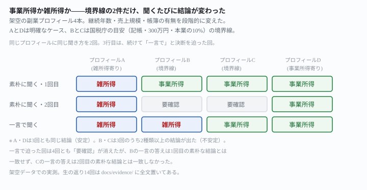
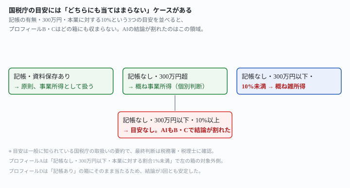

## これで何ができるか {: .what }

副業の所得は、所得税の区分としては**事業所得**か**雑所得**のどちらかになります。
<mark>事業所得と雑所得のどちらになるかで、損失を他の所得と相殺できるか・青色申告特別控除が使えるかが変わります</mark>。
継続年数・売上規模・帳簿の有無を段階的に変えた架空の副業プロフィール4本をAIに渡し、
「事業所得か雑所得か、判定してください」とそのまま聞いてみました。

| プロフィール | 条件 | 判定（2回） | 一言で迫った回 |
|---|---|---|---|
| A（雑所得寄り） | 記帳なし・月1回・年3万円・3か月目 | 雑所得／雑所得 | 雑所得 |
| B（境界線） | 記帳あり・月2〜3件・年25万円・8か月目 | 事業所得／要確認 | **雑所得** |
| C（境界線） | 記帳なし・週5日・年280万円・3年目 | 事業所得／要確認 | **事業所得** |
| D（事業所得寄り） | 開業届・複式簿記・年800万円・生活の主な収入源 | 事業所得／事業所得 | 事業所得 |

<figure class="figure">

<figcaption>明確な2件（A・D）は3回とも同じ結論。境界線の2件（B・C）は毎回結論が変わりました。</figcaption>
</figure>

結論を先に書きます。明確なケースでは安定していた判定が、国税庁の目安のどれにも当てはまらない
境界線のケースでは、同じプロフィールに同じ質問を2回しただけで結論が変わりました。
さらに「一言で教えてください」と決断を迫ると、
4回とも留保は消えましたが、<mark>どちらに決まるかは、直前の2回の結論のどちらとも
一致しない組み合わせになりました</mark>。

📌 **この記事の実測はすべて架空データです。**実在の個人・企業の情報は含みません。
担当がサブエージェントのネスト上限（1階層まで）に達し、新規サブエージェントに聞く方法が
使えなかったため、担当自身がその指示文へ応答する方式に切り替えています。
**合計7本の指示文・14回**試しました。生の返りと機械照合は
`docs/evidence/business-or-misc-income-splits-at-the-border.md` に全文置いてあります。

## 前提 {: .need }

| | |
|---|---|
| かかる時間 | 15分 |
| 費用 | 無料。ブラウザのチャットAIで足ります |
| 必要なもの | 自分の副業の、本業の有無・収入、副業を始めてからの期間、頻度や作業時間、年間の売上、帳簿や記録をつけているかどうか |
| プログラミング | **不要**。この記事の指示文をコピーして、自分の条件に書き換えるだけです |

<mark class="warn">この記事は「AIが事業所得と雑所得をどう判定するか」を実測したものであり、
税務の最終判断ではありません。</mark>事業所得と雑所得の区分は、国税庁の目安（記帳・資料保存の有無・
継続性・反復性など）を踏まえた個別の実態判断で、本記事が仮定した数字や期間が変われば結論も
変わります。実際の確定申告では、国税庁の最新情報か税理士で確認してください。

## なぜそうなるのか {: .ask }

### 国税庁の目安には「どちらにも当てはまらない」領域がある

一般に知られている国税庁の取扱いの目安を、ざっくり並べるとこうなります。

1. **記帳・資料保存があれば、原則、事業所得として扱う**
2. 記帳が無くても、**年間の売上が300万円を超えていれば、概ね事業所得**（個別判断）
3. 記帳が無く、300万円以下で、**本業など主たる収入に対する割合が10%未満なら、概ね雑所得**

<figure class="figure">

<figcaption>記帳なし・300万円以下・本業に対する割合10%以上の領域には、目安そのものがありません。</figcaption>
</figure>

プロフィールAは3の箱（割合1%未満）にそのまま当たり、プロフィールDは1の箱（記帳あり）に
そのまま当たります。<mark>どちらも目安の中にきれいに収まるので、AIの判定も安定しました</mark>。

一方、プロフィールBは「記帳あり」なので1の箱に近いのですが、**売上25万円・開始8か月という
規模の小ささ**が「社会通念上事業と認められるか」を揺らがせます。プロフィールCは「記帳なし・
300万円以下」ですが、<mark>本業に対する割合が約62%で10%をはるかに超えており、
3の箱の条件にも当てはまりません</mark>。**どちらも、目安が明確な答えを持っていない領域に落ちます。**
この記事でAIの結論が割れたのは、まさにこの領域でした。

## AIへの頼み方 {: .ask }

### 1. まず、明確なケースで聞いてみる（プロフィールA・D）

記帳なし・低頻度・低額のプロフィールAを渡しました。

次の副業プロフィールは、所得税の区分としては事業所得にあたりますか、雑所得にあたりますか。判定とその理由を教えてください。

【副業プロフィールA】
会社員（本業収入: 年500万円）。3か月前から、AIで生成した画像をフリマアプリで出品・販売している。出品はおおよそ月1回。年間の売上は3万円程度。帳簿や記録はつけていない。

2回試したところ、**2回とも「雑所得」と判定しました。**

> 1回目:「雑所得と考えられます。帳簿や記録をつけていないこと、年間の売上が300万円以下であること、本業収入（500万円）に対する割合が1%未満と小さいことから、国税庁が示す目安では雑所得として扱われるケースに当たります。開始から3か月と期間が短く、継続性・反復性の実績もまだ十分ではありません。」
> 2回目:「雑所得です。記帳をしていない点、年間売上が3万円程度と小さい点、本業収入に対する割合も非常に小さい点から、事業として行っていると判断する材料は見当たりません。」

開業届・複式簿記・生活の主な収入源のプロフィールDも試しました。

次の副業プロフィールは、所得税の区分としては事業所得にあたりますか、雑所得にあたりますか。判定とその理由を教えてください。

【副業プロフィールD】
5年前に会社員を辞め、フリーランスのプログラマーとして毎日稼働している。開業届を提出し、青色申告のために複式簿記で記帳している。年間の売上は800万円程度で、生活の主な収入源になっている。

こちらも**2回とも「事業所得」でした。**

> 1回目:「事業所得です。開業届を提出し、青色申告のために複式簿記で記帳していること、5年間継続して行っていること、生活の主な収入源になっていることから、事業所得として扱われる典型的な条件を満たしています。」
> 2回目:「事業所得と判断できます。記帳の実態、継続期間（5年）、収入規模（年800万円）、生活の主な収入源であることのいずれも、事業所得の典型的な特徴に当たります。」

条件が目安のどれかにきれいに当たるケースでは、2回とも同じ結論でした。

### 2. 境界線のケースで聞いてみる（プロフィールB・C）

記帳はしているが規模・期間がまだ小さいプロフィールBを渡しました。

次の副業プロフィールは、所得税の区分としては事業所得にあたりますか、雑所得にあたりますか。判定とその理由を教えてください。

【副業プロフィールB】
会社員（本業収入: 年500万円）。8か月前から、クラウドソーシングでライティングの案件を受注している。受注は月2〜3件。年間の売上は25万円程度。売上と支出はExcelで記録している。

**2回試したところ、2回とも違う結論でした。**

> 1回目:「記録をつけている点は、国税庁の目安では『原則事業所得として取り扱う』とされる条件に当たります。そのため事業所得と判断できます。ただし、年間売上が25万円、開始から8か月と、規模・継続期間の両方がまだ小さく、『社会通念上事業と認められるか』という点では評価が割れる余地があります。最終的な判断は、実際の継続意思や今後の規模の見通しも踏まえて税務署・税理士に確認することをおすすめします。」（結論＝事業所得、ただし留保つき）
> 2回目:「記録をつけている点は事業所得の方向に働く材料ですが、年間売上25万円・継続8か月という規模感からすると、現時点では雑所得として扱われる可能性も十分にあります。帳簿の有無だけでなく、営利性や継続性の実態を合わせて判断する必要があるため、この条件だけでは事業所得か雑所得かを一つに決めることはできません。」（結論＝どちらとも決めない）

記帳なしだが売上と継続期間が大きいプロフィールCも試しました。

次の副業プロフィールは、所得税の区分としては事業所得にあたりますか、雑所得にあたりますか。判定とその理由を教えてください。

【副業プロフィールC】
会社員（本業収入: 年450万円）。3年前から、動画編集の受託を継続して受けている。作業は週5日ペースで、本業の勤務時間外はほぼすべてこれに使っている。年間の売上は280万円程度。請求書の控えはPDFで保存しているが、売上や支出をまとめた帳簿はつけていない。

**こちらも2回とも違う結論でした。**

> 1回目:「帳簿は付けていませんが、年間売上280万円は本業収入（450万円）の6割を超えており、国税庁が『概ね雑所得』とする目安（本業に対して10%未満）には当てはまりません。週5日・3年間の継続という反復性・営利性の実態からすると、事業所得と判断できます。ただし帳簿がない点は、事業所得と認められるための材料としては弱いため、最終的には記帳を整えるなど実態を示す準備をしておくことをおすすめします。」（結論＝事業所得、ただし留保つき）
> 2回目:「年間売上280万円は300万円の目安以下であり、帳簿もつけていないため、国税庁の目安に沿えば雑所得として扱われる可能性があります。一方で、本業収入に対する割合が約62%と大きく、反復して継続的に行っている実態もあるため、事業所得と判断される余地も残ります。この条件だけでは、事業所得か雑所得かを一つに決めることはできません。」（結論＝どちらとも決めない）

<mark class="warn">境界線の2件は、同じプロフィール・同じ聞き方で2回試しただけで、
2回とも違う結論になりました。</mark>チャットで1回だけ聞いて、その答えをそのまま信じるのは危険です。

### 3. 「一言で」と決断を迫ると、留保は消える

同じ会話の続きで、決断そのものを求める指示文を4プロフィールすべてに試しました。

結局、事業所得か雑所得か、一言で教えてください。

**4回とも、「要確認」や「どちらとも言えない」は一切出ず、単語1つの答えに変わりました。**

| プロフィール | 一言での答え |
|---|---|
| A | 雑所得 |
| B | **雑所得** |
| C | **事業所得** |
| D | 事業所得 |

<mark>4プロフィールとも、「要確認」などの留保はきれいに消えました。</mark>ただし<mark class="warn">Bの一言での答え（雑所得）は
1回目の素朴な結論（事業所得）とは一致せず、Cの一言での答え（事業所得）は2回目の素朴な結論
（どちらとも決めない）とは違う側に転びました</mark>。一言で迫ると答えは必ず1つに決まりますが、
**それが直前のどちらの結論と一致するかは保証されません。**

## うまくいかないときの言い直し方 {: .fix }

### 「一言で」の答えをそのまま信じてしまった {: .trouble }

手順3のとおり、一言で迫った答えは留保が消えて断定的に見えます。
<mark class="warn">しかし断定的に見えることと、正しさが増したことは別です。</mark>
境界線のケースでは、理由も含めて答えさせ、根拠（記帳の有無・売上規模・継続期間・本業に対する割合）が
揃っているかを確認してください。

### 「要確認」と言われたら、理由も含めてもう一度決めさせる

要確認で終わらせずに、理由つきで決めさせることもできます。プロフィールB・Cに試しました。

このプロフィールについて、事業所得か雑所得か必ず一つに決めて、その理由も教えてください。「要確認」や「どちらとも言える」とは答えないでください。

> B:「雑所得と判断します。理由: 年間売上25万円、継続期間8か月という規模・期間はまだ小さく、帳簿をつけている点だけでは事業として行っている実態を十分には示せないためです。なお、今後規模が大きくなれば判断が変わる可能性があります。」
> C:「事業所得と判断します。理由: 週5日・3年間の継続という反復性、本業収入に対して6割を超える規模から、事業として行っている実態があると考えられます。ただし、帳簿をつけていない点は、税務署等への説明の際には改善が必要です。」

<mark>「要確認」という言葉そのものは2回とも消え、ラベルは必ず1つに決まりました。</mark>
ただし<mark>留保の中身（「今後変わる可能性がある」「改善が必要」）は、
見出しの言葉を禁じても文の中に残りました</mark>。言葉を禁じるだけでは、留保そのものは
消えていません。

## 応用・次の一手 {: .next }

**自分の副業の条件に書き換えて、まず素朴に2回聞いてみてください。**

次の副業プロフィールは、所得税の区分としては事業所得にあたりますか、雑所得にあたりますか。判定とその理由を教えてください。

【自分の副業プロフィール】
（本業の有無と年収、副業を始めてからの期間、頻度や作業時間、年間の売上、帳簿や記録をつけているかを書く）

2回の結論が揃えば、記帳・300万円・本業に対する10%という目安のどれかにはっきり当たっている
可能性が高いです。<mark>2回の結論が割れたら、この記事のプロフィールB・Cと同じ境界線にいる
ということです。</mark>理由つきで決めさせ、その理由（記帳の有無・売上規模・継続期間・
本業に対する割合）を自分の確定申告の相談メモにしてください。

副業の確定申告では、[青色申告の65万円控除をAIに確かめさせた記事](/recipes/paper-filing-still-caps-blue-return-at-55/)や、
[原稿料・デザイン料の源泉徴収をAIに計算させた記事](/recipes/direct-contract-withholding-survives-the-million-yen-line/)、
[講演料・翻訳料でも源泉徴収の式が崩れないかを確かめた記事](/recipes/withholding-formula-holds-for-other-fee-types/)も
同じ型です。**制度の条件は、「説明させる」だけで終わらせないことです。**自分の具体的な条件を
当てはめて判定させ、2回聞いて結論が揃うかまで確かめてください。

<mark class="warn">この結果は、この架空の4プロフィール・7本の指示文・計14回の実測です。</mark>
「境界線のケースは必ず2回で割れる」と一般化しないでください。試したのは、次の範囲までです。

- 試したのは事業所得と雑所得の区分の判定だけです。青色申告特別控除（65万円・55万円・10万円）の
  条件は試していません（[この記事](/recipes/paper-filing-still-caps-blue-return-at-55/)が別に確かめています）
- 国税庁の目安として本文に書いた数字（300万円・10%）は一般に知られている要約であり、
  最終的な区分はこの記事が仮定した条件以外の事情でも変わります
- 境界線の材料は2パターンしか試していません。別の規模・期間の組み合わせでは、
  同じように割れるとは限りません

今回の生の返りと判定は `docs/evidence/business-or-misc-income-splits-at-the-border.md` に全文置いてあります。
