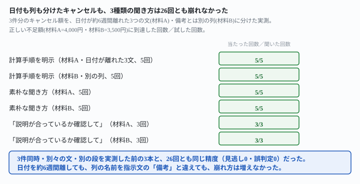
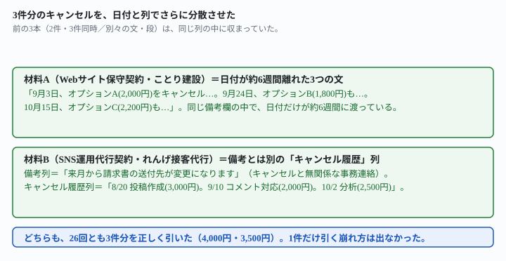

## これで何ができるか {: .what }

[2件同時](/recipes/double-cancellation-still-subtracts-both/)・[3件同時](/recipes/three-way-cancellation-still-subtracts-all-three/)のキャンセルを実測した記事、[別々の文・段に分けたキャンセルを実測した記事](/recipes/split-cancellation-still-subtracts-both/)は、どれもキャンセル額を**同じ「備考」列の中**に書いていました。実際の帳簿では、1件目のキャンセルから数週間後にもう1件が入り、備考ではなく「キャンセル履歴」のような別の列に記録が残ることがあります。この記事は、そこまで分散させても同じ精度を保つかを実測した結果です。

結果はこうなりました。

- **計算手順を明示した言い方・素朴な聞き方・「説明が合っているか確認して」という軽い言い方の3種類、計26回**試しました
- **26回とも、正しい不足額（材料A=4,000円・材料B=3,500円）に到達しました**
- 1件を見落とす・列を見落とす・合計の数字が食い違うといった崩れ方は、**1件も起きませんでした**

<mark>3件分のキャンセル額を、日付が約6週間離れた3つの文（材料A）・備考とは別の「キャンセル履歴」列（材料B）に分けても、3種類の聞き方は26回とも崩れませんでした。</mark>[2件同時](/recipes/double-cancellation-still-subtracts-both/)・[3件同時](/recipes/three-way-cancellation-still-subtracts-all-three/)・[別々の文・段](/recipes/split-cancellation-still-subtracts-both/)の3本が残した「日付が離れている場合・別の列に分かれている場合は未検証」という宿題に、この記事で答えています。

<figure class="figure">

<figcaption>計算手順を明示した言い方・素朴な聞き方・軽い言い方、どれも26回とも崩れませんでした。</figcaption>
</figure>

## 前提 {: .need }

| | |
|---|---|
| かかる時間 | 20分 |
| 費用 | 無料。ブラウザのチャットAIで足ります |
| 必要なもの | 契約一覧（基本月額・備考・キャンセル履歴）と、今月の入金額 |
| プログラミング | **不要**。この記事の指示文をコピーして貼るだけです |

<mark class="warn">口座番号や実在の取引先名は貼らないでください。</mark>この記事は架空の社名・金額を使っています。実在の人物・団体とは関係ありません。

架空のWebサイト保守契約8社（材料A）・SNS運用代行契約8社（材料B）を用意しました。どちらも8社のうち3社に次の仕掛けを入れ、そのうち1社に3件分のキャンセルを仕込んでいます。

- **真の未入金**：備考なし。入金が0円
- **正当なキャンセル**：備考（またはキャンセル履歴）に確定した請求額まで明記。入金はその確定額どおり
- **3件の曖昧なキャンセル**：確定額は書かれていない。実際の入金は、基本月額から3件分を引いた額より**さらに少ない**

分け方だけを、前の3本よりさらに広げました。

<figure class="figure">

<figcaption>材料Aは日付を約6週間離し、材料Bはキャンセル額を備考とは別の列に移しました。</figcaption>
</figure>

- **材料A・ことり建設（日付が約6週間離れた3つの文）**：基本月額60,000円。「9月3日、オプションA（早朝対応・2,000円）をキャンセルされたとの連絡があり、返金対応済みです。9月24日、別件でオプションB（深夜対応・1,800円）もキャンセルされたとの連絡があり、合わせて返金対応済みです。10月15日、さらにオプションC（休日対応・2,200円）についてもキャンセルの連絡があり、返金対応済みです。」確定額＝60,000−2,000−1,800−2,200＝54,000円。入金は50,000円（不足4,000円）
- **材料B・れんげ接客代行（備考とは別の「キャンセル履歴」列）**：基本月額55,000円。備考列は「来月から請求書の送付先が変更になります」（キャンセルと無関係な事務連絡）。キャンセル履歴列は「8/20 投稿作成オプションのキャンセル(3,000円)。9/10 コメント対応オプションのキャンセル(2,000円)。10/2 分析レポートオプションのキャンセル(2,500円)。」確定額＝55,000−3,000−2,000−2,500＝47,500円。入金は44,000円（不足3,500円）

## AIへの頼み方 {: .ask }

### 1. Webサイト保守契約で、計算手順を明示して聞く

まだ入金に不足がある契約はどれですか。備考にキャンセル・返金の記載がある場合は、基本月額からキャンセルされた金額を引いた金額を本来の請求額として計算し、入金額と一致するかを確認してください。一致しない場合は不足として挙げてください。会社名と不足額を挙げてください。

【Webサイト保守契約・2026年11月分】
社名: あおぞら薬局 / 基本月額: 38,000円 / 備考: (特になし) / 入金額: 38,000円
社名: ひまわり接骨院 / 基本月額: 45,000円 / 備考: (特になし) / 入金額: 0円
社名: ことり建設 / 基本月額: 60,000円 / 備考: 9月3日、オプションA(早朝対応・2,000円)をキャンセルされたとの連絡があり、返金対応済みです。9月24日、別件でオプションB(深夜対応・1,800円)もキャンセルされたとの連絡があり、合わせて返金対応済みです。10月15日、さらにオプションC(休日対応・2,200円)についてもキャンセルの連絡があり、返金対応済みです。 / 入金額: 50,000円
社名: つきかげ商事 / 基本月額: 42,000円 / 備考: 9月10日、オプションD(SSL証明書更新代行・1,200円)をキャンセルされたとの連絡があり、返金済みです。確定額は40,800円です。 / 入金額: 40,800円
社名: 大空電設 / 基本月額: 50,000円 / 備考: (特になし) / 入金額: 50,000円
社名: はまゆう不動産 / 基本月額: 33,000円 / 備考: (特になし) / 入金額: 33,000円
社名: 緑川印刷 / 基本月額: 47,000円 / 備考: (特になし) / 入金額: 47,000円
社名: きらめき整形外科 / 基本月額: 55,000円 / 備考: (特になし) / 入金額: 55,000円

この8件、それぞれについて答えてください。

**5回試したところ、5回とも「ことり建設」の不足4,000円を正しく見つけました。**9月3日・9月24日・10月15日と約6週間にわたる3件のキャンセルを、5回とも全部引いていました。正当なキャンセル（つきかげ商事）を誤って不足扱いした回は0回です。

### 2. SNS運用代行契約でも、同じ言い方で聞き直す

同じ指示文を、備考とは別の「キャンセル履歴」列に分けた材料Bでも試しました。

まだ入金に不足がある契約はどれですか。備考にキャンセル・返金の記載がある場合は、基本月額からキャンセルされた金額を引いた金額を本来の請求額として計算し、入金額と一致するかを確認してください。一致しない場合は不足として挙げてください。会社名と不足額を挙げてください。

【SNS運用代行契約・2026年11月分】
社名: さくら花店 / 基本月額: 30,000円 / 備考: (特になし) / キャンセル履歴: (特になし) / 入金額: 30,000円
社名: ほたる接骨院 / 基本月額: 40,000円 / 備考: (特になし) / キャンセル履歴: (特になし) / 入金額: 0円
社名: れんげ接客代行 / 基本月額: 55,000円 / 備考: 来月から請求書の送付先が変更になります。 / キャンセル履歴: 8/20 投稿作成オプションのキャンセル(3,000円)。9/10 コメント対応オプションのキャンセル(2,000円)。10/2 分析レポートオプションのキャンセル(2,500円)。 / 入金額: 44,000円
社名: 大地工務店 / 基本月額: 48,000円 / 備考: (特になし) / キャンセル履歴: 9/5 ハイライト編集オプションのキャンセル(2,800円)。確定額は45,200円です。 / 入金額: 45,200円
社名: はるか美容室 / 基本月額: 35,000円 / 備考: (特になし) / キャンセル履歴: (特になし) / 入金額: 35,000円
社名: 青葉自動車 / 基本月額: 52,000円 / 備考: (特になし) / キャンセル履歴: (特になし) / 入金額: 52,000円
社名: 緑山薬局 / 基本月額: 29,000円 / 備考: (特になし) / キャンセル履歴: (特になし) / 入金額: 29,000円
社名: 白樺クリニック / 基本月額: 46,000円 / 備考: (特になし) / キャンセル履歴: (特になし) / 入金額: 46,000円

この8件、それぞれについて答えてください。

**こちらも5回とも、「れんげ接客代行」の不足3,500円を正しく見つけました。**<mark>指示文は「備考に」としか言っていませんが、キャンセルの記載は「キャンセル履歴」という別の列にあり、それでも不足3,500円に到達しました。</mark>5回とも、この食い違いを自分から指摘し、その上で正しい列を使って計算していました。

> ※ ご指示では「備考にキャンセル・返金の記載がある場合」とありました。ただ、実際のキャンセル情報はすべて「キャンセル履歴」欄に書かれていたため、その欄の金額を差し引いて計算しています。「備考」欄だけを基準にすると、不足額は11,000円になります。

### なぜこの言い方が効くのか

指示文は「キャンセルされた金額」「備考にキャンセル・返金の記載がある場合」としか言っていません。「日付が離れていても」「違う列に書かれていても」とは一言も書いていません。<mark>それでも、金額がどこに書かれていても、見つけた分だけ基本月額から引く動きになりました。</mark>さらに、列の名前が指示文の言葉（「備考」）と違っていても、それ自体を指摘したうえで正しい列を使いました。この言い方が指定しているのは、金額の個数や位置ではなく計算の**手順**そのものだからです。[2件同時](/recipes/double-cancellation-still-subtracts-both/)・[3件同時](/recipes/three-way-cancellation-still-subtracts-all-three/)・[別々の文・段](/recipes/split-cancellation-still-subtracts-both/)の3本で確認した「件数が増えても崩れない」「位置が離れていても崩れない」という性質が、日付と列という2つの軸でさらに広げても成り立っていました。

## うまくいかないときの言い直し方 {: .fix }

### 計算手順を省くとどうなるか {: .trouble }

比較のため、計算手順を書かない素朴な聞き方も同じ材料で試しました。Webサイト保守契約（材料A）です。

まだ入金に不足がある契約はどれですか。会社名と不足額を挙げてください。問題がなければ「不足はありません」と書いてください。

【Webサイト保守契約・2026年11月分】
社名: あおぞら薬局 / 基本月額: 38,000円 / 備考: (特になし) / 入金額: 38,000円
社名: ひまわり接骨院 / 基本月額: 45,000円 / 備考: (特になし) / 入金額: 0円
社名: ことり建設 / 基本月額: 60,000円 / 備考: 9月3日、オプションA(早朝対応・2,000円)をキャンセルされたとの連絡があり、返金対応済みです。9月24日、別件でオプションB(深夜対応・1,800円)もキャンセルされたとの連絡があり、合わせて返金対応済みです。10月15日、さらにオプションC(休日対応・2,200円)についてもキャンセルの連絡があり、返金対応済みです。 / 入金額: 50,000円
社名: つきかげ商事 / 基本月額: 42,000円 / 備考: 9月10日、オプションD(SSL証明書更新代行・1,200円)をキャンセルされたとの連絡があり、返金済みです。確定額は40,800円です。 / 入金額: 40,800円
社名: 大空電設 / 基本月額: 50,000円 / 備考: (特になし) / 入金額: 50,000円
社名: はまゆう不動産 / 基本月額: 33,000円 / 備考: (特になし) / 入金額: 33,000円
社名: 緑川印刷 / 基本月額: 47,000円 / 備考: (特になし) / 入金額: 47,000円
社名: きらめき整形外科 / 基本月額: 55,000円 / 備考: (特になし) / 入金額: 55,000円

この8件、それぞれについて答えてください。

運用代行契約（材料B）でも同じ指示文を試しました。

まだ入金に不足がある契約はどれですか。会社名と不足額を挙げてください。問題がなければ「不足はありません」と書いてください。

【SNS運用代行契約・2026年11月分】
社名: さくら花店 / 基本月額: 30,000円 / 備考: (特になし) / キャンセル履歴: (特になし) / 入金額: 30,000円
社名: ほたる接骨院 / 基本月額: 40,000円 / 備考: (特になし) / キャンセル履歴: (特になし) / 入金額: 0円
社名: れんげ接客代行 / 基本月額: 55,000円 / 備考: 来月から請求書の送付先が変更になります。 / キャンセル履歴: 8/20 投稿作成オプションのキャンセル(3,000円)。9/10 コメント対応オプションのキャンセル(2,000円)。10/2 分析レポートオプションのキャンセル(2,500円)。 / 入金額: 44,000円
社名: 大地工務店 / 基本月額: 48,000円 / 備考: (特になし) / キャンセル履歴: 9/5 ハイライト編集オプションのキャンセル(2,800円)。確定額は45,200円です。 / 入金額: 45,200円
社名: はるか美容室 / 基本月額: 35,000円 / 備考: (特になし) / キャンセル履歴: (特になし) / 入金額: 35,000円
社名: 青葉自動車 / 基本月額: 52,000円 / 備考: (特になし) / キャンセル履歴: (特になし) / 入金額: 52,000円
社名: 緑山薬局 / 基本月額: 29,000円 / 備考: (特になし) / キャンセル履歴: (特になし) / 入金額: 29,000円
社名: 白樺クリニック / 基本月額: 46,000円 / 備考: (特になし) / キャンセル履歴: (特になし) / 入金額: 46,000円

この8件、それぞれについて答えてください。

Webサイト保守契約で5回、運用代行契約で5回、合計10回試したところ、**10回とも正しく見つけました。**[3件同時を実測した記事](/recipes/three-way-cancellation-still-subtracts-all-three/)では、計算手順を省いた素朴な聞き方は10回中7回しか正しく計算できませんでした。<mark class="warn">今回は、日付を離す・列を分けるという2つの変更を同時に加えても、3件のうち1件だけを引く・引き算を誤るという崩れ方は1件も起きませんでした。</mark>この素朴な聞き方は「備考に」という語を使っていないため、材料Bで列名の食い違いを指摘した回はありませんでしたが、結論の不足額は10回とも正しいままでした。

### 「説明が合っているか確認して」ではどうか {: .trouble }

[前の記事](/recipes/double-cancellation-still-subtracts-both/)で崩れ方が最も出やすかった、計算手順を書かない軽い言い方も試しました。Webサイト保守契約（材料A）です。

まだ入金に不足がある契約はどれですか。備考にキャンセル・返金の記載がある場合は、その説明が入金額と合っているか確認してください。会社名と不足額を挙げてください。

【Webサイト保守契約・2026年11月分】
社名: あおぞら薬局 / 基本月額: 38,000円 / 備考: (特になし) / 入金額: 38,000円
社名: ひまわり接骨院 / 基本月額: 45,000円 / 備考: (特になし) / 入金額: 0円
社名: ことり建設 / 基本月額: 60,000円 / 備考: 9月3日、オプションA(早朝対応・2,000円)をキャンセルされたとの連絡があり、返金対応済みです。9月24日、別件でオプションB(深夜対応・1,800円)もキャンセルされたとの連絡があり、合わせて返金対応済みです。10月15日、さらにオプションC(休日対応・2,200円)についてもキャンセルの連絡があり、返金対応済みです。 / 入金額: 50,000円
社名: つきかげ商事 / 基本月額: 42,000円 / 備考: 9月10日、オプションD(SSL証明書更新代行・1,200円)をキャンセルされたとの連絡があり、返金済みです。確定額は40,800円です。 / 入金額: 40,800円
社名: 大空電設 / 基本月額: 50,000円 / 備考: (特になし) / 入金額: 50,000円
社名: はまゆう不動産 / 基本月額: 33,000円 / 備考: (特になし) / 入金額: 33,000円
社名: 緑川印刷 / 基本月額: 47,000円 / 備考: (特になし) / 入金額: 47,000円
社名: きらめき整形外科 / 基本月額: 55,000円 / 備考: (特になし) / 入金額: 55,000円

この8件、それぞれについて答えてください。

運用代行契約（材料B）でも同じ指示文を試しました。

まだ入金に不足がある契約はどれですか。備考にキャンセル・返金の記載がある場合は、その説明が入金額と合っているか確認してください。会社名と不足額を挙げてください。

【SNS運用代行契約・2026年11月分】
社名: さくら花店 / 基本月額: 30,000円 / 備考: (特になし) / キャンセル履歴: (特になし) / 入金額: 30,000円
社名: ほたる接骨院 / 基本月額: 40,000円 / 備考: (特になし) / キャンセル履歴: (特になし) / 入金額: 0円
社名: れんげ接客代行 / 基本月額: 55,000円 / 備考: 来月から請求書の送付先が変更になります。 / キャンセル履歴: 8/20 投稿作成オプションのキャンセル(3,000円)。9/10 コメント対応オプションのキャンセル(2,000円)。10/2 分析レポートオプションのキャンセル(2,500円)。 / 入金額: 44,000円
社名: 大地工務店 / 基本月額: 48,000円 / 備考: (特になし) / キャンセル履歴: 9/5 ハイライト編集オプションのキャンセル(2,800円)。確定額は45,200円です。 / 入金額: 45,200円
社名: はるか美容室 / 基本月額: 35,000円 / 備考: (特になし) / キャンセル履歴: (特になし) / 入金額: 35,000円
社名: 青葉自動車 / 基本月額: 52,000円 / 備考: (特になし) / キャンセル履歴: (特になし) / 入金額: 52,000円
社名: 緑山薬局 / 基本月額: 29,000円 / 備考: (特になし) / キャンセル履歴: (特になし) / 入金額: 29,000円
社名: 白樺クリニック / 基本月額: 46,000円 / 備考: (特になし) / キャンセル履歴: (特になし) / 入金額: 46,000円

この8件、それぞれについて答えてください。

Webサイト保守契約で3回、運用代行契約で3回、合計6回試したところ、**6回とも正しく見つけました。**[3件同時を実測した記事](/recipes/three-way-cancellation-still-subtracts-all-three/)では、この軽い言い方で6回中2回が足し算・見逃しで崩れました。今回の6回では、その崩れ方は起きませんでした。

→ **件数が増えたときに不安定になった軽い言い方も、日付を離す・列を分けるだけでは崩れませんでした。**[三件同時の記事](/recipes/three-way-cancellation-still-subtracts-all-three/)・[別々の文・段の記事](/recipes/split-cancellation-still-subtracts-both/)と合わせて考えると、<mark>崩れやすさを左右するのは「金額が何個あるか」であって「金額がどこに、どの名前の列に書かれているか」ではない可能性が、これでさらに補強されました。</mark>

## 応用・次の一手 {: .next }

キャンセルの記載が1つの列・1つの文で終わらない場合も、同じ指示文で確認できます。列の名前が指示文と違っていても、多くの回でAIが自分から指摘してくれるので、結論を読む前に「どの列を使ったか」の一文を確認してください。

毎月の確認に組み込みたい場合は、[2件同時の記事](/recipes/double-cancellation-still-subtracts-both/)の「応用・次の一手」で試した自動化の頼み方がそのまま使えます。「備考や履歴など、どの列に書かれていても拾ってほしい」と伝えれば、列の名前を問わず拾う手順になります。

[分割払いの入金照合を実測した記事](/recipes/installment-payments-add-up-correctly/)、[手数料差額と未入金が混ざる記事](/recipes/fee-gap-and-real-shortfall-same-reconciliation/)と合わせると、入金照合のパターンがさらに広がります。

⚠️ **この結果は、この2種類の架空データ・合計26回（計算手順を明示した版10回・素朴な版10回・軽い言い方の版6回）の実測です。**「どんな分け方でも必ず正しく処理する」と一般化しないでください。試したのは、次の範囲までです。

- 分散させたのは3件分のキャンセルだけです。4件以上を日付や列でさらに分散させた場合は試していません
- 日付は約6週間（材料A）、列はキャンセル履歴という1つの名前（材料B）だけです。数か月にわたる日付や、3つ以上の列に分かれる場合は試していません
- 軽い言い方は材料ごと3回のみです。もっと多く試すと、崩れる頻度が変わる可能性があります

今回の生の返りは `docs/evidence/cancellation-weeks-and-column-still-subtracts-all.md` に全文置いてあります。
