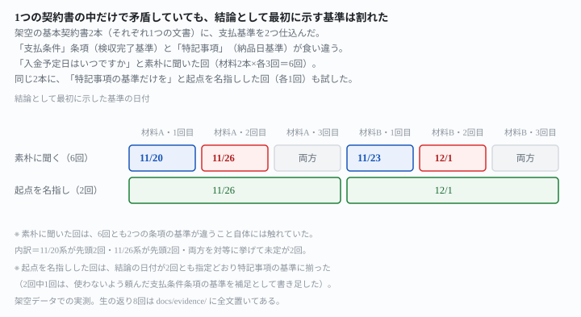
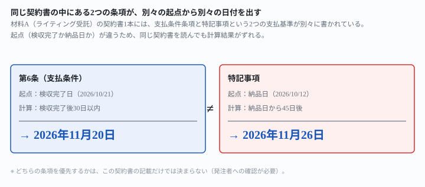

## これで何ができるか {: .what }

発注元と結ぶ契約書は、1枚の中に**支払いの基準を決める条項が複数ある**ことがあります。
<mark>**「支払条件」条項は検収完了を基準に、「特記事項」は納品日を基準にしている**——
同じ1枚の契約書の中だけで、基準そのものが食い違っていることがあります</mark>。
架空の契約書2本（ライティング受託・動画編集受託、それぞれ1本の文書）でこれを仕込み、
AIに「入金予定日はいつですか」とそのまま聞いてみました。

| 聞き方 | 結論として最初に出た基準（6回） | 矛盾そのものへの言及 |
|---|---|---|
| 素朴に「入金予定日はいつですか」 | 検収完了基準×2・納品日基準×2・両方未定×2 | **6回とも**2つの条項の基準が違うこと自体に触れた |
| 「特記事項の基準だけを使って」と名指し | **納品日基準×2（全一致）** | 2回中1回は、使わないよう頼んだ条項の基準を補足として書き足した |

<figure class="figure">

<figcaption>1つの契約書の中だけの矛盾でも、結論の基準は3通りに割れました。</figcaption>
</figure>

<mark class="warn">矛盾そのものには気づくのに、「結論」として先頭に出す基準は安定しません</mark>。
最初の数行だけ読む人は、回によって違う日付を「答え」として受け取ります。
<mark>支払いの基準が書かれた条項を名指しすれば、結論は揃いました</mark>。

📌 **この記事の実測はすべて架空データです。**実在の個人・企業の情報は含みません。
担当がサブエージェントのネスト上限（1階層まで）に達し、前作で使っていた「仮説を持たない
新規サブエージェントに聞く」方法が使えなかったため、担当自身がその指示文へ応答する方式に
切り替えています。**合計6本の指示文・12回**試しました。生の返りと機械照合は
`docs/evidence/clause-conflict-same-document-pick-still-splits.md` に全文置いてあります。

## 前提 {: .need }

| | |
|---|---|
| かかる時間 | 15分 |
| 費用 | 無料 |
| 必要なもの | 自分が結んでいる契約書で、支払いの基準が複数の条項（本文の条文と「特記事項」「別紙」など）に分かれて書かれているもの |
| プログラミング | **不要**。指示文をコピーして、自分の契約条件に書き換えるだけです |

<mark class="warn">発注元がAIの利用を禁じている場合があります</mark>。契約の内容そのものをAIに
読ませる前に、規約や指示書で禁じられていないかを確かめてください。この記事は法的な助言ではなく、
「AIが契約条件をどう読むか」を確かめた記録です。入金予定日を正式に確定するのは、最終的には
発注元への確認です。

## AIへの頼み方 {: .ask }

### 1. まず、素朴に聞いてみる

架空の基本契約書（ライティング受託・1本の文書）を作りました。第6条（支払条件）は
「検収完了後30日以内」に支払うと定め、特記事項は「納品日から45日後」を支払期限としています。

- 検収完了日は2026年10月21日です（第4条）
- 納品日は2026年10月12日です（第2条）
- 検収完了基準だと2026年11月20日、納品日基準だと2026年11月26日になり、6日ずれます

この契約書を読んで、入金予定日はいつか教えてください。

【契約書】
業務委託契約書

発注者（甲）：株式会社サンライズ商事
受託者（乙）：合同会社ことのは工房

第1条（業務内容）
乙は、甲が指定するウェブサイト用記事の執筆業務（以下「本業務」という）を行う。

第2条（納期）
乙は、本業務の成果物を2026年10月12日までに甲へ納品する。

第3条（検収）
甲は、乙から成果物の納品を受けた後、14日以内に内容を確認し、検収完了の通知を乙に行う。甲が本契約に定める検収完了の通知を行った日をもって「検収完了日」とする。

第4条（検収完了日）
本契約における検収完了日は、2026年10月21日とする。

第5条（契約金額）
本業務の委託料は、税込440,000円とする。

第6条（支払条件）
甲は、前条に定める委託料を、検収完了後30日以内に、乙の指定する銀行口座へ振込む方法により支払う。

第7条（その他）
本契約に定めのない事項は、甲乙協議のうえ別途定める。

特記事項
本契約に基づく委託料は、納品日から45日後を支払期限とする。

同じ指示文を3回試したところ、3回とも矛盾には触れましたが、結論として先頭に出す基準が割れました。

> 1回目:「第6条（支払条件）に基づくと、支払期限は検収完了日（2026年10月21日)から30日以内、つまり2026年11月20日です。なお……特記事項には……2026年11月26日を支払期限とする記載もあり、第6条の内容と一致していません」
> 2回目:「文書の末尾の『特記事項』には……これに従うと2026年11月26日が入金予定日になります。一方で第6条（支払条件）では……2026年11月20日が期限になります」
> 3回目:「どちらの条項を優先すべきかが契約書内に明記されていないため、この契約書の記載だけでは入金予定日を一つに決めることができません」

別の架空の動画編集の契約（検収完了後20日以内／納品日から60日後）でも同じ質問を3回試しました。

> 1回目:「支払期限は2026年11月23日です。ただし、特記事項には……2026年12月1日を支払期限とする記載もあり」
> 2回目:「特記事項の記載に基づくと……2026年12月1日が入金予定日です。なお、第5条（支払条件）には……2026年11月23日を期限とする別の記載もあります」
> 3回目:「どちらを優先するかが契約書に明記されていないため、入金予定日を一つに決めることができません」

<mark>6回とも、2つの条項の基準が違うこと自体には触れました。</mark>
<mark class="warn">ただし「結論」として最初に言う基準は、検収完了基準が2回、納品日基準が2回、
どちらとも決めない回が2回で、3通りに割れました。</mark>

<figure class="figure">

<figcaption>起点（検収完了か納品日か）が違うだけで、同じ契約書から別々の日付が出ます。</figcaption>
</figure>

### 2. 起点を名指しして聞く

この契約書を読んで、入金予定日はいつか教えてください。ただし、特記事項に書かれた基準だけを使って判断してください。支払条件の条項に書かれた基準は考慮しないでください。

【契約書】
業務委託契約書

発注者（甲）：株式会社サンライズ商事
受託者（乙）：合同会社ことのは工房

第1条（業務内容）
乙は、甲が指定するウェブサイト用記事の執筆業務（以下「本業務」という）を行う。

第2条（納期）
乙は、本業務の成果物を2026年10月12日までに甲へ納品する。

第3条（検収）
甲は、乙から成果物の納品を受けた後、14日以内に内容を確認し、検収完了の通知を乙に行う。甲が本契約に定める検収完了の通知を行った日をもって「検収完了日」とする。

第4条（検収完了日）
本契約における検収完了日は、2026年10月21日とする。

第5条（契約金額）
本業務の委託料は、税込440,000円とする。

第6条（支払条件）
甲は、前条に定める委託料を、検収完了後30日以内に、乙の指定する銀行口座へ振込む方法により支払う。

第7条（その他）
本契約に定めのない事項は、甲乙協議のうえ別途定める。

特記事項
本契約に基づく委託料は、納品日から45日後を支払期限とする。

同じ2つの契約で、合計2回試しました。**2回とも、計算そのものは指定どおり特記事項の基準で揃いました。**

> 「特記事項：納品日（2026年10月12日）から45日後 → 2026年11月26日。これが特記事項に基づく入金予定日です。（参考：第6条の支払条件による基準では2026年11月20日となりますが、ご指示により今回の計算には含めていません。）」
> 「納品日（2026年10月2日）から60日後 → 2026年12月1日。これが入金予定日です。」

<mark>起点を名指しすると、結論の基準は2回とも一致しました。</mark>
ただし<mark class="warn">2回中1回は、「考慮しないでください」と頼んだ支払条件条項の基準を、
頼んでいないのに補足として付け加えました</mark>。「使うな」と言われた情報は計算には使わなくなりますが、
注意書きとしては消えません。

### 3. 矛盾があるかどうかを先に聞く

結論を急がず、まず矛盾の有無だけを聞くこともできます。

この契約書を読んで、支払期日に関する条項の内容は一致していますか。一致していない場合は、どこがどう違うかを具体的に指摘してください。

【契約書】
業務委託契約書

発注者（甲）：株式会社サンライズ商事
受託者（乙）：合同会社ことのは工房

第1条（業務内容）
乙は、甲が指定するウェブサイト用記事の執筆業務（以下「本業務」という）を行う。

第2条（納期）
乙は、本業務の成果物を2026年10月12日までに甲へ納品する。

第3条（検収）
甲は、乙から成果物の納品を受けた後、14日以内に内容を確認し、検収完了の通知を乙に行う。甲が本契約に定める検収完了の通知を行った日をもって「検収完了日」とする。

第4条（検収完了日）
本契約における検収完了日は、2026年10月21日とする。

第5条（契約金額）
本業務の委託料は、税込440,000円とする。

第6条（支払条件）
甲は、前条に定める委託料を、検収完了後30日以内に、乙の指定する銀行口座へ振込む方法により支払う。

第7条（その他）
本契約に定めのない事項は、甲乙協議のうえ別途定める。

特記事項
本契約に基づく委託料は、納品日から45日後を支払期限とする。

1回試したところ、起点の違い（検収完了日か、納品日か）と計算結果の違いを具体的に指摘しました。
「第6条は検収完了後30日以内（2026年11月20日）、特記事項は納品日から45日後（2026年11月26日）で、
起点も計算結果も異なります」。**1回だけの結果ですが、聞き方を変えるだけで矛盾の中身まで届きました。**

### 4. どちらか一方に決めずに、両方を挙げさせる

この契約書を読んで、入金予定日を教えてください。支払条件の条項と特記事項で基準が異なる場合は、どちらか一方に決めずに、両方の日付とその理由を挙げてください。

【契約書】
業務委託契約書

発注者（甲）：株式会社サンライズ商事
受託者（乙）：合同会社ことのは工房

第1条（業務内容）
乙は、甲が指定するウェブサイト用記事の執筆業務（以下「本業務」という）を行う。

第2条（納期）
乙は、本業務の成果物を2026年10月12日までに甲へ納品する。

第3条（検収）
甲は、乙から成果物の納品を受けた後、14日以内に内容を確認し、検収完了の通知を乙に行う。甲が本契約に定める検収完了の通知を行った日をもって「検収完了日」とする。

第4条（検収完了日）
本契約における検収完了日は、2026年10月21日とする。

第5条（契約金額）
本業務の委託料は、税込440,000円とする。

第6条（支払条件）
甲は、前条に定める委託料を、検収完了後30日以内に、乙の指定する銀行口座へ振込む方法により支払う。

第7条（その他）
本契約に定めのない事項は、甲乙協議のうえ別途定める。

特記事項
本契約に基づく委託料は、納品日から45日後を支払期限とする。

1回試したところ、2つの基準それぞれで計算した日付（11月20日・11月26日）を、根拠つきでどちらにも
決めずに挙げました。**1回だけの結果です**が、冒頭の表の「結論が割れる」という問題そのものを、
指示文側で封じる形になっています。

### 5. 毎回の形式を固定する

同じ形の契約書を毎回渡すなら、出力の形式を先に決めておけます。

これから毎回、契約書を渡します。入金予定日と、その計算で使った基準（検収完了／納品日のどちらか）を必ずセットで出力してください。支払条件の条項と特記事項で基準の記述が異なる場合は、両方の日付を出し、どちらを優先すべきか確認が必要だと明記してください。

【契約書】
業務委託契約書

発注者（甲）：株式会社サンライズ商事
受託者（乙）：合同会社ことのは工房

第1条（業務内容）
乙は、甲が指定するウェブサイト用記事の執筆業務（以下「本業務」という）を行う。

第2条（納期）
乙は、本業務の成果物を2026年10月12日までに甲へ納品する。

第3条（検収）
甲は、乙から成果物の納品を受けた後、14日以内に内容を確認し、検収完了の通知を乙に行う。甲が本契約に定める検収完了の通知を行った日をもって「検収完了日」とする。

第4条（検収完了日）
本契約における検収完了日は、2026年10月21日とする。

第5条（契約金額）
本業務の委託料は、税込440,000円とする。

第6条（支払条件）
甲は、前条に定める委託料を、検収完了後30日以内に、乙の指定する銀行口座へ振込む方法により支払う。

第7条（その他）
本契約に定めのない事項は、甲乙協議のうえ別途定める。

特記事項
本契約に基づく委託料は、納品日から45日後を支払期限とする。

1回試したところ、起点を明記した形式で両方の日付を出し、「どちらを優先すべきか、発注者への確認が
必要」と明記しました。手順3・4の言い方を1つの出力形式に合体させた形です。

### 6. 要約を頼んでも、矛盾は埋もれない

「入金予定日はいつですか」とピンポイントで聞かなくても、矛盾は表に出るかを確かめました。

この契約書を、担当者向けのメモとして要約してください。入金予定日は必ず含めてください。

【契約書】
業務委託契約書

発注者（甲）：株式会社サンライズ商事
受託者（乙）：合同会社ことのは工房

第1条（業務内容）
乙は、甲が指定するウェブサイト用記事の執筆業務（以下「本業務」という）を行う。

第2条（納期）
乙は、本業務の成果物を2026年10月12日までに甲へ納品する。

第3条（検収）
甲は、乙から成果物の納品を受けた後、14日以内に内容を確認し、検収完了の通知を乙に行う。甲が本契約に定める検収完了の通知を行った日をもって「検収完了日」とする。

第4条（検収完了日）
本契約における検収完了日は、2026年10月21日とする。

第5条（契約金額）
本業務の委託料は、税込440,000円とする。

第6条（支払条件）
甲は、前条に定める委託料を、検収完了後30日以内に、乙の指定する銀行口座へ振込む方法により支払う。

第7条（その他）
本契約に定めのない事項は、甲乙協議のうえ別途定める。

特記事項
本契約に基づく委託料は、納品日から45日後を支払期限とする。

1回試したところ、メモの「入金予定日」欄に「第6条に基づくと2026年11月20日ですが、特記事項には
……2026年11月26日とする別の記載があり、基準が一致していません。どちらが適用されるか要確認です」と
書きました。**1回だけの結果です**が、間接的な頼み方でも矛盾は埋もれませんでした。

## うまくいかないときの言い直し方 {: .fix }

### 「結論」だけ読んで、そのまま信じてしまった {: .trouble }

手順1のとおり、素朴に聞いた結論は回によって違う基準になります。
<mark class="warn">同じ指示文を3回試して同じ答えが返っても、4回目・5回目も同じとは限りません</mark>。
入金予定日のように後で食い違うと困る数字は、手順2（起点を名指し）か手順4（両方を挙げさせる）の
形で聞き直してください。

### どちらの条項が優先するか分からない {: .trouble }

この記事の実測では、どの回も「支払条件の条項と特記事項のどちらが優先するか」を契約書の記載だけ
からは決められませんでした。発注者への確認を勧める回がほとんどです。
<mark>AIに聞いても、優先関係を決める条文が無ければ答えは出ません</mark>。
手順3の聞き方で矛盾を洗い出したら、その一覧を発注者への確認メールの材料にしてください。

### この記事が実測していないこと {: .trouble }

[入金予定日の矛盾にAIは気づく——結論の日付は4回で3通りに割れた](/recipes/due-date-conflict-noticed-but-the-pick-still-flips/)が
確かめたのは「2つの文書（基本契約書と個別発注書）の間で基準が違う」場合でした。今回は**同じ1枚の
契約書の中**で基準が違う場合を試し、気づき率は6/6で変わらず、結論が割れる崩れ方も同じ形で
再現しました。もう一つの前作、[「中5営業日」の納期をAIに計算させる](/recipes/deadline-count-needs-holiday-list/)は
**情報そのものが欠けている**（休みの日付を渡していない）ときにAIがどう埋めるかを見ており、
今回のように矛盾する情報が両方「見えている」場合とは別の崩れ方でした。

⚠️ **この記事の実測方法には限界があります。**前作は仮説を持たない新規サブエージェントに
聞いて生の応答を得ていましたが、今回の担当はサブエージェントのネスト上限（1階層まで）に
達していたため、担当自身が指示文へ応答する方式に切り替えています。仮説を知っている状態での
応答という限界込みの実測です。

## 応用・次の一手 {: .next }

この記事で分かったのは、**矛盾を見つける力と、結論を安定させる力は別**だということです。
入金予定日のように後でトラブルになりうる数字は、手順1の素朴な聞き方で済ませないでください。
手順2（起点を名指し）か、手順5（形式を固定する）まで進めてください。

この作業を、毎週決まった時刻に自動で実行できるようにしたいです。

私はプログラムを書けません。何が必要になるか、私がやる作業を番号を振って書いてください。作れるものはあなたが作ってください。

ここから先は[「毎日決まった時刻に自動でやっておいて」をAIに作らせる](/recipes/github-actions-daily-cron/)に続きます。
