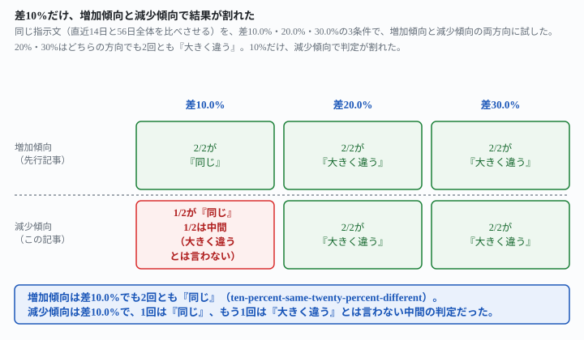
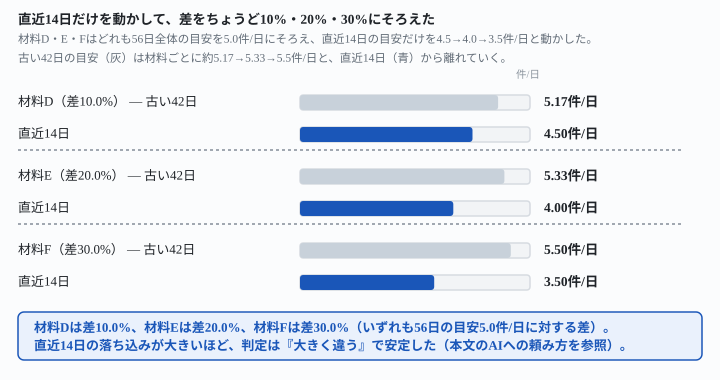

## これで何ができるか {: .what }

監視の自動化では、「直近のふだんの目安」と「もっと長い期間のふだんの目安」をAIに比べさせ、
「実務上同じとみなせるか、それとも大きく違うか」を一言で判定させる場面があります。
[先行記事](/recipes/ten-percent-same-twenty-percent-different/)は**増加傾向**（右肩上がり）の記録で、
差がちょうど10.0%・20.0%・30.0%になる3条件を試し、差10.0%では2回とも「同じ」という結果でした。
この記事は同じ3条件を、**減少傾向**（右肩下がり）の記録で試します。結論を先に書きます。

| 真値の差（56日基準） | 増加傾向（[先行記事](/recipes/ten-percent-same-twenty-percent-different/)） | 減少傾向（この記事） |
|---|---|---|
| 10.0% | 2回とも「同じ」 | **1回は「同じ」、もう1回は中間**（「大きく違う」とは言わない） |
| 20.0% | 2回とも「大きく違う」 | 2回とも「大きく違う」 |
| 約30.0% | 2回とも「大きく違う」 | 2回とも「大きく違う」 |

<mark>差が20.0%・30.0%のときは、増加・減少どちらの方向でも2回とも「大きく違う」でした。
差が10.0%のときだけ、減少傾向では判定が割れています。</mark>

<figure class="figure">

<figcaption>差10.0%だけ、方向によって判定の安定性が変わりました。</figcaption>
</figure>

⚠️ **これは2回×3条件、計6回だけの実測です。**増加傾向で同じ境界（10.0%）を2回試したときは、
たまたま2回とも「同じ」でした。今回の減少傾向でも、違う2回を選んでいれば割れなかった可能性は残ります。
「増減の方向で境界が変わる」という一般法則だとは言いません——**割れたという事実だけが実測です**。

## 前提 {: .need }

| | |
|---|---|
| かかる時間 | 15分。[先行記事](/recipes/ten-percent-same-twenty-percent-different/)を先に読むと早いです |
| 費用 | 無料。無料のチャットAIで足ります |
| 必要なもの | 毎日の件数が並んだ記録（減少傾向のあるもの） |
| プログラミング | **不要**。記録と指示文をそのまま貼るだけです |

使う指示文は[先行記事](/recipes/ten-percent-same-twenty-percent-different/)・
[別の先行記事](/recipes/decreasing-log-judgment-comes-out-right/)と一字一句同じです。
変えたのは記録の中身だけです。

- **材料D**（差10.0%）＝直近14日4.5件/日・56日全体5.0件/日
- **材料E**（差20.0%）＝直近14日4.0件/日・56日全体5.0件/日
- **材料F**（差30.0%）＝直近14日3.5件/日・56日全体5.0件/日

[先行記事](/recipes/ten-percent-same-twenty-percent-different/)の材料D/E/Fは56日全体の目安が
5.0・5.0・6.5件/日とそろっていませんでした。この記事では**56日全体の目安をどの材料も5.0件/日にそろえ**、
直近14日だけを4.5→4.0→3.5件/日と動かして、差をちょうど10.0%・20.0%・30.0%にしています
（真値はPython `statistics` で算出。週ごとの小計の手計算でも全件一致を確認済みです）。

どの材料も56日間（7/20〜9/13）で、独立した新規の呼び出しで**2回ずつ**試しました
（自動化ものの2回転の決まりに従う）。1回の呼び出しに答えを知らない側として
「ふつうの無料チャットAI」の役を演じさせ、ツールは使わず暗算・筆算で計算させています。
実行方法は `claude --safe-mode --tools "" -p` による独立プロセス起動です（CLAUDE.md・履歴を
全部無効化するので、答えを知らない側として厳密な事前知識ゼロの条件です）。
生の返りと機械照合は `docs/evidence/decreasing-boundary-splits-at-ten-percent.md` に全文置いてあります。

## AIへの頼み方 {: .ask }

### 差10.0%の記録で試す（材料D）——判定が割れた

これは問い合わせフォームに届いた件数の記録です。直近14日分の記録と、直近14日分に古い42日分を足した56日分全部の記録、の2つを渡します。それぞれについて、ふだんの1日あたりの件数の目安を計算してください。そのうえで、2つの目安が実務上同じとみなせるほど近いか、それとも大きく違うかを判定し、理由を書いてください。

1回目は「直近14日4.5件/日、56日全体5.0件/日」を正しく算出し、
「実務上ほぼ同じとみなせます」と判定しました。差0.5件は日々の揺れ（標準偏差相当で約1.3件）より
小さいことを理由に挙げています。

これは問い合わせフォームに届いた件数の記録です。直近14日分の記録と、直近14日分に古い42日分を足した56日分全部の記録、の2つを渡します。それぞれについて、ふだんの1日あたりの件数の目安を計算してください。そのうえで、2つの目安が実務上同じとみなせるほど近いか、それとも大きく違うかを判定し、理由を書いてください。

2回目は**同じ数値**（4.5件/日・5.0件/日）を算出しながら、「実務上『同じ』とはみなさない方がよい
（差は中程度）」と判定しました。理由として差は約10%で週3.5件・月15件に積み上がること、
古い42日だけの平均（約5.17件/日）との差は0.7件に広がることを挙げつつ、
最後に「ただし『大きく違う』ほどではない」と明記しています。

<mark>同じ材料・同じ指示文・同じ正しい数値で、1回目は「同じ」、2回目は「同じでも大きく違うでもない」
中間の判定でした。</mark>[増加傾向の先行記事](/recipes/ten-percent-same-twenty-percent-different/)の
差10.0%は2回とも「同じ」だったので、この割れ方は増加傾向では見られなかったものです。

### 差20.0%の記録で試す（材料E）

これは問い合わせフォームに届いた件数の記録です。直近14日分の記録と、直近14日分に古い42日分を足した56日分全部の記録、の2つを渡します。それぞれについて、ふだんの1日あたりの件数の目安を計算してください。そのうえで、2つの目安が実務上同じとみなせるほど近いか、それとも大きく違うかを判定し、理由を書いてください。

1回目は「直近14日4.0件/日、56日全体5.0件/日」を正しく算出し、「大きく違う」と判定しました。
週ごとの合計（44→41→38→35→32→34→29→27件）を自分で並べ、直近2週が他のどの週よりも
少ないことを理由に挙げています。

これは問い合わせフォームに届いた件数の記録です。直近14日分の記録と、直近14日分に古い42日分を足した56日分全部の記録、の2つを渡します。それぞれについて、ふだんの1日あたりの件数の目安を計算してください。そのうえで、2つの目安が実務上同じとみなせるほど近いか、それとも大きく違うかを判定し、理由を書いてください。

2回目も同じ4.0件/日・5.0件/日を算出し、「大きく違います」と判定しました。
<mark>差20.0%では、材料Dと違って2回とも迷いなく「大きく違う」でした。</mark>

### 差約30.0%の記録で試す（材料F）

これは問い合わせフォームに届いた件数の記録です。直近14日分の記録と、直近14日分に古い42日分を足した56日分全部の記録、の2つを渡します。それぞれについて、ふだんの1日あたりの件数の目安を計算してください。そのうえで、2つの目安が実務上同じとみなせるほど近いか、それとも大きく違うかを判定し、理由を書いてください。

1回目は「直近14日3.5件/日、56日全体5.0件/日」を正しく算出し、「大きく違います」と判定しました。
週ごとの合計（45→42→39→36→34→35→26→23件）を示し、8週間でほぼ半分になっていることを
理由に挙げています。

これは問い合わせフォームに届いた件数の記録です。直近14日分の記録と、直近14日分に古い42日分を足した56日分全部の記録、の2つを渡します。それぞれについて、ふだんの1日あたりの件数の目安を計算してください。そのうえで、2つの目安が実務上同じとみなせるほど近いか、それとも大きく違うかを判定し、理由を書いてください。

2回目も同じ3.5件/日・5.0件/日を算出し、「大きく違います。実務上同じとはみなせません」と
判定しました。差約30.0%でも、2回とも「大きく違う」で一致しています。

<figure class="figure">

<figcaption>直近14日の落ち込みが大きいほど、判定は「大きく違う」で安定しました。</figcaption>
</figure>

### 増減のどちらでも6回とも正しい数値、割れたのは判定の言葉だけ

6回すべてで、AIが出した合計・平均・週ごとの小計はすべて真値と完全に一致していました
（★334＝二択判定が合っていても、根拠の数字は別に照合する必要があるという教訓の確認。
今回は数値のほうは6回とも崩れませんでした）。

| 材料 | 真値の差 | 聞いた回数 | AIの判定 |
|---|---|---|---|
| 増加傾向・差10.0%（[先行記事](/recipes/ten-percent-same-twenty-percent-different/)） | 10.0% | 2回 | 2回とも「同じ」 |
| 増加傾向・差20.0%（同上） | 20.0% | 2回 | 2回とも「大きく違う」 |
| 増加傾向・差約30.0%（同上） | 約30.0% | 2回 | 2回とも「大きく違う」 |
| 減少傾向・差約38.3%（[別の先行記事](/recipes/decreasing-log-judgment-comes-out-right/)） | 約38.3% | 3回 | 3回とも「大きく違う」 |
| 減少傾向・差10.0%（この記事・材料D） | 10.0% | 2回 | **割れた**（同じ1回・中間1回） |
| 減少傾向・差20.0%（この記事・材料E） | 20.0% | 2回 | 2回とも「大きく違う」 |
| 減少傾向・差約30.0%（この記事・材料F） | 約30.0% | 2回 | 2回とも「大きく違う」 |

## うまくいかないときの言い直し方 {: .fix }

### 境界に近い差では、1回だけの判定を信用しない {: .trouble }

この記事そのものが、その理由です。<mark class="warn">材料D（差10.0%）は、同じ指示文・同じ記録・
同じ正しい数値で、1回目は「同じ」、2回目は「同じでも大きく違うでもない」中間の判定でした。
1回しか試していなければ、どちらの結果で止まったかで記事の結論が逆になっていました。</mark>

対策は2つです。

1. **境界に近い差だと思ったら、必ず2回以上試す。**[先行記事](/recipes/ten-percent-same-twenty-percent-different/)
   の増加傾向では差10.0%でも2回とも揃いましたが、今回の減少傾向では揃いませんでした。
   方向によって揃うかどうかが変わるので、「前にこの差では揃った」を別の記録に当てはめない
2. **「同じ/大きく違う」の一言だけでなく、使った数値と理由も読む。**材料Dの2回目は、
   一言の判定だけを見ると「違う側」に見えますが、本文には「ただし『大きく違う』ほどではない」
   と明記されていました。一言だけを自動判定に使うと、この中間の判定を見落とします

### 境界% そのものは、記録ごとに測り直す {: .trouble }

この記事が確かめたのは、**この3本の材料・この2回ずつ**だけです。自分の監視対象で
同じことを確かめたいときは、[先行記事](/recipes/ten-percent-same-twenty-percent-different/)
と同じ指示文をそのまま使い、差が10%〜20%に近くなるように記録を2つ以上作って、
それぞれ2回ずつ試してください。

これは問い合わせフォームに届いた件数の記録です。直近14日分の記録と、直近14日分に古い42日分を足した56日分全部の記録、の2つを渡します。それぞれについて、ふだんの1日あたりの件数の目安を計算してください。そのうえで、2つの目安が実務上同じとみなせるほど近いか、それとも大きく違うかを判定し、理由を書いてください。

## 応用・次の一手 {: .next }

**「2つの窓は同じか違うか」という判定は、差が離れていれば増減どちらの方向でも安定しましたが、
差10.0%という境界に近い条件では、減少傾向のときだけ判定が割れました。**
これまでに分かっているのは4点です。

1. 真値の差が約6%（フラット）なら、AIは「同じ」と判定する
   （[フラットな記録の記事](/recipes/flat-log-keeps-the-benchmark-steady/)・2/2）
2. 真値の差が10.0%で**増加傾向**なら、AIは2回とも「同じ」と判定する
   （[先行記事](/recipes/ten-percent-same-twenty-percent-different/)・2/2）
3. 真値の差が10.0%で**減少傾向**だと、判定が割れることがある
   （この記事・1/2が「同じ」、1/2が中間）
4. 真値の差が20.0%以上なら、増加・減少どちらの方向でも「大きく違う」で安定する
   （増加傾向4/4・減少傾向5/5、合計9/9）

定期実行の異常判定に翻訳するなら、こうなります。

- [毎日決まった時刻にAIを動かす仕掛けを作らせる](/recipes/github-actions-daily-cron/)で、
  この指示文を定期的に走らせる
- **差が20%以上開いたときだけを「異常」として通知する。**差が10%台の境界付近は、
  今回の実測どおり判定が割れうるので、一言の判定だけで自動通知しない
- 境界付近（10%〜20%）で通知を出したいなら、一言の判定ではなく**使った数値（差のパーセント）を
  ログに残し、人が最後に読む**仕組みにする

⚠️ **この記事が実測していないこと**は3つです。

- 差が15%・18%のような、10%と20%の**さらに内側**の条件（増加・減少のどちらも未測定）
- 材料Dの中間判定が**どのくらいの頻度で出るか**。今回は2回中1回でしたが、この比率を
  一般化はしません（3回目を試せば「同じ」に戻るか、また中間になるかは分かりません）
- 記録が数百日まで育った場合や、減少の途中で傾向が止まった記録

次に測るなら、材料Dと同じ差10.0%の減少傾向の記録を、**もう2回**（計4回）試して、
割れ方が偶然の範囲か、それとも減少傾向のほうが本当に不安定なのかを確かめられます。
