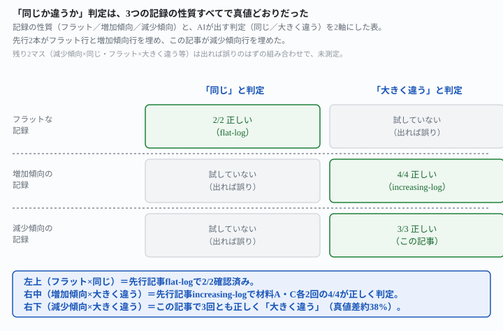
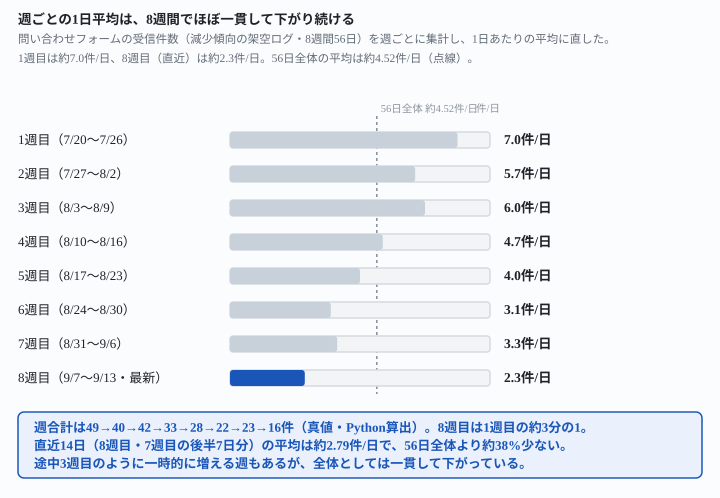

## これで何ができるか {: .what }

[増えている記録に「同じか」と聞くと——4回とも正しく「違う」と言えた](/recipes/increasing-log-judgment-comes-out-right/)は、**増加傾向のある記録**で「直近14日の目安と56日全体の目安は、実務上同じとみなせるか」をAI自身に判定させました。4回とも正しく「大きく違う」と答えています。あの記事の締めはこうでした——「減少傾向（右肩下がり）の記録で同じ判定をしたときの結果は、まだ測っていません」。

今回はそこを埋めます。**減少傾向のある架空の記録**1本で、同じ判定を3回試しました。結論は2つです。

1. **3回とも、正しく「大きく違う」と判定しました。**真値の差は約38%（56日全体の目安は直近14日の約1.62倍）で、3回とも「大きく違う」という結論でした
2. **判定の向きに非対称はありませんでした。**増加傾向（56日全体が直近14日より低い）でも、減少傾向（56日全体が直近14日より高い）でも、AIは真値の大小関係をそのまま「大きく違う」という判定に反映しました

<figure class="figure">

<figcaption>フラット・増加傾向・減少傾向の3つの性質すべてで、判定は真値どおりでした。</figcaption>
</figure>

| 記録の性質 | 真値の差 | 聞いた回数 | AIの判定 |
|---|---|---|---|
| フラット（[先行記事](/recipes/flat-log-keeps-the-benchmark-steady/)） | 約5.7% | 2回 | 2回とも「同じ」 |
| 増加傾向（[先行記事](/recipes/increasing-log-judgment-comes-out-right/)） | 約36.5%・約68.5% | 4回 | 4回とも「大きく違う」 |
| 減少傾向（この記事） | 約38.3% | 3回 | 3回とも「大きく違う」 |

<mark>真値が近いときは「同じ」、真値が離れているときは「大きく違う」。増えている記録でも減っている記録でも、この対応は崩れませんでした</mark>。

📌 **この記事の数字はすべて架空データでの実測です。**問い合わせフォームの受信件数ログ（8週間・56日、右肩下がりに作った架空の記録）に、[先行記事](/recipes/increasing-log-judgment-comes-out-right/)と一字一句同じ指示文を、独立した3回の呼び出しで試しました。生の返りと機械照合は `docs/evidence/decreasing-log-judgment-comes-out-right.md` に全文置いてあります。

⚠️ **実測の仕方が1点、先行記事と違います。**[先行記事](/recipes/increasing-log-judgment-comes-out-right/)は実在する独立クラウドセッション4つに依頼を送りましたが、今回はこのセッションで使える `claude` コマンド（`--safe-mode --tools ""`）を使い、独立したプロセスを3回起動しました。CLAUDE.md・過去のやり取り・ツールの一切を無効にして動かすので、クラウドセッションより厳密に「事前知識ゼロ」の条件です。「材料を作った本人とは別の、答えを知らない側に答えさせる」という条件自体は変わっていません（詳細は証拠ファイルの冒頭）。

## 前提 {: .need }

| | |
|---|---|
| かかる時間 | 10分。[先行記事](/recipes/increasing-log-judgment-comes-out-right/)を先に読むと早いです |
| 費用 | 無料。無料のチャットAIで足ります |
| 必要なもの | 毎日の件数が並んだ記録（減少傾向があるもの） |
| プログラミング | **不要**。記録と指示文をそのまま貼るだけです |

使う指示文は[先行記事](/recipes/increasing-log-judgment-comes-out-right/)の指示文そのものです。変えたのは**記録の中身**だけで、指示文の文字列は1文字も変えていません。

## AIへの頼み方 {: .ask }

### 減少傾向のある記録で、2つの窓を直接比較させる

[先行記事](/recipes/increasing-log-judgment-comes-out-right/)で使った指示文と一字一句同じです。

<div class="prompt">これは問い合わせフォームに届いた件数の記録です。直近14日分の記録と、直近14日分に古い42日分を足した56日分全部の記録、の2つを渡します。それぞれについて、ふだんの1日あたりの件数の目安を計算してください。そのうえで、2つの目安が実務上同じとみなせるほど近いか、それとも大きく違うかを判定し、理由を書いてください。</div>

渡した記録は、1週目が1日あたり約7件、8週目（直近）が約2.3件まで下がる、右肩下がりの56日間です。真値は直近14日が2.785714…件/日、56日全体が4.517857…件/日で、56日全体は直近14日の約1.62倍（差は56日基準で約38.3%）です。

1回目はこう返りました。

> **結論：2つの目安は大きく違います。**直近14日分は1日あたり約3件、56日分全部は約4.5件で、同じとはみなせません。

2回目・3回目も、言葉は違いますが同じ結論でした。

> 2つの目安は**大きく違います**。直近14日分は1日あたり約3件、56日分全部は約4.5件で、実務上同じとはみなせません。

> **判定:大きく違う**(実務上同じとはみなせません)

<mark>3回とも、真値どおり「大きく違う」と判定しました</mark>。[増加傾向の先行記事](/recipes/increasing-log-judgment-comes-out-right/)は「直近14日の方が56日全体より高い」という向きでしたが、今回は逆に「直近14日の方が56日全体より低い」という向きです。向きが入れ替わっても、判定の正しさは変わりませんでした。

### 週ごとの推移も、AIが自分で言い当てた

3回とも、AIは根拠として週ごとの1日平均を自分で計算して示していました。

<figure class="figure">

<figcaption>8週間で、週ごとの1日平均はほぼ一貫して下がっています。</figcaption>
</figure>

| 回 | AIが出した週合計 | 真値（週合計） | 一致 |
|---|---|---|---|
| 1回目 | 49・40・42・33・28・22・23・16件 | 49・40・42・33・28・22・23・16件 | 8/8 |
| 2回目 | 49・40・42・33・28・22・23・16件 | 49・40・42・33・28・22・23・16件 | 8/8 |
| 3回目 | 49・40・42・33・28・22・23・16件 | 49・40・42・33・28・22・23・16件 | 8/8 |

**3回とも、週合計8件すべてが真値と完全一致しています。**「ばらつきではなく、件数が減り続けていること」が差の原因だという理由づけも、3回に共通していました。

### もっと厳しい条件（1回だけ出力が崩れた）

同じ指示文・同じ材料で**もう1回**別のプロセスを起動したところ、計算も判定もない1行だけが返った回がありました。

```
"ふだんの1日あたりの件数の目安"
```

<mark class="warn">同じ条件でも、1回だけ出力が丸ごと崩れることがあります</mark>。このときは、材料や指示文を疑う前に、もう一度同じ条件で起動し直しました。やり直した回は正常に返り、他の3回と同じ結論でした。定期実行に組み込むときは、1回の失敗ですぐ「指示文が悪い」と決めず、再試行を1回挟む価値があります。

## うまくいかないときの言い直し方 {: .fix }

### 境界的な差（10〜30%程度）での判定はまだ分からない {: .trouble }

この記事が確かめたのは、真値の差が約38.3%という**はっきり離れた1条件**だけです。[先行記事](/recipes/increasing-log-judgment-comes-out-right/)の増加傾向2条件（約36.5%・約68.5%）と合わせても、確かめた差はすべて30%を超えています。<mark class="warn">差が10〜30%程度の、どちらとも言えそうな境界的な条件では、この記事の結果をそのまま当てはめないでください</mark>。

境界に近い差を自分で測りたいときは、まず週ごとの小計を出させてから判定させる2段構えにすると安全です。

<div class="prompt">これは問い合わせフォームに届いた件数の記録です。まず1週間ごとの合計を出し、次にそれぞれを7で割って週ごとの平均を出してください。そのうえで、全体のふだんの1日あたりの件数の目安を計算し、本日の件数34件がふだんの目安の何倍にあたるかを書いてください。</div>

### 「大きく違う」が出ても、どちらの方向に違うのかを取り違えたくない {: .trouble }

増加傾向と減少傾向のどちらでも「大きく違う」という同じ言葉が返ってきます。<mark>判定の言葉だけでなく、「直近14日の方が高いのか低いのか」をAIの回答から必ず確認してください</mark>。今回の3回は、どの回も「直近14日分は約3件、56日分全部は約4.5件」のように、どちらが高いかを明記していました。

<div class="prompt">今の判定で、直近14日分と56日分全部のどちらの目安が高いですか。1行で答えてください。</div>

### 出力がまれに崩れたとき、材料を疑う前にまず再試行したい {: .trouble }

[前作](/recipes/how-far-back-changes-the-usual-number/)の指示文5番（出す項目を絞って崩れなかった型）と組み合わせると、定期実行の中で崩れた回を機械で見分けやすくなります。

<div class="prompt">これは来店予約の件数の記録です。毎回この形で処理してください。

①この記録から、ふだんの1日あたりの件数の目安を計算して書く
②本日の件数29件が、ふだんの目安の何倍にあたるかを書く
③②が5倍を超えているかどうかを1行で

この3つ以外は書かないでください。</div>

①の数字が1行も出ていない回は、この記事で見た「1行だけの崩れ」と同じ壊れ方です。判定を信用せず、同じ条件でもう一度走らせてください。

## 応用・次の一手 {: .next }

**「2つの窓は同じか違うか」という判定は、記録が増えていても減っていても、真値の大小関係どおりに動きました。**この記事までで分かっているのは3点です。

1. 真値の差が約6%（フラット）なら、AIは「同じ」と判定する（[先行記事](/recipes/flat-log-keeps-the-benchmark-steady/)・2/2）
2. 真値の差が約36.5%・約68.5%（増加傾向）・約38.3%（減少傾向）なら、AIは「大きく違う」と判定する（[先行記事](/recipes/increasing-log-judgment-comes-out-right/)・この記事・合計7/7）
3. その間（差10〜30%程度）の境界的な条件は、増加・減少のどちらもまだ誰も試していない

定期実行の異常判定に翻訳するなら、こうなります。

- [毎日決まった時刻にAIを動かす仕掛けを作らせる](/recipes/github-actions-daily-cron/)で、この指示文を定期的に走らせる
- 「大きく違う」が出た回だけ、人間に知らせる。増えているのか減っているのかはAIの回答本文から読む
- まれに出力が崩れる回があるので、**1回の失敗で判定しない**。同じ条件で1回だけ再試行する仕組みを挟む

毎回「どちらが高いか」を別の指示文で聞き直すと手間が増えるので、1本の指示文に両方を入れた版も試しました。

<div class="prompt">これは問い合わせフォームに届いた件数の記録です。直近14日分の記録と、直近14日分に古い42日分を足した56日分全部の記録、の2つを渡します。それぞれについて、ふだんの1日あたりの件数の目安を計算してください。そのうえで、2つの目安が実務上同じとみなせるほど近いか、それとも大きく違うかを判定し、理由を書いてください。大きく違う場合は、直近14日分と56日分全部のどちらの目安が高いかも明記してください。</div>

1回目はこう返りました。

> 2つの目安は**大きく違います**。**56日分全部の目安のほうが高い**です(1日あたり約4.5件に対し、直近14日分は約3件)。

2回目も、途中の週ごとの内訳に書き間違いが1か所ありましたが（週合計を書く際に9/7〜9/13の16件を18件と書いた）、**最終的な合計・平均・判定はすべて真値どおり**でした。

> 判定: 大きく違う(56日分全部の目安のほうが高い)

<mark>どちらの回も、「大きく違う」という判定と「どちらが高いか」という向きを、1本の指示文で同時に正しく返しました</mark>。定期実行に組み込むなら、この1本化した版のほうが扱いやすいです。向きの明記が不要なら、[先行記事](/recipes/increasing-log-judgment-comes-out-right/)と同じ元の指示文だけで足ります。

<div class="prompt">これは問い合わせフォームに届いた件数の記録です。直近14日分の記録と、直近14日分に古い42日分を足した56日分全部の記録、の2つを渡します。それぞれについて、ふだんの1日あたりの件数の目安を計算してください。そのうえで、2つの目安が実務上同じとみなせるほど近いか、それとも大きく違うかを判定し、理由を書いてください。</div>

⚠️ **この記事が実測していないこと**は3つです。

- 真値の差が10〜30%程度の、境界的な条件での判定（増加・減少のどちらも[先行記事](/recipes/ten-percent-same-twenty-percent-different/)が扱った「境界%」とは別軸で未測定）
- 出力が崩れる頻度そのもの（今回3+1回のうち1回だったが、この比率を一般化はしません）
- 記録が数百日まで育った場合や、減少の途中で傾向が止まった記録

次に測るなら、真値の差を10%・20%・30%と段階的に変えた記録を増加・減少の両方向で作ります。どこで判定が「同じ」から「大きく違う」に切り替わるかを、方向ごとに確かめるところから始められます。
