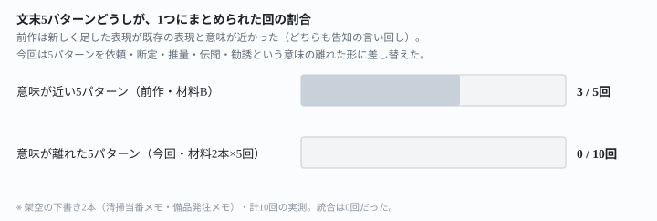
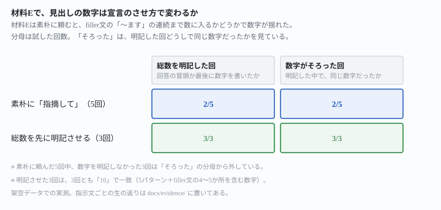

## これで何ができるか {: .what }

[前の記事](/recipes/fifth-pattern-merges-with-a-lookalike/)では、文末表現が不自然に連続している箇所を「指摘して」と頼んだときの崩れ方を調べました。5つ目に足した表現が既存の表現と**意味が近い**と、2つが1つの項目にまとめられることを確かめました。今回は5パターンを依頼・断定・推量・伝聞・勧誘という**意味の離れた形**に差し替え、同じ崩れ方が起きるかを調べます。

結論を先に書きます。

| 確かめたこと | 結果 |
|---|---|
| 意味が離れた5パターンどうしが、1つにまとめられるか | **架空の下書き2本・計10回で、0回**（前作の意味が近い5パターンは5回中3回まとめられた） |
| 見出しが宣言する総数は、材料によらず5で揺れないか | **揺れた**。材料Fは5回とも「5」、材料Eは5回とも5ではない数字（宣言無しまたは8） |
| 総数を先に明記させる言い直しは、材料Eの数字を安定させるか | **安定した**。3回とも同じ「10」で一致した |

<mark>5パターンの意味を離すと、パターンどうしが統合される崩れ方は10回とも出ませんでした。</mark><mark class="warn">代わりに、パターンの間に挟んだ「〜ます」で終わる普通の業務連絡の文まで、材料によっては「不自然な連続」として数えられ、見出しの数字が5ではなく8まで増えました。</mark><mark>見つかった総数を先に明記させる言い方に変えると、この数字も3回とも同じ値でそろいました。</mark>

<figure class="figure">

<figcaption>意味を離すと、パターンどうしの統合は起きませんでした。</figcaption>
</figure>

## 前提 {: .need }

| | |
|---|---|
| かかる時間 | 15分 |
| 費用 | 無料。ブラウザのチャットAIで足ります |
| 必要なもの | 直したい文章（下書き）1本 |
| プログラミング | **不要**。この記事の指示文をコピーして貼るだけです |

<mark class="warn">発注者の原稿や実在の人物が書いた文章は、そのまま貼らないでください。</mark>この記事は架空の下書きを使っています。実在の人物・団体とは関係ありません。

この記事は[前の記事](/recipes/fifth-pattern-merges-with-a-lookalike/)・[その前の記事](/recipes/headline-count-slips-at-four-patterns/)の続編です。AI生成文章の検品という副業区分の全体は[発注書どおりに検品する記事](/recipes/writing-check-against-spec/)も参考にしてください。

<mark class="warn">この実測には、このサイト（ai-tsukaikata）のプロジェクトを動かしている環境の文脈が一部伝わっています。</mark>「素のAIは必ずこう返す」とは一般化せず、ここに書いた数字（n回中n回）だけを根拠にしてください。

## AIへの頼み方 {: .ask }

### 1. 意味の離れた5パターンに差し替えた下書きで試す（材料E）

前作までの5パターンは「でしょう・と思います・のです・次第です・ということになります」でした。今回は、文末の形だけでなく**意味も互いに遠い**5パターンに差し替えました。

| 分類 | 文末 |
|---|---|
| 依頼 | 〜してください |
| 断定 | 〜です |
| 推量 | 〜でしょう |
| 伝聞 | 〜そうです |
| 勧誘 | 〜ましょう |

清掃当番メモ（35文）に、それぞれ3文連続で、間に4文ずつ無関係な業務連絡を挟んで仕込みました。

次の文章で、文末表現が不自然に連続している箇所があれば指摘してください。

今月から清掃当番のやり方を少し変更します。分からないことがあれば先輩に聞いてください。忘れ物があれば当番リーダーに連絡してください。道具を使ったら元の場所に戻してください。当番は月曜から金曜まで、1日ずつ交代で担当します。担当の順番は五十音順になっています。休んだ場合は翌週に繰り越します。道具は給湯室の棚にまとめてあります。今回の変更の目的は作業時間の短縮です。対象は各部署の当番担当者全員です。開始日は来週の月曜日です。雑巾は使ったら洗って干しておきます。スプレーのつけ替えは総務へ一声かけます。鍵は守衛室で借ります。忘れ物は週末にまとめて片付けます。新しい担当表には最初は戸惑うこともあるでしょう。慣れれば作業時間も短くなるでしょう。午前中に済ませたほうが楽でしょう。ゴミ袋がいっぱいになったら新しいものに交換します。拭き掃除には乾いた布を使います。最後に窓を少し開けて換気をします。掃除用のスプレーは共用のものを使います。他の部署ではすでに新しい担当表を使っているそうです。総務課もこの方式に変更するそうです。来月からは当番表が掲示板にも貼られるそうです。終わったらチェック表に印を付けます。椅子は机の下にしまいます。電気はブレーカーごと確認します。トイレの消耗品は週明けに補充します。今回の見直しで、負担を均等にしましょう。困ったことがあれば早めに相談しましょう。みんなで気持ちよく使える状態を保ちましょう。靴置き場も整理をお願いします。点検は月末にまとめて行います。引き続きよろしくお願いします。

5回試した結果です。

| 回 | 見出しの数字 | 5パターンどうしの統合 | 新しく出た指摘 |
|---|---|---|---|
| 1回目 | 「8か所」（本文は9項目） | 無し | 「〜ます」の4連続クラスタを4つとも別項目として追加 |
| 2回目 | 数字の宣言無し | 無し | 「〜ます」の4連続クラスタ4つを、番号なしの別枠で追加 |
| 3回目 | 数字の宣言無し | 無し | 「〜ます」の4連続クラスタを3つ、⑥⑦⑧として追加 |
| 4回目 | 「少なくとも8か所」 | 無し | 「〜ます」の4連続クラスタを3つ、④⑥⑦として追加（1つは脚注扱い） |
| 5回目 | 数字の宣言無し | 無し | 「〜ます」の4連続クラスタ4つを①〜⑨の一部として追加 |

**5パターン（してください・です・でしょう・そうです・ましょう）は、5回とも別々の項目として指摘されました。**まとまったのは0回です。代わりに起きたのは、こちらが意図していなかった崩れ方でした。間に挟んだ「無関係な業務連絡」も全部「〜ます」で終わる丁寧な文です。そのため**AIはその4連続も「不自然な連続」として数えました。**結果、見出しの数字は5ではなく8前後まで増え、回によってバラバラでした。

### 2. 別の題材でも同じか（材料F）

備品発注の引き継ぎメモで、同じ構成（35文・5パターン・間に4文ずつ）の別の材料を作りました。

次の文章で、文末表現が不自然に連続している箇所があれば指摘してください。

来月から備品発注の担当をあなたに引き継ぎます。発注書は毎月25日までに提出してください。在庫が少ない品目は早めに注文してください。急な欠品があれば業者に直接連絡してください。発注先の一覧は共有フォルダに置いてあります。見積もりは2社以上から取ります。支払いは月末締めの翌月払いになっています。承認は部長の決裁が必要になります。今回のフォーム簡略化の目的は入力ミスの削減です。対象は全部署の発注担当者です。切り替えの開始日は来月1日です。新しいフォームのリンクはメールで送ります。旧フォームは今月末で廃止します。マニュアルは社内wikiに置いてあります。大型の備品は別の承認フローを通します。最初は入力に戸惑うこともあるでしょう。慣れれば発注の手間も減るでしょう。ミスも今より少なくなるでしょう。配送は週2回、火曜と金曜になっています。受け取りは受付で対応します。破損品はすぐに写真を撮っておきます。返品の連絡は発注書の番号を伝えます。他の部署ではすでに新しいフォームを使っているそうです。総務課も同じ方式に切り替えるそうです。来月からは承認もオンラインで行うそうです。紙の申請書は廃止します。印鑑も不要になります。倉庫の鍵は防災センターで借ります。棚の整理は四半期ごとに行います。緊急発注のときは早めに課長へ相談しましょう。発注ミスがあれば早めに業者へ連絡しましょう。年度末は締め日が早まるので余裕をもって動きましょう。伝票の控えはファイルにまとめて保管します。来年度の予算要望は10月に取りまとめます。よろしくお願いします。

5回試した結果です。

| 回 | 見出しの数字 | 5パターンどうしの統合 | 「〜ます」クラスタの扱い |
|---|---|---|---|
| 1〜5回目すべて | 「5つ」「5か所」と正しく宣言 | 無し | 「補足」の見出しで分けて記載。数には含めない |

**材料Fでは5回とも、見出しの数字が5のまま揺れませんでした。**「〜ます」で終わる文のまとまりは本文に書かれています。ただし5回とも「補足」という別枠に置かれ、「〜ますは丁寧体の基本形なので目立たない」のような注記がついています。数には加えられていません。

<figure class="figure">

<figcaption>材料Eだけ、見出しの数字が回によって揺れました。</figcaption>
</figure>

### なぜ材料Eだけ揺れるのか

材料Eと材料Fで、5パターンの仕込み方(3文連続・間に4文ずつ)はまったく同じです。違うのは、間に挟んだ「無関係な業務連絡」の中身です。材料Eの filler文は「担当します・なっています・交換します・使います」のように**動詞＋ます**で終わる文が多いです。そのため、同じ語尾が4文連続する箇所が4つできています。材料Fの filler文も、同じ構造で同じ数の「ます」クラスタを持っています。ただしこちらはAIに「補足」として格下げされ、数には入りませんでした。<mark>同じ構造の filler でも、AIがそれを本題の「不自然な連続」として数えるかどうかは、材料によって揺れます。</mark>この揺れは、5パターンが意味的に近いかどうかとは関係ありません。「指摘して」という頼み方が、**どこまでを「不自然」と見なすかを決めていない**ことが根にあります。

## うまくいかないときの言い直し方 {: .fix }

### 総数を明記させると、材料Eの揺れも消えるか {: .trouble }

前作・前々作と同じ言い直し方——見つかった総数を先に明記させる言い方——を、材料Eで試しました。

次の文章で、文末表現が不自然に連続している箇所をすべて洗い出してください。見つかった箇所の総数を、回答の最初に明記してください。

今月から清掃当番のやり方を少し変更します。分からないことがあれば先輩に聞いてください。忘れ物があれば当番リーダーに連絡してください。道具を使ったら元の場所に戻してください。当番は月曜から金曜まで、1日ずつ交代で担当します。担当の順番は五十音順になっています。休んだ場合は翌週に繰り越します。道具は給湯室の棚にまとめてあります。今回の変更の目的は作業時間の短縮です。対象は各部署の当番担当者全員です。開始日は来週の月曜日です。雑巾は使ったら洗って干しておきます。スプレーのつけ替えは総務へ一声かけます。鍵は守衛室で借ります。忘れ物は週末にまとめて片付けます。新しい担当表には最初は戸惑うこともあるでしょう。慣れれば作業時間も短くなるでしょう。午前中に済ませたほうが楽でしょう。ゴミ袋がいっぱいになったら新しいものに交換します。拭き掃除には乾いた布を使います。最後に窓を少し開けて換気をします。掃除用のスプレーは共用のものを使います。他の部署ではすでに新しい担当表を使っているそうです。総務課もこの方式に変更するそうです。来月からは当番表が掲示板にも貼られるそうです。終わったらチェック表に印を付けます。椅子は机の下にしまいます。電気はブレーカーごと確認します。トイレの消耗品は週明けに補充します。今回の見直しで、負担を均等にしましょう。困ったことがあれば早めに相談しましょう。みんなで気持ちよく使える状態を保ちましょう。靴置き場も整理をお願いします。点検は月末にまとめて行います。引き続きよろしくお願いします。

3回試した結果です。

| 回 | 見出しの数字 | 本文の構成 |
|---|---|---|
| 1〜3回目すべて | 「合計10か所」「全部で10箇所」 | 5パターン＋「〜ます」クラスタ5つ（4連続×4・末尾の3連続×1）を10項目として同格に列記 |

**3回とも「10」で一致しました。**5パターンどうしが統合される動きは、ここでも0回でした。ただし<mark class="warn">「総数を先に明記させる」という言い直しは、5だけを数えさせる指示ではありません。</mark>この言い方は「見つかったものをすべて洗い出す」という指示と対になっています。そのため、filler文のます連続も含めて**AIが見つけたもの全部**の総数を安定させます。材料Eでは、その「全部」が5ではなく10でした。

念のため、総数を**最後に**明記させる言い方も材料Eで試しました。

次の文章で、文末表現が不自然に連続している箇所をすべて洗い出してください。見つかった箇所の総数は、最後にまとめて明記してください。

今月から清掃当番のやり方を少し変更します。分からないことがあれば先輩に聞いてください。忘れ物があれば当番リーダーに連絡してください。道具を使ったら元の場所に戻してください。当番は月曜から金曜まで、1日ずつ交代で担当します。担当の順番は五十音順になっています。休んだ場合は翌週に繰り越します。道具は給湯室の棚にまとめてあります。今回の変更の目的は作業時間の短縮です。対象は各部署の当番担当者全員です。開始日は来週の月曜日です。雑巾は使ったら洗って干しておきます。スプレーのつけ替えは総務へ一声かけます。鍵は守衛室で借ります。忘れ物は週末にまとめて片付けます。新しい担当表には最初は戸惑うこともあるでしょう。慣れれば作業時間も短くなるでしょう。午前中に済ませたほうが楽でしょう。ゴミ袋がいっぱいになったら新しいものに交換します。拭き掃除には乾いた布を使います。最後に窓を少し開けて換気をします。掃除用のスプレーは共用のものを使います。他の部署ではすでに新しい担当表を使っているそうです。総務課もこの方式に変更するそうです。来月からは当番表が掲示板にも貼られるそうです。終わったらチェック表に印を付けます。椅子は机の下にしまいます。電気はブレーカーごと確認します。トイレの消耗品は週明けに補充します。今回の見直しで、負担を均等にしましょう。困ったことがあれば早めに相談しましょう。みんなで気持ちよく使える状態を保ちましょう。靴置き場も整理をお願いします。点検は月末にまとめて行います。引き続きよろしくお願いします。

2回試した結果です。

| 回 | 見出しの数字 |
|---|---|
| 1回目 | 「8か所」(5パターン＋ますクラスタ3つ。4つ目のますクラスタは「です・ます調として許容範囲」と注記して対象外に) |
| 2回目 | 「10箇所」(5パターン＋ますクラスタ5つ全部) |

<mark class="warn">「最後に明記させる」言い方は、2回のうち1回が「8」でした。</mark>「先に明記させる」言い方は3回とも同じ「10」で一致していました。これに対し、こちらは2回のうち1回だけ、4つ目のますクラスタを「です・ます調として許容範囲」と判断して数から外していました。**n=2と少数ですが、「先に」のほうが「最後に」より安定している可能性があります。**前作・前々作では「先に」と「最後に」の差は無かったので、この差自体が今回初めて出た違いです。

念のため、同じ言い直し(先に明記)が材料Fでも変化しないかを確認しました。

次の文章で、文末表現が不自然に連続している箇所をすべて洗い出してください。見つかった箇所の総数を、回答の最初に明記してください。

来月から備品発注の担当をあなたに引き継ぎます。発注書は毎月25日までに提出してください。在庫が少ない品目は早めに注文してください。急な欠品があれば業者に直接連絡してください。発注先の一覧は共有フォルダに置いてあります。見積もりは2社以上から取ります。支払いは月末締めの翌月払いになっています。承認は部長の決裁が必要になります。今回のフォーム簡略化の目的は入力ミスの削減です。対象は全部署の発注担当者です。切り替えの開始日は来月1日です。新しいフォームのリンクはメールで送ります。旧フォームは今月末で廃止します。マニュアルは社内wikiに置いてあります。大型の備品は別の承認フローを通します。最初は入力に戸惑うこともあるでしょう。慣れれば発注の手間も減るでしょう。ミスも今より少なくなるでしょう。配送は週2回、火曜と金曜になっています。受け取りは受付で対応します。破損品はすぐに写真を撮っておきます。返品の連絡は発注書の番号を伝えます。他の部署ではすでに新しいフォームを使っているそうです。総務課も同じ方式に切り替えるそうです。来月からは承認もオンラインで行うそうです。紙の申請書は廃止します。印鑑も不要になります。倉庫の鍵は防災センターで借ります。棚の整理は四半期ごとに行います。緊急発注のときは早めに課長へ相談しましょう。発注ミスがあれば早めに業者へ連絡しましょう。年度末は締め日が早まるので余裕をもって動きましょう。伝票の控えはファイルにまとめて保管します。来年度の予算要望は10月に取りまとめます。よろしくお願いします。

**1回試したところ、「合計5か所」のまま、filler文のますクラスタは本文でも補足のまま数には入りませんでした。**元から揺れていなかった材料は、言い方を変えても後退しません。

## 応用・次の一手 {: .next }

filler文まで数えられると見出しの数字が増えることが分かったので、**材料に無関係な filler文を混ぜるとき自体の注意点**も聞いておきました。

文末表現の不自然な連続をAIに検品させる材料を作るとき、意図した文末パターンの間に挟む「無関係な業務連絡」の文も、同じ語尾(〜ます等)が続くと別の指摘対象として数えられてしまうことがあります。検品の対象をはっきり絞って材料を作るには、どんな点に注意すればいいですか。プログラミングはできません。

2回試したところ、どちらも同じ方向の答えでした。

- **filler文の語尾も意図的にばらけさせる**。「〜ます」で統一せず、体言止めや「〜ください」「〜です」を混ぜると、filler文がひとまとまりの「連続」に見えなくなる
- **検品の対象を指示文の中で名指しする**。「次の5種類の文末に限って」のように対象を絞ると、filler文の「〜ます」連続は対象外になる(1回目)
- **材料を作ったら、自分でも filler文だけを読み直し、同じ語尾が3文以上続いていないか数える**(2回目)

副業のライティングで文体・検品を扱う他の記事として、[誤字と冗長さだけ直させて言い回しには触らせない記事](/recipes/fix-typos-not-voice/)も参考にしてください。

⚠️ **この結果は、架空の下書き2本・計18回での実測です。**内訳は素朴な指示10回・総数を明記させる指示6回（先に3回・最後に2回・材料Fでの確認1回）・応用2回です。「意味が離れた5パターンは必ず崩れない」と一般化しないでください。試したのは、次の範囲までです。

- 文末パターンは「〜してください」「〜です」「〜でしょう」「〜そうです」「〜ましょう」の5種のみです。6つ以上に増やした場合は試していません
- filler文(無関係な業務連絡)がすべて「〜ます」で終わる構成でのみ、見出しの数字の揺れを確認しました。filler文の語尾を最初からばらけさせた場合は試していません
- 1本の下書きの長さは35文です。材料は2本のみです

今回の生の返りは `docs/evidence/distant-endings-hold-but-filler-joins-the-count.md` に全文置いてあります。
