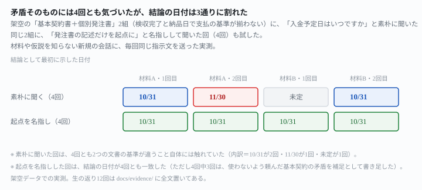
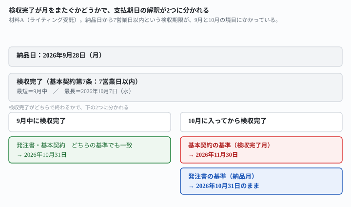

## これで何ができるか {: .what }

副業の契約書と、個別の発注書・発注メールをセットで持っていませんか。<mark>**基本契約書**（検収完了を基準に支払う）と**個別発注書**（納品日を基準に支払う）が、同じ案件の中で**違う基準**を書いていることがあります</mark>。架空の契約書2組（ライティング受託・動画編集受託）でこれを仕込み、AIに「入金予定日はいつですか」とそのまま聞いてみました。

| 聞き方 | 結論として最初に出た日付（4回） | 矛盾そのものへの言及 |
|---|---|---|
| 素朴に「入金予定日はいつですか」 | 10月31日×2・11月30日×1・未定×1 | **4回とも**何らかの形で2つの基準の違いに触れた |
| 「発注書の記述だけを起点に」と名指し | **10月31日×4（全一致）** | 4回中3回は、使わないよう頼んだ基本契約の矛盾を補足として書き足した |

<figure class="figure">

<figcaption>矛盾には4回とも気づいたのに、結論の日付は3通りに割れました。</figcaption>
</figure>

<mark class="warn">矛盾そのものには気づくのに、「結論」として先頭に出す日付は安定しません</mark>。最初の数行だけ読む人は、回によって違う日付を「答え」として受け取ります。<mark>起点をどちらの文書にするか名指しすれば、結論は揃いました</mark>。

📌 **この記事の実測はすべて架空データです。**実在の個人・企業の情報は含みません。材料や仮説を知らない独立した新規会話で、**合計6本の指示文・14回**試しました。生の返りと機械照合は `docs/evidence/due-date-conflict-noticed-but-the-pick-still-flips.md` に全文置いてあります。

## 前提 {: .need }

| | |
|---|---|
| かかる時間 | 15分 |
| 費用 | 無料 |
| 必要なもの | 自分が結んでいる基本契約書（または取引条件）と、個別の発注書・発注メール |
| プログラミング | **不要**。指示文をコピーして、自分の契約条件に書き換えるだけです |

<mark class="warn">発注元がAIの利用を禁じている場合があります</mark>。契約の内容そのものをAIに読ませる前に、規約や指示書で禁じられていないかを確かめてください。この記事は法的な助言ではなく、「AIが契約条件をどう読むか」を確かめた記録です。入金予定日を正式に確定するのは、最終的には発注元への確認です。

## AIへの頼み方 {: .ask }

### 1. まず、素朴に聞いてみる

架空の「基本契約書＋個別発注書」を1組作りました。基本契約は「検収完了後、翌月末日まで」に支払うと定め、発注書は「納品月の翌月末お支払い」と書いています。

- 納品日は2026年9月28日（月）です
- 検収完了は、そこから最長で10月7日までずれる可能性があります
- 9月中に終わるか、10月にずれ込むかで、2つの基準は一致したりしなかったりします

フリーランスとして受けた仕事の契約書と発注書です。入金予定日はいつになりますか。

【基本契約書（抜粋）】
第7条（検収）発注者は、成果物の納品を受けてから7営業日以内に内容を検査し、合格の場合は検収完了とする。
第8条（支払）発注者は、検収完了後、翌月末日までに、受注者の指定する銀行口座へ報酬を振り込むものとする。

【個別発注書（抜粋）】
件名：コラム記事10本制作
納品日：2026年9月28日（月）
支払条件：納品月の翌月末お支払い

同じ指示文を2回試したところ、両方とも矛盾の存在には触れましたが、結論として先頭に出す日付が割れました。

> 1回目:「入金予定日は原則として2026年10月31日（土)になりそうですが……11月末にずれる可能性も残っています」
> 2回目:「入金予定日は2026年11月30日(月)になる可能性が高いです……2つの解釈があり、1か月の差が生じる」

別の架空の動画編集の契約でも同じ質問を2回試しました。基本契約は「検収完了通知後、請求書発行→請求書発行日の翌月末払い」、発注書は「納品日の翌月末」です。

> 1回目:「まとめ：楽観的に見れば10月31日、契約書どおり厳密運用されれば11月30日という2つの可能性があり、どちらか不明確」
> 2回目:「要するに『最速なら10/31、検収に時間がかかれば11/30』という想定」

<mark>4回とも、2つの文書の基準が違うこと自体には触れました。</mark><mark class="warn">ただし「結論」として最初に言う日付は、10月31日が2回、11月30日が1回、どちらとも決めない回が1回で、3通りに割れました。</mark>

<figure class="figure">

<figcaption>検収完了が月をまたぐかどうかが、仕込みの境目です。</figcaption>
</figure>

### 2. 起点を名指しして聞く

フリーランスとして受けた仕事の契約書と発注書です。個別発注書に書かれている支払条件の記述だけを起点として、入金予定日を計算してください。基本契約の検収完了に関する記述は考慮しないでください。

【基本契約書（抜粋）】
第7条（検収）発注者は、成果物の納品を受けてから7営業日以内に内容を検査し、合格の場合は検収完了とする。
第8条（支払）発注者は、検収完了後、翌月末日までに、受注者の指定する銀行口座へ報酬を振り込むものとする。

【個別発注書（抜粋）】
件名：コラム記事10本制作
納品日：2026年9月28日（月）
支払条件：納品月の翌月末お支払い

同じ2つの契約で、合計4回試しました。**4回とも、計算そのものは同じ日付（2026年10月31日）で揃いました。**

> 「結論：入金予定日は2026年10月31日。」
> 「よって、支払条件の文言どおりに読むと入金予定日は2026年10月31日です。」

<mark>起点を名指しすると、結論の日付は4回とも一致しました。</mark>ただし<mark class="warn">4回中3回は、「考慮しないでください」と頼んだ基本契約の矛盾を、頼んでいないのに補足として付け加えました</mark>。「使うな」と言われた情報は計算には使わなくなりますが、注意書きとしては消えません。

### 3. 矛盾があるかどうかを先に聞く

結論を急がず、まず矛盾の有無だけを聞くこともできます。

フリーランスとして受けた仕事の契約書と発注書です。この2つの文書で、入金予定日の基準となる記述は一致していますか。一致していない場合は、どこがどう違うかを具体的に指摘してください。

【基本契約書（抜粋）】
第7条（検収）発注者は、成果物の納品を受けてから7営業日以内に内容を検査し、合格の場合は検収完了とする。
第8条（支払）発注者は、検収完了後、翌月末日までに、受注者の指定する銀行口座へ報酬を振り込むものとする。

【個別発注書（抜粋）】
件名：コラム記事10本制作
納品日：2026年9月28日（月）
支払条件：納品月の翌月末お支払い

1回試したところ、基準点の違い（検収完了日か、納品日か）を正確に名指ししました。「検収期限の7営業日が月をまたぐかどうかがちょうど境界線上にあり」と、今回の仕込みの核心まで言い当てています。<mark>1回だけの結果ですが、聞き方を変えるだけで仕込みの核心に届きました。</mark>

### 4. どちらか一方に決めずに、両方を挙げさせる

フリーランスとして受けた仕事の契約書と発注書です。入金予定日を教えてください。基本契約と発注書で考え方が違う場合は、どちらか一方に決めずに、両方の日付とその理由を挙げてください。

【基本契約書（抜粋）】
第7条（検収）発注者は、成果物の納品を受けてから7営業日以内に内容を検査し、合格の場合は検収完了とする。
第8条（支払）発注者は、検収完了後、翌月末日までに、受注者の指定する銀行口座へ報酬を振り込むものとする。

【個別発注書（抜粋）】
件名：コラム記事10本制作
納品日：2026年9月28日（月）
支払条件：納品月の翌月末お支払い

1回試したところ、2つの基準それぞれで計算した日付（10月31日・11月30日）を、根拠つきでどちらにも決めずに挙げました。**1回だけの結果です**が、冒頭の表の「結論が割れる」という問題そのものを、指示文側で封じる形になっています。

### 5. 請求書発行日が決まったあとも、確かめる

検収完了の連絡を受け、実際に請求書を発行したあとも試しました。

フリーランスとして受けた仕事の契約書と発注書です。検収完了の通知を受けたあと、請求書は2026年10月8日に発行しました。この日付を基準にすると、入金予定日はいつになりますか。

【基本契約書（抜粋）】
第5条（検収）発注者は、成果物の納品を受けてから10営業日以内に内容を確認し、合格の場合は検収完了の通知を受注者に行う。
第6条（支払）発注者は、受注者が発行する請求書に基づき、請求書発行日の翌月末日までに報酬を支払う。受注者は、検収完了の通知を受けてから速やかに請求書を発行するものとする。

【個別発注書（抜粋）】
件名：YouTube動画編集（5本）
納品日：2026年9月24日（木）
お支払いについて：納品日の翌月末にお支払いします

1回試したところ、基本契約の基準（請求書発行日起点）で正しく11月30日と計算しました。そのうえで<mark>頼んでいないのに「個別発注書を基準にすると10月31日になり、まったく別の支払期日が出てきます」と自分から指摘しました</mark>。具体的な日付を1つ与えても、**「どちらの文書が優先するか」という矛盾そのものは消えません**。

### 6. 毎回の形式を固定する

契約書と発注書のセットを毎回渡すなら、出力の形式を先に決めておけます。

これから毎回、契約書と発注書をセットで渡します。入金予定日と、その計算で使った起点（検収完了／請求書発行／納品日のどれか）を、必ずセットで出力してください。基本契約と発注書で起点の記述が異なる場合は、両方の日付を出し、どちらを優先すべきか確認が必要だと明記してください。

【基本契約書（抜粋）】
第7条（検収）発注者は、成果物の納品を受けてから7営業日以内に内容を検査し、合格の場合は検収完了とする。
第8条（支払）発注者は、検収完了後、翌月末日までに、受注者の指定する銀行口座へ報酬を振り込むものとする。

【個別発注書（抜粋）】
件名：コラム記事10本制作
納品日：2026年9月28日（月）
支払条件：納品月の翌月末お支払い

1回試したところ、起点を明記した表形式で両方の日付を出し、「どちらの起点規定を優先するか」を確認事項として明記しました。手順3・4の言い方を1つの出力形式に合体させた形です。

## うまくいかないときの言い直し方 {: .fix }

### 「結論」だけ読んで、そのまま信じてしまった {: .trouble }

手順1のとおり、素朴に聞いた結論は回によって違う日付になります。<mark class="warn">同じ指示文を2回試して同じ答えが返っても、3回目・4回目も同じとは限りません</mark>。入金予定日のように後で食い違うと困る数字は、手順2（起点を名指し）か手順4（両方を挙げさせる）の形で聞き直してください。

### 契約書と発注書、どちらが優先するか分からない {: .trouble }

この記事の実測では、どの回も「基本契約と発注書のどちらが優先するか」を契約書の抜粋だけからは決められませんでした。発注者への確認を勧める回がほとんどです。<mark>AIに聞いても、優先関係の条文が無ければ答えは出ません</mark>。手順3の聞き方で矛盾を洗い出したら、その一覧を発注者への確認メールの材料にしてください。

### この記事が実測していないこと {: .trouble }

試したのは「2つの文書に別々の基準が書かれている」という形だけです。[「中5営業日」の納期をAIに計算させる](/recipes/deadline-count-needs-holiday-list/)で確かめたのは逆の形でした。あちらは**情報そのものが欠けている**（休みの日付を渡していない）ときに、AIがどう埋めるかを見ています。今回のように**矛盾する情報が両方「見えている」**ときは違いました。黒だまりで選ぶのではなく、矛盾への言及自体はしています。ただし結論の日付が安定しないという、別の崩れ方でした。契約書が1つの文書の中だけで矛盾している場合（条文どうしの食い違い）は、この記事では試していません。

## 応用・次の一手 {: .next }

この記事で分かったのは、**矛盾を見つける力と、結論を安定させる力は別**だということです。入金予定日のように後でトラブルになりうる数字は、手順1の素朴な聞き方で済ませないでください。手順2（起点を名指し）か、手順6（形式を固定する）まで進めてください。

この作業を、毎週決まった時刻に自動で実行できるようにしたいです。

私はプログラムを書けません。何が必要になるか、私がやる作業を番号を振って書いてください。作れるものはあなたが作ってください。

ここから先は[「毎日決まった時刻に自動でやっておいて」をAIに作らせる](/recipes/github-actions-daily-cron/)に続きます。毎月の案件が増えてきたら、[副業の手取りを、契約額から出す](/recipes/take-home-from-the-contract-amount/)で手数料を引いた実際の受取額まで計算させられます。副業のお金の流れ全体を見るなら、[副業のお金は3つの流れで届く](/tools/money-map-three-routes/)も合わせて読んでください。
