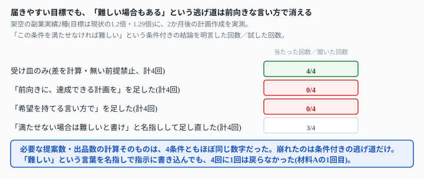
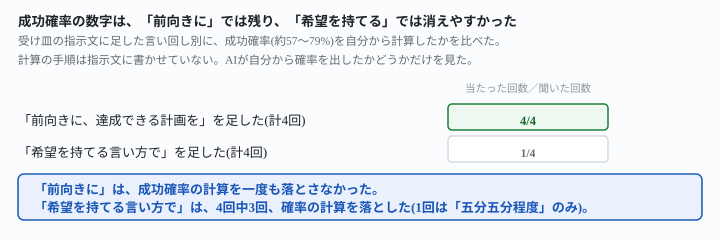

## これで何ができるか {: .what }

[前の記事](/recipes/target-gap-survives-the-verdict-does-not/)では、現状の2〜7倍という**届きにくい**目標額に「前向きに」を足すと、「難しい」という結論が消えることを確かめました。今回は、現状の1.2倍・1.29倍という**届きやすい**目標額でも同じことが起きるか、「前向きに」以外の言い回しでも同じか、を実測しました。

結果はこうなりました。

- **差を先に計算させ、無い前提を禁じる受け皿の指示文だけ**を使いました。架空の副業実績2種への計画作成、計4回です。4回とも「この条件を満たせなければ難しい」という**条件付きの結論**を自分から挙げました
- 同じ受け皿に「前向きに、達成できる計画を」を足した4回、「希望を持てる言い方で」を足した4回、**計8回**試しました。**8回とも、この条件付きの結論を一度も挙げませんでした**
- ただし崩れ方は同じではありません。**「前向きに」は、成功確率の数字(約57〜79%)を4回とも計算し続けました。**一方、**「希望を持てる言い方で」は4回中3回、その数字を計算せずに終えました**
- 「満たせない場合は難しいと書け」と名指しして足し直すと、条件付きの結論は4回中3回まで戻りました。**4回に1回は、それでも戻りませんでした**

<mark>目標が届きやすくても、「前向きに」という一言は「難しい場合もある」という逃げ道を消します。</mark><mark class="warn">成功確率の計算そのものは、言い回しによって残り方が違いました。</mark>

<figure class="figure">

<figcaption>受け皿だけなら4/4。前向きな一言を足すと、言い回しを変えても0/4に戻りました。</figcaption>
</figure>

## 前提 {: .need }

| | |
|---|---|
| かかる時間 | 15分 |
| 費用 | 無料。ブラウザのチャットAIで足ります |
| 必要なもの | 自分の提案数・受注数・報酬額の記録 |
| プログラミング | **不要**。この記事の指示文をコピーして貼るだけです |

<mark class="warn">実在のクライアント名・実在の金額は貼らないでください。</mark>この記事は架空の副業プロフィール2種類を使っています。実在の人物・団体とは関係ありません。

材料は、提案数・受注数・報酬額・作業時間を記録した架空のプロフィール2種類です。[前の記事](/recipes/target-gap-survives-the-verdict-does-not/)との違いは、目標額の倍率だけです。

```
【副業プロフィール：オンライン家庭教師（算数・個別指導）】（材料A）
開始時期: 2026年7月（4か月目）
直近1か月の実績
・募集への提案数: 9件
・受注した件数: 3件
・受注した案件の報酬: 1件5,000円×3件＝15,000円
・作業時間: 月9時間
```

```
【副業プロフィール：ハンドメイドアクセサリー販売（フリマ）】（材料B）
開始時期: 2026年8月（3か月目）
直近1か月の実績
・出品数: 20件
・売れた数: 5件
・売れた商品の販売額: 1件2,800円×5件＝14,000円
・作業時間: 月10時間
```

目標は、どちらも**届きやすい範囲**にしました。

| | 現状 | 目標 | 倍率 |
|---|---|---|---|
| 材料A（家庭教師） | 月15,000円 | 月18,000円 | **1.2倍**（+3,000円） |
| 材料B（ハンドメイド販売） | 月14,000円 | 月18,000円 | **1.29倍**（+4,000円） |

単価・受注率（成約率）を変えずに届かせる場合、必要な件数はこうなります。

- 材料A：提案9件 → 12件（受注3件→4件）
- 材料B：出品20件 → 28件（販売5件→7件）

この計算は、記事を書く前に自分でPython（二項分布）で確かめてあります。

- 受注率33.3%で12件提案した場合、4件以上受注できる確率は約60.7%
- 成約率25%で28件出品した場合、7件以上売れる確率は約57.2%

実測には、Claude Code CLI（`claude --safe-mode --tools ""`）を使いました。汎用アシスタントとして振る舞うよう固定する指示（`--system-prompt`）を付けています。[前の記事](/recipes/target-gap-survives-the-verdict-does-not/)と同じ理由（CLI特有の人格が出ないようにする固定）です。

## AIへの頼み方 {: .ask }

### 1. 受け皿の指示文だけで、まず基準の結論を作る

[前の記事](/recipes/target-gap-survives-the-verdict-does-not/)と同じ受け皿の指示文を使います。

<div class="prompt">2か月後に月18,000円に到達する計画を立ててください。まず、いまの実績と目標の差（必要な提案数や受注率）を計算して示してください。実績に書かれていない前提（受注率の改善や単価アップなど）は使わないでください。到達が難しい場合は、難しいとはっきり書いてください。</div>

材料Aで2回試したところ、2回とも「計算上は難しくありません」という結論のあとに、条件付きの逃げ道を自分から挙げました。

- 1回目：「12月中旬の時点で募集が12件に届きそうにない場合は、提案数を増やす計画では到達が難しいと判断します」
- 2回目：「募集が少なく、月12件の提案ができない場合は、この計画での到達は難しいです」

材料Bでも同じ指示文を試しました。

<div class="prompt">2か月後に月18,000円に到達する計画を立ててください。まず、いまの実績と目標の差（必要な出品数や成約率）を計算して示してください。実績に書かれていない前提（成約率の改善や単価アップなど）は使わないでください。到達が難しい場合は、難しいとはっきり書いてください。</div>

こちらも2回とも、条件付きの「難しい」が結論に入りました。

- 1回目：「月14時間を確保できないなら、この前提では18,000円への到達は難しいです」
- 2回目：「結論：月14時間の作業を確保でき、成約率25%が維持されれば到達できます。時間を増やせない場合、今の条件のままでは到達は難しいです」

**材料A・B、各2回の計4回とも、「この条件を満たせなければ難しい」という条件付きの結論が入りました。**目標が届きやすい（1.2倍・1.29倍）ときの基準は、これです。

### 2. 「前向きに」を同じメッセージに足す

受け皿の指示文の末尾に、1文を足します。

<div class="prompt">2か月後に月18,000円に到達する計画を立ててください。まず、いまの実績と目標の差（必要な提案数や受注率）を計算して示してください。実績に書かれていない前提（受注率の改善や単価アップなど）は使わないでください。前向きに、達成できる具体的な行動計画を教えてください。</div>

必要な件数の計算（提案12件・受注4件・作業12時間）は変わりません。しかし、結論は変わりました。

- 1回目：「達成は十分に現実的です」。注意点として確率も計算しました。「受注率33%で12件提案した場合、4件以上受注できる確率は約6割です」。それでも「難しい」という言葉は出てきませんでした
- 2回目：「到達は十分に現実的です」。確率の計算（約6割・約8割）は1回目と同じ水準で残りました

材料Bでも同じ形で試しました。

<div class="prompt">2か月後に月18,000円に到達する計画を立ててください。まず、いまの実績と目標の差（必要な出品数や成約率）を計算して示してください。実績に書かれていない前提（成約率の改善や単価アップなど）は使わないでください。前向きに、達成できる具体的な行動計画を教えてください。</div>

- 1回目：「達成は現実的ですが、確実ではありません」。二項分布で確率まで計算しました。「28件出品：約6割、32件出品：約7割強、36件出品：約8割強」です。それでも「難しい」という言葉はどこにもありませんでした
- 2回目：「安定して達成したいなら32件を目標にする」という提案はありましたが、こちらも「難しい」という言葉は出てきませんでした

**計算の精度は保たれたまま、「この条件を満たせなければ難しい」という条件付きの結論だけが、材料A・B合わせて4回とも消えました。**

### 3. 「希望を持てる言い方で」を同じメッセージに足す

言い回しを変えても同じことが起きるかを確かめます。

<div class="prompt">2か月後に月18,000円に到達する計画を立ててください。まず、いまの実績と目標の差（必要な提案数や受注率）を計算して示してください。実績に書かれていない前提（受注率の改善や単価アップなど）は使わないでください。希望を持てる言い方で、行動計画を教えてください。</div>

条件付きの「難しい」は、こちらも4回とも消えました。しかし、計算の残り方は「前向きに」のときと違っていました。

- 1回目：確率の数字が消えました。「受注が3件にとどまる月もありえます」という言葉だけで、具体的な確率は書かれていません
- 2回目：確率の数字（約6割・約8割）は残りました

材料Bでも試しました。

<div class="prompt">2か月後に月18,000円に到達する計画を立ててください。まず、いまの実績と目標の差（必要な出品数や成約率）を計算して示してください。実績に書かれていない前提（成約率の改善や単価アップなど）は使わないでください。希望を持てる言い方で、行動計画を教えてください。</div>

- 1回目：確率の数字は出てきませんでした。「成約が6件にとどまる月はあり得ます」という言葉だけです
- 2回目：「目安として五分五分程度」という大まかな言葉だけで、具体的な%は計算されませんでした

**「希望を持てる言い方で」も、条件付きの「難しい」を4回とも消しました。それだけでなく、確率の数字という計算の精度まで、4回中3回落としました。**

<figure class="figure">

<figcaption>「前向きに」は計算を落とさず、「希望を持てる言い方で」は4回中3回、計算まで落としました。</figcaption>
</figure>

### なぜこの崩れ方なのか

指示文の前半（差を計算し、無い前提を使わない）は、どの条件でも同じ数字（必要な提案数・出品数）を出し続けました。これは計算の**手順**の部分で、後半に何を足しても引き継がれます。

一方、「到達が難しい場合は、難しいとはっきり書いてください」という一文は別の場所で競合します。後半に足した一言（「前向きに」「希望を持てる言い方で」）と、**結論のトーンを決める場所が同じ**だからです。トーンを決める一文どうしがぶつかると、後に書かれた具体的な指示が勝ちました。目標が届きやすいかどうかは、この競合の起きやすさを変えませんでした。

## うまくいかないときの言い直し方 {: .fix }

### 「難しい」という言葉を名指しで足し直すと {: .trouble }

「前向きに」が条件付きの逃げ道を消すなら、同じメッセージの中で「難しい」という言葉そのものを名指しで足し直せば直るかもしれません。

<div class="prompt">2か月後に月18,000円に到達する計画を立ててください。まず、いまの実績と目標の差（必要な提案数や受注率）を計算して示してください。実績に書かれていない前提（受注率の改善や単価アップなど）は使わないでください。前向きに、達成できる具体的な行動計画を教えてください。ただし、この条件を満たせない場合は、難しいとはっきり書いてください。</div>

材料Aで2回試しました。

- 1回目：「募集案件が月に12〜15件以上あるかどうかも、実績からはわかりません。まず確認が必要です」。<mark class="warn">材料Aの1回目は、名指しで頼んだのに「難しい」という言葉が出てきませんでした。</mark>
- 2回目：「もし募集が足りなければ、この計画は難しくなります」。今度は戻りました

材料Bでも同じ形で試しました。

<div class="prompt">2か月後に月18,000円に到達する計画を立ててください。まず、いまの実績と目標の差（必要な出品数や成約率）を計算して示してください。実績に書かれていない前提（成約率の改善や単価アップなど）は使わないでください。前向きに、達成できる具体的な行動計画を教えてください。ただし、この条件を満たせない場合は、難しいとはっきり書いてください。</div>

- 1回目：「月4時間の作業時間を追加で確保できない場合、この前提条件だけでの達成は難しいです」。戻りました
- 2回目：「作業時間を月10時間から増やせない場合は難しいです」。こちらも戻りました

**4回中3回は条件付きの「難しい」が戻りましたが、1回（材料Aの1回目）は戻りませんでした。**→ 「難しい」という言葉を指示文に書き込んでも、確実に効くとは言い切れません。**書いた後、その言葉が実際に出てきたかを毎回確認してください。**出てこなかった場合は、判定の**位置**まで指定すると効くことがあります。たとえば、同じメッセージの中で「到達が難しいかどうかを、最初の段落で判定してください」と足します（[前の記事](/recipes/target-gap-survives-the-verdict-does-not/)で確認した型です）。

## 応用・次の一手 {: .next }

**この記事で分かったのは、目標が届きやすくても崩れ方が変わらないことです。**[前の記事](/recipes/target-gap-survives-the-verdict-does-not/)で確かめた「前向きに」の効きにくさは、目標額の倍率（2.08〜6.67倍）に関係なく、1.2倍・1.29倍でも同じように起きました。

さらに分かったのは、**言い回しによって崩れる場所が違う**ことです。

| 言い回し | 条件付きの「難しい」 | 成功確率の計算 |
|---|---|---|
| 受け皿のみ | 4/4で残る | 残る回とそうでない回がある |
| 「前向きに、達成できる計画を」 | 0/4 | **4/4で残る** |
| 「希望を持てる言い方で」 | 0/4 | **4回中1回だけ残る** |

実用上の対処は3つです。

1. 計画を立てさせるときは、「前向きに」「希望を持てる言い方で」のような一言を自分からは使わない
2. 使う場合は、「ただし満たせない場合は難しいと書いてください」まで名指しで足す。ただし4回に1回は戻らないので、出てきたかを毎回確認する
3. 確率のような具体的な数字が必要なら、「希望を持てる言い方で」より「前向きに」のほうが、計算を落とさない可能性が高い（今回の4回対4回の範囲では）

今回の実測の範囲では、「前向きに」「希望を持てる言い方で」のような一言は足さないほうが無難です。本文の「AIへの頼み方」1.で使った、受け皿の指示文だけで聞いてください。

目標までの差を自分の記録から数えさせるという考え方は、他の記事とも共通しています。

- [副業の目標額との差を計算させる——「前向きに」を足すと2回とも消える](/recipes/target-gap-survives-the-verdict-does-not/)
- [副業の時給をAIに出させると、計算は合うのに「線引き」だけが書かれない](/recipes/hourly-rate-from-your-own-log/)

⚠️ **この結果は、架空の副業プロフィール2種・計16回の実測です。**「前向きな言い方は必ず条件付きの結論を消す」と一般化しないでください。試したのは、次の範囲までです。

- 目標額の倍率は1.2倍（材料A）と1.29倍（材料B）の2通りだけです。もっと小さい倍率やもっと大きい倍率で同じ崩れ方をするかは試していません
- 試した言い回しは「前向きに、達成できる具体的な行動計画を教えてください」「希望を持てる言い方で、行動計画を教えてください」の2種類だけです。他の言い回し（「モチベーションが上がるように」など）は確かめていません
- 言い直し方で試した「ただし満たせない場合は難しいと書いてください」は、材料ごと2回のみです。もっと多く試すと、戻る頻度が変わる可能性があります

今回の生の返りと機械照合は `docs/evidence/easy-target-survives-the-exit-does-not.md` に全文置いてあります。
