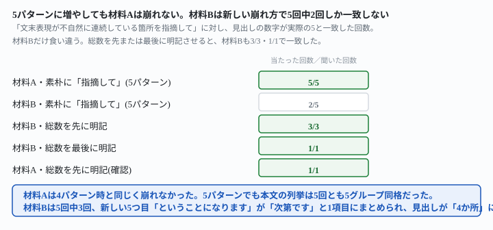
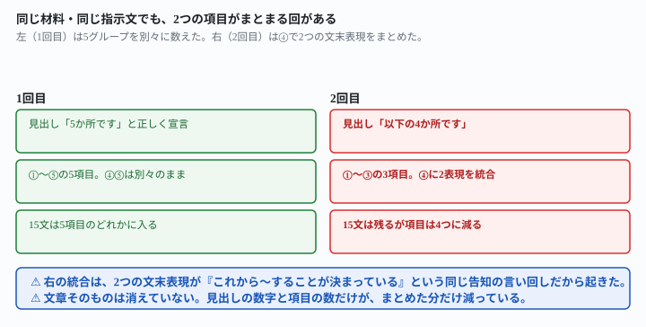

## これで何ができるか {: .what }

[前の記事](/recipes/headline-count-slips-at-four-patterns/)では、文末表現が不自然に連続している箇所を「指摘して」と頼んだときの崩れ方を調べました。パターンを3つから4つに増やしても、崩れ方は悪化しませんでした。今回はパターンをさらに5つに増やし、新しく足した表現が既存の表現と意味が近いときに何が起きるかを調べます。

結論を先に書きます。

| 条件 | 材料 | 見出しの数字が実際の5と一致した回数 |
|---|---|---|
| 素朴に「指摘して」 | 材料A（清掃当番・5パターン） | 5/5 |
| 素朴に「指摘して」 | 材料B（備品発注・5パターン） | **2/5** |
| 総数を先に明記させる | 材料B | 3/3 |
| 総数を最後に明記させる | 材料B | 1/1 |
| 総数を先に明記させる（確認） | 材料A | 1/1 |

<mark>材料Aは5パターンに増やしても崩れませんでした。5回とも「5か所」と正しく数え、本文も5グループ同格に並びました。</mark><mark class="warn">材料Bは5回中3回、見出しが「4か所」になりました。原因は本文の列挙が減ったのではありません。新しく足した「ということになります」が、既存の「次第です」と同じ項目にまとめられていました。両方とも「これから〜することが決まっている」という告知の言い回しで、意味が近いためです。</mark><mark>総数を先または最後に明記させる言い方に変えると、材料Bも4回とも一致しました。</mark>

<figure class="figure">

<figcaption>材料Aは崩れない。材料Bは新しい崩れ方で5回中2回しか一致しませんでした。</figcaption>
</figure>

## 前提 {: .need }

| | |
|---|---|
| かかる時間 | 15分 |
| 費用 | 無料。ブラウザのチャットAIで足ります |
| 必要なもの | 直したい文章（下書き）1本 |
| プログラミング | **不要**。この記事の指示文をコピーして貼るだけです |

<mark class="warn">発注者の原稿や実在の人物が書いた文章は、そのまま貼らないでください。</mark>この記事は架空の下書きを使っています。実在の人物・団体とは関係ありません。

この記事は[前の記事](/recipes/headline-count-slips-at-four-patterns/)・[その前の記事](/recipes/other-patterns-get-named-but-not-counted/)の続編です。AI生成文章の検品という副業区分の全体は[発注書どおりに検品する記事](/recipes/writing-check-against-spec/)も参考にしてください。

<mark class="warn">この実測には、このサイト（ai-tsukaikata）のプロジェクトを動かしている環境の文脈が一部伝わっています。</mark>「素のAIは必ずこう返す」とは一般化せず、ここに書いた数字（n回中n回）だけを根拠にしてください。

## AIへの頼み方 {: .ask }

### 1. 5パターンに増やした下書きで試す（材料A）

清掃当番メモを前作の28文から35文に拡張し、文末パターンを4つから5つに増やしました。新しく足したのは「〜ということになります」です。それぞれ3文連続で仕込み、間に4文ずつ無関係な業務連絡を挟んでいます。

<div class="prompt">次の文章で、文末表現が不自然に連続している箇所があれば指摘してください。

今月から清掃当番のやり方を少し変更します。新しい担当表は来週から適用されるでしょう。初めての方は戸惑うこともあるでしょう。分からないことがあれば先輩に聞くとよいでしょう。当番は月曜から金曜まで、1日ずつ交代で担当します。担当の順番は五十音順です。休んだ場合は翌週に繰り越します。道具は給湯室の棚にまとめてあります。今回の変更で、作業時間も短くなると思います。午前中に済ませたほうが楽だと思います。慣れれば5分程度で終わると思います。雑巾は使ったら、洗って干しておいてください。スプレーのつけ替えは総務へ一声かけること。鍵は守衛室で借りるようにしてください。忘れ物は週末にまとめて片付けます。ゴミ袋がいっぱいになったら新しいものに交換するのです。拭き掃除には乾いた布を使うのです。最後に窓を少し開けて換気をするのです。掃除用のスプレーは共用のものを使います。終わったらチェック表に印を付けてください。椅子は机の下にしまうこと。電気はブレーカーごと確認してください。来月からは当番表を掲示板にも貼る次第です。連絡はチャットでも行う次第です。質問は当番リーダーに聞く次第です。新しい担当者には個別に説明します。不明点は月初のミーティングで共有してください。トイレの消耗品は週明けに補充します。靴置き場も整理をお願いします。今回の見直しで、掃除の負担は均等になるということになります。当番の交代は前日までに連絡するということになります。道具の破損は速やかに報告するということになります。休憩室の利用ルールは別紙に掲示します。点検は月末にまとめて行います。引き続きよろしくお願いします。</div>

5回試した結果です。

| 回 | 見出しの数字 | 本文の列挙 |
|---|---|---|
| 1〜5回目すべて | 「5か所」と正しく宣言 | でしょう・と思います・のです・次第です・ということになります の5グループが同格に列記 |

**5回中5回、見出しの数字も本文の列挙も5と一致しました。**4パターン時と同じく、材料Aではこの崩れ方は再発しませんでした。

### 2. 別の題材でも同じか（材料B）

備品発注の引き継ぎメモで、同じ構成（35文・5パターン・間に4文ずつ）の別の材料を作りました。内容は違いますが、パターンの仕込み方は材料Aと同じです。

<div class="prompt">次の文章で、文末表現が不自然に連続している箇所があれば指摘してください。

来月から備品発注の担当をあなたに引き継ぎます。発注書は毎月25日までに提出するとよいでしょう。在庫が少ない品目は早めに注文したほうがよいでしょう。急な欠品は業者に直接連絡するとよいでしょう。発注先の一覧は共有フォルダに置いてあります。見積もりは2社以上から取ってください。支払いは月末締めの翌月払いです。承認は部長の決裁が必要です。今回から発注フォームを簡略化できると思います。これで入力の手間も減ると思います。ミスも少なくなると思います。新しいフォームのリンクはメールで送ります。旧フォームは今月末で廃止します。質問があれば総務課に聞いてください。マニュアルは社内wikiに置いてあります。消耗品は在庫表で毎週確認するのです。文房具は各部署からの申請を集めるのです。大型の備品は別の承認フローを通すのです。配送は週2回、火曜と金曜です。受け取りは受付で対応します。破損品はすぐに写真を撮っておいてください。返品の連絡は発注書の番号を伝えてください。来月からは発注の承認もオンラインで行う次第です。紙の申請書は廃止する次第です。印鑑も不要になる次第です。引き継ぎ資料は別途お送りします。不明な点はいつでも聞いてください。倉庫の鍵は防災センターで借ります。棚の整理は四半期ごとに行います。緊急発注の場合は課長の口頭承認で先行するということになります。発注ミスがあった場合は発注者本人が業者に訂正を連絡するということになります。年度末の発注は締め日が1週間早まるということになります。伝票の控えはファイルにまとめて保管してください。来年度の予算要望は10月に取りまとめます。よろしくお願いします。</div>

5回試した結果です。

| 回 | 見出しの数字 | 本文の列挙 |
|---|---|---|
| 1回目 | 「5か所」 | ①②③④⑤の5グループが同格に列記 |
| 2回目 | 「4か所」 | ①②③の3グループ＋④に「次第です」と「ということになります」をまとめて1グループとして記載 |
| 3回目 | 「4か所」 | 同様に、④として2つの表現を1グループにまとめて記載 |
| 4回目 | 「4か所」 | 同様（インラインの列挙だが、2つの表現を1つの括りで言及） |
| 5回目 | 「5か所」 | ①②③④⑤の5グループが同格に列記 |

<mark class="warn">材料Bでは、5回中3回（2・3・4回目）が見出しで「4か所」と宣言しました。</mark>本文では「次第です」と「ということになります」を1つの項目にまとめていました。2回目の実際の言葉は次のとおりです。

```
不自然な文末の連続は、以下の4か所です。（…）4. 今後の予定・決定事項を告げる文末（次第です/ということになります）：23-25文目と30-32文目で、「次第です」「ということになります」がそれぞれ3文連続しています。どちらも『これから〜することになっている』という同じ告知の言い回しなので、まとめて1つの傾向として扱いました。
```

**15文はどの回も本文のどこかに書かれていて、消えてはいません。**まとめられて、項目の「数」だけが減っています。前作（4パターン時）に見つかった崩れ方は2種類でした。

- 本文のリストそのものが減る
- 本文は無傷で見出しの数字だけ誤る

今回はそのどちらとも違う、**3つ目の崩れ方**です。

<figure class="figure">

<figcaption>同じ材料・同じ指示文でも、2つの項目がまとまる回がありました。</figcaption>
</figure>

### なぜ材料Bだけ崩れるのか

材料Aの5パターンは、文末の形も意味もそれぞれ独立しています（感想・推量・説明・宣言・決定事項の告知）。材料Bで新しく足した5つ目「ということになります」は、既存の4つ目「次第です」と**文末の形は違っても、意味はほぼ同じ**です。どちらも「これから〜することが決まっている」という告知を表します。AIが「同じ指摘を2回繰り返すより、1つにまとめたほうが読みやすい」と判断すると、数字も項目数もその分だけ減るようです。<mark>意味が近い2つのパターンを両方仕込むと、材料によっては「見落とす」のではなく「まとめる」形で数が減ることがあります。</mark>

## うまくいかないときの言い直し方 {: .fix }

### 総数を明記させると、この崩れ方も消えるか {: .trouble }

前作・前々作と同じ言い直し方——見つかった総数を先に明記させる言い方——を、材料Bで試しました。

<div class="prompt">次の文章で、文末表現が不自然に連続している箇所をすべて洗い出してください。見つかった箇所の総数を、回答の最初に明記してください。

来月から備品発注の担当をあなたに引き継ぎます。発注書は毎月25日までに提出するとよいでしょう。在庫が少ない品目は早めに注文したほうがよいでしょう。急な欠品は業者に直接連絡するとよいでしょう。発注先の一覧は共有フォルダに置いてあります。見積もりは2社以上から取ってください。支払いは月末締めの翌月払いです。承認は部長の決裁が必要です。今回から発注フォームを簡略化できると思います。これで入力の手間も減ると思います。ミスも少なくなると思います。新しいフォームのリンクはメールで送ります。旧フォームは今月末で廃止します。質問があれば総務課に聞いてください。マニュアルは社内wikiに置いてあります。消耗品は在庫表で毎週確認するのです。文房具は各部署からの申請を集めるのです。大型の備品は別の承認フローを通すのです。配送は週2回、火曜と金曜です。受け取りは受付で対応します。破損品はすぐに写真を撮っておいてください。返品の連絡は発注書の番号を伝えてください。来月からは発注の承認もオンラインで行う次第です。紙の申請書は廃止する次第です。印鑑も不要になる次第です。引き継ぎ資料は別途お送りします。不明な点はいつでも聞いてください。倉庫の鍵は防災センターで借ります。棚の整理は四半期ごとに行います。緊急発注の場合は課長の口頭承認で先行するということになります。発注ミスがあった場合は発注者本人が業者に訂正を連絡するということになります。年度末の発注は締め日が1週間早まるということになります。伝票の控えはファイルにまとめて保管してください。来年度の予算要望は10月に取りまとめます。よろしくお願いします。</div>

**3回とも「5か所」と正しく宣言し、「次第です」と「ということになります」も別の項目として列記しました。**材料Bで5回中3回出ていた統合は消えました。

念のため、総数を**最後に**明記させる言い方も試しました。

<div class="prompt">次の文章で、文末表現が不自然に連続している箇所をすべて洗い出してください。見つかった箇所の総数は、最後にまとめて明記してください。

来月から備品発注の担当をあなたに引き継ぎます。発注書は毎月25日までに提出するとよいでしょう。在庫が少ない品目は早めに注文したほうがよいでしょう。急な欠品は業者に直接連絡するとよいでしょう。発注先の一覧は共有フォルダに置いてあります。見積もりは2社以上から取ってください。支払いは月末締めの翌月払いです。承認は部長の決裁が必要です。今回から発注フォームを簡略化できると思います。これで入力の手間も減ると思います。ミスも少なくなると思います。新しいフォームのリンクはメールで送ります。旧フォームは今月末で廃止します。質問があれば総務課に聞いてください。マニュアルは社内wikiに置いてあります。消耗品は在庫表で毎週確認するのです。文房具は各部署からの申請を集めるのです。大型の備品は別の承認フローを通すのです。配送は週2回、火曜と金曜です。受け取りは受付で対応します。破損品はすぐに写真を撮っておいてください。返品の連絡は発注書の番号を伝えてください。来月からは発注の承認もオンラインで行う次第です。紙の申請書は廃止する次第です。印鑑も不要になる次第です。引き継ぎ資料は別途お送りします。不明な点はいつでも聞いてください。倉庫の鍵は防災センターで借ります。棚の整理は四半期ごとに行います。緊急発注の場合は課長の口頭承認で先行するということになります。発注ミスがあった場合は発注者本人が業者に訂正を連絡するということになります。年度末の発注は締め日が1週間早まるということになります。伝票の控えはファイルにまとめて保管してください。来年度の予算要望は10月に取りまとめます。よろしくお願いします。</div>

**この回も「5か所」と正しく宣言し、5グループとも別の項目として列記しました。**→ 前作と同じく、**効いているのは「先に」でも「最後に」でもなく、「総数を数字で明記させる」という指示そのものです。**この指示は、2つの文末表現が意味的に似ているときの統合も、崩れたままにしませんでした。

もともと崩れていなかった材料Aでも、同じ言い方で変化が無いかを確認しました。

<div class="prompt">次の文章で、文末表現が不自然に連続している箇所をすべて洗い出してください。見つかった箇所の総数を、回答の最初に明記してください。

今月から清掃当番のやり方を少し変更します。新しい担当表は来週から適用されるでしょう。初めての方は戸惑うこともあるでしょう。分からないことがあれば先輩に聞くとよいでしょう。当番は月曜から金曜まで、1日ずつ交代で担当します。担当の順番は五十音順です。休んだ場合は翌週に繰り越します。道具は給湯室の棚にまとめてあります。今回の変更で、作業時間も短くなると思います。午前中に済ませたほうが楽だと思います。慣れれば5分程度で終わると思います。雑巾は使ったら、洗って干しておいてください。スプレーのつけ替えは総務へ一声かけること。鍵は守衛室で借りるようにしてください。忘れ物は週末にまとめて片付けます。ゴミ袋がいっぱいになったら新しいものに交換するのです。拭き掃除には乾いた布を使うのです。最後に窓を少し開けて換気をするのです。掃除用のスプレーは共用のものを使います。終わったらチェック表に印を付けてください。椅子は机の下にしまうこと。電気はブレーカーごと確認してください。来月からは当番表を掲示板にも貼る次第です。連絡はチャットでも行う次第です。質問は当番リーダーに聞く次第です。新しい担当者には個別に説明します。不明点は月初のミーティングで共有してください。トイレの消耗品は週明けに補充します。靴置き場も整理をお願いします。今回の見直しで、掃除の負担は均等になるということになります。当番の交代は前日までに連絡するということになります。道具の破損は速やかに報告するということになります。休憩室の利用ルールは別紙に掲示します。点検は月末にまとめて行います。引き続きよろしくお願いします。</div>

**「5か所」のまま、変化はありませんでした。**元から崩れていなかった材料は、言い方を変えても後退しません。

## 応用・次の一手 {: .next }

パターンの種類が増え、意味が近い表現どうしがまとまってしまうときの、自分での見直し方も聞いておきました。

<div class="prompt">AIに「下書きの中で文末表現が不自然に連続している箇所を指摘して」と頼むと、見出しで言った件数と、実際に指摘した項目数が食い違うことがあります。パターンの種類が増えると、意味が似ている文末表現(たとえば「次第です」と「ということになります」)が1つの項目にまとめられてしまうこともあるようです。これを自分で見落とさずに確認するコツを教えてください。プログラミングはできません。</div>

2回試したところ、どちらも同じ方向の答えでした。

- **見出しの数字は信用せず、本文に並んだ項目を指でなぞって数え直す**
- **項目の中に「と」「・」「／」で2つ以上の言い回しが並んでいないか確認する。**1項目に見えて、実は2つがまとめられていることがあります
- 件数が一致しないときは「1項目ずつ分けて数え直してください」と聞き返す（1回目）
- 最初から「件数を言わず、見つけた表現をすべて別の項目として列挙して」と頼む方法も提案された（2回目）

副業のライティングで文体・検品を扱う他の記事として、[誤字と冗長さだけ直させて言い回しには触らせない記事](/recipes/fix-typos-not-voice/)も参考にしてください。

⚠️ **この結果は、架空の下書き2本・計17回（素朴な指示10回・総数を明記させる指示5回・応用2回）での実測です。**「5パターンに増やすと必ずまとめられる」と一般化しないでください。試したのは、次の範囲までです。

- 文末パターンは「〜でしょう」「〜と思います」「〜のです」「〜という次第です」「〜ということになります」の5種のみです。6つ以上に増やした場合は試していません
- まとめられたのは、意味が近い2つの表現（次第です／ということになります）どうしでした。意味の近さが無い5パターンの組み合わせでも同じことが起きるかは確かめていません
- 1本の下書きの長さは35文です。材料は2本のみです

今回の生の返りは `docs/evidence/fifth-pattern-merges-with-a-lookalike.md` に全文置いてあります。
