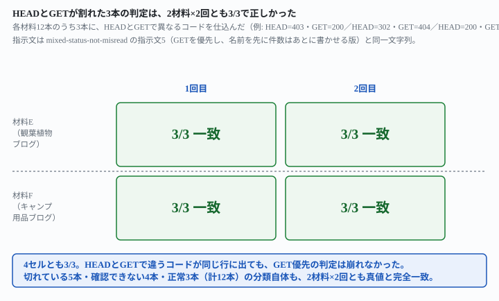
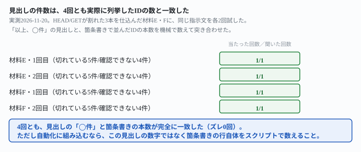

## これで何ができるか {: .what }

[500番台を混ぜても基準は変わらない記事](/recipes/mixed-status-not-misread/)は、最後にこう書いて終わっています。

「リンクの本数がもっと多い場合や、1本のリンクで複数のコードが混在する場合にも同じ結果になるかは、まだ確かめていません」。ここでの「複数のコードが混在する場合」とは、HEADとGETで違うコードが返ることです。

この記事はその宿題に答えます。**1本のリンクで、HEADとGETが違うコードを返す場合**です。

結論を先に書きます。

| 確かめたこと | 結果 |
|---|---|
| HEAD/GETが一致する9本の分類（真値との一致） | 2材料×2回＝4回とも12本中9本が真値と一致 |
| HEAD/GETが**不一致**の3本の分類（真値との一致） | 2材料×2回＝4回とも3本とも真値と一致 |
| 見出しの「以上◯件」と、実際に並べたIDの本数 | 4回とも完全一致（ズレ0回） |

<figure class="figure">

<figcaption>HEADとGETが割れた3本も、2材料×2回とも真値と一致しました。</figcaption>
</figure>

<mark>前作の指示文は「HEADが404や403でも、GETが200ならそのリンクは切れていません」と、GETを優先する基準を文字で渡していました。1本のリンクで実際にHEADとGETが違う値を返しても、この基準どおりに分類されました。</mark>

⚠️ **これは1つの指示文（前作で最も安定していたもの）だけの実測です。**前作の「基準を渡さずに素朴に聞く」版や、4分類に割る版をHEAD/GET不一致の材料で試した場合にどうなるかは、この記事では確かめていません。

## 前提 {: .need }

| | |
|---|---|
| かかる時間 | 20分。[前作](/recipes/mixed-status-not-misread/)を先に読むと早いです |
| 費用 | 無料 |
| 必要なもの | リンクごとにHEAD・GETの応答コードが分かる点検結果 |
| プログラミング | **不要**。この記事の指示文をコピーして貼るだけです |

材料は、[前作](/recipes/mixed-status-not-misread/)と同じ12本構成（真値の切れている・正常・403・転送・タイムアウト・5xxの7カテゴリ）の新しい2本です。そのうち3本だけ、HEADとGETに別々のコードを仕込みました。

- **材料E**（観葉植物の育て方ブログ）・**材料F**（キャンプ・アウトドア装備ブログ）、各12本
- 不一致の3本は共通構成です。L06（HEAD=403・GET=200→真値は正常）、L08（HEAD=302・GET=404→真値は切れている）、L12（HEAD=200・GET=503→真値は切れている）

試した指示文は1つだけです。[前作](/recipes/mixed-status-not-misread/)の5つの指示文のうち、見出しの件数が4回とも崩れなかった最後の版を使います。この版は、500番台を切れている側に含め、IDを名前で先に全部挙げたあとに件数を書かせる言い方です。変えたのは材料だけで、指示文は1文字も変えていません。

<div class="prompt">次は、ブログに貼っているリンクを自動点検した結果です。それぞれのリンクについて、HEADリクエストとGETリクエストの応答コードを記録しています。HEADの応答コードだけでは判断しないでください。HEADが404や403でも、GETが200ならそのリンクは切れていません。GETが404、または500番台の場合は、切れていると判断してください。それ以外でGETが200でない場合（301・302・403・タイムアウトなど）は、切れているとは断定せず、確認できないリンクとして分けてください。件数はまだ書かないでください。まず、切れているリンクと確認できないリンクのIDを箇条書きで全部挙げてください。箇条書きが終わったら、最後にそれぞれ「以上、何件」と書いてください。</div>

実行方法は `claude --safe-mode --tools "" --print` による独立プロセス起動です。CLAUDE.md・skills・plugins・履歴を全部無効化するので、事前知識ゼロの条件です。材料2本×各2回、計4回試しました。生の返りと機械照合は `docs/evidence/head-get-disagreement-still-sorts-correctly.md` に全文置いてあります。

## AIへの頼み方 {: .ask }

### 材料E（観葉植物ブログ）で試す

材料Eの12本です。L06・L08・L12がHEAD/GETの不一致行です。

```
L01  https://leaf-care-diary.jp/2019/watering-mistake  HEAD=404  GET=404
L02  https://leaf-care-diary.jp/2020/repotting-signs  HEAD=404  GET=404
L03  https://green-corner-notes.jp/guide/light-level-chart  HEAD=200  GET=200
L04  https://green-corner-notes.jp/guide/humidity-basics  HEAD=200  GET=200
L05  https://plant-tool-market.jp/items/mister-01  HEAD=403  GET=403
L06  https://plant-tool-market.jp/items/pot-tray-02  HEAD=403  GET=200
L07  https://green-corner-notes.jp/guide/old-fertilizer-chart  HEAD=301  GET=301
L08  https://leaf-care-diary.jp/archive/2018/pruning-faq  HEAD=302  GET=404
L09  https://plant-tool-market.jp/items/grow-light-03  HEAD=タイムアウト  GET=タイムアウト
L10  https://green-corner-notes.jp/guide/soil-mix-ratio  HEAD=タイムアウト  GET=タイムアウト
L11  https://leaf-care-diary.jp/2021/pest-signs-early  HEAD=500  GET=500
L12  https://plant-tool-market.jp/items/drainage-rock-04  HEAD=200  GET=503
```

<div class="prompt">次は、ブログに貼っているリンクを自動点検した結果です。それぞれのリンクについて、HEADリクエストとGETリクエストの応答コードを記録しています。HEADの応答コードだけでは判断しないでください。HEADが404や403でも、GETが200ならそのリンクは切れていません。GETが404、または500番台の場合は、切れていると判断してください。それ以外でGETが200でない場合（301・302・403・タイムアウトなど）は、切れているとは断定せず、確認できないリンクとして分けてください。件数はまだ書かないでください。まず、切れているリンクと確認できないリンクのIDを箇条書きで全部挙げてください。箇条書きが終わったら、最後にそれぞれ「以上、何件」と書いてください。</div>

1回目は「切れている」にL01・L02・L08・L11・L12の5件を挙げました。「確認できない」にはL05・L07・L09・L10の4件です。どちらも真値と一致しました。末尾には「L03、L04、L06はGETが200なので切れていません。L06はHEADが403でも、GETが200なので正常です」と、不一致行L06への言及も自分から添えています。

<div class="prompt">次は、ブログに貼っているリンクを自動点検した結果です。それぞれのリンクについて、HEADリクエストとGETリクエストの応答コードを記録しています。HEADの応答コードだけでは判断しないでください。HEADが404や403でも、GETが200ならそのリンクは切れていません。GETが404、または500番台の場合は、切れていると判断してください。それ以外でGETが200でない場合（301・302・403・タイムアウトなど）は、切れているとは断定せず、確認できないリンクとして分けてください。件数はまだ書かないでください。まず、切れているリンクと確認できないリンクのIDを箇条書きで全部挙げてください。箇条書きが終わったら、最後にそれぞれ「以上、何件」と書いてください。</div>

2回目も、同じ5件・4件に分かれ、同じく「L03・L04・L06はGETが200なので、切れていないリンクです。L06はHEADが403ですが、GETが200なので切れていません」という補足が付きました。<mark>2回とも、HEAD=403・GET=200という不一致行を、GETの値どおり「正常」側に正しく判定しました。</mark>

### 材料F（キャンプ用品ブログ）で試す

ドメインと内容だけ替えた、同じ構成の12本です。

```
L01  https://backyard-camp-log.jp/2019/tent-pole-snap  HEAD=404  GET=404
L02  https://backyard-camp-log.jp/2020/zipper-repair-fail  HEAD=404  GET=404
L03  https://gear-weight-notes.jp/guide/pack-weight-basics  HEAD=200  GET=200
L04  https://gear-weight-notes.jp/guide/layering-basics  HEAD=200  GET=200
L05  https://outdoor-supply-depot.jp/items/stove-01  HEAD=403  GET=403
L06  https://outdoor-supply-depot.jp/items/lantern-02  HEAD=403  GET=200
L07  https://gear-weight-notes.jp/guide/old-size-chart  HEAD=301  GET=301
L08  https://backyard-camp-log.jp/archive/2018/knot-guide  HEAD=302  GET=404
L09  https://outdoor-supply-depot.jp/items/cooler-box-03  HEAD=タイムアウト  GET=タイムアウト
L10  https://gear-weight-notes.jp/guide/rain-fly-check  HEAD=タイムアウト  GET=タイムアウト
L11  https://backyard-camp-log.jp/2021/bear-signs-notice  HEAD=500  GET=500
L12  https://outdoor-supply-depot.jp/items/water-filter-04  HEAD=200  GET=503
```

<div class="prompt">次は、ブログに貼っているリンクを自動点検した結果です。それぞれのリンクについて、HEADリクエストとGETリクエストの応答コードを記録しています。HEADの応答コードだけでは判断しないでください。HEADが404や403でも、GETが200ならそのリンクは切れていません。GETが404、または500番台の場合は、切れていると判断してください。それ以外でGETが200でない場合（301・302・403・タイムアウトなど）は、切れているとは断定せず、確認できないリンクとして分けてください。件数はまだ書かないでください。まず、切れているリンクと確認できないリンクのIDを箇条書きで全部挙げてください。箇条書きが終わったら、最後にそれぞれ「以上、何件」と書いてください。</div>

1回目は「切れている」にL01・L02・L08・L11・L12の5件でした。「確認できない」はL05・L07・L09・L10の4件です。材料Eと完全に同じ割れ方です。こちらは不一致行への言及は書かれませんでした。

<div class="prompt">次は、ブログに貼っているリンクを自動点検した結果です。それぞれのリンクについて、HEADリクエストとGETリクエストの応答コードを記録しています。HEADの応答コードだけでは判断しないでください。HEADが404や403でも、GETが200ならそのリンクは切れていません。GETが404、または500番台の場合は、切れていると判断してください。それ以外でGETが200でない場合（301・302・403・タイムアウトなど）は、切れているとは断定せず、確認できないリンクとして分けてください。件数はまだ書かないでください。まず、切れているリンクと確認できないリンクのIDを箇条書きで全部挙げてください。箇条書きが終わったら、最後にそれぞれ「以上、何件」と書いてください。</div>

2回目も同じ5件・4件でした。不一致行のL08とL12には、括弧でHEADの値も書き添えていました。たとえば「L08（GET=404、HEADは302）」という書き方です。<mark>材料を替えても、不一致3本の判定は4回とも崩れませんでした。</mark>

<figure class="figure">

<figcaption>見出しの件数は、4回とも箇条書きの本数とズレませんでした。</figcaption>
</figure>

## うまくいかないときの言い直し方 {: .fix }

### 不一致への説明は、毎回は付かない {: .trouble }

材料Eの1回目・2回目と、材料Fの2回目は、不一致行について補足を自分から書きました。書き方は「HEADは◯◯ですがGETが◯◯なので」というものです。<mark class="warn">ところが材料Fの1回目だけ、分類は正しいのに、HEADとGETの不一致についての補足が一切書かれませんでした。</mark>

分類そのものは4回とも崩れていないので、実害はありません。ただし、**この補足文の有無を自動化の正しさの判定材料にはできません。**補足が付くかどうかは回によって変わるので、見るべきは「L06・L08・L12がどちらのバケツに入ったか」という分類結果だけです。

### 見出しの件数は、自動化では自分で数える {: .trouble }

この記事の4回では、見出しの「以上、5件」「以上、4件」は箇条書きの本数と毎回一致しました。<mark class="warn">それでも、見出しの数字を自動化にそのまま使わないでください。</mark>[前作](/recipes/mixed-status-not-misread/)では、分類を4種類に増やした版で件数のズレが2回に1回起きています。今回崩れなかったのは「この1つの指示文・この2つの材料・この4回」での結果です。分類をさらに増やしたり、材料を変えたりすれば、同じ保証はありません。

自動化に組み込むなら、見出しの数字ではなく、箇条書きで並んだID（L01・L02…）の行自体をスクリプトで数えてください。

## 応用・次の一手 {: .next }

**この記事の値打ちは1つです。**1本のリンクでHEADとGETが違うコードを返しても、分類は崩れませんでした。[前作](/recipes/mixed-status-not-misread/)が最後に見つけた「名前を先に、件数はあとに」指示文のまま、GET優先の判定を保てます。

毎回この点検を自動で回すなら、[毎日決まった時刻にAIを動かす](/recipes/github-actions-daily-cron/)の形に載せてください。保存版はこの記事の指示文（前作の指示文5と1文字も変えていません）です。

<div class="prompt">次は、ブログに貼っているリンクを自動点検した結果です。それぞれのリンクについて、HEADリクエストとGETリクエストの応答コードを記録しています。HEADの応答コードだけでは判断しないでください。HEADが404や403でも、GETが200ならそのリンクは切れていません。GETが404、または500番台の場合は、切れていると判断してください。それ以外でGETが200でない場合（301・302・403・タイムアウトなど）は、切れているとは断定せず、確認できないリンクとして分けてください。件数はまだ書かないでください。まず、切れているリンクと確認できないリンクのIDを箇条書きで全部挙げてください。箇条書きが終わったら、最後にそれぞれ「以上、何件」と書いてください。</div>

[欠番の日を集計から正しく除く](/recipes/missing-row-does-not-count-as-zero/)も、「AIが書いた数字を自動化にそのまま流さない」という同じ注意に行き着く記事です。見出しの件数より、列挙された行自体を数えるほうが確実という点は、リンク点検でも日次集計でも同じでした。

⚠️ **今回試したのは、前作で最も安定していた1つの指示文だけです。**基準を渡さない素朴な聞き方は、まだ試していません。4分類に割る聞き方も同じです。HEAD/GET不一致の材料でどうなるかは未確認です。1本のリンクに3つ以上のコードが絡む場合（HEAD・GET・再取得後のコードなど）も対象外です。実測に使ったのは`claude --safe-mode --tools ""`という実測環境1つだけです。

📌 この記事の実測は、架空のリンク一覧2本・不一致3本×2材料・**全4回**です。判定はすべて機械照合で、生の返りは `docs/evidence/head-get-disagreement-still-sorts-correctly.md` に全文置いてあります。
