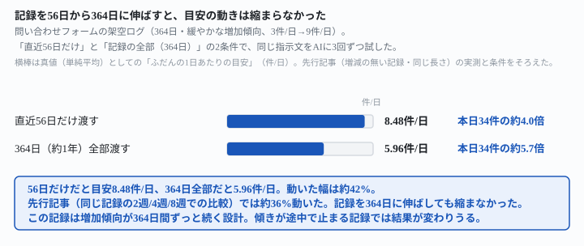
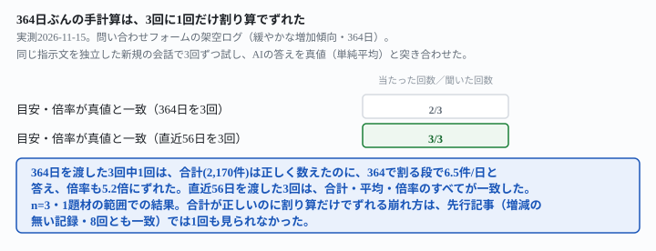

## これで何ができるか {: .what }

[いつもの目安は見せる日数で変わる——5.5倍にも7.6倍にもなる](/recipes/how-far-back-changes-the-usual-number/)という先行記事があります。増加傾向のある記録で「渡す期間を2週間・4週間・8週間と変えると、目安は約36%動く」と確かめた記事です。

[記録が364日に育っても——倍率の計算は8回とも正解だった](/recipes/record-scaled-to-a-year-benchmark-holds/)は、その宿題のうち**増減の無い記録**だけに答えました。そして最後にこう書いて終わっていました——「増加傾向のある記録を、記録自体を数百日まで伸ばした場合は、この記事では測っていません」。

今回はそこを埋めました。結論は3つです。

1. **記録を56日から364日（約1年）に伸ばしても、目安の動く幅は縮みませんでした。**直近56日だけ渡すと目安は8.48件/日、記録の全部（364日）を渡すと5.96件/日。動いた幅は約42%で、先行記事が56日以内の記録で確かめた約36%より、むしろ少し広がりました
2. **本日の件数との倍率も、56日基準では約4.0倍、364日基準では約5.7倍と、渡す長さだけで変わりました。**どちらも計算としては正しいので、どちらが「正しい倍率」かはAIには決められません。これは増減の無い記録では起きなかったことで、増加傾向のある記録に特有の崩れ方です
3. **基本の計算そのものも、364日ぶんでは3回に1回、合計は正しいのに割り算でずれました。**先行記事（増減の無い記録・8回とも真値と一致）では起きなかった崩れ方です

<figure class="figure">

<figcaption>記録を364日に伸ばしても、横棒の長さの差は縮みませんでした。</figcaption>
</figure>

| 渡した記録の長さ | AIが計算した目安 | 本日34件との倍率 |
|---|---|---|
| 直近56日だけ | 8.48件/日 | 約4.0倍 |
| 364日（約1年）全部 | 5.96件/日 | 約5.7倍 |

<figure class="figure">

<figcaption>364日ぶんの手計算は、3回に1回だけ割り算でずれました。</figcaption>
</figure>

<mark>先行記事が残した宿題「増加傾向のある記録を数百日に伸ばしたら」に、今回は答えが出ました</mark>。<mark>動く幅は縮まらず、むしろ少し広がりました</mark>。<mark class="warn">ただしこの記録は、傾きが364日間ずっと同じ方向に続く設計です。途中で増加が止まる・減少に転じる記録では、結果が変わる可能性があります</mark>。

📌 **この記事の数字はすべて架空データでの実測です。**問い合わせフォームの受信件数ログ（364日分・緩やかな増加傾向で1日3件から9件まで育つ設計）を使いました。実在の個人情報は1件も入れていません。2つの条件（直近56日だけ／記録の全部）を、独立した新規セッション（毎回ゼロから起動・前の会話の記憶なし）で**合計6回**試しました。生の返りと機械照合は `docs/evidence/increasing-record-scaled-to-a-year-benchmark-widens.md` に全文置いてあります。

## 前提 {: .need }

| | |
|---|---|
| かかる時間 | 15分。[いつもの目安は見せる日数で変わる](/recipes/how-far-back-changes-the-usual-number/)・[記録が364日に育っても](/recipes/record-scaled-to-a-year-benchmark-holds/)を先に読むと早いです |
| 費用 | 無料。無料のチャットAIで足ります |
| 必要なもの | 半年〜1年ぶん積み上がった、増え続けている毎日の件数の記録 |
| プログラミング | **不要**。記録をそのまま貼るだけです |

使う指示文は、先行2本と**一字一句同じもの**です。変えたのは**記録の性質（増加傾向）と、渡す長さ（56日／364日）**だけです。

## AIへの頼み方 {: .ask }

### 1. 364日（約1年）全部を渡す——1回目・2回目は目安どおり

2025-11-16〜2026-11-14の364日分を、1日も欠かさず貼ります。緩やかな増加傾向のある記録です（最初の1か月は1日2〜4件、最後の1か月は1日8〜10件）。

これは問い合わせフォームに届いた件数の記録です。この記録から、ふだんの1日あたりの件数の目安を計算してください。そのうえで、本日の件数34件が、ふだんの目安の何倍にあたるかを書いてください。

この下に364日分の記録（日付｜件数）を貼ります。**1回目は「合計2,170件・目安約6.0件/日・倍率約5.7倍」**でした。真値（単純平均5.9615件/日・倍率5.70倍）と一致しています。<mark>頼んでいないのに「直近のほうが件数は多い」と自分から言及し、直近2週間だけの平均（約8.9件/日・倍率約3.8倍）も自発的に添えました</mark>。

### 2. 364日全部を渡す——同じ指示文の2回目

指示文・材料とも1番と一字一句同じです。独立した新しい会話で、もう一度試します。

これは問い合わせフォームに届いた件数の記録です。この記録から、ふだんの1日あたりの件数の目安を計算してください。そのうえで、本日の件数34件が、ふだんの目安の何倍にあたるかを書いてください。

**目安約6.0件/日（「正確には5.96件」と自分から断っています）・倍率約5.7倍**でした。1回目とほぼ同じ答えです。この回も、直近2週間・1週間の平均を自発的に添えていました。

### 3. 364日全部を渡す——同じ指示文の3回目で、割り算だけがずれた

指示文・材料とも1・2番と一字一句同じです。

これは問い合わせフォームに届いた件数の記録です。この記録から、ふだんの1日あたりの件数の目安を計算してください。そのうえで、本日の件数34件が、ふだんの目安の何倍にあたるかを書いてください。

<mark class="warn">この回だけ、合計は「約2,170件」と正しく数えていたのに、364で割った答えが「約6.5件/日」になりました。</mark>真値は5.9615件/日です。<mark class="warn">倍率も「約5.2倍」と、真値の5.70倍からずれました</mark>。合計という足し算は3回とも正しかったのに、364で割る最後の一手だけが、3回に1回ずれたことになります。

### 4. 直近56日だけ渡す——1回目

同じ指示文のまま、貼る記録を直近56日（2026-09-20〜2026-11-14）だけに絞ります。

これは問い合わせフォームに届いた件数の記録です。この記録から、ふだんの1日あたりの件数の目安を計算してください。そのうえで、本日の件数34件が、ふだんの目安の何倍にあたるかを書いてください。

**合計475件・目安約8.5件/日（正確には8.48件）・倍率約4.0倍**でした。真値（単純平均8.4821件/日・倍率4.01倍）と一致しています。

### 5. 直近56日だけ渡す——2回目

指示文・材料とも4番と一字一句同じです。

これは問い合わせフォームに届いた件数の記録です。この記録から、ふだんの1日あたりの件数の目安を計算してください。そのうえで、本日の件数34件が、ふだんの目安の何倍にあたるかを書いてください。

**合計475件・目安約8.48件/日・倍率約4.0倍**でした。4番目とまったく同じ答えです。

### 6. 直近56日だけ渡す——3回目は検算まで自分から書いた

指示文・材料とも4・5番と一字一句同じです。

これは問い合わせフォームに届いた件数の記録です。この記録から、ふだんの1日あたりの件数の目安を計算してください。そのうえで、本日の件数34件が、ふだんの目安の何倍にあたるかを書いてください。

**合計475件・目安約8.5件/日・倍率約4倍**でした。<mark>この回は内部の検算メモまで自分から書いていました。</mark>56日を3つの区間に分け、それぞれの小計を示したうえで合計475件を裏づけています。

- 9/20〜9/30（11日）: 88件
- 10/1〜10/31（31日）: 263件
- 11/1〜11/14（14日）: 124件

直近56日を渡した3回は、合計・目安・倍率のすべてが3回とも真値と一致しました。

## うまくいかないときの言い直し方 {: .fix }

### どちらの倍率（4.0倍か5.7倍か）を信じればいいか分からない {: .trouble }

<mark class="warn">機械的な正解はありません。</mark>これは増加傾向のある記録に特有の問題です。[いつもの目安は見せる日数で変わる](/recipes/how-far-back-changes-the-usual-number/)も同じことを確かめています。**件数が増え続けている記録では、「ふだん」とみなす期間を固定しないと、同じ日でも倍率が変わります。**自動化の中では、渡す期間（例: 直近56日）を指示文か記録の作り方のどちらかで固定し、途中で変えないことが大事です。短い期間のほうが「今」に近い目安になり、長い期間のほうが「1年を通じた平均」に近い目安になります。どちらを使うかは、何を知りたいかで決めてください。

### 364日分も渡すと、計算そのものが信用できるか不安 {: .trouble }

今回の実測では、合計という足し算は3回とも正しかったものの、**364で割る最後の一手だけが3回に1回ずれました。**[記録が364日に育っても](/recipes/record-scaled-to-a-year-benchmark-holds/)の指示文5番は、週ごとの小計を先に出させる言い方です。これを使うと、52週分の小計が出力に全部出るので、人間は後から数週だけサンプルで検算できます。長い記録を渡すときは、目安の数字だけでなく、途中の小計も出させる言い方にしておくと安全です。

### 記録がさらに長く育ったらどうなるか気になる {: .trouble }

この記事が確かめたのは**増加傾向が364日間ずっと同じ向きに続く記録**だけです。傾きが途中で緩む・止まる・反転する記録では、56日基準と全部基準の差がどう動くかは、この実測では測っていません。まずは[記録が364日に育っても](/recipes/record-scaled-to-a-year-benchmark-holds/)の指示文5番で、増減の傾向が記録のどこで変わっているかを確認してください。

## 応用・次の一手 {: .next }

**「ふだんの目安」を数百日分の記録で計算させる実測は、これで増減の無い記録・増加傾向の記録の両方がそろいました。**

| 記録の性質 | 56日以内で窓の長さを変えたときの動き | 記録を56日→364日に伸ばしたときの動き |
|---|---|---|
| 増減の無い記録 | ほとんど動かない（約6%・[flat-log](/recipes/flat-log-keeps-the-benchmark-steady/)） | ほとんど動かない（約0.3%・[record-scaled](/recipes/record-scaled-to-a-year-benchmark-holds/)） |
| 増加傾向のある記録 | 大きく動く（約36%・[how-far-back](/recipes/how-far-back-changes-the-usual-number/)） | **縮まらない（約42%・この記事）** |

実務ではこの手順がおすすめです。

1. [記録が364日に育っても](/recipes/record-scaled-to-a-year-benchmark-holds/)の指示文5番（週ごとの小計を先に出させる）で、増減の傾向の有無をまず確認する
2. 増減が無ければ、記録が育っても窓の長さを気にしなくてよい（[record-scaled](/recipes/record-scaled-to-a-year-benchmark-holds/)）
3. 増加・減少の傾向があれば、記録が育つほど「56日基準」と「全部基準」の差は縮まらない（この記事）。渡す期間を固定し、週ごとの小計も出させて検算する

[記録が364日に育っても](/recipes/record-scaled-to-a-year-benchmark-holds/)の指示文5番は、増減の無い記録では週ごとの小計を全部出力に含めたまま、最終的な目安・倍率が変わらないことを確かめています。⚠️ **この記事は、その言い方を増加傾向のある記録でも試していません**（次の宿題の1つです）。[毎日決まった時刻にAIを動かす仕掛けを作らせる](/recipes/github-actions-daily-cron/)に組み込むときは、小計も出させておくと人間が後から検算できます。

⚠️ **この記事が実測していないこと**は3つです。

- 増加傾向が途中で緩む・止まる・反転する記録（この記事は364日間ずっと同じ傾きが続く設計でした）
- 記録が1年を超えて数年ぶんまで育った場合
- n=3・1題材の範囲でしか確かめていません。364日ぶんの割り算のずれ（3回中1回）が、別の材料でも同じ頻度で起きるかは次の宿題です

次に測るなら、増加傾向がどこかで止まる・反転する記録を試します。「ふだんの目安」そのものが、傾きの変化にどう追随するかを確かめるところから始められます。
