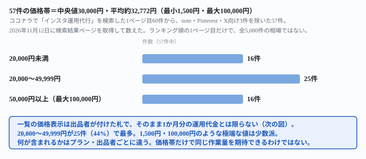
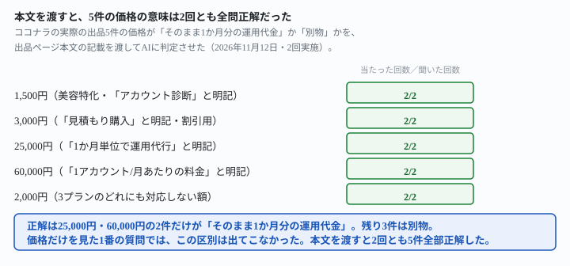

## これで何ができるか {: .what }

副業でインスタの運用代行をやってみたいとき、「相場はいくらなのか」が最初の疑問です。<mark>ココナラで「インスタ運用代行」を検索すると、2026年11月12日時点で5,080件が見つかりました。</mark>そのランキング順1ページ目・60件のうち、Instagram向けの57件を数えた結果が結論です。

| | |
|---|---|
| 価格の範囲 | 1,500円〜100,000円 |
| 中央値 | **30,000円** |
| 平均 | 約32,772円 |
| 20,000円未満 | 16件（28%） |
| 20,000〜49,999円 | 25件（44%・最多） |
| 50,000円以上 | 16件（28%） |

<figure class="figure">

<figcaption>57件の価格帯。20,000〜49,999円が最多（44%）。</figcaption>
</figure>

<mark class="warn">ここに1つ落とし穴があります。一覧に出ている価格が、そのまま「1か月分の運用代金」ではない出品が混ざっています。</mark>価格の安い5件を選んで、出品ページの本文まで開きました。そのうち3件は診断・見積もり・用途不明の価格で、実際の月額運用代金は別に書かれていました。

AIに価格だけを見せて聞いた質問では、この区別は一度も出てきませんでした。一方、**出品ページ本文の実際の記載を渡して判定させると、2回とも5件全部を正しく判定できました。**この記事は、その頼み方の違いを6つの指示文で確かめた結果です。試した記録は[こちら](https://github.com/invest-ai-info/ai-tsukaikata/blob/main/docs/evidence/instagram-agency-rate-sticker-price-trap.md)に全文置いています。

## 前提 {: .need }

| | |
|---|---|
| かかる時間 | 20分 |
| 費用 | 無料。無料のチャットAIで足ります |
| 必要なもの | ブラウザで使えるAI（ChatGPT・Claude・Geminiなど） |
| プログラミング | **不要**。この記事の指示文をコピーして貼るだけです |

この記事の実データは、2026年11月12日に確認したものです。ココナラの検索結果「インスタ運用代行」（ランキング順）を開きました。<mark class="warn">表示価格は出品者が自由に設定・変更できるので、今開くと数字は変わっています。</mark>この記事は特定の相場を保証するものではなく、**「価格だけで比較してよいか」を確かめるための実測**です。

🚨 この記事は料金形態や運用の中身を実物で示しますが、収入を保証する書き方はしていません。実際に出品していくらになるかは、ご自身の実績・内容・交渉で変わります。

## AIへの頼み方 {: .ask }

### 1. まず何も伝えずに、出品価格を聞く

副業でこれからインスタ運用代行を始めます。出品価格はいくらにすればいいですか。

2回試した返りです。

> 1回目: まずは2〜4万円/月あたりから始めて、実績が増えたら値上げしていくのが無理のない進め方です。

> 2回目: 初心者・実績なし 1〜3万円。実績作りを兼ねて最初の1〜2件は相場より安く（月1〜2万円程度）受けて、ビフォーアフターの数字を残す。

2回とも、**価格差を作業量の違いだけで説明しています。**例えば「投稿のみなら2〜5万円、広告運用まで含むなら10〜30万円」です。<mark class="warn">「安い出品価格そのものが、月額運用代金ではなく診断・見積もりかもしれない」という視点は、2回とも一度も出ませんでした。</mark>

### 2. 検索した価格帯を見せて、気をつけることを聞く

副業でココナラのインスタ運用代行を始めようと思っています。検索すると、出品の価格は1,500円から100,000円くらいまで並んでいました。この価格の範囲について、気をつけたほうがいいことはありますか。

> 1回目: 1,500円台は「投稿1〜数件の文章作成だけ」といった、作業の一部だけが多い（中略）。1万〜3万円台は、一般的な「運用代行」のイメージに近いボリューム。

実際に1,500円の出品ページ（美容業界特化・SocialPro）を開きました。説明文は「【本格コンサル・アカウント診断｜1,500円】」でした。運用代行そのものの月額プランは別にあり、最安でも50,000円/月からです。<mark>AIの推測「1,500円台=投稿1〜数件の文章作成だけ」は、実物と違いました。</mark>価格の幅を「量の違い」とだけ解釈すると、こういう外し方をします。

### 3. 「丸投げOK」の想像を聞く

インスタ運用代行の出品に「丸投げOK」と書かれていました。丸投げという言葉から、依頼する側は何が含まれていると考えればいいですか。

> 1回目: 「丸投げOK」だけでは分からない・別料金になりやすいもの: 写真・動画の撮影、広告出稿など（中略）。

実際に5件の出品ページを確認すると、次はどの出品でも「別途」と明記されていました。

- Meta広告費
- 広告クリエイティブ制作
- 撮影
- リール追加

**別途になりやすい項目は、データが無くても的を射ていました。**この質問については、データを渡さなくても2回とも実物とだいたい一致しています。<mark>外れたのは2番（価格の意味）で、3番（作業範囲の想像）は的を射ていました。</mark>AIが何でも外すわけではありません。

### 4. 実際の5件の本文を渡して、価格の意味を判定させる

ここから、実際に開いた5件の出品ページ本文を渡します。

次の5件は、ココナラで実際に「インスタ運用代行」を検索して見つけた出品の、価格と出品ページ本文の実際の記載です。それぞれの価格が「そのまま1か月分の運用代金」なのか、「そうではない（見積もり・診断・オプションなど別の意味の価格）」なのかを、1件ずつ判定してください。

1. 価格1,500円。出品ページの説明：「【本格コンサル・アカウント診断｜1,500円】」。運用代行プランは別にあり、アカウント運用プラン50,000円/月〜。
2. 価格3,000円。出品ページの説明：「見積もり購入」。プラン契約時に3,000円分の割引が適用されると書かれている。実際の運用プランはライト25,000円・基本35,000円など。
3. 価格25,000円。出品ページの説明：「1か月単位で下記の運用代行をいたします」。ベーシックプラン25,000円（税抜）、月8回投稿。
4. 価格60,000円。出品ページの説明：「サービスは1アカウント/月あたりの料金となっております」。競合リサーチ・投稿作成・投稿を含む。
5. 価格2,000円。出品ページの説明：プランはライト13,000円・スタンダード20,000円・プレミアム30,000円。2,000円は単独のプランとしては明記されていない。

正解は、3番（25,000円）と4番（60,000円）の2件だけが「そのまま1か月分の運用代金」です。残りの1・2・5番は別物です。

<figure class="figure">

<figcaption>本文を渡すと、5件の価格の意味は2回とも全問正解だった。</figcaption>
</figure>

**2回試して、2回とも5件全部を正解しました。**1番・2番の質問では0回だった区別が、本文という材料を渡すと2回とも100%になっています。<mark>外せなかったのは「材料」のほうで、AIの読み取り自体は正確でした。</mark>

### 5. 実際の57件の価格データを渡して集計させる

ココナラで「インスタ運用代行」を検索して見つかった、Instagram向けサービス57件の価格（円）は次のとおりです。
1500,2000,3000,7500,8000,9000,10000,13000,13000,15000,15000,15000,15000,16000,18000,19000,20000,20000,20000,20000,20000,20000,22000,22000,25000,25000,25000,29000,30000,30000,30000,30000,30000,32000,33000,35000,35000,35000,35000,40000,40000,50000,50000,50000,50000,50000,50000,55000,60000,60000,60000,60000,65000,70000,75000,80000,100000

この57件について、①平均値②中央値③20,000円未満・20,000円以上50,000円未満・50,000円以上の3段階に分けた件数を、それぞれ計算してください。

> 平均値: 57件の合計は1,868,000円です。1,868,000 ÷ 57 ≒ 32,771.9円 → 約32,772円。中央値: 57件（奇数個）なので29番目の値、30,000円。20,000円未満16件／20,000円以上50,000円未満25件／50,000円以上16件（合計57件で一致）。

2回試して、**平均・中央値・3段階の件数とも、2回とも真値と完全に一致しました。**渡した数字をそのまま集計する作業は、崩れていません。

### 6. 実際の集計結果を渡して、出品価格の助言を再度させる

1番と同じ質問を、今回の実測結果を添えてもう一度聞きます。

ココナラで「インスタ運用代行」を検索すると、Instagram向けサービスが57件見つかりました。価格は1,500円から100,000円まで分かれていて、中央値は30,000円、20,000円未満が16件・20,000円以上50,000円未満が25件・50,000円以上が16件でした。副業でこれから初めてインスタ運用代行を出品するなら、いくらにすればいいですか。

> 1回目: 最初は15,000〜19,800円に置き、レビューが貯まったら30,000円前後まで上げるのがおすすめです（中略）。20,000円未満の16件のうち、1,500円のような極端に安いものは「診断だけ」のような軽いサービスの可能性が高いです。

1番の質問（データ無し）では「極端に安いものは診断かもしれない」という視点は出ませんでした。<mark>データを渡すと、2回とも自発的に出てきました。</mark>推奨額も「15,000〜19,800円」「15,000〜20,000円」でした。これは実データの「20,000円未満」ゾーンに収まっています。同じ質問でも、根拠になる材料があるかどうかで答えの質が変わりました。

## うまくいかないときの言い直し方 {: .fix }

### 価格だけ見て「相場はこのくらい」と決めてしまう {: .trouble }

1番・2番のように、何も伝えずに相場を聞くと、表示価格の罠には気づけません。質問に一文を足すだけで変わります。

ココナラでインスタ運用代行の相場を調べるとき、出品に表示されている価格の中には、そのまま1か月分の運用代金ではなく、診断・見積もり・オプション代など別の意味の価格が混ざっていることがあります。これを踏まえて教えてください。副業でこれからインスタ運用代行を始めます。出品価格はいくらにすればいいですか。

> ご質問の前提（出品価格には診断・見積もり・オプション代などが混ざっている）は正しい観察です（中略）。「月額」と明記されていない出品を相場の根拠にしないこと。これが今回のご質問の核心であり、最も多い誤読のパターンです。

2回とも、「出品一覧の価格を相場の根拠にしない」という注意そのものを回答に明記しました。1番では0/2件だった言及が、一文を足すだけで2/2件になっています。

### 「丸投げOK」の範囲を、自分が検討している出品でも確かめたい {: .trouble }

3番の推測はおおむね当たっていましたが、推測のままで契約すると実物と食い違う危険は残ります。4番の指示文の書き方をそのまま使い、5件の部分を自分が検討している出品の価格と本文に置き換えてください。

4番の実測で確かめたとおり、本文という材料があればAIの判定は安定します。想像で聞くより、本文を貼って聞くほうが確実です。

## 応用・次の一手 {: .next }

<mark>この記事の実測から言えるのは、次の2点です。</mark>

- 「価格の幅＝作業量の幅」と決めつけないこと
- 「本文を読まずに価格だけで比べない」こと

自分が依頼する側でも、出品する側でも、価格を見たら本文の「含まれるもの」を必ず確認してください。

出品する側に立つなら、[ココナラで売る出口の実態](/tools/coconala-ai-automation-634-listings/)も合わせて読んでください。同じココナラでも「AI業務効率化・自動化」の区分は事情が別です。見積り必須の出品が多く、価格の表示そのものが相談ベースになっています。

相場を自分で聞く前に、[フリマの相場をAIに聞くと作り話で埋まる](/recipes/resale-price-guess-fills-the-blank/)も参考にしてください。データが無いと、AIは具体的な数字を作ってしまいます。この癖は、物の値段でもサービスの値段でも起きます。

⚠️ <mark class="warn">この記事の実測は、検索結果60件・個別に開いた5件・実データを渡した聞き方の範囲です。</mark>一般法則として「AIは価格の罠に必ず気づかない」と書くつもりはありません。試したのは次の範囲までです。

- 検索結果は2026年11月12日・ランキング順の1ページ目のみです。全5,080件や、並び順を変えた場合は試していません
- 本文を個別に確認したのは5件のみです。価格が低い・中間・高いものを広く選びましたが、57件全部の本文は開いていません
- 使ったAIは1種類（Claude）です。他のAIでも同じ傾向になるかは確かめていません

次に相場を調べるときは、一覧の価格をそのまま比べないでください。気になった出品のページ本文を開いて、「月額」と明記されているかを確認してください。AIに聞くなら、本文をそのまま貼って判定させるのが、この記事で確かめたなかでいちばん正確でした。
