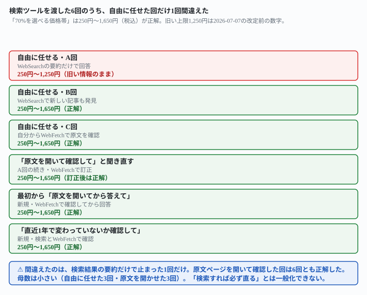
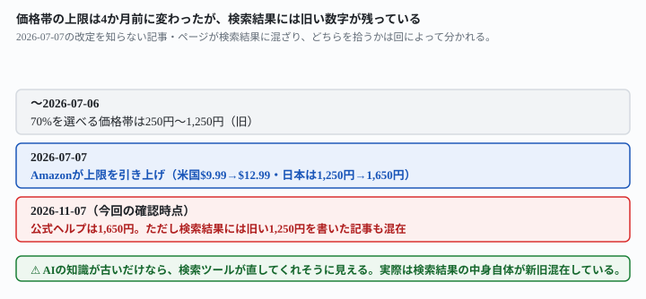

## これで何ができるか {: .what }

[前の記事](/recipes/kindle-royalty-formula/)で、Kindle本の印税をAIに聞く実測をしました。「70%を選べる価格帯」の上限を、AIは3回とも間違えました（正解は1,650円なのに1,250円と答えました）。そのとき使ったのは**検索を使わせない条件**だけです。「検索を有効にしたAIに同じ文を貼ると結果は変わりえます」と宿題を残していました。この記事はその宿題に答えます。

結論を先に書きます。

| 条件 | 試行回数 | 正しい上限（1,650円）に一致 |
|---|---|---|
| 検索ツールを渡し、使うかどうかはAI任せ | 3回 | **2/3** |
| 「根拠のページを実際に開いて確認して」と指定 | 3回 | **3/3** |

<mark>検索ツールを渡しても、使うかどうか・どこまで調べるかはAI任せのままだと、3回に1回は2026-07-07の改定前の古い数字（1,250円）が返ってきました。</mark><mark class="warn">検索結果の要約だけで止まると、新旧の数字が混ざったまま古いほうを拾うことがあります。</mark><mark>「根拠のページを実際に開いて確認して」と指定すると、聞き直しも含めて6回とも正しい上限にたどり着きました。</mark>

<figure class="figure">

<figcaption>間違えたのは、検索結果の要約だけで止まった1回だけでした。</figcaption>
</figure>

## 前提 {: .need }

| | |
|---|---|
| かかる時間 | 15分 |
| 費用 | 無料。検索機能が使えるブラウザのチャットAIで足ります |
| 必要なもの | 「検索」「ウェブ検索」「ブラウジング」などのトグルが付いたAIチャット |
| プログラミング | **不要**。この記事の指示文をコピーして貼るだけです |

⚠️ **この記事は、価格帯の数字そのものより「検索ツールをどう使わせるか」の違いを見るための実測です。**自分の本の金額を出したいだけなら、[前の記事](/recipes/kindle-royalty-formula/)の式と、下の応用セクションの金額目安を使ってください。規約と価格帯は変わるので、出版するときは必ず当日の[KDPヘルプ](https://kdp.amazon.co.jp/ja_JP/help/topic/G201849770)を開いて確認してください。

## AIへの頼み方 {: .ask }

### 1. まず、検索ツールを渡して自由に答えさせる

[前の記事](/recipes/kindle-royalty-formula/)と同じ質問を、今度は検索ツールが使えるAIに、独立に3回送りました。使うかどうか・どこまで調べるかはAI任せです。

500円のKindle本が1冊売れたら印税はいくらですか。70%を選べる価格帯も教えてください。

3回の結果です。

| 回 | 70%の価格帯 | 使った方法 |
|---|---|---|
| A回 | 250円〜1,250円（**誤り**） | 検索結果の要約だけで回答 |
| B回 | 250円〜1,650円（正解） | 検索で新しい記事も見つけた |
| C回 | 250円〜1,650円（正解） | 自分から原文ページを開いて確認した |

**3回中1回（A回）は、2026-07-07の改定前の古い上限（1,250円）のままでした。**正解は1,650円です（出典は下の応用セクション）。A回が引用した情報源の1つは2026年より前の古い解説記事で、検索結果の要約だけを読むと、新旧の数字が混ざったまま古いほうを拾うことがあります。

### 2. 間違えた回に、根拠のページを開いて確認し直すよう頼む

A回の間違いに気づいたら、同じ会話を続けて聞き直せます。

さっきの答えが合っているか、根拠のページを実際に開いて確認してください。

<mark>A回はこの一言で訂正し、正しい上限（1,650円）に書き直しました。</mark>自分からこう書いています。「以前ご案内した『¥250〜¥1,250』は古い情報でした。2026年7月7日以降、上限が¥1,250から¥1,650に引き上げられています」。

### 3. 最初から「原文を開いてから答えて」と指定する

聞き直すのではなく、最初の質問にあらかじめ条件を足す言い方も試しました。独立の新規セッションで聞いています。

500円のKindle本が1冊売れたら印税はいくらですか。70%を選べる価格帯も教えてください。検索結果の要約だけでなく、根拠となる一次情報のページ（Amazon KDPの公式ヘルプ）を実際に開いて(フェッチして)から答えてください。

**この回も正しい上限（250円〜1,650円）にたどり着きました。**公式ヘルプを開いたうえで、確認しきれなかった点まで正直に書いています。「日本円での配信コストの具体的な1MBあたりの単価は、今回開いた公式ヘルプページには記載がありませんでした」。

### 4. 「直近で変わっていないか確認して」と念を押す

原文を名指しする代わりに、変更の有無だけを確認させる言い方も試しました。

500円のKindle本が1冊売れたら印税はいくらですか。70%を選べる価格帯も教えてください。念のため、直近1年以内に価格帯のルールが変わっていないか確認してから答えてください。

**この回も正しい上限（250円〜1,650円）にたどり着き、しかも変更の経緯まで言い当てました。**答えの中身です。

- 「ネット上でよく見かける『日本は¥250〜¥1,250』という情報は古い情報で……現在の上限は¥1,650になっていました」
- 「英語版ヘルプページの一部ではまだ¥1,250という表記が見られるなど、情報源によって数字が食い違っている状態も確認しました」

情報源どうしが食い違っていること自体に気づいた回です。

### 5. その答えの根拠を、URLと確認日で聞く

正しく答えた回に、出典を聞き返しました。

その答えの根拠にしたページのURLを教えてください。何年何月の情報か分かれば、それも教えてください。

公式ヘルプのURLと確認日（質問した当日）をそのまま答えました。<mark>URLと確認日を即答できる回は、原文を実際に開いた回でした。</mark>要約だけで答えた回がこの聞き方にどう応えるかは、この記事では試していません。A回は訂正後に、出典を含めて答え直しています。

### 6. 価格帯の境界に近い金額でも確認する

正しく答えた回に、70%の上限ぎりぎりを超える金額をぶつけました。

1,700円のKindle本でも、70%ロイヤリティを選べますか。理由も教えてください。

**「1,700円のKindle本は70%ロイヤリティを選べません」と正しく判定しました。**理由も「上限1,650円を50円超えているので、70%の条件に当てはまりません」と明記しています。35%ロイヤリティでの印税（1,700円×35%＝595円）まで添えました。価格帯の数字を「覚え直した」だけでなく、境界をまたぐ金額にも正しく適用できています。

### なぜこの言い方が効くのか

**検索ツールを持たせても、それをどう使うかはAI自身の判断に委ねられます。**検索結果の要約を読んで止まるか、気になった情報源をさらに開いて裏取りするかは、同じ質問でも回によって分かれました。<mark class="warn">今回の価格帯のように「最近ルールが変わった」話題は、検索結果の中に新旧の数字が両方存在するため、要約だけ読むとどちらを拾うかは運次第になります。</mark>「根拠のページを実際に開いて確認して」と名指しすると、AIは検索結果の要約で止まらず、一次情報まで遡るようになりました。

## うまくいかないときの言い直し方 {: .fix }

### 答えに自信がありそうでも、鵜呑みにしない {: .trouble }

A回は「500円はこの範囲に入るので対象になります」と、間違った価格帯のまま自信を持って断定していました。<mark class="warn">言い切り方の強さと、答えの正しさは関係ありません。</mark>とくに「ルールが最近変わったかもしれない」話題（手数料率・税率・価格の上限など）は要注意です。AIの訓練データの時点で止まっている可能性を前提に、一度は裏取りを頼んでください。

### 検索ありでも、自分で全部を確かめなくていい {: .trouble }

今回の実測でも、正しく答えた回がすべてを確認しきれたわけではありません。B回は分からない点を自分から申告していました。「KDP Select登録が日本の70%適用に必須かどうかは情報源間で記述が曖昧だったため、回答には含めなかった」と書いています。正しく答えた回に、聞き返してみました。

さっきの回答で、確信が持てずに省いた条件はありますか。あれば教えてください。

**5点が出てきました。**

- 「¥1,650という数字に確定日付の記載がなく、為替レートからの推測で判断した」
- 「KDP Select登録が自国マーケットプレイスの条件か、他国からの購入時の条件か区別できなかった」
- 「配信コストの日本円レートが裏付けられなかった」
- 「消費税を差し引く順序の細部が分からなかった」
- 「紙の本との20%価格差ルールが日本にも適用されるか分からなかった」

<mark>最初の回答には、これらの不確実性は一切書かれていませんでした。</mark>価格帯の結論（250円〜1,650円）自体は変わりませんでしたが、<mark>聞き返すまで、どこまで確信があるのかは分かりませんでした。</mark>[原文を貼って聞く前の記事](/recipes/kindle-royalty-formula/)でも、同じ仕組みを確かめています。「書かれていないなら書かれていないとだけ答えて」と範囲を決めると、AIは範囲の外を「無い」と言えるようになります。

## 応用・次の一手 {: .next }

金額の目安: 500円（税込）のKindle本が1冊売れたときの印税は、70%オプションで約317円、35%オプションで約159円
根拠: 70%オプションを選べるのは希望小売価格が250円〜1,650円（税込）のとき。2026年7月7日の改定で上限が引き上げられました。米国は9.99ドルから12.99ドルへ、日本は1,250円から1,650円へです（出典: <a href="https://kdp.amazon.co.jp/ja_JP/help/topic/G201849770">日本のマーケットプレイス (Amazon.co.jp) 向けの価格設定</a>・2026-11-07確認）
計算: 500円 ÷ 1.1 ＝ 約454円（税抜）。1MBの本なら配信コスト1円を引いて453円、その70%で約317円。35%なら454円の35%で約159円
この金額は目安であり、収益を保証するものではありません。価格帯の上限は変わることがあるので、出版前に必ず当日の原文を確認してください。

今回の実測で分かった上限の変更の経緯を、図にまとめました。

<figure class="figure">

<figcaption>上限は4か月前に変わりましたが、検索結果には旧い数字がまだ残っています。</figcaption>
</figure>

**読める形にすると、確認のコツは3つにまとまります。**

1. **ルールが変わりうる話題（価格・手数料率・税率）は、まず「検索結果の要約だけでなく原文を開いて確認して」と頼む**
2. **答えに自信がありそうでも、裏取りの一言を省かない**
3. **省いた条件がないか、あとから聞いてみる**

価格帯以外の条件（KDPセレクトへの登録・消費税の扱い）を含めた式の全体は[Kindleの印税を式から出す記事](/recipes/kindle-royalty-formula/)にあります。原文を貼って条件を確かめる頼み方は[Kindle出版のAI申告を原文で確かめる記事](/recipes/kindle-ai-disclosure-check/)も参考にしてください。

⚠️ **この結果は、架空の質問1問・計6回（自由に任せる3回・原文を開かせる3回）の実測です。**「検索を有効にすれば必ず直る」とは一般化しないでください。試したのは、次の範囲までです。

- 検索ツールを使えるAIとして独立のセッション6回のみです。実際のChatGPT・Gemini・Claudeのブラウザ版で同じ結果になるかは確かめていません
- 間違いが起きたのは「最近ルールが変わった」価格帯の1項目だけです。別の種類の間違い（計算式そのものなど）でも同じ対策が効くかは試していません
- 原文を開かせる3回のうち1回は、間違えた回への聞き直しです。残り2回が独立の新規セッションです

今回の生の返りは `docs/evidence/kindle-royalty-search-band-two-of-three.md` に全文置いてあります。
