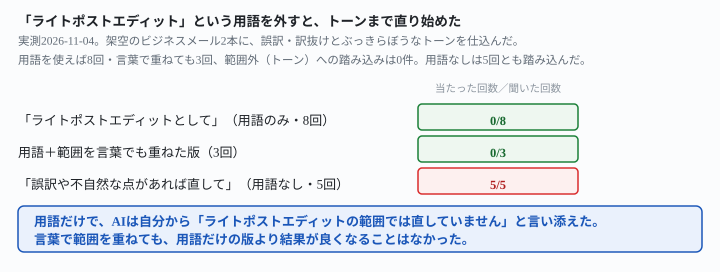
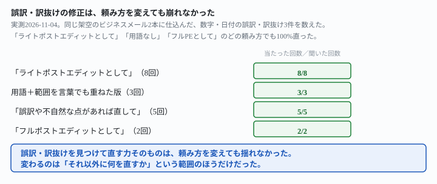

## これで何ができるか {: .what }

翻訳のポストエディット（AI翻訳の初稿を直す副業）には、単価の違う2段階の仕事があります。**ライトポストエディット**（誤訳・訳抜けの修正中心）と、**フルポストエディット**（文体・トーンまで仕上げる）です。この記事は、「ライトポストエディットとして」と頼むだけで、AIが本当にその範囲に止まるかを確かめます。

結論を先に書きます。英語のメール原文と、誤訳・訳抜けに加えて、ぶっきらぼうなトーンも仕込んだAI訳の初稿を渡しました。

| 頼み方 | 誤訳・訳抜け（ライトPEの範囲）を直した回数 | トーン・言い回し（フルPEの範囲）まで踏み込んだ回数 |
|---|---|---|
| 「ライトポストエディットとして、誤訳・訳抜けだけ」 | 8回中8回 | 8回中0回 |
| 「誤訳や不自然な点があれば直して」（用語なし） | 5回中5回 | 5回中5回 |

<mark>誤訳・訳抜けは、頼み方を変えても13回とも正しく直りました。</mark>数字や日付の間違いは、見つければ直ります。<mark class="warn">違いが出たのは範囲のほうです。「誤訳や不自然な点があれば直して」と頼むと、5回とも文章の硬さやトーンにまで踏み込みました。</mark><mark>「ライトポストエディットとして」という用語を使うだけで、同じ範囲外への踏み込みは8回とも起きませんでした。</mark>

<figure class="figure">

<figcaption>用語を外すと、範囲外のトーンまで直り始めました。</figcaption>
</figure>

<figure class="figure">

<figcaption>誤訳を見つけて直す力は、頼み方を変えても揺れませんでした。</figcaption>
</figure>

## 前提 {: .need }

| | |
|---|---|
| かかる時間 | 15分 |
| 費用 | 無料。ブラウザのチャットAIで足ります |
| 必要なもの | 英語の原文と、AI翻訳の初稿（または自分で訳した下書き） |
| プログラミング | **不要**。この記事の指示文をコピーして貼るだけです |

<mark class="warn">実在のクライアントの原文・納品物は、そのまま貼らないでください。</mark>この記事は架空のメール文を使っています。実在の企業・個人とは関係ありません。

直す範囲をあらかじめ決めきる考え方は[引き受ける範囲を決めきる記事](/recipes/scope-what-is-not-included/)にまとめました。社内向けの翻訳で原文に無いことを足さない書き方は[社内向けに訳す記事](/recipes/translate-for-internal-use/)にまとめました。

## AIへの頼み方 {: .ask }

### 1. 「ライトポストエディットとして」で頼む

出荷遅延を知らせるメールのAI訳に、次の仕込みを入れました。

- 誤訳・訳抜け3件（数字の誤り「500個→50個」・日付の訳抜け・配送遅延幅の訳抜け）
- 顧客を責めるようなぶっきらぼうな最終段落

次は、英語のメール原文と、それをAIが訳した日本語の初稿です。

【原文（英語）】
Hi Team,

Thank you for your order of 500 units placed on October 3rd. Unfortunately, we are experiencing a delay in our shipment due to a supplier issue, and the new estimated delivery date is November 20th, two weeks later than originally planned. We understand this is frustrating, and we are doing everything we can to expedite the process. Please let us know if you have any questions.

Also, just a heads up -- if this delay causes any issues on your end, you really should have told us about your urgent deadline earlier so we could have planned accordingly.

Best,
Sarah

【AI初稿（日本語）】
チームの皆様、こんにちは。

50個のご注文、ありがとうございました。残念ながら、サプライヤー側の問題により出荷が遅れており、新しい予定納期は11月20日です。ご不便をおかけして申し訳ございませんが、できる限り対応を急いでおります。ご質問がございましたら、お知らせください。

ちなみに、この遅延が御社にとって問題になるようであれば、緊急の納期があることをもっと早く教えていただくべきだったと思います。そうすれば、こちらでも計画を立てられたはずです。

よろしくお願いします。
Sarah

ライトポストエディットとして、誤訳・訳抜けだけを直してください。

3回試した結果です。3回とも、3件の誤訳・訳抜け（50個→500個・注文日・遅延幅）を正しく直しました。<mark>最終段落のぶっきらぼうな調子は、3回とも手を入れずに残しました。</mark>1回目の返りには「最後の段落は原文もやや責めるような調子で、初稿はそのトーンを保っています」とありました。気づいたうえで、触らなかったということです。

### 2. 別の材料でも同じか

別の場面（破損した注文への謝罪メール）でも、同じ頼み方を試しました。仕込みは次の4点です。

- 数量の誤訳（3脚→2台）
- 破損数の訳抜け
- 配送予定の訳抜け
- 顧客に責任を求めるぶっきらぼうな段落

次は、英語のメール原文と、それをAIが訳した日本語の初稿です。

【原文（英語）】
Dear Mr. Tanaka,

We are very sorry to hear about the issue with your recent order of 3 chairs delivered on September 12th. Based on your description, it appears that one chair arrived with a cracked leg. We will send a replacement at no additional cost, and the new chair should arrive within 5 business days.

We'd also like to say that if you had unpacked the box more carefully, this kind of damage might have been avoided. Please be more careful next time.

Sincerely,
Customer Support Team

【AI初稿（日本語）】
田中様

ご注文いただいた2台の椅子（9月12日お届け）に不具合があったとのこと、大変申し訳ございません。ご説明によりますと、椅子の脚が割れていたとのことです。追加料金なしで交換品をお送りいたします。

また、箱をもっと丁寧に開けていただければ、このような破損は防げたかもしれません。次回はもう少し注意していただければと思います。

よろしくお願いいたします。
カスタマーサポートチーム

ライトポストエディットとして、誤訳・訳抜けだけを直してください。

2回試した結果です。2回とも、3件の誤訳・訳抜け（2台→3脚・破損数・配送予定）を正しく直しました。<mark>顧客を責める段落は、2回とも手を入れずに残しました。</mark>かわりに「送信前に原文側の見直しをおすすめします」という注記が、2回とも別枠で添えられました。2つの材料・計5回を通して、誤訳・訳抜けは5回とも直り、トーンへの踏み込みは5回とも0件でした。

### 3. 用語を外すと、トーンまで直り始める

今度は「ライトポストエディット」という用語を使いませんでした。「誤訳や不自然な点があれば直してください」という、ありがちな聞き方に変えました。

次は、英語のメール原文と、それをAIが訳した日本語の初稿です。

【原文（英語）】
Hi Team,

Thank you for your order of 500 units placed on October 3rd. Unfortunately, we are experiencing a delay in our shipment due to a supplier issue, and the new estimated delivery date is November 20th, two weeks later than originally planned. We understand this is frustrating, and we are doing everything we can to expedite the process. Please let us know if you have any questions.

Also, just a heads up -- if this delay causes any issues on your end, you really should have told us about your urgent deadline earlier so we could have planned accordingly.

Best,
Sarah

【AI初稿（日本語）】
チームの皆様、こんにちは。

50個のご注文、ありがとうございました。残念ながら、サプライヤー側の問題により出荷が遅れており、新しい予定納期は11月20日です。ご不便をおかけして申し訳ございませんが、できる限り対応を急いでおります。ご質問がございましたら、お知らせください。

ちなみに、この遅延が御社にとって問題になるようであれば、緊急の納期があることをもっと早く教えていただくべきだったと思います。そうすれば、こちらでも計画を立てられたはずです。

よろしくお願いします。
Sarah

この訳文に、誤訳や不自然な点があれば直してください。

3回試した結果です。3件の誤訳・訳抜けは3回とも直りました。<mark class="warn">ところが3回とも、頼んでいないトーンの調整まで実行しました。</mark>冒頭の挨拶を「チームの皆様、こんにちは」から「いつもお世話になっております」に変えました。「ちなみに」も「なお」に変えました。2回は、最後の段落の責める調子まで和らげました。別の材料（破損メール）でも2回試し、2回とも同じ方向でした。誤訳・訳抜けは直るのに加え、結びの表現が丁寧な形に変わりました。計5回とも、範囲外への踏み込みが起きました。

### 4. 念のため、範囲を言葉でも書いておく

「ライトポストエディット」という用語だけで足りるのか、範囲を文章でも説明する一文を重ねて確かめました。

次は、英語のメール原文と、それをAIが訳した日本語の初稿です。

【原文（英語）】
Hi Team,

Thank you for your order of 500 units placed on October 3rd. Unfortunately, we are experiencing a delay in our shipment due to a supplier issue, and the new estimated delivery date is November 20th, two weeks later than originally planned. We understand this is frustrating, and we are doing everything we can to expedite the process. Please let us know if you have any questions.

Also, just a heads up -- if this delay causes any issues on your end, you really should have told us about your urgent deadline earlier so we could have planned accordingly.

Best,
Sarah

【AI初稿（日本語）】
チームの皆様、こんにちは。

50個のご注文、ありがとうございました。残念ながら、サプライヤー側の問題により出荷が遅れており、新しい予定納期は11月20日です。ご不便をおかけして申し訳ございませんが、できる限り対応を急いでおります。ご質問がございましたら、お知らせください。

ちなみに、この遅延が御社にとって問題になるようであれば、緊急の納期があることをもっと早く教えていただくべきだったと思います。そうすれば、こちらでも計画を立てられたはずです。

よろしくお願いします。
Sarah

ライトポストエディットとして、原文と比べて明らかな誤訳・訳抜け（数字・日付・事実の違い）だけを直してください。
文章の硬さ・丁寧さ・言い回しの調整（フルポストエディットの範囲）はしないでください。

3回試した結果です。<mark>用語だけの版（指示文1）と同じ結果でした。</mark>3件の誤訳・訳抜けは3回とも直り、トーンへの踏み込みは3回とも0件でした。範囲の説明を言葉で重ねても、用語だけの版より結果が良くなることはありませんでした。

### なぜ、用語ひとつでここまで変わるのか

「誤訳や不自然な点があれば直してください」の「不自然な点」は、トーンの硬さも読み方の範囲に含みます。AIは親切に、気づいた不自然さを全部直そうとします。

「ライトポストエディット」は、業界で広く使われている言葉です。<mark>この用語を使うだけで、AIは自分から何を外したかを言い添えました（8回中8回）。</mark>「ライトポストエディットの範囲では直していません」のような一文です。「それ以外は直さないで」という注意書きを別につけなくても、用語そのものに範囲の定義が含まれているようです。

## うまくいかないときの言い直し方 {: .fix }

### トーンまで直してほしいとき {: .trouble }

ライトPEではなく、フルPEとして頼むとどうなるかも確かめました。

次は、英語のメール原文と、それをAIが訳した日本語の初稿です。

【原文（英語）】
Hi Team,

Thank you for your order of 500 units placed on October 3rd. Unfortunately, we are experiencing a delay in our shipment due to a supplier issue, and the new estimated delivery date is November 20th, two weeks later than originally planned. We understand this is frustrating, and we are doing everything we can to expedite the process. Please let us know if you have any questions.

Also, just a heads up -- if this delay causes any issues on your end, you really should have told us about your urgent deadline earlier so we could have planned accordingly.

Best,
Sarah

【AI初稿（日本語）】
チームの皆様、こんにちは。

50個のご注文、ありがとうございました。残念ながら、サプライヤー側の問題により出荷が遅れており、新しい予定納期は11月20日です。ご不便をおかけして申し訳ございませんが、できる限り対応を急いでおります。ご質問がございましたら、お知らせください。

ちなみに、この遅延が御社にとって問題になるようであれば、緊急の納期があることをもっと早く教えていただくべきだったと思います。そうすれば、こちらでも計画を立てられたはずです。

よろしくお願いします。
Sarah

フルポストエディットとして、誤訳・訳抜けだけでなく、日本語として不自然な言い回しや、文化的に配慮を欠く言い方も直してください。

2回試した結果です。2回とも、誤訳・訳抜けを直しました。そのうえで、冒頭の挨拶・「ちなみに」・最後の責める段落を、取引先向けの丁寧な表現に直しました。<mark>2回とも、トーンを変えたことを明記しました。</mark>「原文のニュアンスを意図的に弱めた訳です」「どちらが良いか確認してください」のような一文です。→ ライトPEとフルPEのどちらで頼んでも、何を変えたか・変えなかったかは都度返ってきます。受注した範囲と食い違っていないか、その都度確認してください。

## 応用・次の一手 {: .next }

発注者から「どこまで直したか」を聞かれたときのために、変更点をまとめさせる聞き方も使えます。

今回の修正で、原文に忠実な誤訳・訳抜けの修正と、文章の硬さやトーンの調整を、それぞれ分けて一覧にしてください。

この記事の指示文4（フルPE版）の返りに続けて2回試し、2回とも2種類の変更点を正しく分けた一覧が返りました。ライトPEとして受けた仕事で、発注者に「どこまでのレベルで直したか」を説明する場面に使えます。

⚠️ **この結果は、計20回での実測です。**架空のメール文2本を使い、ライトPE8回・範囲を言葉で重ねた版3回・用語なし5回・フルPE2回・応用2回を試しました。「ライトポストエディットと言えばAIは絶対に越えない」と一般化しないでください。試したのは次の範囲までです。

- 材料はビジネスメール2本（出荷遅延の案内・破損への謝罪）のみです。契約書や技術文書では試していません
- 仕込んだ誤訳・訳抜けは、数字・日付の間違いという分かりやすい形のみです。文脈に依存する訳し分けの誤りは試していません
- 1回のやりとりで確かめています。長い会話の中で範囲の指定が薄れるかは扱っていません

今回の生の返りは `docs/evidence/light-post-edit-term-keeps-ai-in-scope.md` に全文置いてあります。
