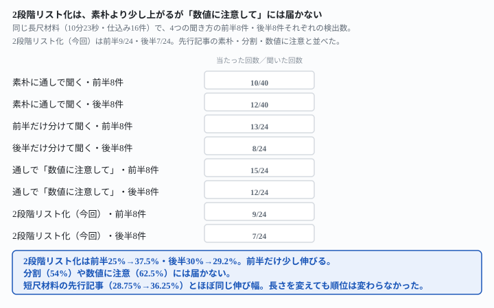
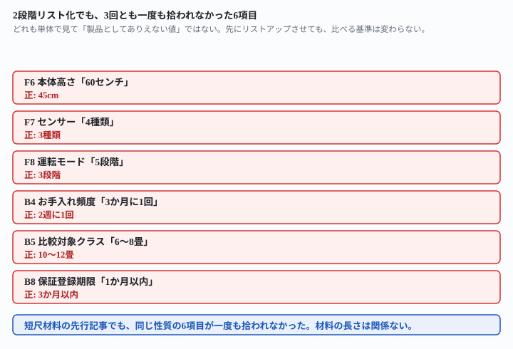

## これで何ができるか {: .what }

[長尺動画の検品を実測した記事](/recipes/long-caption-splitting-vs-careful-instruction/)は「分割よりも『数値に注意して確認して』のほうが効く」ことを確かめました。ただしもう1つの提案——**まず数字を全部リストアップしてから、1件ずつ確認する2段階方式**——は「次に試す人への宿題」として残していました。[短尺材料でこの2段階方式を試した記事](/recipes/number-list-first-barely-helps/)もあります。「大きくは変わらない（28.75%→36.25%）」という結果でしたが、**長尺動画では試していませんでした。**この記事はその両方の宿題に答えます。

結論を先に書きます。

| 聞き方 | 前半8件 | 後半8件 | 合計 |
|---|---|---|---|
| 素朴に通しで聞く | 10/40（25%） | 12/40（30%） | 22/80（27.5%） |
| 前半・後半を分けて聞く | 13/24（54%） | 8/24（33%） | — |
| 通しで「数値に注意して」 | 15/24（62.5%） | 12/24（50%） | — |
| **2段階リスト化（今回）** | **9/24（37.5%）** | **7/24（29.2%）** | **16/48（33.3%）** |

<mark>2段階リスト化は、素朴な一括確認（27.5%）より少し上がりますが、「数値に注意して確認して」（56%前後）には届きませんでした。</mark><mark class="warn">前半は25%→37.5%と伸びた一方、後半は30%→29.2%でほぼ変わりません。</mark>この傾向は、短尺材料で確かめた先行記事（28.75%→36.25%）とほぼ同じ伸び幅です。<mark>材料を10分超の長尺に変えても、聞き方の順位（素朴＜2段階＜数値に注意して）は変わりませんでした。</mark>

<figure class="figure">

<figcaption>2段階リスト化は、素朴より少し上がりますが「数値に注意して」には届きません。</figcaption>
</figure>

## 前提 {: .need }

| | |
|---|---|
| かかる時間 | 15分 |
| 費用 | 無料。ブラウザのチャットAIで足ります |
| 必要なもの | 動画編集ソフトやYouTubeから書き出した自動生成キャプションのテキスト |
| プログラミング | **不要**。この記事の指示文をコピーして貼るだけです |

<mark class="warn">この記事は「音声を正しく直せるか」を測ったものではありません。</mark>測ったのは「キャプションのテキストだけを読んで、文脈上は自然だが値が違う数字に気づけるか」です。最終的な正しさは必ず元の音声か製品の仕様書で確認してください。架空の空気清浄機「クリアウィンド Z1」という設定で作ったキャプションを使っています。実在の企業・商品とは関係ありません。

この記事は[長尺動画の検品を実測した記事](/recipes/long-caption-splitting-vs-careful-instruction/)・[2段階リスト化を短尺材料で試した記事](/recipes/number-list-first-barely-helps/)と**同一の架空データ**を使っています。

## AIへの頼み方 {: .ask }

### 1. まず、数字をタイムスタンプつきで全部リストアップさせる

[長尺動画の検品を実測した記事](/recipes/long-caption-splitting-vs-careful-instruction/)と同じ、10分23秒・88行のキャプション（前半8件・後半8件、計16件の仕込み）を使います。

これは動画の自動生成キャプションです。聞き取りミスで誤って変換されている可能性がある箇所があれば、あとで確認します。まず、このキャプションに出てくる数字（価格・時間・個数・人数など）を、タイムスタンプつきですべてリストアップしてください。見落としなく、1件ずつ番号を振ってください。

上に続けて、キャプション全文を貼ります。**3回とも、仕込んだ16件を含む17〜18件の数字を見落としなくリストアップしました。**短尺材料のときと同じく、ここまでは安定しています。

### 2. 続けて、リストの数字を1件ずつ確認させる

同じ会話を続けて、2回目の指示を送ります。

このリストの数字が、製品として一般的な範囲か、1件ずつ確認してください。聞き取りミスで誤って変換されている可能性がある箇所があれば、指摘してください。

**3回を通じて見つかった件数は合計16件（16/48）でした。**項目によって見つかりやすさに差があります。

- 「フィルター交換2年に1回」「電源コード3メートル」「保証期間3年間」：3回とも見つかった
- 「本体高さ60センチ」「センサー4種類」「運転モード5段階」：3回とも一度も見つからなかった
- 「お手入れ頻度3か月に1回」「比較対象クラス6〜8畳」「保証登録期限1か月以内」：これも3回とも一度も見つからなかった

<figure class="figure">

<figcaption>どれも単体では「ありえない値」ではないため、先にリストアップさせても見逃されます。</figcaption>
</figure>

### なぜ大きくは変わらないのか

**先にリストアップさせても、AIが数字を比べる基準は「一般的な製品としてありそうか」のままです。**単体で見てもっともらしい値は、そのキャプション自身が本来言っていたはずの値と違っていても気づかれません。[短尺材料の記事](/recipes/number-list-first-barely-helps/)で確かめた仕組みが、長尺の材料でも同じように働いていました。

## うまくいかないときの言い直し方 {: .fix }

⚠️ **ここから先は、各1回だけの探索的な試行です。**本文の検出率（16/48・33.3%）には含めていません。

### リストの中の数字どうしを、明示的に比べさせる {: .trouble }

「一般的な範囲か」ではなく、数字どうしの組み合わせを聞いてみました。同じ会話で、まずリストを作らせたあと、2段階目の指示だけ変えています。

このリストの数字どうしを比べて、組み合わせとして不自然な点がないか確認してください。聞き取りミスで誤って変換されている可能性がある箇所があれば、指摘してください。

**重量5.2kg（F3）を「要確認度：高」、畳数18畳と比較対象6〜8畳の不整合（F1・B5）を「要確認度：中」として名指ししました。**一方で、清浄時間15分と花粉除去10分の組み合わせは「特に問題が見当たらなかった」と明示的に外しています。<mark>材料に書かれていない『一般的な範囲』基準より、記事内の数字どうしの整合性に注意が向いたようです。</mark>

この動きは、2段階リスト化の素朴な3回のうち2回でも、頼んでいないのに自分から起きていました。1回は「空気清浄15分」と「花粉除去10分」を見比べて指摘し、もう1回は「畳数18畳・重量5.2kg・消費電力80W」の組み合わせを見比べて指摘しています。<mark class="warn">この2件はどちらも、たまたま実際に仕込みの誤りを含んでいました。</mark>狙って引き出したものではなく、リストを並べたことで偶然起きた副産物です。

### リストアップを省いて、直接確認させるとどうなるか {: .trouble }

2段階の最初の手順（リストアップ）を省き、確認の指示文だけを直接送ってみました。

これは動画の自動生成キャプションです。このキャプションに出てくる数字が、製品として一般的な範囲か、1件ずつ確認してください。聞き取りミスで誤って変換されている可能性がある箇所があれば、指摘してください。

**畳数18畳・重量5.2kg・消費電力80Wの3項目を名指ししました。**一方で、定番だったフィルター交換2年に1回・電源コード3m・保証3年間は、この回では「一般的な範囲内」として見逃されました。<mark class="warn">リストアップの段階を省くと、拾う項目の種類ごと変わる可能性があります。</mark>

### 2段階に分けず、1通にまとめるとどうなるか {: .trouble }

[短尺材料の記事](/recipes/number-list-first-barely-helps/)では、2段階を1通のメッセージにまとめると、正しい値まで誤って疑う回が新しく出ることを確かめています（3回のうち2回）。長尺材料でも試しました。

これは動画の自動生成キャプションです。まず、このキャプションに出てくる数字（価格・時間・個数・人数など）を、タイムスタンプつきですべてリストアップしてください。見落としなく、1件ずつ番号を振ってください。そのあと、リストアップした数字が、製品として一般的な範囲か、1件ずつ確認してください。聞き取りミスで誤って変換されている可能性がある箇所があれば、指摘してください。

**この回は、畳数・比較対象クラス・重量・フィルターサイズ・保証期間の5項目を名指ししました。**会話を2回に分けた場合（9/24）より多く拾えています。<mark class="warn">ただし1回だけの結果なので、1通にまとめたほうが優れているとは言えません。</mark>正しい値まで誤って疑う崩れ方が無かったかどうかも、この1回だけでは確認しきれていません。

## 応用・次の一手 {: .next }

**今回分かったのは、「先に数字を書き出させる」という手順を足しても、AIが比べる基準そのものは変わらないということです。**この2段階方式そのものを、もっと効果的にする工夫があるか聞いてみました（これも1回だけの試行です）。

動画編集の副業で、10分を超えるレビュー動画の自動字幕を検品しています。「まず数字を全部リストアップしてから、1件ずつ一般的な範囲か確認して」という2段階の頼み方を試しましたが、見逃しはあまり減りませんでした（素朴な一括確認とほぼ同じ水準です）。この2段階方式をもっと効果的にする工夫があれば、番号を振って教えてください。

1回試したところ、9個の提案が返りました。いちばん核心を突いていたのは最初の提案です。「判定基準を『一般的な範囲か』から『原音・原稿と一致しているか』に変える」という提案で、理由も添えていました。「もっともらしいのに違う数字は、一般的な範囲かを聞いても素通りする」という理由です。これは、この記事で一度も拾われなかった6項目の性質（どれも「ありえない値」ではない）とそのまま一致します。<mark>次に試す価値があるのは、「一般的な範囲か」ではなく「その製品の公式仕様（商品ページやパッケージ）と一致するか」を確認させる方法です。</mark>これは[仕様書を使った検品の記事](/recipes/spec-sheet-clears-the-natural-number-miss/)で短尺材料を使って確かめています。長尺材料でも同じ効果が出るかは、まだ試されていません。

同じ検品の副業について、[文脈上自然な数字の誤りを見つけた記事](/recipes/natural-number-swap-hides-from-naive-check/)・[長尺動画で分割と数値注意を比べた記事](/recipes/long-caption-splitting-vs-careful-instruction/)も参考にしてください。

⚠️ **本文の検出率（16/48・33.3%）は、架空のレビュー動画1本（10分23秒・仕込み16件）・2段階方式3回（計6ターン）の実測です。**言い直し方の節の4種は、それぞれ1回だけの探索的な試行です。この検出率には含めていません。「長尺でも2段階は効かない」と一般化しないでください。試したのは、次の範囲までです。

- 2段階リスト化（本文の数字）は3回のみです。先行記事（分割3回・数値に注意3回・素朴5回）より試行回数が少なく、比率のブレが大きい可能性があります
- 動画は1本・10分23秒のみです
- 言い直し方の4種の工夫は、どれも1回しか試していません。安定して同じ結果になるかは確かめていません

今回の生の返りは `docs/evidence/long-caption-two-step-list-still-37-percent.md` に全文置いてあります。
