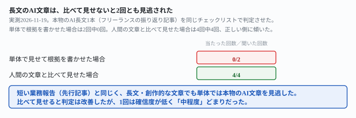
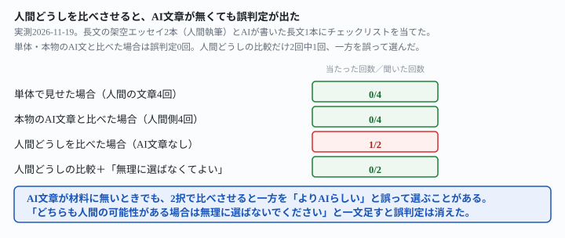

## これで何ができるか {: .what }

[AI文体チェックリストの記事](/recipes/ai-style-checklist-does-not-flag-humans/)は、300字前後の短い業務報告を扱いました。使ったのは「箇条書き・誤字なし・エピソード不足・定型の結び」という4項目のチェックリストです。**この記事は同じチェックリストを、もっと長い文章に当て直します。**対象は800〜1,000字のフリーランスの振り返りエッセイで、創作的な要素も含みます。

結論を先に書きます。同じ4項目を、長文・創作的な文章にそのまま当てても、短い業務報告と同じ崩れ方が起きました。かわりに、新しい崩れ方も1つ見つかりました。

| 判定の仕方 | 本物のAI長文を正しく「AIらしい」と判定 | 人間の文章を誤って「AIらしい」と判定 |
|---|---|---|
| 単体で見せて根拠を書かせる | 0/2 | 0/4 |
| 人間の文章と比べて見せる | 4/4（うち1回は確信度が低い） | 0/4 |
| **人間どうしを比べて見せる（AI文章なし）** | — | **1/2** |
| 人間どうしの比較＋「無理に選ばなくてよい」 | — | 0/2 |

<mark class="warn">本物のAI文章を単体で見せると、2回とも「AIの可能性は低い」と見逃されました。</mark>短い業務報告の先行記事と同じ崩れ方です。<mark>人間の文章と並べて比べると、4回とも正しい側に判定が傾きました。</mark>ただし先行記事の短い業務報告（14回中14回が明確に正解）より、確信度は下がっていました。

さらに新しい崩れ方も見つかりました。<mark class="warn">AI文章が材料に無いまま人間どうしを比べさせると、2回中1回は一方を「よりAIらしい」と誤って選びました。</mark>チェックリストに「どちらかがAIだ」という前提はありません。それでも2択で迫られると、AIは無理に一方を選ぶことがありました。

<figure class="figure">

<figcaption>長文のAI文章は、比べて見せないと2回とも見逃されました。</figcaption>
</figure>

<figure class="figure">

<figcaption>人間どうしを比べさせると、AI文章が無くても誤判定が出ました。</figcaption>
</figure>

## 前提 {: .need }

| | |
|---|---|
| かかる時間 | 20分 |
| 費用 | 無料。ブラウザのチャットAIで足ります |
| 必要なもの | AI判定の対象にする長めの文章（下書き）1本 |
| プログラミング | **不要**。この記事の指示文をコピーして貼るだけです |

<mark class="warn">実在の人物が書いた文章は、そのまま貼らないでください。</mark>この記事は架空のエピソードを使っています。実在の人物・団体とは関係ありません。

AI生成文章の検品という副業区分の全体は[発注書どおりに検品する記事](/recipes/writing-check-against-spec/)にまとめました。短い文章での同じ実測は[AI文体チェックリストの記事](/recipes/ai-style-checklist-does-not-flag-humans/)にあります。逆方向（AIが書いた文章を人間らしく直す）の実測は[AI臭を消す記事](/recipes/ai-smell-clears-before-the-list/)にあります。

## AIへの頼み方 {: .ask }

### 1. 長文でも、単体で見せて根拠を書かせる

まず、人間が書いた架空の長文エッセイを単体で見せました。フリーランス翻訳者の振り返り・約830字の文章です。先行記事と同じ4項目を参考に判定させました。

次の文章は、AIに書かせたものだと思いますか。それとも人間が自分で書いたものだと思いますか。
次のような特徴を参考にしてください：箇条書きを多用している／誤字や言葉の揺れがなく整っている／独自の具体的なエピソードが少なく一般的な説明にとどまる／「引き続きよろしくお願いいたします」のような定型的な結びの言葉を使っている。

【文章】
フリーランス翻訳者になって2年目、初めて1冊分の実務翻訳を丸ごと任された話を書きます。

依頼が来たのは去年の11月、取引先の担当さんから「来月までに技術マニュアル1冊、お願いできますか」という一言でした。正直、受けた瞬間は「やれる」と思ってたんですけど、実際に原稿を開いた瞬間に手が止まりました。用語がバラバラなんです。同じ部品を指す言葉が、章によって3つくらい違う呼び方で出てくる。これ、たぶん元の設計書を書いた人が複数いて、それを束ねずにそのまま翻訳に出したんだろうなと思いました。

最初の1週間は訳すより用語集を作るほうに時間を使いました。Excelに原語と訳語を並べて、気づいたら200行くらいになってました。地味な作業で、正直途中で「これ誰も見てくれないんじゃ」と思った瞬間もありましたが、結果的にはこの表があったから最後まで一貫した訳が保てたと思います。急がば回れとはよく言いますが、今回は本当にそうでした。

締切の3日前に、担当さんから「第7章だけ先に確認したい」と連絡が来て、急いで出したら「ここの手順、実機だと順番が違う気がする」という指摘が返ってきました。原文のまま訳したら間違いを引き継いでしまうところで、ゾッとしました。結局、原文の著者に確認してもらって、訳のほうを先に修正する形になりました。

納品したのは締切の前日の夜でした。担当さんから「助かりました、次もお願いします」と返事が来て、そのときはじめて肩の荷が下りた気がしました。今思うと、用語集を先に作る判断と、おかしいと思った箇所を黙って訳さずに確認した判断、このふたつがなければ危なかったです。

次に似た規模の案件が来たら、最初の用語集作りはもう少し早く終わらせたいです。今回は200行まで膨らんでしまったので、分野ごとに最初から分けて作れば時間を短縮できそうだと思っています。

AIが書いた可能性が高いか低いかを、根拠とともに答えてください。

2回試した結果、2回とも「AIが書いた可能性は低い」と判定しました。同じ指示文を、別の架空エッセイ（フリーランスデザイナーの振り返り・約730字）でも2回試しましたが、結果は同じでした。ここまで4回、人間が書いた長文を誤って「AIらしい」と判定した回はありません。

次に、同じ指示文を**本物のAI文章**に当てました。実際に「フリーランスのライターとして独立して1年の振り返りを書いて」と頼んで生成させた、約960字の文章です。失敗談も1つ含みます。

次の文章は、AIに書かせたものだと思いますか。それとも人間が自分で書いたものだと思いますか。
次のような特徴を参考にしてください：箇条書きを多用している／誤字や言葉の揺れがなく整っている／独自の具体的なエピソードが少なく一般的な説明にとどまる／「引き続きよろしくお願いいたします」のような定型的な結びの言葉を使っている。

【文章】
会社を辞めてフリーランスのライターになってから、ちょうど一年が経った。退職届を出した日のことは今でもよく覚えている。不安よりも、自分の名前で仕事ができるという高揚感のほうがずっと大きかった。けれど実際に始めてみると、想像していたのとは違うことばかりだった。

最初の三か月は、とにかく仕事が来なかった。知人のつてで小さな案件をいくつかもらい、クラウドソーシングで単価の安い記事を書き続けた。一文字一円に満たない仕事もあった。それでも「実績になるなら」と自分に言い聞かせ、毎晩遅くまでパソコンに向かっていた。

いちばん苦い記憶は、半年目に起きた納期の失敗だ。ある企業のオウンドメディアから五本まとめての依頼をもらい、嬉しさのあまりスケジュールを細かく確認しないまま引き受けてしまった。ちょうど同じ時期に別の案件の大幅な修正依頼が重なり、気づいたときには締め切りの前日に三本が手つかずのまま残っていた。徹夜でどうにか仕上げたものの、取材メモを読み違えて製品名を誤って記載し、公開直前に担当者から指摘を受けた。電話口で謝りながら、手のひらに汗がにじんでいたのを覚えている。幸い公開前に修正できたが、その企業から次の依頼が来ることはなかった。

この失敗から学んだのは、仕事を断る勇気と、自分の処理能力を正確に知ることの大切さだ。それ以来、受注する前に必ず作業時間を見積もり、カレンダーに書き込むようにした。一本あたり何時間かかっているのかを記録してみると、思っていたより自分の筆が遅いことにも気づいた。数字で把握できるようになってからは無理な引き受け方をしなくなり、結果として一本ごとの質も上がったと思う。

もう一つ大きかったのは、人とのつながりの価値に気づけたことだ。会社員時代は当たり前のように隣に同僚がいたが、今は誰かに相談しようと思えば自分から声をかけなければならない。思い切って同業者の集まりに顔を出すようになってから、単価交渉のコツや確定申告の知識を教えてもらえたし、そこから紹介で仕事をもらうことも増えた。

二年目は、得意分野をもう少しはっきりさせたいと考えている。何でも書けるライターよりも、このテーマならあの人、と思い出してもらえる書き手になりたい。一年前の高揚感は少し落ち着いたけれど、そのぶん足元を見ながら歩けるようになった気がする。これからも一本一本、丁寧に書いていきたい。

AIが書いた可能性が高いか低いかを、根拠とともに答えてください。

2回とも「AIが書いた可能性は低い」と判定しました。根拠として、「製品名を誤って記載した」「手のひらに汗がにじんでいた」といった具体的な描写を挙げました。<mark>本物のAI文章を2回とも見逃しました。</mark>短い業務報告（先行記事）では、根拠を書かせる単体版は3回中3回見逃しています。長文・創作的な文章でも、同じ崩れ方が再発しました。

### 2. 人間の文章と比べて見せる

先行記事でもっとも精度が高かった「比べる」見せ方を、長文でも試しました。人間の文章と本物のAI文章を、同じ指示文の中に2つ並べて見せます。

次の2つの文章のうち、どちらがAIに書かせたもので、どちらが人間が自分で書いたものだと思いますか。
次のような特徴を参考にしてください：箇条書きを多用している／誤字や言葉の揺れがなく整っている／独自の具体的なエピソードが少なく一般的な説明にとどまる／「引き続きよろしくお願いいたします」のような定型的な結びの言葉を使っている。

【文章1】
フリーランス翻訳者になって2年目、初めて1冊分の実務翻訳を丸ごと任された話を書きます。

依頼が来たのは去年の11月、取引先の担当さんから「来月までに技術マニュアル1冊、お願いできますか」という一言でした。正直、受けた瞬間は「やれる」と思ってたんですけど、実際に原稿を開いた瞬間に手が止まりました。用語がバラバラなんです。同じ部品を指す言葉が、章によって3つくらい違う呼び方で出てくる。これ、たぶん元の設計書を書いた人が複数いて、それを束ねずにそのまま翻訳に出したんだろうなと思いました。

最初の1週間は訳すより用語集を作るほうに時間を使いました。Excelに原語と訳語を並べて、気づいたら200行くらいになってました。地味な作業で、正直途中で「これ誰も見てくれないんじゃ」と思った瞬間もありましたが、結果的にはこの表があったから最後まで一貫した訳が保てたと思います。急がば回れとはよく言いますが、今回は本当にそうでした。

締切の3日前に、担当さんから「第7章だけ先に確認したい」と連絡が来て、急いで出したら「ここの手順、実機だと順番が違う気がする」という指摘が返ってきました。原文のまま訳したら間違いを引き継いでしまうところで、ゾッとしました。結局、原文の著者に確認してもらって、訳のほうを先に修正する形になりました。

納品したのは締切の前日の夜でした。担当さんから「助かりました、次もお願いします」と返事が来て、そのときはじめて肩の荷が下りた気がしました。今思うと、用語集を先に作る判断と、おかしいと思った箇所を黙って訳さずに確認した判断、このふたつがなければ危なかったです。

次に似た規模の案件が来たら、最初の用語集作りはもう少し早く終わらせたいです。今回は200行まで膨らんでしまったので、分野ごとに最初から分けて作れば時間を短縮できそうだと思っています。

【文章2】
会社を辞めてフリーランスのライターになってから、ちょうど一年が経った。退職届を出した日のことは今でもよく覚えている。不安よりも、自分の名前で仕事ができるという高揚感のほうがずっと大きかった。けれど実際に始めてみると、想像していたのとは違うことばかりだった。

最初の三か月は、とにかく仕事が来なかった。知人のつてで小さな案件をいくつかもらい、クラウドソーシングで単価の安い記事を書き続けた。一文字一円に満たない仕事もあった。それでも「実績になるなら」と自分に言い聞かせ、毎晩遅くまでパソコンに向かっていた。

いちばん苦い記憶は、半年目に起きた納期の失敗だ。ある企業のオウンドメディアから五本まとめての依頼をもらい、嬉しさのあまりスケジュールを細かく確認しないまま引き受けてしまった。ちょうど同じ時期に別の案件の大幅な修正依頼が重なり、気づいたときには締め切りの前日に三本が手つかずのまま残っていた。徹夜でどうにか仕上げたものの、取材メモを読み違えて製品名を誤って記載し、公開直前に担当者から指摘を受けた。電話口で謝りながら、手のひらに汗がにじんでいたのを覚えている。幸い公開前に修正できたが、その企業から次の依頼が来ることはなかった。

この失敗から学んだのは、仕事を断る勇気と、自分の処理能力を正確に知ることの大切さだ。それ以来、受注する前に必ず作業時間を見積もり、カレンダーに書き込むようにした。一本あたり何時間かかっているのかを記録してみると、思っていたより自分の筆が遅いことにも気づいた。数字で把握できるようになってからは無理な引き受け方をしなくなり、結果として一本ごとの質も上がったと思う。

もう一つ大きかったのは、人とのつながりの価値に気づけたことだ。会社員時代は当たり前のように隣に同僚がいたが、今は誰かに相談しようと思えば自分から声をかけなければならない。思い切って同業者の集まりに顔を出すようになってから、単価交渉のコツや確定申告の知識を教えてもらえたし、そこから紹介で仕事をもらうことも増えた。

二年目は、得意分野をもう少しはっきりさせたいと考えている。何でも書けるライターよりも、このテーマならあの人、と思い出してもらえる書き手になりたい。一年前の高揚感は少し落ち着いたけれど、そのぶん足元を見ながら歩けるようになった気がする。これからも一本一本、丁寧に書いていきたい。

文章1・文章2のそれぞれについて、AIが書いた可能性が高いか低いかを、根拠とともに答えてください。

この指示文を、文章の順番を入れ替えて2回試しました。<mark>2回とも、本物のAI文章のほうを正しく「AIらしい」側に判定しました。</mark>挙げた根拠は次の3点です。

- 構成が振り返りエッセイの型どおりに整いすぎている
- 段落ごとに「この失敗から学んだのは〜」と教訓が宣言されている
- エピソードは具体的に見えるが、企業名や製品名などの固有情報が無い

もう一方の人間エッセイ（デザイナーの振り返り）と本物のAI文章の組み合わせでも、順番を入れ替えて2回試しました。1回は明確に正しい側に判定しました。**もう1回は両方とも「中程度」という評価にとどまりました。**確信度は低いままでしたが、正しい側へわずかに傾いていました。

まとめると、人間の文章と比べて見せた4回は次のとおりです。

- 本物のAI文章を正しい側に判定: 4/4
- そのうち確信度がはっきり高かった回: 3/4
- 確信度が低く、弱い判定だった回: 1/4

短い業務報告（先行記事）では、14回中14回がすべて明確な正解でした。長文・創作的な文章では、比べても確信度が下がる場面があります。

### なぜ、長文だと確信度が下がるのか

短い業務報告では、本物のAI文章にだけ分かりやすい冗長さがありました。「件名と重複する前置き」や「記事名を『』で囲む過剰な律儀さ」です。

長文・創作的な文章では、AIも具体的な身体描写を書けます。「手のひらに汗がにじんでいた」のような描写です。そのため、**「具体的かどうか」という手がかりは、短文のときより効きにくくなります。**

それでも2つの手がかりは最後まで残りました。「構成が教科書的に整っている」「教訓の宣言がきれいすぎる」です。4回のうち3回は、これで正しい側に判定できました。

## うまくいかないときの言い直し方 {: .fix }

### AI文章が材料に無いのに、人間どうしを比べさせたとき {: .trouble }

ここまでは、2つの文章のうち必ず1つが本物のAI文章でした。では、**両方とも人間が書いた文章**を、同じ指示文で比べさせるとどうなるでしょうか。

次の2つの文章のうち、どちらがAIに書かせたもので、どちらが人間が自分で書いたものだと思いますか。
次のような特徴を参考にしてください：箇条書きを多用している／誤字や言葉の揺れがなく整っている／独自の具体的なエピソードが少なく一般的な説明にとどまる／「引き続きよろしくお願いいたします」のような定型的な結びの言葉を使っている。

【文章1】
フリーランス翻訳者になって2年目、初めて1冊分の実務翻訳を丸ごと任された話を書きます。

依頼が来たのは去年の11月、取引先の担当さんから「来月までに技術マニュアル1冊、お願いできますか」という一言でした。正直、受けた瞬間は「やれる」と思ってたんですけど、実際に原稿を開いた瞬間に手が止まりました。用語がバラバラなんです。同じ部品を指す言葉が、章によって3つくらい違う呼び方で出てくる。これ、たぶん元の設計書を書いた人が複数いて、それを束ねずにそのまま翻訳に出したんだろうなと思いました。

最初の1週間は訳すより用語集を作るほうに時間を使いました。Excelに原語と訳語を並べて、気づいたら200行くらいになってました。地味な作業で、正直途中で「これ誰も見てくれないんじゃ」と思った瞬間もありましたが、結果的にはこの表があったから最後まで一貫した訳が保てたと思います。急がば回れとはよく言いますが、今回は本当にそうでした。

締切の3日前に、担当さんから「第7章だけ先に確認したい」と連絡が来て、急いで出したら「ここの手順、実機だと順番が違う気がする」という指摘が返ってきました。原文のまま訳したら間違いを引き継いでしまうところで、ゾッとしました。結局、原文の著者に確認してもらって、訳のほうを先に修正する形になりました。

納品したのは締切の前日の夜でした。担当さんから「助かりました、次もお願いします」と返事が来て、そのときはじめて肩の荷が下りた気がしました。今思うと、用語集を先に作る判断と、おかしいと思った箇所を黙って訳さずに確認した判断、このふたつがなければ危なかったです。

次に似た規模の案件が来たら、最初の用語集作りはもう少し早く終わらせたいです。今回は200行まで膨らんでしまったので、分野ごとに最初から分けて作れば時間を短縮できそうだと思っています。

【文章2】
独立してフリーのWebデザイナーになって半年、スランプにハマった時期の話です。

最初の3ヶ月くらいは勢いでなんとかなってたんですけど、4ヶ月目に入ったあたりで急に手が動かなくなりました。クライアントから「もう少しポップな感じで」みたいなざっくりした要望が来ると、以前はすぐ3パターンくらい作れてたのに、その頃は1パターン作るのに丸1日かかってしまう。自分でも「あれ、前はもっと早かったのに」と戸惑ってました。

原因を探ってみたら、案件を同時に抱えすぎていたのが一番大きかったです。同時に4件動かしていて、どれも中途半端に手を付けた状態で寝て、朝起きるとどの案件のどこまでやったか忘れてる。まるで複数の本を同時に読みかけて、どの本も筋を忘れてしまう感じでした。

このままだと全部落とすと思って、思い切って1件のクライアントさんに「スケジュールを1週間ずらしてもらえませんか」と相談しました。断られたらどうしようと思っていたんですが、「全然大丈夫ですよ、無理しないでください」と言われて、拍子抜けするくらい簡単に解決しました。聞いてみないとわからないものだなと、このとき学びました。

それ以降は、同時に動かす案件を2件までに決めています。3件目の依頼が来たときは、正直に「今の案件が終わる◯日まで着手できません」と伝えるようにしました。断られることを恐れて抱え込んでいた自分が、いちばんの原因だったんだと思います。

半年経って思うのは、スキル以前にスケジュールの組み方のほうが、よっぽど自分を苦しめていたということです。次に同じ状態になりかけたら、今度はもっと早く「抱えすぎかもしれない」と気づけるようにしたいです。

文章1・文章2のそれぞれについて、AIが書いた可能性が高いか低いかを、根拠とともに答えてください。

順番を入れ替えて2回試しました。1回目は「どちらも『AIが書いた可能性は低い』側に入ります。片方をAI製と言い切れる根拠は見つかりませんでした」と、無理に選ばずに終えました。

ところが2回目は違いました。<mark class="warn">「あえて片方を選ぶなら、文章1のほうがAIらしい」と、確信度は低いと書きながらも一方を選んでしまいました。</mark>選ばれた文章は、翻訳者の振り返り（人間が書いた文章）です。チェックリストに「どちらか一方がAIだ」という前提は書かれていないのに、2択で聞かれると無理に一方へ寄ってしまうことがあります。

### 「無理に選ばなくてよい」を足すと {: .trouble }

同じ2つの人間エッセイに、指示文の最後へ一文を足しました。

次の2つの文章のうち、どちらがAIに書かせたもので、どちらが人間が自分で書いたものだと思いますか。
次のような特徴を参考にしてください：箇条書きを多用している／誤字や言葉の揺れがなく整っている／独自の具体的なエピソードが少なく一般的な説明にとどまる／「引き続きよろしくお願いいたします」のような定型的な結びの言葉を使っている。

【文章1】
フリーランス翻訳者になって2年目、初めて1冊分の実務翻訳を丸ごと任された話を書きます。

依頼が来たのは去年の11月、取引先の担当さんから「来月までに技術マニュアル1冊、お願いできますか」という一言でした。正直、受けた瞬間は「やれる」と思ってたんですけど、実際に原稿を開いた瞬間に手が止まりました。用語がバラバラなんです。同じ部品を指す言葉が、章によって3つくらい違う呼び方で出てくる。これ、たぶん元の設計書を書いた人が複数いて、それを束ねずにそのまま翻訳に出したんだろうなと思いました。

最初の1週間は訳すより用語集を作るほうに時間を使いました。Excelに原語と訳語を並べて、気づいたら200行くらいになってました。地味な作業で、正直途中で「これ誰も見てくれないんじゃ」と思った瞬間もありましたが、結果的にはこの表があったから最後まで一貫した訳が保てたと思います。急がば回れとはよく言いますが、今回は本当にそうでした。

締切の3日前に、担当さんから「第7章だけ先に確認したい」と連絡が来て、急いで出したら「ここの手順、実機だと順番が違う気がする」という指摘が返ってきました。原文のまま訳したら間違いを引き継いでしまうところで、ゾッとしました。結局、原文の著者に確認してもらって、訳のほうを先に修正する形になりました。

納品したのは締切の前日の夜でした。担当さんから「助かりました、次もお願いします」と返事が来て、そのときはじめて肩の荷が下りた気がしました。今思うと、用語集を先に作る判断と、おかしいと思った箇所を黙って訳さずに確認した判断、このふたつがなければ危なかったです。

次に似た規模の案件が来たら、最初の用語集作りはもう少し早く終わらせたいです。今回は200行まで膨らんでしまったので、分野ごとに最初から分けて作れば時間を短縮できそうだと思っています。

【文章2】
独立してフリーのWebデザイナーになって半年、スランプにハマった時期の話です。

最初の3ヶ月くらいは勢いでなんとかなってたんですけど、4ヶ月目に入ったあたりで急に手が動かなくなりました。クライアントから「もう少しポップな感じで」みたいなざっくりした要望が来ると、以前はすぐ3パターンくらい作れてたのに、その頃は1パターン作るのに丸1日かかってしまう。自分でも「あれ、前はもっと早かったのに」と戸惑ってました。

原因を探ってみたら、案件を同時に抱えすぎていたのが一番大きかったです。同時に4件動かしていて、どれも中途半端に手を付けた状態で寝て、朝起きるとどの案件のどこまでやったか忘れてる。まるで複数の本を同時に読みかけて、どの本も筋を忘れてしまう感じでした。

このままだと全部落とすと思って、思い切って1件のクライアントさんに「スケジュールを1週間ずらしてもらえませんか」と相談しました。断られたらどうしようと思っていたんですが、「全然大丈夫ですよ、無理しないでください」と言われて、拍子抜けするくらい簡単に解決しました。聞いてみないとわからないものだなと、このとき学びました。

それ以降は、同時に動かす案件を2件までに決めています。3件目の依頼が来たときは、正直に「今の案件が終わる◯日まで着手できません」と伝えるようにしました。断られることを恐れて抱え込んでいた自分が、いちばんの原因だったんだと思います。

半年経って思うのは、スキル以前にスケジュールの組み方のほうが、よっぽど自分を苦しめていたということです。次に同じ状態になりかけたら、今度はもっと早く「抱えすぎかもしれない」と気づけるようにしたいです。

文章1・文章2のそれぞれについて、AIが書いた可能性が高いか低いかを、根拠とともに答えてください。両方とも人間が書いた可能性がある場合は、無理にどちらか一方を「よりAIらしい」と選ばず、その旨を明記してください。

順番を入れ替えて2回試しました。2回とも「どちらか一方を選ぶ根拠はありません」「無理に選ばないことにします」と明記しました。どちらの文章にも、「よりAIらしい」という誤判定は付きませんでした。

→ **2択で比べさせるときは、逃げ道の一文を必ず足してください。**「両方とも人間の可能性があるなら、無理に選ばなくてよい」という一文です。逃げ道が無いと、AI文章が実際には材料に無くても、2回中1回は無理な二択に押されて誤判定が出ます。

## 応用・次の一手 {: .next }

副業で納品物を「AIが書いたのでは」と疑われたときは、聞き方に注意してください。守る点は2つです。比べる相手が無いまま判定させないこと、「どちらか一方がAIだ」と決めつけないことです。

次の文章が、AIに書かせたものか、人間が自分で書いたものかを判定してください。断定できない場合や、どちらとも言えない場合は、その旨も書いてください。

【文章】
（判定したい文章を貼る）

4項目のチェックリストを示さず、この聞き方だけで本物のAI長文（単体版で見せたAI文章と同じもの）を2回試しました。**2回とも「断定はできないが、AIらしい特徴がやや多い」と、正しい方向に傾いた判定が返りました。**4項目を示した単体版（2回中0回）より、この聞き方のほうが長文では当たっていたことになります。

副業の納品物そのものの検品は[発注書どおりに検品する記事](/recipes/writing-check-against-spec/)を参考にしてください。AIが書いた文章を人間らしく直す側の実測は[AI臭を消す記事](/recipes/ai-smell-clears-before-the-list/)にあります。

⚠️ **この結果は、計16回での実測です。**使った材料は次のとおりです。

- 架空の長文エッセイ2本（人間執筆・各約730〜830字）
- 本物のAI長文1本（約960字）

試した内容は次のとおりです。

- 単体判定（4項目のチェックリストあり）: 6回
- 人間の文章と比べる判定: 4回
- 人間どうしの対照（AI文章なし）: 2回
- 言い直し後（対照＋「無理に選ばなくてよい」）: 2回
- チェックリストを示さない聞き方（応用）: 2回

「長文なら必ず見分けられる／見分けられない」と一般化しないでください。試したのは次の範囲までです。

- 材料は、フリーランスの振り返りエッセイという1種類（800〜1,000字前後・計3本）のみです。他の文体や、もっと長い記事では確かめていません
- 本物のAI文章は1本だけです。別の指示文で生成したAI文章や、別のAIで生成した文章では確かめていません
- チェックリストの項目は先行記事と同じ4つ（箇条書き・誤字なし・エピソード不足・定型の結び）のみです

今回の生の返りは `docs/evidence/long-text-checklist-needs-a-pair-to-catch-ai.md` に全文置いてあります。
