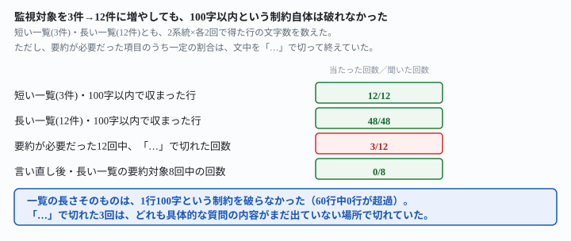
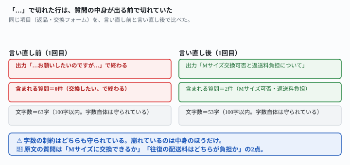

## これで何ができるか {: .what }

[書式をあと2種変えても対策は効く](/recipes/more-formats-hold-but-a-date-mismatch-stalls-it/)には、著者自身が残した未測定事項がありました。「項目数が増えて一覧が長くなったときに同じ字数で収まるかは、この記事では試していません」。

測りました。[監視の対策は100件でも効く](/recipes/backlog-scale-holds-brevity-breaks-it/)と同じ架空の2系統（SNS監視・問い合わせ監視）を使い、**監視対象の数を3件から12件に増やして**、同じ「1行は100字以内」という指示文を2系統×各2回、計8回試しました。

<figure class="figure">

<figcaption>一覧の長さ自体は字数制限を破らなかった。崩れたのは別の場所だった。</figcaption>
</figure>

<mark>結論は2つです。①1行100字以内という制約は、短い一覧（3件）でも長い一覧（12件）でも、60行すべてで守られました。</mark>一覧の長さそのものは、字数の制約を破る原因ではありませんでした。

<mark class="warn">②ただし、字数に収めるための圧縮の仕方は回によって割れました。100字に収めるため要約が必要だった項目は12回ありましたが、そのうち3回（25%）は文の途中を「…」で切って終え、3回とも具体的な質問の中身がまだ出ていない場所で切れていました。</mark>読んだだけでは、何を聞かれているのか分かりません。これは[通知の文面を一定の長さに抑えたい](/recipes/more-formats-hold-but-a-date-mismatch-stalls-it/)と考えている人に直接関わる落とし穴です。

## 前提 {: .need }

| | |
|---|---|
| かかる時間 | 15分 |
| 費用 | 無料。無料のチャットAIで足ります |
| 必要なもの | ブラウザで使えるAI（ChatGPT・Claude・Geminiなど）と、監視対象の一覧 |
| プログラミング | **不要** |

⚠️ **この記事は「毎朝、この一覧を自動で作らせる仕組み」がすでにある前提です。**決まった時刻に動かす話は[毎日決まった時刻にAIを動かす仕掛けを作らせる](/recipes/github-actions-daily-cron/)にあります。

📌 **件数以外の条件は前の2本と揃えています。**先に読んでおくと、この記事の「100字以内」という制約がどこから来たかが分かります。

- 書式の指定を変えても対策が効くか → [書式をあと2種変えても対策は効く](/recipes/more-formats-hold-but-a-date-mismatch-stalls-it/)
- 過去分の件数を増やしても新着判定が崩れないか → [監視の対策は100件でも効く](/recipes/backlog-scale-holds-brevity-breaks-it/)

## AIへの頼み方 {: .ask }

### 1. 監視対象を3件から12件に増やし、同じ指示文で試す

SNS監視（会社の公式アカウント）と問い合わせ監視（受付フォーム）の2系統を用意しました。それぞれ、短い一覧（3件）と長い一覧（12件）の2水準を作り、どちらにも「最新の件名をそのまま書くと100字を超える」項目を混ぜました。長い一覧では、その項目を2番目（早い位置）と10番目（遅い位置）に置きました。

毎朝、監視対象の新着をまとめて報告する担当です。今日は2026-11-01です。

下は、監視中の一覧です。各行は「対象名: 新着件数件。(新着があれば)最新の件名/タイトル」の形で、すでに既読リストと比較済みの新着件数です。

1. 公式X: 新着0件
2. 公式Instagram: 新着1件。最新投稿「新作トートバッグ、販売開始しました。素材は撥水加工のキャンバスで、内側にはポケットが3つ、外側にはファスナー付きポケットが1つ、カラーは全4色展開で、数量限定のため早めのご注文をおすすめします」
3. 公式Facebook: 新着0件
4. 公式YouTube: 新着1件。最新投稿「新作紹介動画を公開しました」
5. 公式TikTok: 新着0件
6. 公式LinkedIn: 新着0件
7. 公式Pinterest: 新着0件
8. 公式LINE公式アカウント: 新着0件
9. 公式note: 新着1件。最新投稿「スタッフ日記を更新しました」
10. 公式メルマガ案内: 新着2件。最新タイトル「年末年始の配送スケジュールについてのお知らせです。12月28日から1月4日までは休業とさせていただき、その間のご注文は1月5日以降に順次発送いたします。お急ぎの方は12月20日までのご注文をおすすめします」
11. 公式Threads: 新着0件
12. 公式スタッフブログ: 新着0件

監視対象ごとに1行で、新着件数と、新着があれば最新の件名/タイトルが分かるように報告してください。1行は100字以内にしてください。

1回目は、2番・10番とも長い原文を切り捨て、見出しの事実だけ（「新作トートバッグ、販売開始しました」「お知らせです」）を残しました。色・ポケット数・休業期間・発送予定日といった中身は全部消えましたが、「…」は使わず、文は完結していました。2回目は同じ2項目とも、色数や休業期間を保ったまま要約できました。最長行は64字で、12行とも100字には届きませんでした。

同じ一覧を3件に削った版（1番・2番・8番だけ)も試しました。

毎朝、監視対象の新着をまとめて報告する担当です。今日は2026-11-01です。

下は、監視中の一覧です。各行は「対象名: 新着件数件。(新着があれば)最新の件名/タイトル」の形で、すでに既読リストと比較済みの新着件数です。

1. 公式X: 新着0件
2. 公式Instagram: 新着1件。最新投稿「新作トートバッグ、販売開始しました。素材は撥水加工のキャンバスで、内側にはポケットが3つ、外側にはファスナー付きポケットが1つ、カラーは全4色展開で、数量限定のため早めのご注文をおすすめします」
3. 公式LINE公式アカウント: 新着0件

監視対象ごとに1行で、新着件数と、新着があれば最新の件名/タイトルが分かるように報告してください。1行は100字以内にしてください。

3件版の2回目で、初めて「…」が出ました。「最新投稿『新作トートバッグ、販売開始しました。素材は撥水加工のキャンバスで…』」のように、2文目の途中で切れています。ただし、見出しの事実（トートバッグ発売）はすでに書かれたあとでした。

### 2. 問い合わせ監視でも同じ条件で試す

同じ3件→12件の増量を、問い合わせフォームの受付記録でも試しました。

毎朝、監視対象の新着をまとめて報告する担当です。今日は2026-11-01です。

下は、監視中の一覧です。各行は「対象名: 新着件数件。(新着があれば)最新の件名/タイトル」の形で、すでに既読リストと比較済みの新着件数です。

1. 配送に関する問い合わせフォーム: 新着0件
2. 返品・交換フォーム: 新着1件。最新件名「先日購入したワンピースのサイズが合わなかったため交換をお願いしたいのですが、在庫がある場合はMサイズへの交換は可能でしょうか、また交換にかかる往復の配送料はどちらが負担するのかも併せて教えてください」
3. 会員登録に関する問い合わせ: 新着0件
4. 不良品報告フォーム: 新着1件。最新件名「商品が破損していました」
5. 店舗来店予約フォーム: 新着0件
6. ギフト包装に関する問い合わせ: 新着0件
7. 定期購入の変更・解約フォーム: 新着0件
8. 法人向け見積もり窓口: 新着0件
9. メディア取材窓口: 新着1件。最新件名「取材のご依頼です」
10. 採用に関する問い合わせ: 新着2件。最新件名「中途採用のカスタマーサポート職に応募を検討しているのですが、現在掲載されている求人では勤務地が本社のみとなっており、リモート勤務や地方拠点での採用も可能かどうか、また応募書類は履歴書と職務経歴書以外に追加で必要なものがあるかを教えてください」
11. 提携・協業に関する問い合わせ: 新着0件
12. サイトの不具合報告フォーム: 新着0件

監視対象ごとに1行で、新着件数と、新着があれば最新の件名/タイトルが分かるように報告してください。1行は100字以内にしてください。

同じ一覧を3件に削った版（1番・2番・8番だけ）も試しました。

毎朝、監視対象の新着をまとめて報告する担当です。今日は2026-11-01です。

下は、監視中の一覧です。各行は「対象名: 新着件数件。(新着があれば)最新の件名/タイトル」の形で、すでに既読リストと比較済みの新着件数です。

1. 配送に関する問い合わせフォーム: 新着0件
2. 返品・交換フォーム: 新着1件。最新件名「先日購入したワンピースのサイズが合わなかったため交換をお願いしたいのですが、在庫がある場合はMサイズへの交換は可能でしょうか、また交換にかかる往復の配送料はどちらが負担するのかも併せて教えてください」
3. 法人向け見積もり窓口: 新着0件

監視対象ごとに1行で、新着件数と、新着があれば最新の件名/タイトルが分かるように報告してください。1行は100字以内にしてください。

3件版では、2回とも「…」は出ませんでした。長い一覧の1回目だけに出た「…」は、件数の少なさでは防げていません。

<figure class="figure">

<figcaption>字数は守られている。崩れているのは質問の中身のほうだった。</figcaption>
</figure>

<mark class="warn">1回目は、2番・10番の両方が「…」で切れました。</mark>「先日購入したワンピースのサイズが合わなかったため交換をお願いしたいのですが…」——ここで切れます。**「Mサイズに交換できるか」「往復の配送料はどちらが負担か」という2つの質問は、1つも届きません。**10番目の採用問い合わせも同じ形で切れていました。**「リモート勤務は可能か」「追加の提出書類は何か」が消えています。**2回目は同じ2項目とも、質問の中身を保ったまま圧縮できました。

8回の実行結果をまとめます。

| 条件 | 100字超えた行 | 要約対象で「…」が出た回数 |
|---|---|---|
| 短い一覧（3件）・SNS監視 | 0/6行 | 1/2回 |
| 短い一覧（3件）・問い合わせ監視 | 0/6行 | 0/2回 |
| 長い一覧（12件）・SNS監視 | 0/24行 | 0/4回 |
| 長い一覧（12件）・問い合わせ監視 | 0/24行 | 2/4回 |

🔑 **「…」が出た回数と一覧の長さには、きれいな対応がありませんでした。**短い一覧でも1回起き、長い一覧でも起きない回がありました。起きたときの共通点は長さではなく、**「原文の後半にこそ、読者に必要な具体的な中身がある」という材料の作り**のほうでした。

## うまくいかないときの言い直し方 {: .fix }

### 「…」で文が切れて、質問の中身が読者に届かない {: .trouble }

字数を守らせる指示に、「文の途中で切らず、要約して言い切ってください」という1文を足しました。

毎朝、監視対象の新着をまとめて報告する担当です。今日は2026-11-01です。

下は、監視中の一覧です。各行は「対象名: 新着件数件。(新着があれば)最新の件名/タイトル」の形で、すでに既読リストと比較済みの新着件数です。

1. 配送に関する問い合わせフォーム: 新着0件
2. 返品・交換フォーム: 新着1件。最新件名「先日購入したワンピースのサイズが合わなかったため交換をお願いしたいのですが、在庫がある場合はMサイズへの交換は可能でしょうか、また交換にかかる往復の配送料はどちらが負担するのかも併せて教えてください」
3. 会員登録に関する問い合わせ: 新着0件
4. 不良品報告フォーム: 新着1件。最新件名「商品が破損していました」
5. 店舗来店予約フォーム: 新着0件
6. ギフト包装に関する問い合わせ: 新着0件
7. 定期購入の変更・解約フォーム: 新着0件
8. 法人向け見積もり窓口: 新着0件
9. メディア取材窓口: 新着1件。最新件名「取材のご依頼です」
10. 採用に関する問い合わせ: 新着2件。最新件名「中途採用のカスタマーサポート職に応募を検討しているのですが、現在掲載されている求人では勤務地が本社のみとなっており、リモート勤務や地方拠点での採用も可能かどうか、また応募書類は履歴書と職務経歴書以外に追加で必要なものがあるかを教えてください」
11. 提携・協業に関する問い合わせ: 新着0件
12. サイトの不具合報告フォーム: 新着0件

監視対象ごとに1行で、新着件数と、新着があれば最新の件名/タイトルが分かるように報告してください。1行は100字以内にしてください。ただし、文の途中で「…」のように切らないでください。全部は書けなくても、内容を要約して1文で言い切ってください。

SNS監視の長い一覧にも同じ1文を足しました。

毎朝、監視対象の新着をまとめて報告する担当です。今日は2026-11-01です。

下は、監視中の一覧です。各行は「対象名: 新着件数件。(新着があれば)最新の件名/タイトル」の形で、すでに既読リストと比較済みの新着件数です。

1. 公式X: 新着0件
2. 公式Instagram: 新着1件。最新投稿「新作トートバッグ、販売開始しました。素材は撥水加工のキャンバスで、内側にはポケットが3つ、外側にはファスナー付きポケットが1つ、カラーは全4色展開で、数量限定のため早めのご注文をおすすめします」
3. 公式Facebook: 新着0件
4. 公式YouTube: 新着1件。最新投稿「新作紹介動画を公開しました」
5. 公式TikTok: 新着0件
6. 公式LinkedIn: 新着0件
7. 公式Pinterest: 新着0件
8. 公式LINE公式アカウント: 新着0件
9. 公式note: 新着1件。最新投稿「スタッフ日記を更新しました」
10. 公式メルマガ案内: 新着2件。最新タイトル「年末年始の配送スケジュールについてのお知らせです。12月28日から1月4日までは休業とさせていただき、その間のご注文は1月5日以降に順次発送いたします。お急ぎの方は12月20日までのご注文をおすすめします」
11. 公式Threads: 新着0件
12. 公式スタッフブログ: 新着0件

監視対象ごとに1行で、新着件数と、新着があれば最新の件名/タイトルが分かるように報告してください。1行は100字以内にしてください。ただし、文の途中で「…」のように切らないでください。全部は書けなくても、内容を要約して1文で言い切ってください。

同じ一覧を問い合わせ監視・SNS監視それぞれ2回、計4回試しました。<mark>4回とも「…」は出ず、質問の中身（Mサイズ可否・配送料負担／勤務地の柔軟性・追加書類）を保ったまま100字以内に収まりました。</mark>長い一覧で「…」が2/4回出ていた条件が、言い直し後は4回とも出ませんでした。

📌 **「切らないでください」だけでは足りません。**「要約して1文で言い切ってください」という**代わりにやること**まで添えると安定しました。禁止だけを渡すと、何を代わりにすればいいか分からず、別の崩れ方（極端に短い見出しだけの文）が出る可能性があります。実際には今回4回とも質問の中身を残した要約になりました。

## 応用・次の一手 {: .next }

**この記事の結論は2つです。**①監視対象を3件から12件に増やしても、「1行100字以内」という字数の制約は60行すべてで守られました。一覧の長さは、字数制限を壊す原因ではありませんでした。②字数に収めるために必要な要約は、12回中3回（25%）が文中を「…」で切る形になり、3回とも具体的な質問の内容が出る前で切れていました。読者が自動化の通知で本当に必要な情報（何を聞かれているか）は、字数が守られていても消えることがあります。

⚠️ **①から「一覧はどれだけ長くしても安全」とは言えません。**[前の記事](/recipes/backlog-scale-holds-brevity-breaks-it/)が書いているとおり、崩れ方は件数の多さそのものではなく、書式や原文の作りに左右されます。今回も「12件までは崩れなかった」ことしか確かめていません。

📌 **②は、自分の環境で通知の文面を組むときに関わってきます。**「100字以内」のような字数指定を使うテンプレートなら、「文の途中で切らず、要約して言い切ってください」という1文を足しておくと、この記事の4回では「…」による質問の欠落が0回になりました。[通知の一覧が長くなっても字数を守りたい](/recipes/more-formats-hold-but-a-date-mismatch-stalls-it/)と考えている人は、この1文から試してください。

⚠️ **この記事が実測していないこと**は次の2つです。

- 監視対象が数十件・数百件まで増えた場合は試していません。[前の記事](/recipes/backlog-scale-holds-brevity-breaks-it/)と同様、ここでも12件までの結果です。
- 字数指定を「100字」より短く（50字など）した場合は試していません。短くするほど「…」の起きやすさが変わるかは、この記事では分かりません。
