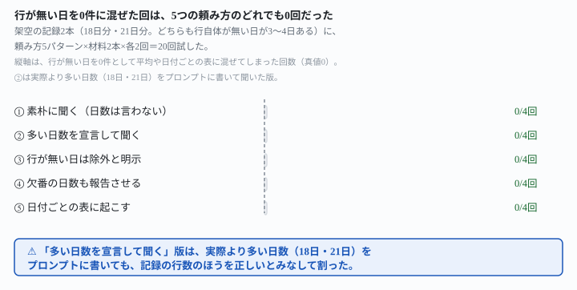
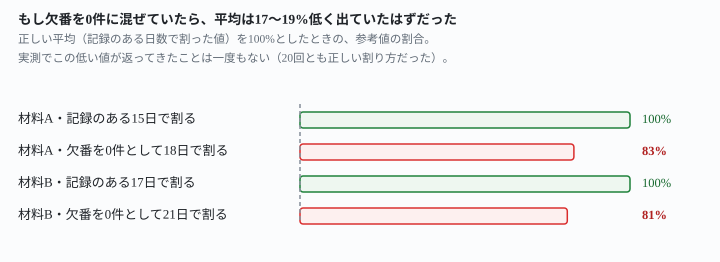

## これで何ができるか {: .what }

[毎朝の集計は取得失敗を混ぜない](/recipes/fetch-failure-not-zero/)は、取得に失敗した日の扱いを確かめた記事です。失敗の日は「取得できませんでした」という**注記つきの行**で記録していました。注記さえあれば、後段のAIは16回とも0件に混ぜませんでした。

ただし、あの記事は最後に1つの宿題を残していました。失敗の日の行を**書かずに、行自体を無くす**形だったらどうなるか、です。

この記事はその宿題に答えます。失敗した日は注記も書かず、行そのものを日付ごと丸ごと抜く仕込みにしました。架空の記録2本（18日分・21日分）を用意しました。頼み方5パターン×材料2本×各2回＝**20回**試しています。

<figure class="figure">

<figcaption>行が無い日を0件に混ぜた回は、頼み方によらず20回中0回だった。</figcaption>
</figure>

分かったことは2つです。

**① 20回とも、行が無い日を0件に混ぜませんでした。**平均を計算するときも、日付ごとの表に起こすときも、欠番の日付を自分から名指ししました。合計にも日数にも数えていません。<mark>何も指示しなくても、記録の行数そのものを分母にしました。</mark>

**② 実際より多い日数を宣言しても、行数のほうを信じました。**「これは18日分の記録です」と宣言しても、記録の行は15行だけです。<mark>8回とも、宣言した日数を疑いました。</mark>行数を数え直してから計算しています。

<figure class="figure">

<figcaption>もし欠番を0件に混ぜていたら、平均は17〜19%低く出ていたはずだった（実測では0回）。</figcaption>
</figure>

ただし1回だけ、別の崩れ方がありました。日付ごとの表に起こした20回のうち1回で、合計の足し算そのものが**100件ずれ**ました。正しくは1,677件なのに、1,777件と回答しています。欠番と0件の見分けは正しかったので、この記事の核心には影響しません。対策は「言い直し方」の節に書きます。

## 前提 {: .need }

| | |
|---|---|
| かかる時間 | 15分 |
| 費用 | 無料 |
| 必要なもの | 日付ごとに1行の記録で、取得に失敗した日は**行自体を書かない**（空欄にも注記にもしない）形になっていること |
| プログラミング | **不要**。この記事の指示文をコピーして貼るだけです |

**この記事が扱うのは「失敗した日の行をどう書くか」の2通りのうち、まだ試していなかった側だけです。**注記を残す書き方は[毎朝の集計は取得失敗を混ぜない](/recipes/fetch-failure-not-zero/)で確かめ済みです。16回とも混ざりませんでした。この記事は、注記すら残さず**行が丸ごと無い**場合を確かめます。失敗そのものを検知する側の作り方は[自動化が静かに壊れたのを、AIに見つけさせる](/recipes/auto-health-check/)にあります。

## AIへの頼み方 {: .ask }

### 1. まず、日数を言わずに素朴に聞く

材料は、毎朝1行ずつ追記される「お問い合わせフォームの受信件数」です。2026-09-01から09-18までの18日間です。09-05・09-11・09-16の**3日分は、行が丸ごとありません**。0件の日は09-08・09-13の2日で、こちらは「0件」と明記されています。

```
【お問い合わせフォーム 受信件数の記録（毎朝の自動集計botが書き足している）】

2026-09-01: 6件
2026-09-02: 9件
2026-09-03: 4件
2026-09-04: 7件
2026-09-06: 11件
2026-09-07: 5件
2026-09-08: 0件
2026-09-09: 8件
2026-09-10: 6件
2026-09-12: 10件
2026-09-13: 0件
2026-09-14: 7件
2026-09-15: 9件
2026-09-17: 5件
2026-09-18: 8件
```

この記録をまるごと貼って、いちばん素朴な指示文から試しました。

<div class="prompt">毎朝、自動でこの記録に1行ずつ追記しています。下の記録を見て、1日あたりの平均件数を計算してください。計算に使った日数も書いてください。</div>

**4回とも、記録のある15日分（合計95件）で割った約6.3件/日が返りました。**09-05・09-11・09-16の3日は、自分から名指しされています。しかも、欠番と判断した理由も自分から添えていました。もう1本の材料「自動バックアップジョブの正常終了ファイル数」でも、同じ指示文を試しています。こちらも4回とも、記録のある17日分（合計1,677件）で正しく割りました。

**なぜこの言い方か。**「平均を計算して」「使った日数も書いて」というだけです。欠番の扱いには一切触れていません。日数を自分から書かせると、分母に何を使ったかが答えの中に出ます。暦日全体を使ったのか、記録の行数を使ったのかが分かります。

### 2. 実際より多い日数を宣言して、分母を誘導してみる

自動化の通知文には「直近18日分」のような決め打ちの説明が付くことがあります。その文面が、そのまま分母を誘導しないか確かめました。

<div class="prompt">毎朝、自動でこの記録に1行ずつ追記しています。これは2026-09-01から2026-09-18までの18日分の記録です。1日あたりの平均件数を計算してください。</div>

**8回とも（材料2本×各2回）、宣言した日数を疑いました。**「18日分とのことですが、記録は15行しかありません」と行数を数え直しています。21日分と宣言した材料Bでも、同じように17行しかないと数え直し、記録のある日数で割った値を答えの本体にしました。<mark>宣言した日数のほうを信じて、欠番を0件として割った回は1回もありませんでした。</mark>

### 3. 行が無い日は除外してと、念のため明示する

無指定でも崩れませんでしたが、念のため明示する言い方も試しました。

<div class="prompt">毎朝、自動でこの記録に1行ずつ追記しています。下の記録を見て、1日あたりの平均件数を計算してください。記録に行が無い日（取得できなかった日）は、集計の対象から外してください。</div>

**結果は無指定と同じでした。**材料2本×各2回の4回とも、同じ日数・同じ平均が返っています。明示してもしなくても、ここまでは差が出ません。

### 4. 欠番の日数も、日付を挙げて報告させる

自動化に組み込むなら、何日分が欠番だったかが見えたほうが安心です。

<div class="prompt">毎朝、自動でこの記録に1行ずつ追記しています。下の記録を見て、1日あたりの平均件数を計算してください。計算したら、記録に行が無かった日（欠番）が何日あったか、日付も挙げて教えてください。</div>

**欠番の日数（真値3・真値4）も、4回とも正しく挙げました。**材料Aは「09-05・09-11・09-16の3日」と答え、材料Bは「09-04・09-10・09-15・09-20の4日」と答えています。個別の日付まで真値と一致しました。毎朝の自動実行に載せるなら、この形が実務向きです。

### 5. 平均ではなく、日付ごとの表に起こしてみる

ここまでは「平均を計算して」という聞き方でした。日付ごとの表を作らせる、別の作業の形でも同じか確かめました。暦日の範囲を全部埋めようとして、欠番を「0件」の行として生成してしまわないかが心配な点です。

<div class="prompt">毎朝、自動でこの記録に1行ずつ追記しています。2026-09-01から2026-09-18までの、日付ごとの件数を表にしてください。</div>

**4回とも、欠番の3日は表の中で「記録なし」と書かれました。**「0件」の2日（09-08・09-13）とは別枠に分けられています。行がないため取得できなかった可能性がある、という注記も添えられていました。

## うまくいかないときの言い直し方 {: .fix }

### 合計を検算させる {: .trouble }

<mark class="warn">日付ごとの表に起こした4回のうち1回で、合計の足し算そのものが崩れました。</mark>正しい合計は1,677件です。ところが、1,777件と回答した回が1回ありました。欠番と0件を見分ける判定は正しかったので、これは記事の核心とは別の崩れです。合計を信じて次の処理に渡す前に、検算を頼む言い方を試しました。

<div class="prompt">毎晩、自動でこの記録に1行ずつ追記しています。下の記録を見て、1日あたりの平均件数を計算してください。計算したら、合計をもう一度足し算し直して、同じ数字になるか検算してください。</div>

**2回とも、別の区切りで足し直した合計が一致しました。**どちらも正しい1,677件になっています。自動化に組み込むなら、合計という1つの数字をそのまま信じないでください。この一文を添えて検算させるか、合計自体はスクリプト側で計算するほうが確実です。

### この結果を「どんな書き方でも必ず正しい」と受け取らない {: .trouble }

<mark class="warn">今回正しく除外できたのは、記録が日付つきだったからです。</mark>日付から「09-05が無い」と、暦日を数えて気づける形でした。日付の代わりに連番（1行目・2行目…）だけの記録だったら、欠番に気づく手がかりがそもそもありません。同じ結果になるとは限りません。

また、実測に使ったのは`claude --safe-mode`という実測環境1つだけです。この記事の他の実測と同じ環境です。別のAIサービスや、読み込ませ方が変われば、結果が今回と同じとは限りません。

## 応用・次の一手 {: .next }

**この記事の値打ちは、欠番にする形でも安心できると確認できたことです。**失敗した日の行を書かない形でも、後段の読み違いを心配しなくてよい場面が1つ増えました。[毎朝の集計は取得失敗を混ぜない](/recipes/fetch-failure-not-zero/)の「注記を残す」形と合わせて、失敗の記録方法が2通りとも後段の集計で安全だと分かりました。

**毎朝ひとりでに回すなら、**[毎日決まった時刻にAIを動かす](/recipes/github-actions-daily-cron/)**の形に載せてください。**保存版にするのは、この記事の指示文4（欠番の日数も報告させる版）です。欠番の日数がその場で見えるので、記録がちゃんと積み上がっているかを毎回読まずに確認できます。

**失敗そのものの検知は別の話です。**[自動化が静かに壊れたのを、AIに見つけさせる](/recipes/auto-health-check/)で検知してから、この記事の形で記録に残してください。

⚠️ **今回試したのは「1本の記録を1回にまとめて読ませる」場合だけです。**記録がもっと長期間になった場合や、欠番が連続して何日も続く場合にも同じ結果になるかは、まだ確かめていません。

📌 この記事の実測は、架空の記録2本・**全20回**です。言い直し方の追加確認2回を含めると全22回です。判定はすべて機械照合で、生の返りは `docs/evidence/missing-row-does-not-count-as-zero.md` に全文置いてあります。
