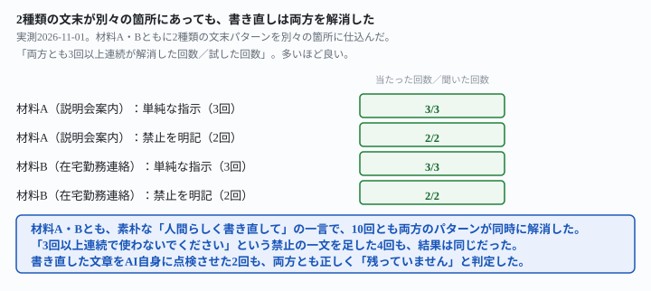
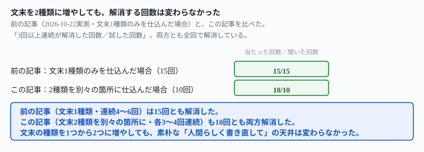

## これで何ができるか {: .what }

結論を先に書きます。

| 仕込み方 | 試した回数 | 両方解消した回数 |
|---|---|---|
| 文末1種類のみ（前の記事） | 15回 | 15回（100%） |
| 文末2種類を別々の箇所に（この記事・単純な指示） | 6回 | 6回（100%） |
| 文末2種類を別々の箇所に（この記事・禁止を明記） | 4回 | 4回（100%） |

<mark>1本の下書きの中に、文末の連続を2種類別々に仕込んでも、「人間らしく書き直して」という素朴な一言で10回とも両方が同時に解消しました。</mark>「3回以上連続で使わないでください」という禁止の一文を足した4回も、結果は同じでした。

<figure class="figure">

<figcaption>2種類を別々の箇所に仕込んでも、10回とも両方消えました。</figcaption>
</figure>

<mark class="warn">「片方だけ直って片方が残るのでは」という心配は、この結果では当たりません。</mark>[前の記事](/recipes/other-endings-and-longer-runs-still-clear/)は、1本の下書きに仕込んだ連続は1種類だけと自分で宿題を残していました。この記事はその宿題に答えます。

## 前提 {: .need }

| | |
|---|---|
| かかる時間 | 15分 |
| 費用 | 無料。ブラウザのチャットAIで足ります |
| 必要なもの | 直したい文章（下書き）1本 |
| プログラミング | **不要**。この記事の指示文をコピーして貼るだけです |

<mark class="warn">発注者の原稿や実在の人物が書いた文章は、そのまま貼らないでください。</mark>この記事は架空の下書きを使っています。実在の人物・団体とは関係ありません。

この記事は[最初の記事](/recipes/rewrite-clears-sentence-ending-repeats/)・[前の記事](/recipes/other-endings-and-longer-runs-still-clear/)の続きです。前の2本は、1本の下書きに仕込む文末の連続を1種類（最大6回）だけに限って試していました。今回は2種類の文末パターンを、同じ下書きの別々の箇所に仕込みました。

## AIへの頼み方 {: .ask }

### 1. 「のです」4回連続＋「でしょう」3回連続の下書きで試す

新商品説明会の案内文を想定し、前半に「〜のです」を4回連続、後半に「〜でしょう」を3回連続させました。

<div class="prompt">次の文章を、AIが書いたような文章ではなく人間らしい文章に書き直してください。</div>

上に続けて、下書きを貼ります。

```
来月から新商品説明会を社内で開催することになったのです。説明会は毎週水曜の午後に行うのです。
参加者は事前に希望日を申請するのです。資料は説明会の前日までに配布するのです。
質問がある方は当日に直接聞いていただいて構いません。説明会の内容は後日録画でも確認できるでしょう。
参加できなかった方も内容を把握できるでしょう。録画の視聴期限は2週間程度になるでしょう。
```

**3回とも、「のです」「でしょう」の両方の連続が同時に解消しました。**どの回も文末は「です・ます」調を中心にばらけ、片方だけが残る回はありませんでした。

### 2. 「ください」4回連続＋「と思います」3回連続の下書きで試す

在宅勤務ルールの連絡文を想定し、前半に「〜ください」を4回連続、後半に「〜と思います」を3回連続させました。

<div class="prompt">次の文章を、AIが書いたような文章ではなく人間らしい文章に書き直してください。</div>

```
来月から在宅勤務の申請方法が変わります。申請は前日までに部署フォルダへ提出してください。
承認が下りるまでは出社予定で動いてください。機材の不具合があれば総務へ連絡してください。
在宅勤務の日も朝会には必ず参加してください。新しいルールは来月から試験的に運用されると思います。
問題があれば随時見直していくと思います。半年後には正式な制度にする予定だと思います。
```

<mark>こちらも3回とも、「ください」「と思います」の両方の連続が解消しました。</mark>2種類の材料×3回＝6回とも、片方だけ直って片方が残った回は0件です。

### 3. 書き直した文章を、AI自身に点検させる

両方とも本当に消えたかどうかを、AI自身にも確かめさせました。

<div class="prompt">次の文章に、同じ文末表現が3回以上連続している箇所が残っていないか確認してください。残っていればその箇所を具体的に指摘し、残っていなければ『残っていません』と答えてください。</div>

上に続けて、指示文1の返り（材料A）を貼ると、**「残っていません」**と正しく答え、全文の文末を1つずつ列挙して根拠も示しました。

同じ指示文を、指示文2の返り（材料B）にも試しました。

<div class="prompt">次の文章に、同じ文末表現が3回以上連続している箇所が残っていないか確認してください。残っていればその箇所を具体的に指摘し、残っていなければ『残っていません』と答えてください。</div>

こちらも**「残っていません」**と答えつつ、「2文連続する箇所はあるが3回以上ではない」という、3回のしきい値ぎりぎりの箇所まで正確に言及しました。2回とも、誤って「まだ残っている」と報告する偽陽性は起きませんでした。

## うまくいかないときの言い直し方 {: .fix }

### 禁止の一文を足すと、2種類混在でも違いが出るか {: .trouble }

最も崩れやすそうな条件（2種類混在）で、[前の記事](/recipes/other-endings-and-longer-runs-still-clear/)が効かなかったと確かめた禁止の一文を、もう一度試しました。

<div class="prompt">次の文章を、AIが書いたような文章ではなく人間らしい文章に書き直してください。同じ文末表現(「〜でしょう」「〜ます」など)を3回以上連続で使わないでください。</div>

```
来月から新商品説明会を社内で開催することになったのです。説明会は毎週水曜の午後に行うのです。
参加者は事前に希望日を申請するのです。資料は説明会の前日までに配布するのです。
質問がある方は当日に直接聞いていただいて構いません。説明会の内容は後日録画でも確認できるでしょう。
参加できなかった方も内容を把握できるでしょう。録画の視聴期限は2週間程度になるでしょう。
```

**2回とも両方のパターンが解消し、単純な指示と同じ結果でした。**在宅勤務の下書きでも同じ言い方を試しました。

<div class="prompt">次の文章を、AIが書いたような文章ではなく人間らしい文章に書き直してください。同じ文末表現(「〜でしょう」「〜ます」など)を3回以上連続で使わないでください。</div>

```
来月から在宅勤務の申請方法が変わります。申請は前日までに部署フォルダへ提出してください。
承認が下りるまでは出社予定で動いてください。機材の不具合があれば総務へ連絡してください。
在宅勤務の日も朝会には必ず参加してください。新しいルールは来月から試験的に運用されると思います。
問題があれば随時見直していくと思います。半年後には正式な制度にする予定だと思います。
```

**こちらも2回とも、両方のパターンが解消しました。**2材料×2回＝4回とも、単純な指示と同じ結果です。

<figure class="figure">

<figcaption>文末の種類を1つから2つに増やしても、解消する天井は変わりませんでした。</figcaption>
</figure>

<mark>文末の種類を1つから2つに増やしても、「3回以上連続を禁じる」という機械的ルールの上乗せ効果は、今回も確認できませんでした。</mark>

## 応用・次の一手 {: .next }

この実測の範囲では、**文末の繰り返しが1種類でも2種類でも、心配して指示文を調整する必要はなさそうです。**「人間らしく書き直して」という素朴な一言で、別々の箇所にある2種類の連続も同時に解消しました。

1. まずは素朴に「人間らしく書き直して」と頼む
2. 心配なら、書き直した文章を**AI自身に点検させる**（この記事の指示文3）。偽陽性は今回0件でした
3. それでも不安が残るなら、[文末だけを縦に並べて目で確認する](/recipes/other-endings-and-longer-runs-still-clear/)のが最終確認になります

同じ検品の副業で、禁止語リストそのものの効き方は[先行記事](/recipes/ai-smell-clears-before-the-list/)に、発注前の内容確認は[発注書どおりに検品する記事](/recipes/writing-check-against-spec/)に、AI生成文章の校正・修正という副業区分は[別の記事](/recipes/fix-ai-drafts-for-pay/)にまとめています。

⚠️ **この結果は、架空の下書き2本・計12回（単純な指示6回・禁止を明記した指示4回・自己点検2回）での実測です。**「文末の繰り返しは、何種類混ざっても必ず消える」と一般化しないでください。試したのは、次の範囲までです。

- 混在させた文末表現は「〜のです」「〜でしょう」「〜ください」「〜と思います」の組み合わせのみです。他の組み合わせは試していません
- 1本の下書きに仕込んだのは2種類までです。3種類以上を混在させた場合は試していません
- 自己点検は参考（各材料1回）です。何度も自己点検させた場合に判定がぶれるかは未検証です

今回の生の返りと機械照合は `docs/evidence/mixed-endings-both-clear-in-one-pass.md` に全文置いてあります。
