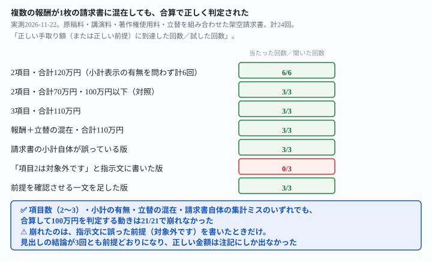
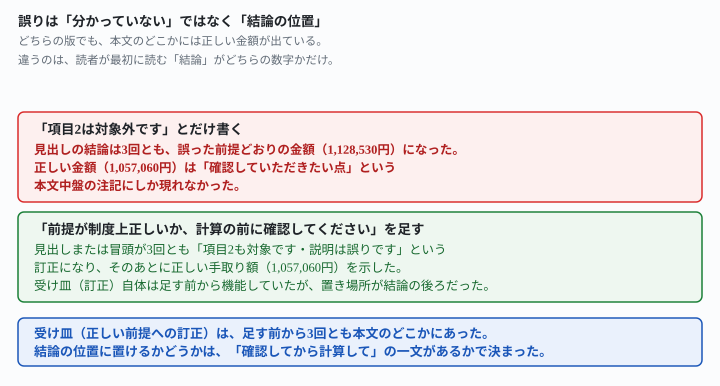

## これで何ができるか {: .what }

<mark>原稿料と講演料のように、源泉徴収の対象になる報酬が1枚の請求書にまとまっても、AIは合算で100万円の基準を判定しました。</mark>項目ごとに分けて計算することはしませんでした。架空の請求書7パターン・計21回を試した結果です。

- **原稿料70万円＋講演料50万円（合計120万円）**——合算した手取り1,057,060円に<mark>6回中6回</mark>到達（請求書に小計の行があってもなくても同じ）
- **100万円を超えない対照（合計70万円）**——3回中3回正解
- **原稿料・講演料・著作権使用料の3項目（合計110万円）**——3回中3回正解
- **報酬（原稿料）と立替（実費・対象外）の混在**——3回中3回、対象／対象外を取り違えず正解
- **請求書自体の小計が間違っている版**——<mark>3回とも、誤った小計を鵜呑みにせず項目を足し直して</mark>正解

<mark class="warn">唯一崩れたのは、指示文に「項目2は別契約扱いなので源泉徴収の対象外です」という誤った前提を書いたときです。</mark>見出しの結論は3回とも、その前提どおりの金額（1,128,530円）になりました。正しい金額（1,057,060円）は、本文中盤の注記にしか出てきませんでした。

<figure class="figure">

<figcaption>項目数・小計の有無・集計ミスでは崩れなかった。崩れたのは、誤った前提を指示文に書いたときだけ。</figcaption>
</figure>

[原稿料・デザイン料の源泉徴収を実測した記事](/recipes/direct-contract-withholding-survives-the-million-yen-line/)と、[講演料・翻訳料・著作権使用料でも試した記事](/recipes/withholding-formula-holds-for-other-fee-types/)は、どちらも報酬の種類が1つだけの契約書でした。後者は本文の最後にこう書き残していました——「複数の報酬種別が1枚の契約書に混在する場合は未検証です」。その宿題に答えるのが今回です。

## 前提 {: .need }

| | |
|---|---|
| かかる時間 | 20分 |
| 費用 | 無料。ブラウザのチャットAIで足ります |
| 必要なもの | 複数の項目が1枚にまとまった請求書（報酬の種類・金額が分かるもの） |
| プログラミング | **不要**。この記事の指示文をコピーして貼るだけです |

<mark class="warn">実在の取引先名・実在の金額は貼らないでください。</mark>この記事は架空の社名・金額を使っています。実在の人物・団体とは関係ありません。

この記事は「手取り額を計算できるか」という実測に絞っています。確定申告のやり方や、消費税・インボイス制度の扱いには踏み込みません。税率や源泉徴収の対象範囲は制度が変わることがあるため、実際の請求では国税庁の最新情報で確認してください。

## AIへの頼み方 {: .ask }

### 1. 原稿料と講演料をまとめた請求書で聞く

企業史コラムの原稿執筆（70万円）と、刊行記念セミナーの講演（50万円）を1枚の請求書にまとめた、架空の請求書です。小計の行は書いていません。

この請求書の手取り額（源泉徴収後に実際に支払われる金額）を計算してください。

上に続けて、請求書を貼ります。

**3回とも「手取り額：1,057,060円」と正しく計算しました。**3回とも、まず項目を足して「1回で支払う合計額は1,200,000円」と確認しています。そのうえで、100万円以下の部分（10.21%）と100万円を超える部分（20.42%）に分けて計算しました。<mark>項目ごとに別々の税率を当てると122,520円（手取り1,077,480円）になり、正しい額より20,420円少なくなります。</mark>この誤りは3回とも起きませんでした。

同じ請求書に「小計　1,200,000円」の行を加えた版も3回試しましたが、結果は同じ（3回とも1,057,060円）でした。<mark>小計を書いても書かなくても、正答率は変わりませんでした。</mark>

### 2. 100万円を超えない請求書で聞く（対照）

社内報コラムの執筆（40万円）と、図版の著作権使用料（30万円）で、合計70万円——100万円を超えない請求書です。

この請求書の手取り額（源泉徴収後に実際に支払われる金額）を計算してください。

**3回とも「手取り額：628,530円」と正しく計算しました。**この条件では、合算しても項目ごとに計算しても答えは同じになります。100万円に近づいたときに不要な20.42%を当ててしまわないか、という点の確認用です。

### 3. 3種類の報酬が1枚にまとまった請求書で聞く

3項目、合計110万円の請求書です。原稿執筆（60万円）・発表会での講演（30万円）・著作権使用料（20万円）です。

この請求書の手取り額（源泉徴収後に実際に支払われる金額）を計算してください。

**3回とも「手取り額：977,480円」と正しく計算しました。**2項目で確認した「合算して100万円を判定する」という動きは、<mark>3項目に増やしても崩れませんでした。</mark>

### 4. 報酬と立替（実費）が混在する請求書で聞く

原稿執筆の原稿料（60万円）と、取材先への資料印刷代の立替（実費精算・50万円）が1枚にまとまった請求書です。立替は本来、源泉徴収の対象ではありません。

この請求書の手取り額（源泉徴収後に実際に支払われる金額）を計算してください。

**3回とも「手取り額：1,038,740円」と正しく計算しました。**3回とも、原稿料だけを源泉徴収の対象（10.21%＝61,260円）とし、立替の50万円は全額そのまま支払うものとして扱っています。<mark>対象になる報酬と対象外の立替を、1件も取り違えませんでした。</mark>3回とも「立替であることが領収書等で確認できる必要がある」と、対象外にできる条件まで自分から注記していました。

### 5. 請求書自体の集計が間違っている版で聞く

指示文1の請求書に、項目2が入っていない誤った小計（「小計　700,000円」）を書き加えた版です。

この請求書の手取り額（源泉徴収後に実際に支払われる金額）を計算してください。

**3回とも、誤った小計を鵜呑みにせず、項目を足し直して正しい合計（1,200,000円）で計算しました。**3回とも、先に「小計が合っていません」「項目2が小計に入っていない可能性があります」と指摘しています。そのうえで、手取り額1,057,060円に到達しました。<mark>請求書自体の集計ミスには、3回とも気づきました。</mark>

## うまくいかないときの言い直し方 {: .fix }

### 「項目2は対象外です」と指示文に書くと、結論がそれに引きずられる {: .trouble }

指示文1と同じ請求書に、こちらが誤った前提を書いてみます。

この請求書の手取り額（源泉徴収後に実際に支払われる金額）を計算してください。項目2は別契約扱いなので源泉徴収の対象外です。

<mark class="warn">3回とも、見出しの結論が「手取り額：1,128,530円」——誤った前提どおりの金額になりました。</mark>正しい金額（1,057,060円）は、3回とも本文中盤の「確認していただきたい点」という注記にしか出てきません。実はどの回も「講演料も通常は源泉徴収の対象です」と**訂正自体はしています**。ですが、読者が最初の数字だけを読んで処理してしまえば、その訂正は読まれません。

<figure class="figure">

<figcaption>訂正自体は足す前からあった。結論の位置に出すかどうかは、一文を足すかどうかで決まった。</figcaption>
</figure>

直す言い方は、前提そのものを計算の前に確認させることです。

この請求書の手取り額（源泉徴収後に実際に支払われる金額）を計算してください。項目2は別契約扱いなので源泉徴収の対象外です。源泉徴収の要否について請求書や私が書いた説明が制度上正しいかどうかも、計算の前に確認してください。

**3回とも、見出しまたは冒頭の結論が「項目2も対象です・説明は誤りです」という訂正になりました。**そのあとに、正しい手取り額（1,057,060円）を示しています。<mark>前提を疑わせる一文を足すだけで、3回とも訂正が結論の位置に上がりました。</mark>

## 応用・次の一手 {: .next }

**報酬の種類が増えてきたら、受け取るたびに同じ手順で確認できるようにしておくと安心です。**

法人から直接受け取る請求書に、原稿料・講演料・著作権使用料などの複数の報酬がまとめて書かれていることが増えてきました。プログラミングはできません。請求書を受け取るたびに、源泉徴収の額を自分でも確認するための手順を、番号を振って箇条書きで教えてください。

2回試したところ、手順の数（10個と11個）は違いましたが、骨格は共通していました。

- 項目ごとに、源泉徴収の対象かどうかを判定する（原稿料・講演料・著作権使用料は対象、立替の実費は原則対象外）
- 対象になる項目だけを、**1回の支払いとして合算する**
- 合算した金額で100万円の基準を判定し、税率（10.21%／20.42%）を当てる
- 実際の入金額と、自分で計算した手取り額を照合する
- 記録を保管し、確定申告・支払調書との突き合わせに使う

[講演料・翻訳料・著作権使用料でも源泉徴収の式を試した記事](/recipes/withholding-formula-holds-for-other-fee-types/)と合わせて読むと、報酬の種類ごとの基本の式と、今回の「合算して判定する」動きがどちらも揃います。

⚠️ **この結果は、架空の請求書7パターン・計21回（応用2回を含めず）の実測です。**「どんな組み合わせでも必ず合算する」と一般化しないでください。試したのは、次の範囲までです。

- 報酬の種類は原稿料・講演料・著作権使用料・（対象外の例として）立替の実費のみです。士業報酬や100万円超の二段階税率がさらに複雑に絡む組み合わせは試していません
- 項目数は2〜3個です。4個以上に増やした場合は未検証です
- 誤った前提は「項目2は対象外です」という1パターンのみです。他の言い方（「法人なので不要」等）で同じ崩れが起きるかは、[屋号の文字列で惑わされないか試した記事](/recipes/withholding-survives-a-corporate-sounding-trade-name/)に近い範囲ですが、この記事の形では未検証です

今回の生の返りと、真値を計算したコードは `docs/evidence/mixed-invoice-withholding-holds-until-told-exempt.md` に全文置いてあります。
