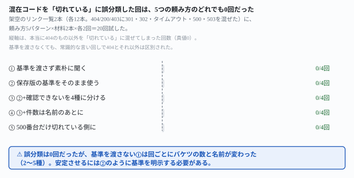
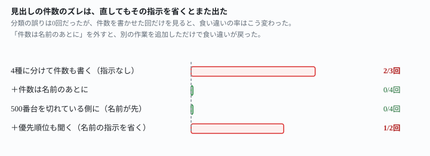

## これで何ができるか {: .what }

[リンク切れ点検の判断をAIに任せる](/recipes/head-only-flags-live-pages-as-broken/)は、HEADとGETの両方を渡す言い方を確かめた記事です。試したのは404・403・200の組み合わせだけでした。あの記事は最後に、1つの宿題を残しています。

リダイレクト（301・302）やタイムアウト、500番台を混ぜたらどうなるか、です。

<mark>この記事はその宿題に答えます。</mark>架空のリンク一覧2本（各12本）を用意しました。元の404・200・403に加えて、<mark class="warn">301・302・タイムアウト・500・503を混ぜています</mark>。頼み方5パターン×材料2本×各2回＝**20回**試しました。

<figure class="figure">

<figcaption>404以外を「切れている」に混ぜた回は、頼み方によらず20回中0回だった。</figcaption>
</figure>

分かったことは2つです。

**① 20回とも、404以外のコードを「切れている」に混ぜませんでした。**基準を渡さなくても、常識的な言い回しで404と301・タイムアウト・500番台は区別されました。<mark>混在コードへの誤分類という心配は、この実測では起きませんでした。</mark>

**② ただし、基準を渡さないと出力の形がばらつきました。**バケツの数は2〜5種、同じ301が回によって違うバケツに入ることもありました。自動化に組み込むなら、この不安定さのほうが実害になります。

<mark class="warn">さらに別の崩れ方も見つかりました。</mark>確認できないリンクを種類別に分けて件数も書かせると、見出しの数字が実際の件数と食い違う回が出ます。「言い直し方」の節で詳しく書きます。

## 前提 {: .need }

| | |
|---|---|
| かかる時間 | 20分。[前作](/recipes/head-only-flags-live-pages-as-broken/)を先に読むと早いです |
| 費用 | 無料 |
| 必要なもの | リンクごとにHEAD・GETの応答コードが分かる点検結果 |
| プログラミング | **不要**。この記事の指示文をコピーして貼るだけです |

**この記事は「判断の基準は404・403・200だけで足りるか」という1点だけを確かめます。**点検結果の取得そのものは[前作](/recipes/head-only-flags-live-pages-as-broken/)と同じ前提です。すでに自動で動いている点検の仕組みがあることを想定しています。

## AIへの頼み方 {: .ask }

### 1. まず、基準を渡さずに素朴に聞く

材料は、架空のブログに貼ったリンク一覧12本です。内訳は次のとおりです。

- 本当に切れている（404）: 2本
- 正常（200）: 2本
- ボット判定の可能性（403）: 2本
- 恒久転送（301）: 2本
- 一時転送（302）: 2本
- タイムアウト: 2本
- サーバーエラー（500・503）: 2本

```
L01  https://exam-prep-notes.jp/2020/past-paper-review  HEAD=404  GET=404
L02  https://study-method-hub.jp/guide/spaced-repetition  HEAD=200  GET=200
L03  https://license-archive-notes.jp/2019/mock-test  HEAD=404  GET=404
L04  https://exam-prep-notes.jp/2021/schedule-template  HEAD=200  GET=200
L05  https://cert-gear-store.jp/items/timer-01  HEAD=403  GET=403
L06  https://cert-gear-store.jp/items/binder-02  HEAD=403  GET=403
L07  https://study-method-hub.jp/guide/old-syllabus  HEAD=301  GET=301
L08  https://license-archive-notes.jp/archive/2018/intro  HEAD=302  GET=302
L09  https://exam-prep-notes.jp/2022/mentor-interview  HEAD=タイムアウト  GET=タイムアウト
L10  https://cert-gear-store.jp/items/desk-lamp-03  HEAD=タイムアウト  GET=タイムアウト
L11  https://study-method-hub.jp/guide/burnout-signs  HEAD=500  GET=500
L12  https://license-archive-notes.jp/2020/renewal-steps  HEAD=503  GET=503
```

<div class="prompt">次は、ブログに貼っているリンクを自動点検した結果です。それぞれのリンクについて、HEADリクエストとGETリクエストの応答コードを記録しています。この中でリンク切れになっているものを教えてください。</div>

**4回とも、本当の404(L01・L03)だけを「確実にリンク切れ」と判定しました。**301・タイムアウト・500番台を、何も教えなくても別枠に分けています。ただし、この別枠の数と名前は回によって違いました。2種類の回もあれば、5種類に分かれた回もあります。301を「要確認」に入れた回と、403と同じ「問題なしの可能性」に入れた回がありました。<mark>誤って404と同じ「切れている」に入れた回は0回でしたが、出力の形は安定していません。</mark>

### 2. 前作の保存版の基準を、そのまま使う

[前作](/recipes/head-only-flags-live-pages-as-broken/)の保存版は、GETが200か404かだけで判断し、それ以外は「確認できない」に分ける言い方でした。この基準を変えずに、混在コードの材料へそのまま使いました。

<div class="prompt">次は、ブログに貼っているリンクを自動点検した結果です。それぞれのリンクについて、HEADリクエストとGETリクエストの応答コードを記録しています。HEADの応答コードだけでは判断しないでください。HEADが404や403でも、GETが200ならそのリンクは切れていません。GETも404の場合は、切れていると判断してください。GETが200でも404でもない場合（403など）は、サーバーがロボットを拒否している可能性があり、人がブラウザで開けば中身を見られることがあります。この場合は切れているとは断定せず、確認できないリンクとして分けてください。この基準で、切れているリンクと確認できないリンクを、それぞれ教えてください。</div>

**4回とも、「切れている」2本・「確認できない」8本・「問題なし」2本に、毎回同じ形で分かれました。**301・302・タイムアウト・500・503はすべて「確認できない」に入り、404と混ざりませんでした。<mark>基準を変えずに流用するだけで、出力の形も安定しました。</mark>しかも、「確認できない」の中で転送と5xxとタイムアウトを区別する説明が、頼んでいないのに自分から添えられていました。

### 3. 確認できないリンクを、種類別に分けてと頼む

「確認できない」8本がひとまとめだと、どこから手を付けるか分かりません。種類別に分ける言い方を試しました。

<div class="prompt">次は、ブログに貼っているリンクを自動点検した結果です。それぞれのリンクについて、HEADリクエストとGETリクエストの応答コードを記録しています。HEADの応答コードだけでは判断しないでください。HEADが404や403でも、GETが200ならそのリンクは切れていません。GETも404の場合は、切れていると判断してください。GETが200でも404でもない場合は、切れているとは断定せず、確認できないリンクとして分けてください。確認できないリンクは、さらに次の4種類に分けてください。①転送（301・302）②タイムアウト（応答なし）③サーバーエラー（500番台）④その他（403など）。この基準で、切れているリンクと、確認できないリンクの4種類を、それぞれ教えてください。</div>

**分類そのものは4回とも正しく、各カテゴリ2本・計12本が真値と一致しました。**ところが、件数を書いた3回のうち2回で、見出しの数字が食い違いました。1回は「切れているリンク：3件」と書いたのに実際は2件、もう1回は「確認できないリンク：6件」と書いたのに4種類の内訳を合計すると8件でした。詳しくは「言い直し方」で直します。

### 4. 500番台だけ、切れている側に含めたい

403は人には見えることがありますが、500番台はサーバー側が応答していないので、読者には見えません。この違いを基準に反映したいときの言い方です。

<div class="prompt">次は、ブログに貼っているリンクを自動点検した結果です。それぞれのリンクについて、HEADリクエストとGETリクエストの応答コードを記録しています。HEADの応答コードだけでは判断しないでください。HEADが404や403でも、GETが200ならそのリンクは切れていません。GETが404、または500番台の場合は、切れていると判断してください。それ以外でGETが200でない場合（301・302・403・タイムアウトなど）は、切れているとは断定せず、確認できないリンクとして分けてください。件数はまだ書かないでください。まず、切れているリンクと確認できないリンクのIDを箇条書きで全部挙げてください。箇条書きが終わったら、最後にそれぞれ「以上、何件」と書いてください。</div>

**4回とも、「切れている」4本（404の2本＋500番台の2本）・「確認できない」6本（403・301・302・タイムアウト）に、正確に分かれました。**件数も4回とも「4件」「6件」で正しく、見出しのズレも出ませんでした。基準を変えても、404の代わりを増やすだけなら正確に反映されます。

## うまくいかないときの言い直し方 {: .fix }

### 件数は、名前を全部挙げたあとに書かせる {: .trouble }

<mark class="warn">指示文3（4種類に分ける）で、件数を書いた3回のうち2回、見出しの数字がずれました。</mark>この壊れ方は[前作](/recipes/head-only-flags-live-pages-as-broken/)でも見つかっていて、直し方も同じです。件数を先に宣言させず、名前を全部挙げたあとに書かせます。

<div class="prompt">次は、ブログに貼っているリンクを自動点検した結果です。それぞれのリンクについて、HEADリクエストとGETリクエストの応答コードを記録しています。HEADの応答コードだけでは判断しないでください。HEADが404や403でも、GETが200ならそのリンクは切れていません。GETも404の場合は、切れていると判断してください。GETが200でも404でもない場合は、切れているとは断定せず、確認できないリンクとして分けてください。確認できないリンクは、さらに次の4種類に分けてください。①転送（301・302）②タイムアウト（応答なし）③サーバーエラー（500番台）④その他（403など）。件数はまだ書かないでください。まず、切れているリンクと、確認できないリンクの4種類それぞれについて、IDを箇条書きで全部挙げてください。箇条書きが終わったら、最後にそれぞれ「以上、何件」と書いてください。</div>

**4回とも、見出しの数字と実際に並べたIDの数が、すべて一致しました。**指示文3と分類の中身は同じなのに、件数を書く順番を変えるだけでズレが消えています。

<figure class="figure">

<figcaption>名前を先に書かせれば直るが、別の作業を足してその指示を省くと、また出る。</figcaption>
</figure>

### この直し方を、1回効かせたら終わりにしない {: .trouble }

指示文4の基準に、優先順位付けという別の作業を追加し、**名前を先に書く指示だけを外して**試しました。

<div class="prompt">次は、ブログに貼っているリンクを自動点検した結果です。それぞれのリンクについて、HEADリクエストとGETリクエストの応答コードを記録しています。HEADの応答コードだけでは判断しないでください。HEADが404や403でも、GETが200ならそのリンクは切れていません。GETが404、または500番台の場合は、切れていると判断してください。それ以外でGETが200でない場合（301・302・403・タイムアウトなど）は、切れているとは断定せず、確認できないリンクとして分けてください。確認できないリンクは、どれを先に手で確認すべきか、優先順位を付けてください。理由も一緒に書いてください。</div>

<mark class="warn">件数を書いた2回のうち1回で、また見出しがずれました。</mark>「切れているリンクは5件」と書いたのに4件しか並んでおらず、本文中で自分から「訂正：上の表は4件です」と書き直しています。

分類の基準が正しくても、**新しい作業を1つ追加するたびに、件数の指示をもう一度確認してください。**「名前を先に、件数はあとに」という一文は、聞くたびに毎回添える前提で使うのが安全です。

## 応用・次の一手 {: .next }

**この記事の値打ちは2つです。**①[前作](/recipes/head-only-flags-live-pages-as-broken/)の基準は、301・302・タイムアウト・500番台を混ぜても404と取り違えずに使えること。②ただし、分類を増やすたびに件数のズレが再発しうるので、「名前を先に、件数はあとに」を毎回添える必要があること。

**毎週この点検を自動で回すなら、**[毎日決まった時刻にAIを動かす](/recipes/github-actions-daily-cron/)**の形に載せてください。**保存版にするのは、この記事の指示文5（500番台を切れている側に含め、名前を先に書かせる版）です。件数という1語ではなく、箇条書きの行自体をスクリプト側で数えるほうが確実です。

**失敗の記録をどう後段に渡すかは、別の記事で扱っています。**[欠番の日を集計から正しく除く](/recipes/missing-row-does-not-count-as-zero/)は、毎日の記録が欠けたときに後段のAIがどう数えるかを確かめた記事です。この記事の「見出しの件数」と、あちらの「集計の分母」は、どちらも**AIが書いた数字を自動化にそのまま流さない**という同じ注意に行き着きます。

⚠️ **今回試したのは「1本のリンク一覧を1回にまとめて読ませる」場合だけです。**リンクの本数がもっと多い場合や、1本のリンクで複数のコードが混在する場合（HEADとGETで違うコードが返るなど）にも同じ結果になるかは、まだ確かめていません。実測に使ったのは`claude --safe-mode`という実測環境1つだけです。

📌 この記事の実測は、架空のリンク一覧2本・**全27回**です。判定はすべて機械照合で、生の返りは `docs/evidence/mixed-status-not-misread.md` に全文置いてあります。
