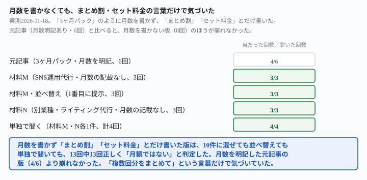
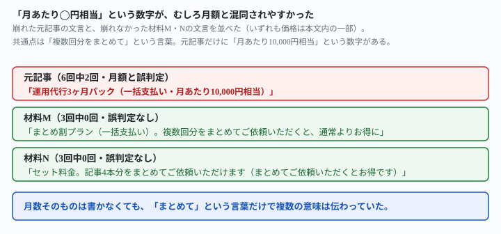

## これで何ができるか {: .what }

[出品10件に増やしても判定は崩れない](/recipes/ten-listings-hold-but-bundle-price-slips/)は、月数が明記された一括価格（「3ヶ月パック（一括支払い・月あたり10,000円相当）」）を確かめました。**6回中2回**、これを「月額」と誤判定しています。残した宿題は「月数そのものが書かれていない一括価格（『まとめ割』『セット料金』など）でも、同じように気づけるか」です。この記事はその宿題に答えます。

結論を先に書きます。

| 条件 | 文言 | 試行回数 | 月額と誤判定した回数 |
|---|---|---|---|
| 元記事 | 「3ヶ月パック（一括支払い・**月あたり10,000円相当**）」 | 6回 | **2回** |
| 材料M | 「まとめ割プラン（一括支払い）。**複数回分をまとめて**ご依頼いただくと…」 | 3回 | 0回 |
| 材料M・並べ替え | 同上（一覧の1番目に提示） | 3回 | 0回 |
| 材料N（別業種） | 「セット料金。記事**4本分をまとめて**ご依頼いただけます…」 | 3回 | 0回 |
| 単独で聞く | 材料M・Nの該当1件だけを取り出す | 4回 | 0回 |
| **合計（月数なし）** | | **13回** | **0回** |

<mark>月数そのものを書かなくても、「まとめ割」「セット料金」のような言葉だけで、13回のうち1回も「月額」と誤判定しませんでした。</mark>これは、月数を明記した元記事の版（6回中2回誤判定）より**崩れていません**。

<figure class="figure">

<figcaption>月数を書かない版のほうが、むしろ崩れなかった。</figcaption>
</figure>

試した記録は[こちら](https://github.com/invest-ai-info/ai-tsukaikata/blob/main/docs/evidence/month-count-not-needed-to-catch-a-bundle-price.md)に全文置いています。

## 前提 {: .need }

| | |
|---|---|
| かかる時間 | 20分 |
| 費用 | 無料。無料のチャットAIで足ります |
| 必要なもの | ブラウザで使えるAI（ChatGPT・Claude・Geminiなど） |
| プログラミング | **不要**。この記事の指示文をコピーして貼るだけです |

この記事の出品10件は架空です。🚨 この記事は特定の相場を保証するものではなく、「月数を書かない一括価格に気づけるか」を確かめるための実測です。

## AIへの頼み方 {: .ask }

### 1. 月数を書かない「まとめ割」を、SNS運用代行の出品10件に混ぜる（材料M）

元記事の「3ヶ月パック（一括支払い・月あたり10,000円相当）」を、月数を書かない「まとめ割プラン」に差し替えました（8番）。

次の10件は、ココナラで実際に「インスタ運用代行」を検索して見つけた出品の、価格と出品ページ本文の実際の記載です。それぞれの価格が「そのまま1か月分の運用代金」なのか、「そうではない（見積もり・診断・パック・オプションなど別の意味の価格）」なのかを、1件ずつ判定してください。

1. 価格1,500円。出品ページの説明：「【本格コンサル・アカウント診断｜1,500円】」。運用代行プランは別にあり、アカウント運用プラン50,000円/月〜。
2. 価格2,000円。出品ページの説明：プランはライト13,000円・スタンダード20,000円・プレミアム30,000円。2,000円は単独のプランとしては明記されていない。
3. 価格3,000円。出品ページの説明：「見積もり購入」。プラン契約時に3,000円分の割引が適用されると書かれている。実際の運用プランはライト25,000円・基本35,000円など。
4. 価格22,000円。出品ページの説明：「ご相談の上、内容により変動いたします」とあるが、その下に小さく「エントリープラン目安：月22,000円〜」と明記されている。
5. 価格24,000円。出品ページの説明：「アカウント開設〜初期設定一式」。運用代行本体は別途ご相談、と明記されている。
6. 価格25,000円。出品ページの説明：「1か月単位で下記の運用代行をいたします」。ベーシックプラン25,000円（税抜）、月8回投稿。
7. 価格28,000円。出品ページの説明：「アカウント診断＋改善提案書の作成（1回限り・納品物のみ）」。
8. 価格30,000円。出品ページの説明：「まとめ割プラン（一括支払い）。複数回分をまとめてご依頼いただくと、通常よりお得になります」。
9. 価格35,000円。出品ページの説明：「初回限定価格（通常48,000円/月のプランです）」。
10. 価格60,000円。出品ページの説明：「サービスは1アカウント/月あたりの料金となっております」。競合リサーチ・投稿作成・投稿を含む。

**3回**試しました。**3回とも**、8番を「複数回分をまとめた一括価格」「月額に換算するには回数の確認が必要」のように、月額ではないと判定しました。月数が無くても誤判定は0件です。

### 2. 同じ出品を、並べ替えて1番目に出す（材料M・並べ替え）

元記事では崩れた1件が末尾側にありました。順番を変えて1番目に出すとどうかも確かめます。

次の10件は、ココナラで実際に「インスタ運用代行」を検索して見つけた出品の、価格と出品ページ本文の実際の記載です。それぞれの価格が「そのまま1か月分の運用代金」なのか、「そうではない（見積もり・診断・パック・オプションなど別の意味の価格）」なのかを、1件ずつ判定してください。

1. 価格30,000円。出品ページの説明：「まとめ割プラン（一括支払い）。複数回分をまとめてご依頼いただくと、通常よりお得になります」。
2. 価格60,000円。出品ページの説明：「サービスは1アカウント/月あたりの料金となっております」。競合リサーチ・投稿作成・投稿を含む。
3. 価格1,500円。出品ページの説明：「【本格コンサル・アカウント診断｜1,500円】」。運用代行プランは別にあり、アカウント運用プラン50,000円/月〜。
4. 価格35,000円。出品ページの説明：「初回限定価格（通常48,000円/月のプランです）」。
5. 価格3,000円。出品ページの説明：「見積もり購入」。プラン契約時に3,000円分の割引が適用されると書かれている。実際の運用プランはライト25,000円・基本35,000円など。
6. 価格22,000円。出品ページの説明：「ご相談の上、内容により変動いたします」とあるが、その下に小さく「エントリープラン目安：月22,000円〜」と明記されている。
7. 価格28,000円。出品ページの説明：「アカウント診断＋改善提案書の作成（1回限り・納品物のみ）」。
8. 価格2,000円。出品ページの説明：プランはライト13,000円・スタンダード20,000円・プレミアム30,000円。2,000円は単独のプランとしては明記されていない。
9. 価格25,000円。出品ページの説明：「1か月単位で下記の運用代行をいたします」。ベーシックプラン25,000円（税抜）、月8回投稿。
10. 価格24,000円。出品ページの説明：「アカウント開設〜初期設定一式」。運用代行本体は別途ご相談、と明記されている。

**3回**試しました。**3回とも**、1番目に出した「まとめ割プラン」を月額ではないと判定しました。<mark>一覧の先頭に出すか末尾側に出すかで、結果は変わりませんでした。</mark>

### 3. 別業種（ライティング代行）でも、月数を書かない「セット料金」を試す（材料N）

業種を変えても同じかを見ます。

次の10件は、ココナラで実際に「ライティング代行（記事執筆）」を検索して見つけた出品の、価格と出品ページ本文の実際の記載です。それぞれの価格が「そのまま1か月分の執筆代行代金」なのか、「そうではない（見積もり・構成案・セット・オプションなど別の意味の価格）」なのかを、1件ずつ判定してください。

1. 価格1,000円。出品ページの説明：「記事の構成案のみ作成します（執筆は含みません）」。
2. 価格1,800円。出品ページの説明：「お見積り確認用ページです。ご依頼内容確定後、正式にご注文ください」。
3. 価格3,500円。出品ページの説明：「記事1本・2,000文字程度の単発執筆」。
4. 価格20,000円。出品ページの説明：「ご相談の上、内容により変動いたします」とあるが、その下に小さく「ライトプラン目安：月20,000円〜」と明記されている。
5. 価格22,000円。出品ページの説明：「初期セットアップ（キーワード設計・構成テンプレート作成）。執筆代行本体は別途ご相談」。
6. 価格24,000円。出品ページの説明：「セット料金。記事4本分をまとめてご依頼いただけます（まとめてご依頼いただくとお得です）」。
7. 価格26,000円。出品ページの説明：「月8本まで対応する執筆代行プランです」。
8. 価格29,000円。出品ページの説明：「SEO記事の構成案の作成＋初回1本の執筆（1回限りの納品物）」。
9. 価格32,000円。出品ページの説明：「初回限定価格（通常45,000円/月のプランです）」。
10. 価格55,000円。出品ページの説明：「サービスは1クライアント/月あたりの料金となっております」。キーワード選定・執筆・入稿を含む。

**3回**試しました。**3回とも**、6番（記事4本分のセット料金）を「期間（月）とは結びついていない」「該当しない」のように、月額ではないと判定しました。業種を変えても結果は同じでした。

### 4. 月数を書かない1件だけを、他の9件から切り離して聞く

材料M・Nそれぞれの該当1件を、単独で聞きます。

ココナラのインスタ運用代行の出品で、価格30,000円、出品ページの説明が「まとめ割プラン（一括支払い）。複数回分をまとめてご依頼いただくと、通常よりお得になります」というものがあります。この30,000円は、そのまま1か月分の運用代金ですか。

ココナラのライティング代行の出品で、価格24,000円、出品ページの説明が「セット料金。記事4本分をまとめてご依頼いただけます（まとめてご依頼いただくとお得です）」というものがあります。この24,000円は、そのまま1か月分の執筆代行代金ですか。

それぞれ**2回**試しました。**4回とも**「1か月分の料金とは限らない」「期間の記載がない」と、月額ではない可能性を指摘しました。<mark>月数が書かれていなくても、10件に混ぜたときと同じ答えでした。</mark>

### なぜこの言い方が効くのか

出品文言を比べます。元記事で崩れた「3ヶ月パック（一括支払い・**月あたり10,000円相当**）」には、「月あたり◯円」という**月額に見える数字**が入っていました。この数字が、月額の表示と混同される一因だったようです。<mark>この記事の「まとめ割プラン」「セット料金」には、そもそも月額に見える数字がありません。</mark>「複数回分をまとめて」「4本分をまとめて」という言葉だけで、AIは複数の意味に気づいていました。

<figure class="figure">

<figcaption>「月あたり◯円相当」という数字のほうが、むしろ誤判定を招きやすかった。</figcaption>
</figure>

## うまくいかないときの言い直し方 {: .fix }

### それでも見分け方を知っておきたい {: .trouble }

今回は崩れませんでしたが、出品者としてもトラブルを避けるために確認するとよい点を聞いてみました。

ココナラで副業として運用代行やライティング代行を受けたいです。出品の価格を見るとき、「まとめ割」「セット料金」のように複数回分の価格を一括で表示している出品を、そのまま1か月分の代金だと誤解しないために、確認するとよい点を番号を振って教えてください。

10個の提案が返りました。この記事で実際に確かめた視点と同じ方向だったのは3つです。

- 1番目「価格が何回分・何本分か」
- 2番目「期間の表記があるか」
- 5番目「『定期購入』なのか『一括購入』なのか」

10個のうち実測したのはこの3つの観点だけです。

## 応用・次の一手 {: .next }

<mark>月数そのものを書かなくても、「まとめ割」「セット料金」という言葉だけで、AIは13回のうち1回も「月額」と誤判定しませんでした。</mark>これは、月数を明記した元記事の版（6回中2回誤判定）より崩れていません。[出品10件に増やしても判定は崩れない](/recipes/ten-listings-hold-but-bundle-price-slips/)とあわせて読むと、**「情報が少ないほど誤判定しやすい」とは限らない**ことが分かります。崩れた原因は「情報が無いこと」ではなく、「月額に見える数字が紛れ込んでいたこと」のほうでした。

[AI可の文字単価は0.07円から](/recipes/ai-writing-rate-below-the-rule-of-thumb/)も同じ「本文を渡せば判定が助かる」型の記事です。価格や単価を比べるときは、表示されている数字をそのまま信じず、本文の言葉まで読んでから判定させてください。

⚠️ <mark class="warn">この記事の実測は、架空の出品10件・2業種・6種類の聞き方・のべ14回の範囲です。</mark>一般法則として「月数を書かない一括価格は必ず気づかれる」と書くつもりはありません。試したのは次の範囲までです。

- 試した「月数を書かない表記」は「まとめ割」「セット料金」の2種類のみです。他の言い回し（「パック価格」「お得プラン」など）は試していません
- 業種は2つ（SNS運用代行・ライティング代行）のみです
- 使ったAIは1種類（Claude）です。他のAIでも同じ傾向になるかは確かめていません

次に一括価格の出品を見るときは、価格に「月あたり◯円」のような数字があるかに関わらず、「複数回分」「まとめて」のような言葉を自分でも探してください。
