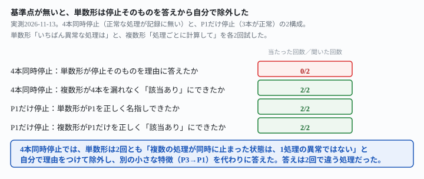

## これで何ができるか {: .what }

[3本同時に止めても単数形は1本だけ名指しする](/recipes/single-answer-can-name-the-normal-one/)という記事は、「正常に残る処理が、どちらの回も1本（P4またはP3）でした。正常な処理が0本（全部停止）・2本以上残る場合は試していません」と未測定事項を残していました。

答えを先に書きます。process=P1〜P4の4本を1本のログに混ぜました。そのうえで**4本すべてを同時に09-10〜09-13停止**させました。正常に動いている処理が記録に1本も残らない構成です。

| 聞き方 | 4本同時停止での結果 |
|---|---|
| 単数形「いちばん異常な処理はどれですか」 | **2回とも、停止そのものを理由にしなかった**。「複数の処理が同時に止まった状態は1つの処理の異常ではない」と自分から理由をつけて除外し、別の特徴を代わりに答えた。しかもその代わりの答えは2回で違った（1回目はP3、2回目はP1） |
| 複数形「処理ごとに、その処理自身の記録から目安を計算して」 | **2回とも、4本すべてを漏れなく「該当あり」にした** |

<mark class="warn">単数形は、監視対象の全部が同時に止まる—もっとも危険な状況—をいちばん苦手にします。</mark>答えは1つしか返らないので、「全部止まっている」と言うことができません。それだけでなく、2回とも停止そのものを**自分から理由をつけて除外**し、停止とは無関係な別の特徴を代わりに答えていました。

<figure class="figure">

<figcaption>基準点が無いと、単数形は停止そのものを答えから自分で除外しました。</figcaption>
</figure>

## 前提 {: .need }

| | |
|---|---|
| かかる時間 | 20分 |
| 費用 | 無料。無料のチャットAIで足ります |
| 必要なもの | 複数の定期実行の、実行時刻が分かる記録（GitHub Actionsの実行履歴・ログファイルのタイムスタンプなど） |
| プログラミング | **不要**。実行時刻の一覧をそのまま貼るだけです |

材料は、先行記事と同じ架空の処理P1〜P4の実行時刻を1本にまとめたログです。21日間（2026-09-01〜09-21）ぶんです。

- **P1**＝1日1〜2回（もっとも少ない）
- **P2**＝1日4〜8回
- **P3**＝1日10〜15回
- **P4**＝1日20〜30回（もっとも多い。P1の約17倍）

停止させる期間は常に同じ4日間（09-10〜09-13）です。2つの構成を用意しました。

- **ALL4**＝P1・P2・P3・P4の4本が同時に停止（正常な基準点が記録に無い。今回新しく試した構成）
- **P1ONLY**＝P1だけが停止（P2・P3・P4は全期間正常。対照として使う構成）

生成後、日付ごと・処理ごとの行数を数え直しました。意図した処理だけが停止4日間に0件になっていること、他の処理に意図しない0件の日が無いことを確認しています。

## AIへの頼み方 {: .ask }

### 1. 4本同時停止で、単数形を試す

これは、複数の定期実行処理が実際に動いた時刻を記録したログです。処理名は process=P1・process=P2・process=P3・process=P4 の4種類が混ざっています。

この記録の中で、いちばん異常な処理はどれですか。処理名と、そう判断した理由を教えてください。

上に、P1〜P4の4本が同時に09-10〜09-13の4日間停止した21日分のログを貼りました。2回試した結果です。

- **1回目**：「P3が最も異常です」と答えました。理由は09-04に2件だけ**12秒**の間隔で連続実行されていたこと（本来は仕込んだものではなく、ログを乱数で作った際の偶然の近接です）。本文の末尾は約4日間の無活動にも触れています。ただし「P1〜P4すべてで同時に発生しているため、特定処理の異常ではない」として、停止そのものを**自分から理由をつけて除外**しています
- **2回目**：「P1が最も異常です」と答えました。理由はP1の実行間隔が不規則なこと（短くて2時間、長くて43時間）。約4日間の共通停止にも触れていますが、「4処理すべてに共通する停止であり、特定の1処理の異常とは言えません」として、同じ理由で除外しています

**2回とも、答えは停止している4本のうちの1本（P3→P1）でしたが、理由はどちらも停止ではありませんでした。**しかも2回の答えは一致していません。

### 2. 同じ構成を、複数形で試す

これは、複数の定期実行処理が実際に動いた時刻を記録したログです。処理名は process=P1・process=P2・process=P3・process=P4 の4種類が混ざっています。

処理ごとに、その処理自身の記録から「ふだんの1日あたりの実行回数」の目安を計算してください。そのうえで、その処理だけの目安と比べて極端に少ない日（0件の日を含む）があれば、処理名・日付・実行回数を挙げてください。処理ごとに「該当あり」か「該当なし」のどちらかを、省略せずに書いてください。

同じ4本同時停止のログに、こちらも2回試しました。

- **1回目**：P1・P2・P3・P4の4本すべてを「該当あり」とし、09-10〜09-13の4日間がいずれも0件であることを表にしました。補足で「これは特定の処理固有の不調ではなく、ログ収集やシステム全体に関わる共通要因…が疑われます」と、原因の見立てまで書いています
- **2回目**：同じく4本すべてを「該当あり」にしました。各処理のふだんの目安（P1約1.3件・P2約6.1件・P3約11.9件・P4約25.2件）を先に計算してから判定しています

**2回とも、4本すべてを漏れなく検出しました。**単数形が苦手にした「全部が同時に止まる」という状況を、複数形は取り落としませんでした。

### 3. 対照：P1だけが停止した場合（正常な基準点が3本残る）

単数形が崩れたのは、材料そのものの性質ではなく「基準点が消えたこと」が原因かを確かめます。P2・P3・P4を全期間正常にして、P1だけを同じ4日間停止させた同じ2つの指示文を、それぞれ2回試しました。

これは、複数の定期実行処理が実際に動いた時刻を記録したログです。処理名は process=P1・process=P2・process=P3・process=P4 の4種類が混ざっています。

この記録の中で、いちばん異常な処理はどれですか。処理名と、そう判断した理由を教えてください。

単数形は2回とも「process=P1が最も異常です」と正しく答えました。理由は「通常は数時間〜最大でも1.5日程度の間隔なのに、09-09から09-14まで約4.5日間、実行記録が一件もない」という、停止そのものです。**停止を除外する言及は、この構成では一度も出ませんでした。**

これは、複数の定期実行処理が実際に動いた時刻を記録したログです。処理名は process=P1・process=P2・process=P3・process=P4 の4種類が混ざっています。

処理ごとに、その処理自身の記録から「ふだんの1日あたりの実行回数」の目安を計算してください。そのうえで、その処理だけの目安と比べて極端に少ない日（0件の日を含む）があれば、処理名・日付・実行回数を挙げてください。処理ごとに「該当あり」か「該当なし」のどちらかを、省略せずに書いてください。

複数形も2回とも、P1だけを「該当あり」、P2・P3・P4を「該当なし」と正しく分けました。

**正常な基準点（P2・P3・P4）が記録に残っているときは、単数形も複数形も崩れませんでした。**崩れたのは、基準点が1本も残らない構成（4本同時停止）のときだけです。

### なぜ、基準点が消えると単数形だけ崩れるのか

単数形の問い「いちばん異常な処理はどれですか」は、処理ごとの自分の目安と比べていません。**ログ全体の中で何かを1つ選ぶ**という形の問いです。処理が1本だけ止まっているときは、その1本だけがログから消えるので、残りの処理との対比で自然に目立ちます。ところが**全部が同時に止まると、比べる相手（正常な処理）がログの中に存在しなくなります。**

そうなると、AIは「複数の処理が同時に止まった状態は、1つの処理の異常ではない」と判断します。停止そのものは、こうして答えの対象から外されます。それでも「何か1つを選ばなければならない」という問いの形だけは残ります。停止とは無関係な、たまたま目についた特徴（今回は偶然の近接・間隔の不規則さ）が、代わりの答えになります。

複数形の指示文は「処理ごとに」という一言で、最初から比べる単位を処理名で区切っています。比べる相手がログの中にいるかどうかに依存しないので、この崩れ方が起きません。

## うまくいかないときの言い直し方 {: .fix }

### 単数形の答えが、2回で違う処理になるとき {: .trouble }

単数形を使い続けたい場合は注意が必要です。[先行記事](/recipes/single-answer-can-name-the-normal-one/)が確かめた「実際に止まっている処理の中から選ぶ」という制約は、今回の構成（4本とも止まっている）ではそもそも的外れです。止まっている処理の中から選べと言われても、4本すべてが対象になります。選ぶ対象を絞る制約そのものが、単数形という形と矛盾してしまいます。

→ **直す場所は制約ではなく、問いの形そのものです。**監視の一次判定や通知の文面には、最初から複数形を使ってください。

これは、複数の定期実行処理が実際に動いた時刻を記録したログです。処理名は process=P1・process=P2・process=P3・process=P4 の4種類が混ざっています。

処理ごとに、その処理自身の記録から「ふだんの1日あたりの実行回数」の目安を計算してください。そのうえで、その処理だけの目安と比べて極端に少ない日（0件の日を含む）があれば、処理名・日付・実行回数を挙げてください。処理ごとに「該当あり」か「該当なし」のどちらかを、省略せずに書いてください。

単数形は、人が結果を読んだあとの要約の文面作りだけに留めるのが安全です。

## 応用・次の一手 {: .next }

| 構成 | 単数形（制約なし） | 複数形「処理ごとに」＋「省略せずに」 |
|---|---|---|
| ALL4（4本同時停止・基準点が無い） | **0/2**（停止を除外し、別の特徴を代わりに答えた。答えも2回で不一致） | **2/2**（4本すべてを漏れなく検出） |
| P1ONLY（P1だけ停止・基準点が3本残る） | 2/2（P1を正しく名指し） | 2/2（P1だけを正しく判定） |

複数形の強さは、これまでも確かめてきました。

- [監視対象を4本に増やしても](/recipes/four-process-log-keeps-each-own-baseline/)崩れない
- [2つ同時に止まっても](/recipes/simultaneous-stop-both-get-named/)崩れない
- [3本同時に止めても](/recipes/three-stop-drops-the-quiet-one/)崩れない

**正常な基準点が記録に1本も残らない、もっとも厳しい構成でも崩れませんでした。**

これは、複数の定期実行処理が実際に動いた時刻を記録したログです。処理名は process=P1・process=P2・process=P3・process=P4 の4種類が混ざっています。

処理ごとに、その処理自身の記録から「ふだんの1日あたりの実行回数」の目安を計算してください。そのうえで、その処理だけの目安と比べて極端に少ない日（0件の日を含む）があれば、処理名・日付・実行回数を挙げてください。処理ごとに「該当あり」か「該当なし」のどちらかを、省略せずに書いてください。

自分の監視対象が複数あるなら、通知の判定にはこの形の指示文を使ってください。「いちばん異常なのはどれですか」という単数形の聞き方は、監視対象がすべて同時に止まる場面——いちばん危険な場面——では使わないでください。

⚠️ **この結果は、架空の処理4本・計8回の実測です。**内訳は単数形〈ALL4〉2回・複数形〈ALL4〉2回・単数形〈P1ONLY〉2回・複数形〈P1ONLY〉2回です。次の範囲までしか確かめていません。

- 試した「基準点が無い」構成は、4本すべてが同時に停止する1パターンだけです。3本停止・1本だけ正常に残る構成は、[先行記事](/recipes/single-answer-can-name-the-normal-one/)が別に確かめています
- 単数形が代わりに答えた特徴（12秒差の近接・間隔の不規則さ）は、こちらが仕込んだものではなく、乱数で生成したログに偶然含まれていたものです。**単数形が毎回「何らかの小さな特徴」を見つけて答えにする、とまでは一般化しません**
- 停止は常に同じ4日間（09-10〜09-13）でした。停止の長さを変えた場合は、[停止の長さを変えた記事](/recipes/short-stop-slips-through-on-the-quiet-process/)の範囲を参照してください

今回の生の返りと機械照合は `docs/evidence/no-baseline-left-singular-answer-looks-away.md` に全文置いてあります。
