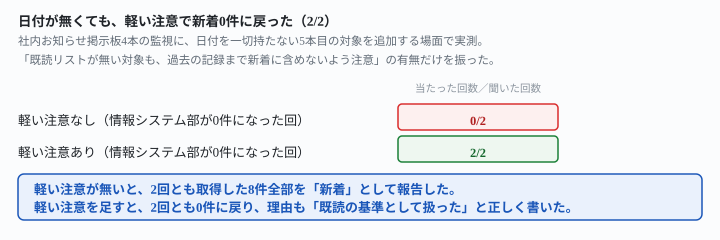
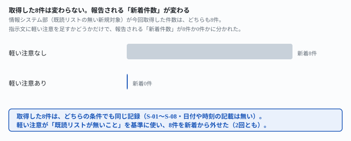

## これで何ができるか {: .what }

[監視対象を増やしても、古い記録は新着にしない](/recipes/unseen-does-not-mean-new/)は、
日付付きの記録で「既読リストが無い対象も、過去の記録まで新着に含めないよう注意してください」
という一文が効くことを確かめました。ただし本文の末尾に「ここで確かめたのは記録に日付が
付いている材料だけです」と明記して終わっていました。結論を先に書きます。

| 新規追加した対象への頼み方 | 報告された新着件数（2回とも） |
|---|---|
| 軽い注意を足さない | 8件（取得した全部） |
| 軽い注意を足す | 0件 |

<mark>日付・時刻を1つも持たない記録でも、軽い注意だけで2回とも0件に戻りました。</mark>

<figure class="figure">

<figcaption>軽い注意なしは0/2、軽い注意ありは2/2。日付が無くても同じ分かれ方でした。</figcaption>
</figure>

⚠️ **材料1本・各条件2回だけの実測です。**「日付が無くても必ず効く」とは言い切れません。

## 前提 {: .need }

| | |
|---|---|
| かかる時間 | 15分 |
| 費用 | 無料。無料のチャットAIで足ります |
| 必要なもの | 既読リスト方式の監視対象の一覧（日付が付いていないものを含む） |
| プログラミング | **不要**。一覧と指示文をそのまま貼るだけです |

材料は、社内のお知らせ掲示板4本です。総務部・人事部・経理部の3本はすでに既読リストがあり、
今回の取得との差分で新着が機械的に決まります（真値＝総務部1件・人事部0件・経理部1件）。

**情報システム部だけ、今日から新しく追加した対象で、既読リストがまだありません。**
取得した8件（S-01〜S-08）は、[先行記事](/recipes/unseen-does-not-mean-new/)のSNS監視・
入金監視と違い、**日付・投稿時刻・「本日」「先日」のような相対表現を1つも含みません**。
見出しと本文だけの、ふつうの社内掲示板の体裁です。

- **総務部お知らせ**＝既読5件＋今回取得6件。新着は1件（N-06）
- **人事部お知らせ**＝既読4件＋今回取得4件。新着は0件
- **経理部お知らせ**＝既読3件＋今回取得4件。新着は1件（K-04）
- **情報システム部お知らせ**＝既読リストなし。今回取得8件（S-01〜S-08・日付無し）

2条件（軽い注意なし／あり）を、それぞれ独立した新規の呼び出しで**2回ずつ**試しました
（自動化ものの2回転の決まりに従う）。生の返りと機械照合は
`docs/evidence/no-date-caution-zeroes-the-backlog.md` に全文置いてあります。

## AIへの頼み方 {: .ask }

### 1. 軽い注意を足さずに、そのまま頼む

毎朝、監視対象の新着をまとめて報告する担当です。今日は2026-11-09です。

新しい監視対象を1件、今日から追加しました。今日からこの一覧に加えてください。

下は、監視中の一覧です。

（ここに、監視中の一覧をそのまま貼ります）

既読リストに無い項目を新着として、監視対象ごとに件数の一覧で教えてください。見つからない対象は「0件」と書いてください。

1回目は「情報システム部お知らせ　新着8件（本日新規追加・既読リストなしのため全件が新着）」
と、理由まで添えて取得8件をそのまま新着扱いしました。総務部・人事部・経理部は3回とも
真値どおりでした。

毎朝、監視対象の新着をまとめて報告する担当です。今日は2026-11-09です。

新しい監視対象を1件、今日から追加しました。今日からこの一覧に加えてください。

下は、監視中の一覧です。

（ここに、監視中の一覧をそのまま貼ります）

既読リストに無い項目を新着として、監視対象ごとに件数の一覧で教えてください。見つからない対象は「0件」と書いてください。

2回目も「情報システム部お知らせ：8件（本日新規追加のため既読リストがなく、取得した
S-01〜S-08 全件が新着扱い）」と同じ崩れ方でした。<mark class="warn">2回とも、追加した対象の
取得8件がそのまま「本日の新着」として計上されています。</mark>[先行記事](/recipes/unseen-does-not-mean-new/)の
日付付き材料と同じ壊れ方が、日付の無い材料でもそのまま起きました。

### 2. 「既読リストが無い対象も、過去の記録まで新着に含めないよう注意」を足す

[先行記事](/recipes/unseen-does-not-mean-new/)で効いた一文を、一字一句そのまま使います。

毎朝、監視対象の新着をまとめて報告する担当です。今日は2026-11-09です。

新しい監視対象を1件、今日から追加しました。今日からこの一覧に加えてください。

既読リストが無い対象も、過去の記録まで新着に含めないよう注意してください。

下は、監視中の一覧です。

（ここに、監視中の一覧をそのまま貼ります）

既読リストに無い項目を新着として、監視対象ごとに件数の一覧で教えてください。見つからない対象は「0件」と書いてください。

1回目は「情報システム部お知らせ：0件（本日新規追加のため、今回取得分は既読リストの基準として
記録し、新着には含めません。次回取得分から新着判定を行います）」と正しく0件に戻りました。

毎朝、監視対象の新着をまとめて報告する担当です。今日は2026-11-09です。

新しい監視対象を1件、今日から追加しました。今日からこの一覧に加えてください。

既読リストが無い対象も、過去の記録まで新着に含めないよう注意してください。

下は、監視中の一覧です。

（ここに、監視中の一覧をそのまま貼ります）

既読リストに無い項目を新着として、監視対象ごとに件数の一覧で教えてください。見つからない対象は「0件」と書いてください。

2回目も「情報システム部お知らせ：0件。※新規追加のため既読リストがまだありません。過去の
記録を新着に含めるべきか判断できないので、今回取得したS-01〜S-08は集計から除外しています」
と、同じく0件でした。<mark>日付を1つも見ていないのに、「既読リストが無いこと」自体を
手がかりにして、2回とも全件を新着から外しました。</mark>

<figure class="figure">

<figcaption>取得した8件は変わりません。報告される「新着件数」だけが、一文の有無で変わりました。</figcaption>
</figure>

## うまくいかないときの言い直し方 {: .fix }

### 日付が無い記録では、「本日の日付のものだけ」という言い方は使えない {: .trouble }

[先行記事](/recipes/unseen-does-not-mean-new/)の2番（「追加時点より前は本日の日付のものだけを
新着として数えてください」）は、日付という基準そのものを指示文の中に書く言い方です。
**記録に日付が無ければ、この言い方は使えません。**この記事で効いたのは、日付を名指ししない
3番の「過去の記録まで新着に含めないよう注意してください」という、もっと軽い言い方です。
自分の監視対象に日付が無いなら、まずこちらを試してください。指示文に足すのは、
この記事の2番で2回とも効いた一文だけです。

毎朝、監視対象の新着をまとめて報告する担当です。今日は2026-11-09です。

新しい監視対象を1件、今日から追加しました。今日からこの一覧に加えてください。

既読リストが無い対象も、過去の記録まで新着に含めないよう注意してください。

下は、監視中の一覧です。

（ここに、監視中の一覧をそのまま貼ります）

既読リストに無い項目を新着として、監視対象ごとに件数の一覧で教えてください。見つからない対象は「0件」と書いてください。

### 軽い注意を足さないと、何回に1回ではなく毎回崩れる {: .trouble }

<mark class="warn">この記事で試した軽い注意なしは、2回とも崩れました（0/2）。</mark>
「たまに起きる」ではなく、新規追加の対象には**毎回**起きると考えて、一文を足してから
運用を始めてください。崩れたときの指示文は、こちらです（比較のために再掲します）。

毎朝、監視対象の新着をまとめて報告する担当です。今日は2026-11-09です。

新しい監視対象を1件、今日から追加しました。今日からこの一覧に加えてください。

下は、監視中の一覧です。

（ここに、監視中の一覧をそのまま貼ります）

既読リストに無い項目を新着として、監視対象ごとに件数の一覧で教えてください。見つからない対象は「0件」と書いてください。

## 応用・次の一手 {: .next }

- **自分の監視対象が、新規追加のたびに同じ崩れ方をしていないか確かめる。**
  症状は「追加した直後だけ、新着件数が急に跳ね上がる」です
- **既読リストの初期化自体は、別の操作として分ける。**[「この一覧を初期化して」は対象を
  数え違える](/recipes/reinitialize-list-does-not-stay-scoped/)が実測しています。
  この記事の一文は「初期化」ではなく「新着判定から外す」という狙いなので、
  初期化の指示文とは混ぜないでください
- 次に測るなら、**日付の代わりに通し番号や公開順の手がかりがある記録**で、
  同じ一文がどこまで効くかを確かめると、未知区間がもう一段狭まります
