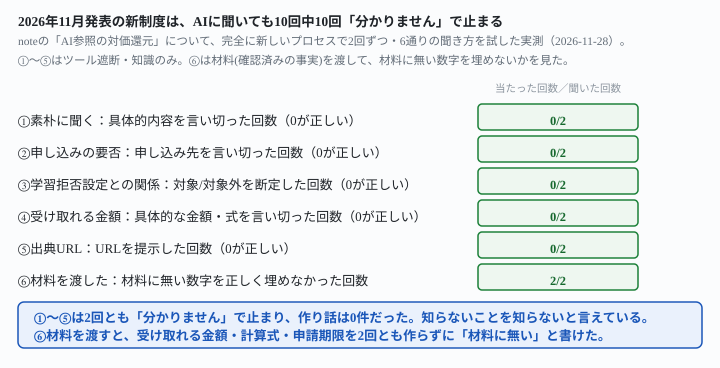
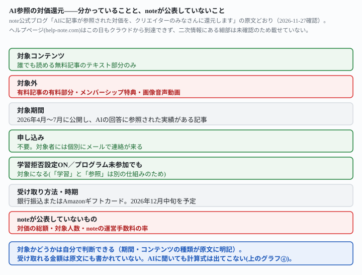

## これで何ができるか {: .what }

noteは2026年11月18日、新しい収入源を公式に発表しました。**AIがユーザーの質問に答えるときに自分の記事が「参照」されていたら、その対価の一部が還元される**という仕組みです。[noteで売る前に、引かれる手数料を原文で確かめる](/recipes/note-fee-before-you-sell/)や[GPTsで稼ぐ門は閉じた](/recipes/gpts-retirement-check-the-source/)と同じ「原文で確かめる」型の記事ですが、この題材には1つ別の面があります。**発表そのものが新しすぎて、AIの知識にまだ入っていません。**

<mark>この記事は、note公式ブログの原文を確認したうえで、「AIに聞けば教えてくれるか」を5つの聞き方×2回・計10回試したものです。結果は、10回とも「分かりません」でした。</mark>作り話の数字や、実在しない申し込みページは1つも出てきませんでした。

<figure class="figure">

<figcaption>5つの聞き方×2回=10回、すべて「分かりません」。材料を渡した回だけ、正しく答えられました。</figcaption>
</figure>

もう1つ大事な点があります。**この還元は、今から申し込んで参加するプログラムではありません。**対象かどうかは、2026年4月〜7月にすでに公開していた記事が、AIの回答にすでに参照されていたかどうかで、もう決まっています。申し込みは不要で、対象者には個別にメールで連絡が来ます。

<figure class="figure">

<figcaption>対象・対象外・手続きは原文に書かれています。総額と手数料率は、noteも公表していません。</figcaption>
</figure>

## 前提 {: .need }

| | |
|---|---|
| かかる時間 | 15分 |
| 費用 | 無料（原文の確認とメールを待つだけ） |
| 必要なもの | noteのアカウントと、届くメールを見落とさないこと |
| プログラミング | **不要** |

⚠️ <mark class="warn">この記事は運営者が対価還元を受け取った記録ではありません。</mark>note公式ブログに書かれていることの確認と、AIに聞いたときの返り方の実測です。この還元は2026年のAI事業者との契約に基づくもので、今後も同じ条件で続くとは書かれていません。この記事の内容は2026-11-27に原文を開いて確認したもので、使う前にご自身でも開いて確かめてください。

📌 **実測に使ったAIについて。**このサイトを書いているのと同じClaude系のAI(Sonnet 5・知識カットオフ2026年1月)に、次の状態で聞いています。

- このリポジトリの外の空ディレクトリで、**1回ずつ完全に新しいプロセスとして**起動
- **設定ファイル(CLAUDE.md等)を読み込まないモードで起動**し、ウェブ検索・ファイル読み書きなどの調査ツールも切った状態
- 各回が初対面で、会話の文脈は一切引き継がない

⚠️ **1回目の実測では、このサイトのリポジトリの設定ファイルが答えに紛れ込む事故がありました。**下の指示文2(申し込みの要否)への回答に、「ai-tsukaikata.com」というこのサイト自身のドメイン名が出てきたためです。原因は、最初に使った実行方法がこのリポジトリの設定を自動で読み込む作りだったことでした。**この記事に載せている結果は、設定ファイルを読み込まないモードで起動し直した2回目の実測です。**

**別のAIサービスや、検索できる状態のAIでは結果が変わります。**この記事の判定は、AIが具体的な内容を言い切ったかどうかを人が確認したものです。送った指示文と返り(生のまま)は[試した証拠](https://github.com/invest-ai-info/ai-tsukaikata/blob/main/docs/evidence/note-ai-reference-compensation-unknown-to-ai.md)にあります。

## AIへの頼み方 {: .ask }

### 1. まず、素朴に聞いてみる

noteが始めた、AIに記事が参照された対価をクリエイターに還元する仕組みについて教えてください。対象期間と受け取り方法を教えてください。

**2回**通しました。<mark>2回とも「分かりません」でした。</mark>

- 1回目：「正確な対象期間・受け取り方法を断定できません」。公式の参照元を教えてほしいと返した
- 2回目：「現時点の正確な情報を私は持っていません」。「不確かな記憶で日付や条件を答えると誤情報になる」と理由も添えた

どちらも、推測で日付や受け取り方法を埋めることはありませんでした。

🔑 **知らないことを、知らないと言えています。**似た形式の[note手数料の記事](/recipes/note-fee-before-you-sell/)では、すでに知っている話題を聞いたので率の数字がばらつきました。今回は知識にそもそも無い話題だったので、答え方自体が違いました。

### 2. 申し込みが必要か聞く

このAI参照の対価還元は、申し込みが必要ですか。必要なら、どこから申し込めますか。

**2回**通しました。<mark>2回とも、具体的な申し込み先は出てきませんでした。</mark>ただし2回とも、**実在する別の話題**を持ち出しました。

- 1回目：「著作権法30条の4の見直し」「文化庁のAIと著作権に関する検討会」
- 2回目：「日本新聞協会の提言」「一部メディアとAI事業者間の個別契約」

どちらも実在する話題ですが、**noteの今回の発表とは別物です。**

⚠️ <mark class="warn">「統一された申込窓口は存在しない」という結論自体は2回とも合っていましたが、たどり着き方には注意が要ります。</mark>作り話ではなく、**知っている別の実在の制度を持ち出した**という外し方です。読む側が聞いたことのある名前(文化庁・新聞協会)を見ると、「それがnoteの話なのか」と早合点しかねません。実際には、この還元には申し込み先そのものが存在しません(前提の節で確認したとおり)。

### 3. 「学習を拒否する設定」との関係を聞く

noteには以前から「生成AIの学習に拒否意向を示す」設定があります。この設定をオンにしている人は、今回の対価還元からも外れるのでは、と考える人がいそうです。

noteで「生成AIの学習に拒否意向を示す」設定をオンにしている人は、今回のAI参照の対価還元の対象外になりますか。

**2回**通しました。<mark>2回とも、対象になるか対象外になるかを断定しませんでした。</mark>

- 1回目：「学習」と「参照」は別軸だから対象から自動的に外れるとは限らないと見立てつつ、「確信を持てません」と明記
- 2回目：「対象外、という設計もあり得る」「対象になる、という設計もあり得る」の両論を並べ、「断定できません」とした

🚨 原文の答えは明確で、**学習拒否の設定をオンにしていても、今回の参照の対価還元の対象になります**(「学習」と「参照」は別の仕組みのため)。AIは誤った方向に断定はしませんでしたが、**正しい方向にも断定しませんでした。**どちらの設定の人にとっても、この答え方のままでは自分が対象かどうか分かりません。

### 4. 受け取れる金額を聞く

このAI参照の対価還元で、1人あたりいくら受け取れますか。計算式を教えてください。

**2回**通しました。<mark>2回とも、具体的な金額や計算式を1つも作りませんでした。</mark>2回とも「実在する確立された仕組みではないので、公式な計算式は存在しない」と回答し、出典や前提条件を教えてほしいと返しました。

🚨 さらに1回(2回中1回)は<mark class="warn">自分から詐欺の可能性を指摘しました。</mark>「AIの利用料が還元される、といった文言は個人情報や金融情報を引き出す詐欺の典型的な手口としても使われます」という一文です。**本物の新しい収入源の話でも、聞き方次第でAIに詐欺だと疑われることがある**ということです。実際にこの話をAIに相談するときは、疑われたかどうかではなく、note公式ブログの原文(前提の節のリンク)で確かめてください。

### 5. 出典URLを聞く

このAI参照の対価還元について詳しく書かれている、noteの公式ヘルプページのURLを教えてください。

**2回**通しました。<mark>2回とも、URLを1つも出しませんでした。</mark>

- 1回目：「URLを推測・生成することは避けるべきガイドラインがあります」
- 2回目：「推測でURLを提示することはできません(不正確な案内はリスクがあるため)」

2回とも、ガイドラインを理由に挙げて止まりました。

📌 これは[note手数料の記事](/recipes/note-fee-before-you-sell/)で見た結果と対照的です。あちらは**すでに知っている話題**について出典URLを求めたところ、3回とも実在しないURLをそれらしい形で作りました。今回は**知識にそもそも無い話題**だったため、作られた出典URLは0件でした。知識の有無が、作り話の出やすさを分けています。

## うまくいかないときの言い直し方 {: .fix }

### 「知りません」で終わったら、確認済みの事実を材料として渡す {: .trouble }

ここまでの5問は、AIの知識だけに頼ると「分かりません」で止まります。そこで、note公式ブログで確認した事実をそのまま材料として渡し、「ここに無い数字は埋めないで」と縛って聞き直しました。

あなたはツールを一切使わずに、以下の材料だけを使って日本語で回答してください。ウェブ検索・ファイル読み込み・コード実行などのツールは使用禁止です。材料に書かれていない数字や手続きを埋めてはいけません。

【材料】(noteの公式ブログ記事より)
・noteは、AI事業者からAIによるコンテンツ参照の対価を受け取り、クリエイターへ還元を始める
・今回の対象はAIの「参照」であり「学習」ではない(別の仕組み)
・対象となるクリエイター:2026年4月〜7月のあいだに公開していた記事がAIの回答に参照された実績のある人
・対象となるコンテンツ:誰でも読める無料記事のテキスト部分のみ(有料記事の有料部分・メンバーシップ特典・画像音声動画は対象外)
・お申し込みは不要。対象者には個別にメールで連絡
・分配の考え方:AI事業者から受け取った対価からnoteの運営手数料を差し引いた金額を、参照の実績等に応じて分配
・受け取り方法:銀行振込またはAmazonギフトカード
・支払い時期:2026年12月中旬を予定
・「生成AIの学習に拒否意向を示す」設定をオンにしていても、今回の参照の対価還元の対象にはなる(学習と参照は別の仕組みのため)。この設定や「AI学習対価還元プログラム」への参加有無にかかわらず対象。受け取りの辞退も可能

【質問】
この情報だけを使って、対象になりうる人が今日確認すべきことを3つにまとめてください。ここに書かれていない数字や手続き(受け取れる金額の具体額・計算式・申請の期限など)は、絶対に埋めずに「材料に無い」と書いてください。

**2回**通しました。<mark>2回とも、材料に書かれている事実だけで3点をまとめました。</mark>

- 1回目の3点：メール通知を待つ(申し込み不要) ／ 学習拒否設定・別プログラムの参加有無は関係ない ／ 対象コンテンツの範囲を確認する
- 2回目の3点：自分が対象になりうるか ／ 申し込み不要・個別メール連絡を待つ ／ 受け取り方法・辞退の可否

金額・計算式・期限は、**2回とも「材料に無い」と正しく書きました。**どちらも材料の範囲を超えていません。

🔑 **「分からない」で止まった質問3〜4も、材料を渡せば答えが出ます。**学習拒否設定との関係(質問3)は、材料に明記されている一文をそのまま渡せば断定できます。受け取れる金額(質問4)は、**材料そのものに金額が書かれていないので、AIに聞いても誰に聞いても出てきません。**ここは「AIへの聞き方」の問題ではなく、「noteがまだ公表していない」という事実のほうです。

## 応用・次の一手 {: .next }

**今日やることは、申し込みではありません。**

1. 2026年4月〜7月に、無料記事(テキスト部分のみ)を公開していたか確認する。有料部分・メンバーシップ特典・画像音声動画は対象外
2. 「学習に拒否意向を示す」設定や「AI学習対価還元プログラム」への参加有無は関係ないと知っておく。対象外になる理由にはならない
3. noteからの個別メールを待つ。支払いは2026年12月中旬を目安に予定されている。受け取りを辞退することもできる

辞退の方法など、より詳しい手続きはnoteのヘルプページ「AI参照の対価還元について」に書かれているとnote公式ブログは案内しています。⚠️ **本記事はこのページを開けずに書いています**(2026-11-28時点でクラウドの実行環境から到達できませんでした)。開けるようになったら、ここにリンクを追加します。

**ページ名を聞いて自分で開く**のが、この記事全体の結論です。[YouTubeの入金しきい値が分かる](/recipes/youtube-payout-thresholds/)でも「数字は書かないで」と足すと3回とも金額を書かずにページ名だけを答えた実例がありました。新しい発表ほど、AIに答えを求めるより先に、原文の在り場所だけ教えてもらう聞き方のほうが安全です。

📌 **noteの収入源をもう1つ知りたい人は、[noteで売る前に、引かれる手数料を原文で確かめる](/recipes/note-fee-before-you-sell/)と[noteメンバーシップの手取りを式で出す](/recipes/note-membership-monthly-formula/)も読んでください。**どちらも「自分が売った額から何が引かれるか」の話です。今回の「書いていなくても参照されただけで入る」収入とは、お金の出どころが違います。全体の地図は[副業のお金は3つの流れで届く](/tools/money-map-three-routes/)にあります。

⚠️ **この記事の数字はAIの回答についての実測です**(全12回＝知識のみで答えさせる5通り×各2回＋材料を渡した1通り×2回)。送った指示文と返り(生のまま)、判定は`docs/evidence/note-ai-reference-compensation-unknown-to-ai.md`に置いてあります。

対価還元の仕組みそのものは、note公式ブログから転記したものです。出典は<a href="https://note.com/info/n/n19e062e42e9e">AIに記事が参照された対価を、クリエイターのみなさんに還元します</a>(2026-11-18公開・2026-11-27確認)。使う前にご自身で開いて確かめてください。この還元を受け取れる保証はどこにもありません。対象かどうかは、自分の記事の公開時期と参照実績だけで決まります。
