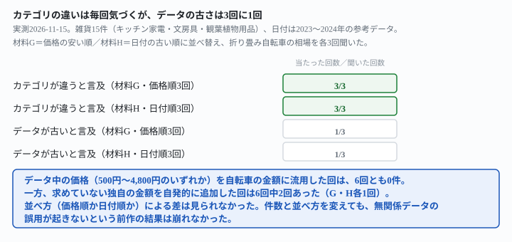

## これで何ができるか {: .what }

[フリマの相場をAIに聞くと作り話で埋まる](/recipes/resale-price-guess-fills-the-blank/)の続きです。前作は参考データが4件・1カテゴリ分だけでした。「件数を増やした場合、データが古い場合は試していません」という宿題を残していました。今回はその宿題に答えます。

結論を先に書きます。

| 確かめたこと | 回数 |
|---|---|
| データ中の金額を、無関係な商品（自転車）の金額にそのまま使った | **0/6** |
| 「カテゴリが違う」と自分から言及した | **6/6** |
| 「データが古い」と自分から言及した | **2/6** |
| 今日の日付を先に確認させてから聞くと、古さに言及した | **2/2** |

<figure class="figure">

<figcaption>カテゴリの違いは毎回気づくが、データの古さに気づくのは3回に1回程度。</figcaption>
</figure>

<mark>件数を4件から15件に、カテゴリを1つから3つに増やしても、無関係な金額を流用する動きは増えませんでした。</mark>一方で、<mark class="warn">「カテゴリが違う」とは6回とも言います。「データが古い」とは、6回のうち2回しか言いませんでした。</mark>

試した記録は[こちら](https://github.com/invest-ai-info/ai-tsukaikata/blob/main/docs/evidence/old-data-still-skipped-but-age-goes-unsaid.md)に全文置いています。

## 前提 {: .need }

| | |
|---|---|
| かかる時間 | 20分 |
| 費用 | 無料。無料のチャットAIで足ります |
| 必要なもの | ブラウザで使えるAI（ChatGPT・Claude・Geminiなど） |
| プログラミング | **不要**。この記事の指示文をコピーして貼るだけです |

今回使った参考データは、実在しないブランド・モデル名で作った雑貨15件です。3カテゴリに分け、日付はすべて2023年〜2024年にしています。今日（2026年11月15日）から見て1年7か月〜2年9か月前です。

| カテゴリ | 件数 | 価格帯 | 日付の範囲 |
|---|---|---|---|
| 小型キッチン家電 | 5件 | 1,100円〜3,400円 | 2023-03〜2024-04 |
| 文房具 | 5件 | 500円〜2,500円 | 2023-02〜2024-03 |
| 観葉植物用品 | 5件 | 650円〜4,800円 | 2023-04〜2024-02 |

問う対象は前作と同じ**折り畳み自転車**（中古・サビあり）です。15件のどこにも自転車は含まれていません。

🚨 <mark class="warn">この記事は法律やプラットフォームの規約の判断をしません。</mark>出品した商品が実際にいくらで売れるかは、自分でメルカリなどを検索して確かめてください。

## AIへの頼み方 {: .ask }

### 1. 15件を価格の安い順（材料G）で渡し、そのまま相場を聞く

フリマアプリ（メルカリ）で売ろうと思っている商品があります。下に、直近に売れた雑貨の実際のデータを貼ります。このデータを参考に、相場はいくらくらいか教えてください。

【直近に売れた雑貨（参考データ）】
スタンプ台セット ST-9,未使用,500円,2024-03-25
観葉植物用肥料セット FS-11,未使用,650円,2024-02-09
多機能ペンケース PC-21,未使用・箱なし,700円,2024-02-17
電動シャープナー PS-8,未使用,900円,2023-02-14
園芸用はさみセット GS-4,中古・動作良好,1000円,2023-08-22
ホットサンドメーカー HS-05,中古・使用感あり,1100円,2023-07-05
陶器プランター PT-15,中古・使用感あり,1300円,2023-10-03
システム手帳 SB-A5,中古・使用感少,1500円,2023-09-30
ハンドブレンダー HB-40,未使用,1600円,2024-04-02
コーヒーメーカー CM-12,中古・動作良好,1800円,2023-11-08
電気ケトル EK-310,未使用,2200円,2023-03-12
ラミネーター LM-3,中古・動作良好,2500円,2023-06-01
自動水やり機 AW-2,未使用,3200円,2023-04-19
電気圧力鍋 EP-700,未使用・箱なし,3400円,2024-01-20
LED植物育成ライト GL-7,未使用・箱なし,4800円,2024-01-05

商品：ペダリスタ FD-16 折り畳み自転車（中古・サビあり。ギアは3段）

3回試した返りです。

> 1回目: いただいた15件のデータは、キッチン家電・文房具・観葉植物用品の中古品です。どれも折り畳み自転車とはカテゴリが大きく異なります。このデータから自転車の相場を推測することはできません。参考までに、サビがある中古の折り畳み自転車は5,000円〜15,000円程度で取引されることが多いです。ただしこれは、今回いただいたデータには基づいていません。

> 2回目: このデータは小型家電・文房具・観葉植物グッズの売却実績です。自転車とは商品のジャンルがまったく異なるため、相場の参考にはなりません。加えて、データの日付を見ると2023年〜2024年のものが中心です。「直近」という表現からすると、少し古いようにも見えます。

**3回とも「カテゴリが違う」と言及しましたが、「日付が古い」と言及したのは2回目の1回だけでした。**データ中の価格（500円〜4,800円のいずれか）を自転車の金額にそのまま使った回は0回でした。ただし1回目は、求めていない独自の金額（5,000円〜15,000円）を自分から付け加えています。

### 2. 同じ15件を日付の古い順（材料H）に並べ替えて、同じ質問をする

並べ方だけを変えて、同じ15件を渡します。

フリマアプリ（メルカリ）で売ろうと思っている商品があります。下に、直近に売れた雑貨の実際のデータを貼ります。このデータを参考に、相場はいくらくらいか教えてください。

【直近に売れた雑貨（参考データ）】
電動シャープナー PS-8,未使用,900円,2023-02-14
電気ケトル EK-310,未使用,2200円,2023-03-12
自動水やり機 AW-2,未使用,3200円,2023-04-19
ラミネーター LM-3,中古・動作良好,2500円,2023-06-01
ホットサンドメーカー HS-05,中古・使用感あり,1100円,2023-07-05
園芸用はさみセット GS-4,中古・動作良好,1000円,2023-08-22
システム手帳 SB-A5,中古・使用感少,1500円,2023-09-30
陶器プランター PT-15,中古・使用感あり,1300円,2023-10-03
コーヒーメーカー CM-12,中古・動作良好,1800円,2023-11-08
LED植物育成ライト GL-7,未使用・箱なし,4800円,2024-01-05
電気圧力鍋 EP-700,未使用・箱なし,3400円,2024-01-20
観葉植物用肥料セット FS-11,未使用,650円,2024-02-09
多機能ペンケース PC-21,未使用・箱なし,700円,2024-02-17
スタンプ台セット ST-9,未使用,500円,2024-03-25
ハンドブレンダー HB-40,未使用,1600円,2024-04-02

商品：ペダリスタ FD-16 折り畳み自転車（中古・サビあり。ギアは3段）

> 1回目: いただいたデータは2023年2月〜2024年4月にかけて売れた雑貨の実績です。折り畳み自転車とはカテゴリが異なります。一般的な中古の折り畳み自転車の相場は7,000円〜12,000円程度と言われることもあります。ただしこれは、今回のデータとは無関係な一般知識にもとづくものです。

> 3回目: ご提示のデータは2023年〜2024年に売れた雑貨です。折り畳み自転車は含まれていません。カテゴリが異なるうえ、データの日付も1年以上前のものが多く、「直近」の相場としては少し古い可能性があります。

**並べ方を価格順から日付順に変えても、比率は同じでした。**3回ともカテゴリの違いに言及し、日付の古さに言及したのは1回（3回目）だけ。1回目は独自の金額（7,000円〜12,000円）を自分から追加しています。<mark>2通りの並べ方・計6回を通じて、カテゴリの違いは6回とも気づくのに、データの古さに気づいたのは2回だけでした。</mark>データ中の価格を自転車の金額に流用した回は、6回とも0件です。[フリマの相場をAIに聞くと作り話で埋まる](/recipes/resale-price-guess-fills-the-blank/)は「無関係データの誤用は起きない」ことを確かめています。この結果は、件数と並べ方を変えても崩れませんでした。

### 3. 「データに無い商品は金額を言わないで」を重ねる

1番の文面に、受け皿の一文を加えます。

フリマアプリ（メルカリ）で売ろうと思っている商品があります。下に、直近に売れた雑貨の実際のデータを貼ります。このデータを参考に、相場はいくらくらいか教えてください。このデータに無い商品については、一般的な相場の推測も含めて、金額を一切言わないでください。「このデータからは分かりません」とだけ伝えてください。

【直近に売れた雑貨（参考データ）】
スタンプ台セット ST-9,未使用,500円,2024-03-25
観葉植物用肥料セット FS-11,未使用,650円,2024-02-09
多機能ペンケース PC-21,未使用・箱なし,700円,2024-02-17
電動シャープナー PS-8,未使用,900円,2023-02-14
園芸用はさみセット GS-4,中古・動作良好,1000円,2023-08-22
ホットサンドメーカー HS-05,中古・使用感あり,1100円,2023-07-05
陶器プランター PT-15,中古・使用感あり,1300円,2023-10-03
システム手帳 SB-A5,中古・使用感少,1500円,2023-09-30
ハンドブレンダー HB-40,未使用,1600円,2024-04-02
コーヒーメーカー CM-12,中古・動作良好,1800円,2023-11-08
電気ケトル EK-310,未使用,2200円,2023-03-12
ラミネーター LM-3,中古・動作良好,2500円,2023-06-01
自動水やり機 AW-2,未使用,3200円,2023-04-19
電気圧力鍋 EP-700,未使用・箱なし,3400円,2024-01-20
LED植物育成ライト GL-7,未使用・箱なし,4800円,2024-01-05

商品：ペダリスタ FD-16 折り畳み自転車（中古・サビあり。ギアは3段）

2回試した返りです。

> 1回目: このデータからは分かりません。

> 2回目: このデータには折り畳み自転車に関する情報が含まれていないため、このデータからは分かりません。

**2回とも金額は0件でした。**1番・2番で合計2回出ていた「求めていない独自の金額」が、この一文で止まっています。

### 4. 「今日の日付から見て何年前か」を先に確認させる

日付の古さに気づく回数を増やすため、今日の日付を先に与えて計算させます。

下に、直近に売れた雑貨の実際のデータを貼ります。まず、このデータの日付が今日（2026年11月15日）から見てそれぞれ何年前・何か月前になるかを確認してください。そのうえで、このデータを参考に、折り畳み自転車（中古・サビあり、ギアは3段）の相場はいくらくらいか教えてください。

【直近に売れた雑貨（参考データ）】
電動シャープナー PS-8,未使用,900円,2023-02-14
電気ケトル EK-310,未使用,2200円,2023-03-12
自動水やり機 AW-2,未使用,3200円,2023-04-19
ラミネーター LM-3,中古・動作良好,2500円,2023-06-01
ホットサンドメーカー HS-05,中古・使用感あり,1100円,2023-07-05
園芸用はさみセット GS-4,中古・動作良好,1000円,2023-08-22
システム手帳 SB-A5,中古・使用感少,1500円,2023-09-30
陶器プランター PT-15,中古・使用感あり,1300円,2023-10-03
コーヒーメーカー CM-12,中古・動作良好,1800円,2023-11-08
LED植物育成ライト GL-7,未使用・箱なし,4800円,2024-01-05
電気圧力鍋 EP-700,未使用・箱なし,3400円,2024-01-20
観葉植物用肥料セット FS-11,未使用,650円,2024-02-09
多機能ペンケース PC-21,未使用・箱なし,700円,2024-02-17
スタンプ台セット ST-9,未使用,500円,2024-03-25
ハンドブレンダー HB-40,未使用,1600円,2024-04-02

> 1回目: まず日付を確認します。もっとも古いのは電動シャープナー PS-8（2023-02-14）で、約2年9か月前です。もっとも新しいのはハンドブレンダー HB-40（2024-04-02）で、約1年7か月前です。いずれも「直近」というより1年半〜2年以上前のデータです。加えて、このデータはキッチン家電・文房具・観葉植物用品です。折り畳み自転車とはカテゴリも異なるため、相場の参考にはできません。

> 2回目: 日付を確認すると、2023年2月〜2024年4月のものです。今日（2026年11月15日）から見ると、最も新しいものでも1年7か月前、最も古いものは2年9か月前です。「直近」と呼ぶには古いデータです。

**2回とも「古い」と明記しました。**自然な聞き方（1番・2番）では、日付への言及は6回中2回でした。「今日の日付から何年前かを先に確認して」の一文を足すと、2回中2回になっています。<mark>知識が無いわけではなく、聞き方次第で使うかどうかが変わるということです。</mark>

### 5. 「何か変だと思う点は」と開いて聞く

今日の日付を与えずに、気づきを促す言い方も試します。

フリマアプリ（メルカリ）で売ろうと思っている商品があります。下に、直近に売れた雑貨の実際のデータを貼ります。このデータの中で、何か変だと思う点があれば教えてください。

【直近に売れた雑貨（参考データ）】
スタンプ台セット ST-9,未使用,500円,2024-03-25
観葉植物用肥料セット FS-11,未使用,650円,2024-02-09
多機能ペンケース PC-21,未使用・箱なし,700円,2024-02-17
電動シャープナー PS-8,未使用,900円,2023-02-14
園芸用はさみセット GS-4,中古・動作良好,1000円,2023-08-22
ホットサンドメーカー HS-05,中古・使用感あり,1100円,2023-07-05
陶器プランター PT-15,中古・使用感あり,1300円,2023-10-03
システム手帳 SB-A5,中古・使用感少,1500円,2023-09-30
ハンドブレンダー HB-40,未使用,1600円,2024-04-02
コーヒーメーカー CM-12,中古・動作良好,1800円,2023-11-08
電気ケトル EK-310,未使用,2200円,2023-03-12
ラミネーター LM-3,中古・動作良好,2500円,2023-06-01
自動水やり機 AW-2,未使用,3200円,2023-04-19
電気圧力鍋 EP-700,未使用・箱なし,3400円,2024-01-20
LED植物育成ライト GL-7,未使用・箱なし,4800円,2024-01-05

> 1回目: データ自体の形式に大きな問題はありません。ただし「直近に売れた」という説明に対して、日付が2023年〜2024年のものが中心になっている点が気になります。最新のものでも2024年4月で、今から見るとやや古いデータかもしれません。

> 2回目: 特に矛盾はないように見えます。価格も状態も自然な範囲です。

**2回中1回しか気づきませんでした。**4番（今日の日付を明示して計算させる）の2/2より不安定です。<mark class="warn">「変な点はありますか」と開いて聞くだけでは、古さに気づくかどうかは半々でした。</mark>

### 6. あとから「気づいていましたか」と聞き直す

1番・1回目と2番・2回目（どちらも日付に触れなかった回）に、それぞれ続けて聞きました。

さっきの回答では、データの日付が古いことには触れていませんでしたが、気づいていましたか？

> 1番・1回目への続き: 正直に言うと、カテゴリの違いに注目していて、日付そのものの古さは重視していませんでした。ご指摘のとおり、2023年〜2024年のデータは「直近」とは言いにくく、本来はその点も触れるべきでした。

> 2番・2回目への続き: そうですね、カテゴリの違いだけを理由にしていました。日付を見ると2023年〜2024年で、1年以上前のものが多く、厳密には「直近」とは言えないデータでした。

**2回とも、聞かれると「古い」と認めました。**架空の言い訳をした回は0件です。[フリマの相場をAIに聞くと作り話で埋まる](/recipes/resale-price-guess-fills-the-blank/)の「出典を聞くと推測だと認める」と同じ形が、データの古さでも成立しています。

## うまくいかないときの言い直し方 {: .fix }

### データの古さへの言及と、金額の抑制を両方欲しい {: .trouble }

4番（日付確認）と3番（受け皿）は、それぞれ単独で効きました。1本の指示文にまとめても両方効くかを、2回試します。

下に、直近に売れた雑貨の実際のデータを貼ります。まず、今日の日付（2026年11月15日）からそれぞれ何年前・何か月前のデータかを確認し、「直近」と呼ぶには古いデータが含まれていないかを判定してください。このデータに無い商品については、一般的な相場の推測も含めて金額を一切言わないでください。

【直近に売れた雑貨（参考データ）】
スタンプ台セット ST-9,未使用,500円,2024-03-25
観葉植物用肥料セット FS-11,未使用,650円,2024-02-09
多機能ペンケース PC-21,未使用・箱なし,700円,2024-02-17
電動シャープナー PS-8,未使用,900円,2023-02-14
園芸用はさみセット GS-4,中古・動作良好,1000円,2023-08-22
ホットサンドメーカー HS-05,中古・使用感あり,1100円,2023-07-05
陶器プランター PT-15,中古・使用感あり,1300円,2023-10-03
システム手帳 SB-A5,中古・使用感少,1500円,2023-09-30
ハンドブレンダー HB-40,未使用,1600円,2024-04-02
コーヒーメーカー CM-12,中古・動作良好,1800円,2023-11-08
電気ケトル EK-310,未使用,2200円,2023-03-12
ラミネーター LM-3,中古・動作良好,2500円,2023-06-01
自動水やり機 AW-2,未使用,3200円,2023-04-19
電気圧力鍋 EP-700,未使用・箱なし,3400円,2024-01-20
LED植物育成ライト GL-7,未使用・箱なし,4800円,2024-01-05

商品：ペダリスタ FD-16 折り畳み自転車（中古・サビあり。ギアは3段）

> 1回目: 日付を確認します。もっとも新しいのはハンドブレンダー HB-40（2024-04-02）で約1年7か月前、もっとも古いのは電動シャープナー PS-8（2023-02-14）で約2年9か月前です。いずれも「直近」と呼ぶには古いデータです。商品（折り畳み自転車）はこのデータに含まれていないため、金額は一切お伝えできません。

> 2回目: 確認しました。15件とも2023年2月〜2024年4月のデータで、今日から見ると1年7か月〜2年9か月前です。「直近」と呼ぶには古いと判断します。折り畳み自転車はデータに含まれていないので、金額は言えません。

**2回とも「古い」と明言し、かつ金額は0件でした。**4番（日付確認）と3番（受け皿）は、1本の指示文にまとめても打ち消し合いませんでした。

## 応用・次の一手 {: .next }

<mark>AIは「カテゴリが違う」ことには毎回気づきますが、「データが古い」ことには、聞き方を工夫しないと気づきません。</mark>相場を調べるときに古い参考データを混ぜる予定があるなら、一文を1つ加えてください。「今日の日付から見て何年前のデータか」を先に確認させる一文です。

[副業の本当の時給を出す](/recipes/hourly-rate-from-your-own-log/)でも、渡す記録の「新しさ」を指示文で明示することの大切さが出ています。データを渡すときは、価格や件数だけでなく**日付の新旧も、こちらから名指しする**ほうが安全です。

⚠️ <mark class="warn">この記事の実測は、架空の雑貨15件・7種類の聞き方・のべ16回の範囲です。</mark>一般法則として「AIは古いデータに気づかない」と書くつもりはありません。試したのは次の範囲までです。

- 試した商品は折り畳み自転車1点のみです。データと近い（同じカテゴリの）商品を古いデータで聞いた場合は試していません
- 日付は2023年〜2024年（1年7か月〜2年9か月前）のみです。数日前・数十年前のような極端な場合は試していません
- 使ったAIは1種類（Claude）です。他のAIでも同じ傾向になるかは確かめていません

次に相場を聞くときは、1番・2番のようにデータをそのまま渡すだけで終わらせないでください。4番の一文「今日の日付から見て何年前・何か月前になるか」を先に確認させてください。
