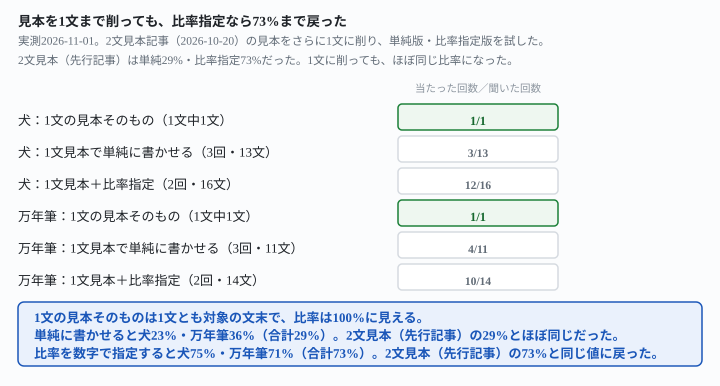
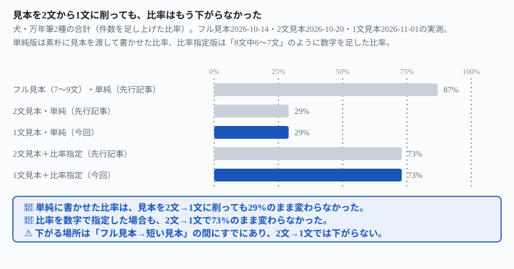

## これで何ができるか {: .what }

結論を先に書きます。

| 見本の長さ | 単純に書かせる | 比率を数字で指定する |
|---|---|---|
| フル見本（7〜9文・先行記事） | 87%（55/63） | — |
| 2文見本（短い見本記事） | 29%（14/48） | 73%（22/30） |
| **1文見本（この記事）** | **29%（7/24）** | **73%（22/30）** |

<mark>見本を2文からさらに1文まで削っても、比率はもう下がりませんでした。</mark>素朴に書かせた比率は犬23%・万年筆36%（合計29%）で、2文見本の29%とほぼ同じです。<mark>比率を「8文中6〜7文」のように数字で指定すると、1文の見本のままで犬75%・万年筆71%（合計73%）まで戻りました。</mark>これも2文見本の73%と同じ値です。

<figure class="figure">

<figcaption>1文の見本そのものは100%に見えても、出力は29%前後。比率指定なら73%まで戻ります。</figcaption>
</figure>

<mark class="warn">「1文しかない見本は、もう手の打ちようがない」という心配は、この結果では当たりません。</mark>比率を数字で指定する工夫は、見本が2文のときと同じだけ効きました。

[短い見本では文体再現が弱まる記事](/recipes/short-sample-still-misses-the-style-ratio/)は、見本を7〜9文から2文に削ると比率が29〜35%まで落ちると確かめました。<mark>あの記事自身が「1文だけに短縮した場合は試していません」と宿題を残していました。</mark>この記事はその宿題を実測しました。

## 前提 {: .need }

| | |
|---|---|
| かかる時間 | 15分 |
| 費用 | 無料。ブラウザのチャットAIで足ります |
| 必要なもの | 自分（または過去のクライアント案件）が書いた、公開してよい過去の原稿。1文だけでも試せます |
| プログラミング | **不要**。この記事の指示文をコピーして貼るだけです |

<mark class="warn">この記事が測ったのは「文体の特徴がどれだけの比率で出力に出たか」という機械で数えられる範囲だけです。</mark>見本に使う文章は、自分自身が過去に書いた原稿だけにしてください。

[見本の文章を渡すと文体は再現できる記事](/recipes/writing-style-sample-matches-the-ratio/)が使ったフル見本（くだけた猫レビュー9文・硬いシャープペンシルレビュー7文）を、さらに先頭1文だけに短縮して使いました。新しい話題（犬の散歩バッグ・万年筆）も先行記事と同じです。

## AIへの頼み方 {: .ask }

### 1. 1文だけの見本を、そのまま渡す

くだけた文体の見本を、先頭1文だけに短縮して渡しました。

次の文章は、私が過去に書いたブログのレビュー文です。

うちの猫、爪とぎがすぐボロボロになるんですよね。

この文体で、新商品の「犬の散歩バッグ」のレビュー文を200字程度で書いてください。

3回試した結果、どの回も対象の文末（「〜んですよね」「〜んです」）が使われたのは最初の1文だけで、残りは「です・ます」調に戻りました。

| 回 | 文数 | 対象の文末 |
|---|---|---|
| 1回目 | 4文 | 1文（25%） |
| 2回目 | 4文 | 1文（25%） |
| 3回目 | 5文 | 1文（20%） |

**合計3/13文（23%）。**2文見本を渡した先行記事の30%と、ほぼ同じ比率です。

### 2. 硬い文体（万年筆）でも、同じ傾向になるか

硬い「である」調の見本も、1文だけに短縮して試しました。

次の文章は、私が過去に書いたブログのレビュー文です。

ラバーではなく金属製のローレット加工が施されており、手が汗ばむ季節でも滑りにくいのである。

この文体で、新商品の「万年筆」のレビュー文を200字程度で書いてください。

| 回 | 文数 | 対象の文末 |
|---|---|---|
| 1回目 | 3文 | 1文（33%） |
| 2回目 | 5文 | 2文（40%） |
| 3回目 | 3文 | 1文（33%） |

**合計4/11文（36%）。**2文見本を渡した先行記事の29%より少し高いものの、同じ桁です。犬・万年筆を合わせると、**7/24文（29%）**で、2文見本の29%と一致しました。

### 3. 1文の見本から、特徴は言葉にできるか確かめる

比率が落ちる理由を確かめるため、見本から文体の特徴を抽出させてみました。

次の文章は、私が過去に書いたブログのレビュー文です。

うちの猫、爪とぎがすぐボロボロになるんですよね。

この文章の文体の特徴を箇条書きで3〜5個挙げてください。

返りは「口語的な話し言葉のトーン」「〜なんですよね、という終助詞を使う」「共感を誘う語尾」など、<mark>使われている語尾の**種類**は正確に言語化されました。</mark>一方で、どの特徴にも「何文中何文」のような**頻度**の情報は出てきませんでした。見本がもともと1文しかないので、頻度を数える材料自体がないのです。

### 4. AIに「見本が短いときのコツ」を直接聞いてみる

ここまでの実測とは別に、工夫そのものをAIに聞けば核心に届くかも確かめました。

クラウドソーシングでライティングの仕事を受けていて、依頼者からの文体の見本が1文しかないことがあります。この見本だけから、文体をできるだけ忠実に再現して書くには、どんな工夫ができますか。番号を振って教えてください。プログラミングはできません。

2回試したところ、どちらも「2段階方式で特徴を抽出する」「文体チェックリストを作る」「見本を何度も再提示する」など複数の工夫が返りました。<mark class="warn">ところが2回とも、「語尾の頻度を自分で決めた数字にして指示に足す」という、この記事で実際に効いた工夫は出てきませんでした。</mark>AIに工夫を聞くだけでは、効く言い方そのものには辿り着けませんでした。

## うまくいかないときの言い直し方 {: .fix }

### 比率を数字で指定すると、1文の見本でも戻るか {: .trouble }

[先行記事](/recipes/writing-style-sample-matches-the-ratio/)で効いた「8文中6〜7文」という数字指定を、1文見本と組み合わせて試しました。

次の文章は、私が過去に書いたブログのレビュー文です。

うちの猫、爪とぎがすぐボロボロになるんですよね。

この文体で、新商品の「犬の散歩バッグ」のレビュー文を200字程度で書いてください。ただし、文末が「〜んですよね」「〜んです」になるのは8文中6〜7文程度にとどめ、残りは別の言い方にしてください。

2回試したところ、2回とも実際の本文は8文で、6文が対象の文末（75%）。**合計12/16文（75%）**です。2文見本を渡した先行記事の75%と、同じ比率です。

硬い文体（万年筆）でも同じ言い方を試しました。

次の文章は、私が過去に書いたブログのレビュー文です。

ラバーではなく金属製のローレット加工が施されており、手が汗ばむ季節でも滑りにくいのである。

この文体で、新商品の「万年筆」のレビュー文を200字程度で書いてください。ただし、文末が「〜である」「〜のである」になるのは7文中5〜6文程度にとどめ、残りは別の言い方にしてください。

2回とも本文は7文で、5文が対象の文末（71%）。**合計10/14文（71%）**です。2条件を合わせると、**22/30文（73%）**まで戻りました。<mark>この73%は、2文見本を渡した先行記事とまったく同じ値です。</mark>

<figure class="figure">

<figcaption>比率が下がるのは「フル見本→短い見本」の間。2文→1文ではもう下がりません。</figcaption>
</figure>

→ **見本が1文しかなくても、比率を数字で指定する工夫は2文のときと同じだけ効きます。**見本の長さを気にするより、頻度を自分で決めた数字にして指示文に足すほうが確実です。

## 応用・次の一手 {: .next }

| 条件 | 犬（対象の文末） | 万年筆（対象の文末） |
|---|---|---|
| フル見本（7〜9文・先行記事） | 77%（27/35） | 100%（28/28） |
| 2文見本・単純（短い見本記事） | 30%（8/27） | 29%（6/21） |
| 1文見本・単純（この記事） | 23%（3/13） | 36%（4/11） |
| 2文見本＋比率指定（短い見本記事） | 75%（12/16） | 71%（10/14） |
| 1文見本＋比率指定（この記事） | 75%（12/16） | 71%（10/14） |

見本が短いときに使う順番は、[短い見本記事](/recipes/short-sample-still-misses-the-style-ratio/)と変わりません。

1. 短い見本（1文でも2文でも）から、使われている文末・接続詞の**種類**だけを確認する
2. 頻度は「8文中6〜7文」のように、**自分で決めた数字**を指示文に足す
3. AIに「コツ」を聞いても、この数字指定という工夫は自分からは出てきません。**自分で足す必要があります**
4. 本当にその頻度が自然かどうかは、依頼者に過去の長めの原稿を1本もらえないか聞くのが一番確実です

長い見本・複数見本を渡した場合の結果は[長い見本・複数見本の記事](/recipes/two-samples-settle-on-one-style-not-a-blend/)に、副業のライティングで文体を扱う他の記事は[誤字と冗長さだけ直させて言い回しには触らせない記事](/recipes/fix-typos-not-voice/)にまとめています。

⚠️ **この結果は、架空のブログレビュー2種・計24回の実測です。**「見本は1文まで削っても必ず大丈夫」と一般化しないでください。試したのは、次の範囲までです。

- 見本は1文に短縮した版のみです。文そのものが極端に短い・長い場合は試していません
- 新しい話題は先行記事と同じ2つ（犬の散歩バッグ・万年筆）だけです
- 比率の数字指定は、1文見本と組み合わせた場合のみ試しました

今回の生の返りと機械照合は `docs/evidence/one-sentence-sample-still-hits-the-named-ratio.md` に全文置いてあります。
