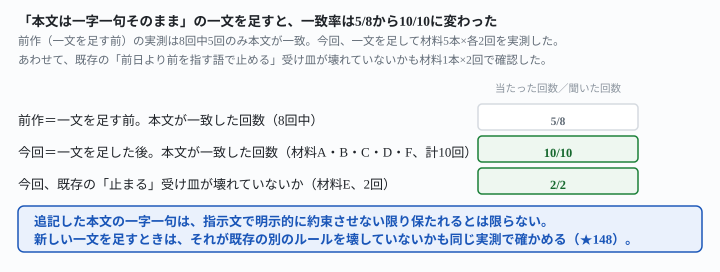
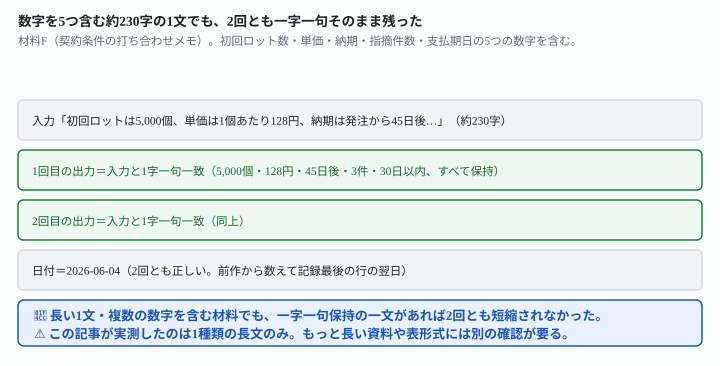

## これで何ができるか {: .what }

[一昨日もおとといも正しく止まる——ただし本文は12回中3回書き換わる](/recipes/two-days-back-stops-correctly-but-wording-shifts/)は、言い直し案を1つ出したまま、実測せずに終わっていました。「追記する本文は、入力された文章を一字一句そのまま使ってください」。前作自身が「この言い直しは、この記事では実測していません」とも書き添えていました。

この1文を実際に指示文へ足して、確かめました。

<figure class="figure">

<figcaption>一文を足す前は8回中5回。足した後は10回中10回だった。</figcaption>
</figure>

<mark>結論は2つです。①本文が入力と一字一句一致した回数は、前作の8回中5回から、今回の10回中10回に変わりました。</mark>材料は5本です。

- 制作業の進捗記録
- 店舗の引き継ぎノート
- 設備点検記録
- 問い合わせ対応ログ
- 数字を多く含む長文の契約メモ

各2回ずつ試しました。

<mark>②新しい一文を足しても、既存の受け皿は壊れていませんでした。</mark>前作が実測した「前日より前を指す語（一昨日・おととい等）が出たら止める」という受け皿です。別の材料で2回試し、2回とも正しく止まりました。

## 前提 {: .need }

| | |
|---|---|
| かかる時間 | 15分。[前作](/recipes/two-days-back-stops-correctly-but-wording-shifts/)を先に読むと話がつながります |
| 費用 | 無料。無料のチャットAIで足ります |
| 必要なもの | ブラウザで使えるAI（ChatGPT・Claude・Geminiなど）と、毎日1行ずつ追記しているテキストファイル |
| プログラミング | **不要**。ファイルはメモ帳で作れるただのテキストです |

⚠️ **[前作](/recipes/two-days-back-stops-correctly-but-wording-shifts/)を先に読んでください。**この記事の指示文は、前作がすでに実測した「相対語の判断」「止まる受け皿」をそのまま引き継いでいます。今回新しく足したのは、末尾の一文だけです。

📌 **この記事の数字は、すべて架空データでの実測です。**2026-11-21という日付だけは本物です。

## AIへの頼み方 {: .ask }

### 1. 「一字一句そのまま」の一文を足して、別の業務領域で試す

前作の指示文に、「追記する本文は、入力された文章を一字一句そのまま使ってください」という1文を足しました。まず、制作業の進捗記録で試します。

下の「記録ファイル」の末尾に、【今日ぶん】を1行だけ追記してください。すでにある行は1文字も変えないでください。【今日ぶん】の中に日付の表記が無く、相対的な言葉だけで時点が書かれている場合は、実際のシステム上の今日の日付を使わないでください。その言葉が指す時点を、記録ファイルの最後の行を基準に判断してください。前の行からの続きとして今日にあたる言葉なら、記録ファイルの最後の行の次の日を使い、前の行と同じ日を指す言葉（前日を指す言葉など）なら、記録ファイルの最後の行と同じ日付を使ってください。ただし、前日より前を指す言葉（一昨日・おととい等）が出た場合は、日付を決めずに「確認が必要です」と書いて作業を止めてください。追記する本文は、入力された文章を一字一句そのまま使ってください。更新後のファイル全体を、コードブロックで出してください。

記録ファイル:
2026-09-01: 新規のロゴ制作案件を受注し、ヒアリングシートを送付した。
2026-09-02: ヒアリングシートの返送を受け、ラフ案を3パターン作成した。
2026-09-03: ラフ案をクライアントに共有し、A案をベースに進める旨の返信を受けた。

【今日ぶん】
今日は、A案を元にカラーバリエーションを5パターン作成し、クライアントに送付しました。あわせて、納品形式についてAI・EPS・PNGの3種類で欲しいという追加の要望も来たので、見積もりに反映しておきます。

2回とも、追記された本文は入力と1字一句一致しました（日付は2026-09-04で2回とも正しい一致）。別の材料（店舗の引き継ぎノート）でも試しました。

下の「記録ファイル」の末尾に、【今日ぶん】を1行だけ追記してください。すでにある行は1文字も変えないでください。【今日ぶん】の中に日付の表記が無く、相対的な言葉だけで時点が書かれている場合は、実際のシステム上の今日の日付を使わないでください。その言葉が指す時点を、記録ファイルの最後の行を基準に判断してください。前の行からの続きとして今日にあたる言葉なら、記録ファイルの最後の行の次の日を使い、前の行と同じ日を指す言葉（前日を指す言葉など）なら、記録ファイルの最後の行と同じ日付を使ってください。ただし、前日より前を指す言葉（一昨日・おととい等）が出た場合は、日付を決めずに「確認が必要です」と書いて作業を止めてください。追記する本文は、入力された文章を一字一句そのまま使ってください。更新後のファイル全体を、コードブロックで出してください。

記録ファイル:
2026-10-20: 新しいPOSレジの操作研修を実施した。
2026-10-21: 発注書のフォーマットを変更した。
2026-10-22: 新人スタッフの初出勤があり、レジ対応を教えた。

【今日ぶん】
今日は、冷蔵庫の温度センサーが一時的に3度まで上昇していたのを発見し、業者に連絡して点検してもらいました。原因はドアパッキンの劣化とのことで、来週部品交換の予定です。念のため、保管していた食材は廃棄せずそのまま使用しています。

<mark>こちらも2回とも、本文が入力と1字一句一致しました</mark>（日付は2026-10-23で2回とも正しい一致）。ここまで2本・計4回とも、本文の短縮は起きていません。

### 2. さらに別の2領域（設備点検・問い合わせ対応）でも試す

材料を替えるほど結果が安定するかを見るため、もう2本試しました。設備点検の記録です。

下の「記録ファイル」の末尾に、【今日ぶん】を1行だけ追記してください。すでにある行は1文字も変えないでください。【今日ぶん】の中に日付の表記が無く、相対的な言葉だけで時点が書かれている場合は、実際のシステム上の今日の日付を使わないでください。その言葉が指す時点を、記録ファイルの最後の行を基準に判断してください。前の行からの続きとして今日にあたる言葉なら、記録ファイルの最後の行の次の日を使い、前の行と同じ日を指す言葉（前日を指す言葉など）なら、記録ファイルの最後の行と同じ日付を使ってください。ただし、前日より前を指す言葉（一昨日・おととい等）が出た場合は、日付を決めずに「確認が必要です」と書いて作業を止めてください。追記する本文は、入力された文章を一字一句そのまま使ってください。更新後のファイル全体を、コードブロックで出してください。

記録ファイル:
2026-11-10: 定例の設備点検を実施し、異常なし。
2026-11-11: 消耗品のフィルターを交換した。
2026-11-12: 点検担当者を1名増員した。

【今日ぶん】
今日は、3号機の稼働音がいつもより大きいことに気づき、メーカーのサポートに問い合わせました。点検の予約は来週の火曜日に取れましたが、それまでは1号機と2号機だけで稼働を続けます。

2回とも一致（日付2026-11-13）。続けて、問い合わせ対応のログです。

下の「記録ファイル」の末尾に、【今日ぶん】を1行だけ追記してください。すでにある行は1文字も変えないでください。【今日ぶん】の中に日付の表記が無く、相対的な言葉だけで時点が書かれている場合は、実際のシステム上の今日の日付を使わないでください。その言葉が指す時点を、記録ファイルの最後の行を基準に判断してください。前の行からの続きとして今日にあたる言葉なら、記録ファイルの最後の行の次の日を使い、前の行と同じ日を指す言葉（前日を指す言葉など）なら、記録ファイルの最後の行と同じ日付を使ってください。ただし、前日より前を指す言葉（一昨日・おととい等）が出た場合は、日付を決めずに「確認が必要です」と書いて作業を止めてください。追記する本文は、入力された文章を一字一句そのまま使ってください。更新後のファイル全体を、コードブロックで出してください。

記録ファイル:
2026-07-01: 返品に関する問い合わせを受け、返送先住所を案内した。
2026-07-02: 製品不具合の問い合わせがあり、交換対応を案内した。
2026-07-03: 発送状況の問い合わせに対し、追跡番号を案内した。

【今日ぶん】
今日は、同じお客様から2回目の問い合わせがあり、前回案内した交換品がまだ届いていないとのことでした。配送業者に確認したところ、配送センターでの仕分けミスが判明し、明日中に再発送されることになりました。

<mark>こちらも2回とも一致しました</mark>（日付2026-07-04）。4本・計8回とも、本文は一字一句保たれました。

### 3. 既存の「止まる」受け皿が、新しい一文で壊れていないかを確かめる

一文を足したことで、前作が実測した「前日より前を指す語が出たら止める」という受け皿が影響を受けないかも確かめました。

下の「記録ファイル」の末尾に、【今日ぶん】を1行だけ追記してください。すでにある行は1文字も変えないでください。【今日ぶん】の中に日付の表記が無く、相対的な言葉だけで時点が書かれている場合は、実際のシステム上の今日の日付を使わないでください。その言葉が指す時点を、記録ファイルの最後の行を基準に判断してください。前の行からの続きとして今日にあたる言葉なら、記録ファイルの最後の行の次の日を使い、前の行と同じ日を指す言葉（前日を指す言葉など）なら、記録ファイルの最後の行と同じ日付を使ってください。ただし、前日より前を指す言葉（一昨日・おととい等）が出た場合は、日付を決めずに「確認が必要です」と書いて作業を止めてください。追記する本文は、入力された文章を一字一句そのまま使ってください。更新後のファイル全体を、コードブロックで出してください。

記録ファイル:
2026-11-05: 新しい在庫管理アプリの導入を検討し始めた。
2026-11-06: アプリのトライアル版を申し込んだ。
2026-11-07: トライアル版の初期設定を終えた。

【今日ぶん】
一昨日の分の記録を忘れていたのですが、在庫アプリの操作研修を受けました。

<mark>2回とも「確認が必要です」とだけ返し、追記や全文出力を行いませんでした。</mark>新しい一文を足しても、既存の受け皿は壊れていません。

### 4. 数字を多く含む長い1文でも、崩れないかを確かめる

最後に、短縮の誘惑が強そうな条件を用意しました。数字を5つ含む、約230字の長い1文です。

下の「記録ファイル」の末尾に、【今日ぶん】を1行だけ追記してください。すでにある行は1文字も変えないでください。【今日ぶん】の中に日付の表記が無く、相対的な言葉だけで時点が書かれている場合は、実際のシステム上の今日の日付を使わないでください。その言葉が指す時点を、記録ファイルの最後の行を基準に判断してください。前の行からの続きとして今日にあたる言葉なら、記録ファイルの最後の行の次の日を使い、前の行と同じ日を指す言葉（前日を指す言葉など）なら、記録ファイルの最後の行と同じ日付を使ってください。ただし、前日より前を指す言葉（一昨日・おととい等）が出た場合は、日付を決めずに「確認が必要です」と書いて作業を止めてください。追記する本文は、入力された文章を一字一句そのまま使ってください。更新後のファイル全体を、コードブロックで出してください。

記録ファイル:
2026-06-01: 新商品のパッケージデザイン案を3社から受け取った。
2026-06-02: デザイン案をもとに社内投票を実施した。
2026-06-03: 投票の結果、B社の案を採用することに決定した。

【今日ぶん】
今日は、B社との契約条件を詰める打ち合わせを行い、初回ロットは5,000個、単価は1個あたり128円、納期は発注から45日後という条件で合意しました。あわせて、パッケージに記載する成分表示について、当社の品質保証部門からの指摘が3件あったため、B社に修正版のデザインを依頼し、来週中に再提出してもらうことになりました。支払い条件は、納品後30日以内の振込とし、不良品が発生した場合は初回ロットに限り無償交換に応じてもらう特約も盛り込みました。

<figure class="figure">

<figcaption>5,000個・128円・45日後・3件・30日以内——5つの数字とも、2回とも保たれた。</figcaption>
</figure>

<mark class="warn">短縮を誘いそうな長さと数字の量でも、2回とも入力と1字一句一致しました。</mark>ここまで5材料・計10回、本文が短縮された回は0回でした。

## うまくいかないときの言い直し方 {: .fix }

### 一字一句を保つ一文を入れたのに、本文が短くなる {: .trouble }

この記事で実測した5材料・10回では起きませんでした。もし起きた場合は、一文の位置を変えてみてください。指示文の最後ではなく、「追記してください」という指示の直後（先頭に近い位置）へ移します。[積み上げた指示ファイルを掃除する](/recipes/date-decides-which-note-wins/)などで、**後から足した条件ほど、先に書いた条件より軽く扱われる**という崩れ方が繰り返し確認されています。位置を動かすのも言い直しの1つです。

### 「前日より前」の受け皿を外してしまっている

この記事の指示文は、前作が実測した「一昨日・おととい等が出たら止める」という一文を前提にしています。これを外すと、前作が実測したとおり、素朴な一般化だけでは「前日」にあたる語すら2回に1回揺れます。受け皿の一文は必ず残してください。

## 応用・次の一手 {: .next }

**この記事の結論は2つです。**①本文が入力と一字一句一致した回数は、前作の8回中5回から、今回の10回中10回に変わりました（材料5本・各2回）。②新しい一文は、既存の「前日より前を指す語で止める」受け皿を壊していません（材料1本・2回で確認）。

📌 **この記事が実測していないこと**は次の3つです。

- 材料は単発の1行ずつです。**複数行をまとめて【今日ぶん】に渡した場合**（例＝2日分をまとめて追記する）は試していません
- 記録ファイルが**表形式（タブ区切り・複数列）**の場合は試していません
- 今回の長文は約230字・5つの数字でした。**1,000字を超えるような、もっと長い【今日ぶん】**でも同じ結果になるかは分かりません

これらを自分の環境で試すときは、**2回以上試して突き合わせる**ことを忘れないでください。[毎日の追記を同じ形にそろえる](/recipes/daily-append-same-shape/)と同じ要領です。1回だけでは「毎回同じ形で出る」とは言えません。
