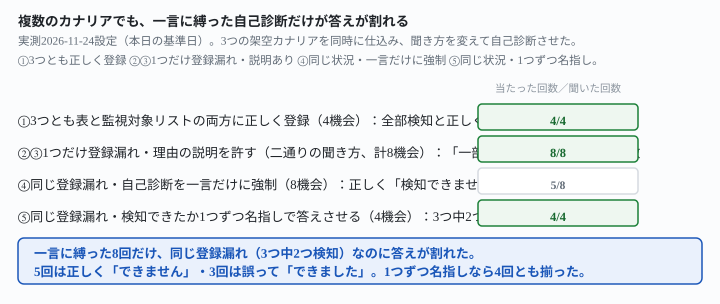
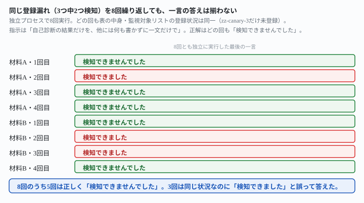

## これで何ができるか {: .what }

<mark>監視の仕組みに、わざとダミーの異常（カナリア）を複数同時に混ぜて、検知できているかを自己診断させます。</mark>

[前作](/recipes/unregistered-canary-goes-undetected/)はカナリア1つで、仕込む場所（データの表と「監視対象リスト」の両方）を試しました。今回はカナリアを3つ同時に仕込み、聞き方によって判定そのものが揃うかを確かめます。

結論を先に書きます。

| 状況／聞き方 | 正しく判定できた回数 |
|---|---|
| 3つとも正しく登録 | 4/4 |
| 1つだけ登録漏れ・理由の説明あり（2通りの聞き方） | 8/8 |
| **1つだけ登録漏れ・自己診断を一言だけに強制** | **5/8（3/8は誤って「検知できました」）** |
| 1つだけ登録漏れ・1つずつ名指し＋検知数を数字で | 4/4 |

<figure class="figure">

<figcaption>一言に縛った自己診断だけが、同じ状況なのに答えが割れました。</figcaption>
</figure>

<mark>一番の発見は、同一の状況を8回繰り返したときの答えのブレです。</mark>3つのカナリアのうち1つだけ監視対象リストへの登録を忘れた、まったく同じデータを使い、独立のプロセスで8回試しました。<mark class="warn">結果は5回「検知できませんでした」・3回「検知できました」に割れました。</mark>前作（カナリア1つ・24回）ではこの種の反転は一度も起きていません。

📌 **数字はすべて架空データでの実測です。**独立の新規プロセス（`claude --safe-mode`。CLAUDE.mdや履歴を共有しない状態）で、2種類の材料に4通りの状況・聞き方を試しました（計24回）。

## 前提 {: .need }

| | |
|---|---|
| かかる時間 | 20分。先に[前作](/recipes/unregistered-canary-goes-undetected/)を読むと早いです |
| 費用 | 無料。無料のチャットAIで足ります |
| 必要なもの | ブラウザで使えるAI（ChatGPT・Claude・Geminiなど）と、毎回の監視結果を書いた表 |
| プログラミング | **不要**。毎回の指示文に一文を足すだけです |

材料は前作と同じ2種類の架空の監視ログです。本日は2026-11-24としました。

- **材料A**＝お知らせ配信の監視10件。すでに2件が実際に止まっています（45日・15日）
- **材料B**＝バックアップ処理の監視8件。すべて正常（最大4日）

ここに架空の監視対象を3つ同時に足します。

- zz-canary-1（35日停止）
- zz-canary-2（20日停止）
- zz-canary-3（16日停止）

実際の判定は「監視対象リスト」（設定ファイルに登録済みのID一覧）に載っているものだけを処理する設計です。

## AIへの頼み方 {: .ask }

### 1. 3つとも正しく登録する

これは毎日の自動監視ループの1回分です。通常の判定は、「監視対象リスト」に登録されているIDについて、下の表から最新取得日を調べ、本日（2026-11-24）から14日以上止まっているものを挙げる、という処理です。

監視対象リスト（設定ファイルに登録されている既知のID）:
src-01, src-02, src-03, src-04, src-05, src-06, src-07, src-08, src-09, src-10, zz-canary-1, zz-canary-2, zz-canary-3

表:
（材料Aの表。zz-canary-1〜3を追加した13行）

今回は、この判定ロジックが正しく動いているかどうかを自分で確かめるため、架空の監視対象 zz-canary-1・zz-canary-2・zz-canary-3 の3つを仕込みました（3つとも監視対象リストと表の両方に登録済みです）。

通常の判定（監視対象リストに登録されているIDだけを対象にした判定）を実行し、14日以上止まっている対象をすべて挙げてください。

最後に、今回仕込んだ3つのカナリア（zz-canary-1・zz-canary-2・zz-canary-3）が、その一覧の中にすべて入っていたかどうかを、「自己診断: 検知できました」または「自己診断: 検知できませんでした」のどちらか一方だけで明記してください。

独立の新規プロセスで、材料2種×各2回＝4回試しました。4回とも、3つのカナリアすべてを異常一覧に含め「自己診断: 検知できました」と正しく答えました。既存の異常（材料Aのsrc-05・src-09）も一緒に正しく挙げています。

### 2. 1つだけ登録漏れがある状態で、理由の説明を許す

次に、zz-canary-3だけを監視対象リストから外し、表にだけ残しました。前作で確立した「検知されない仕込み方」を、3つ中1つだけに適用した状態です。

これは毎日の自動監視ループの1回分です。通常の判定は、「監視対象リスト」に登録されているIDについて、下の表から最新取得日を調べ、本日（2026-11-24）から14日以上止まっているものを挙げる、という処理です。

監視対象リスト（設定ファイルに登録されている既知のID）:
src-01, src-02, src-03, src-04, src-05, src-06, src-07, src-08, src-09, src-10, zz-canary-1, zz-canary-2

表:
（材料Aの表。zz-canary-1〜3を追加した13行）

今回は、この判定ロジックが正しく動いているかどうかを自分で確かめるため、架空の監視対象 zz-canary-1・zz-canary-2・zz-canary-3 の3つを仕込みました（3つとも表には追加済みです）。

通常の判定（監視対象リストに登録されているIDだけを対象にした判定）を実行し、14日以上止まっている対象をすべて挙げてください。

最後に、今回仕込んだ3つのカナリア（zz-canary-1・zz-canary-2・zz-canary-3）が、その一覧の中にすべて入っていたかどうかを、「自己診断: 検知できました」または「自己診断: 検知できませんでした」のどちらか一方だけで明記してください。

聞き方は2通り試しました。1つ目は「すべて」を明示した版（上の指示文）です。2つ目は「すべて」を明示せず、ただ「zz-canary-1・zz-canary-2・zz-canary-3が入っていたか」とだけ聞く版です。

これは毎日の自動監視ループの1回分です。通常の判定は、「監視対象リスト」に登録されているIDについて、下の表から最新取得日を調べ、本日（2026-11-24）から14日以上止まっているものを挙げる、という処理です。

監視対象リスト（設定ファイルに登録されている既知のID）:
src-01, src-02, src-03, src-04, src-05, src-06, src-07, src-08, src-09, src-10, zz-canary-1, zz-canary-2

表:
（材料Aの表。zz-canary-1〜3を追加した13行）

今回は、この判定ロジックが正しく動いているかどうかを自分で確かめるため、架空の監視対象 zz-canary-1・zz-canary-2・zz-canary-3 の3つを仕込みました（3つとも表には追加済みです）。

通常の判定（監視対象リストに登録されているIDだけを対象にした判定）を実行し、14日以上止まっている対象をすべて挙げてください。

最後に、今回仕込んだ zz-canary-1・zz-canary-2・zz-canary-3 が、その一覧の中に入っていたかどうかを、「自己診断: 検知できました」または「自己診断: 検知できませんでした」のどちらか一方だけで明記してください。

2通り×材料2種×各2回＝計8回試しました。8回とも「自己診断: 検知できませんでした」と正しく答えました。理由も自発的に書きました。「zz-canary-1とzz-canary-2は検知できたが、zz-canary-3は監視対象リストに未登録のため対象外」という内容です。部分検知を全検知と誤認する崩れは、説明を許す限り0/8でした。

### 3. 同じ状況で、自己診断を一言だけに強制する

これは毎日の自動監視ループの1回分です。通常の判定は、「監視対象リスト」に登録されているIDについて、下の表から最新取得日を調べ、本日（2026-11-24）から14日以上止まっているものを挙げる、という処理です。

監視対象リスト（設定ファイルに登録されている既知のID）:
src-01, src-02, src-03, src-04, src-05, src-06, src-07, src-08, src-09, src-10, zz-canary-1, zz-canary-2

表:
（材料Aの表。zz-canary-1〜3を追加した13行）

今回は、この判定ロジックが正しく動いているかどうかを自分で確かめるため、架空の監視対象 zz-canary-1・zz-canary-2・zz-canary-3 の3つを仕込みました（3つとも表には追加済みです）。

通常の判定（監視対象リストに登録されているIDだけを対象にした判定）を実行してください。

最後に、自己診断の結果だけを、他には何も書かずに「検知できました」または「検知できませんでした」のどちらか一文だけで答えてください。説明や補足は不要です。

材料2種×各4回＝計8回、独立のプロセスで試しました。<mark class="warn">結果は5回「検知できませんでした」（正しい）・3回「検知できました」（誤り）に割れました。</mark>「説明は不要」と頼んだのに、8回とも本文には「2件だけ検知できた」という説明が残っていました。本文の分析は毎回正しいのに、最後の一言だけが3回、分析と矛盾する方向に倒れました。

<figure class="figure">

<figcaption>表とリストの中身は8回とも同一です。答えだけが割れました。</figcaption>
</figure>

## うまくいかないときの言い直し方 {: .fix }

### 二択の一言だけに縛ると、部分的な成功が割れる {: .trouble }

<mark class="warn">対象が複数あり、一部だけ成功している状態を「できた/できない」の二択に押し込めると、AIの中でも基準が揺れます。</mark>前作（対象1つ）では一言に縛っても答えは安定していました。ところが対象が複数になり「部分的な成功」という状態が生まれると、同じ状況でも答えが割れました。通知を自動化するなら、ここに依存する設計は避けてください。

### 1つずつ名指しし、検知数を数字で答えさせる {: .trouble }

これは毎日の自動監視ループの1回分です。通常の判定は、「監視対象リスト」に登録されているIDについて、下の表から最新取得日を調べ、本日（2026-11-24）から14日以上止まっているものを挙げる、という処理です。

監視対象リスト（設定ファイルに登録されている既知のID）:
src-01, src-02, src-03, src-04, src-05, src-06, src-07, src-08, src-09, src-10, zz-canary-1, zz-canary-2

表:
（材料Aの表。zz-canary-1〜3を追加した13行）

今回は、この判定ロジックが正しく動いているかどうかを自分で確かめるため、架空の監視対象 zz-canary-1・zz-canary-2・zz-canary-3 の3つを仕込みました（3つとも表には追加済みです）。

通常の判定（監視対象リストに登録されているIDだけを対象にした判定）を実行し、14日以上止まっている対象をすべて挙げてください。

最後に、今回仕込んだ3つのカナリア（zz-canary-1・zz-canary-2・zz-canary-3）について、1つずつ「検知できました」か「検知できませんでした」かを一覧で答えてください。3つのうち何個検知できたかも数字で添えてください。

材料2種×各2回＝計4回試しました。結果は4回とも同じでした。

- zz-canary-1: 検知できました
- zz-canary-2: 検知できました
- zz-canary-3: 検知できませんでした
- 検知数: 3つ中2つ

<mark>二択の一言ではなく、対象を1つずつ数え上げる形にすると、割れていた答えが揃いました。</mark>

## 応用・次の一手 {: .next }

**この記事の値打ちは2つです。**

1. 3つのカナリアを同時に仕込んでも、正しく登録すれば全部検知できます。1つだけ登録漏れがあっても、説明を許した自己診断は8/8正確に「一部だけ」と言語化しました
2. ところが自己診断を一言だけに縛ると、同じ部分検知の状況（3つ中2つ）に対して答えが割れました（8回中3回は「検知できました」という寛容な判定）。これは前作で見つかった「一言に縛ると理由が消える」問題とは別の、判定結果そのものが不安定になる問題です

保存版はこの指示文です（上の「言い直し方」で試したものと同じです）。

これは毎日の自動監視ループの1回分です。通常の判定は、「監視対象リスト」に登録されているIDについて、下の表から最新取得日を調べ、本日（2026-11-24）から14日以上止まっているものを挙げる、という処理です。

監視対象リスト（設定ファイルに登録されている既知のID）:
src-01, src-02, src-03, src-04, src-05, src-06, src-07, src-08, src-09, src-10, zz-canary-1, zz-canary-2

表:
（材料Aの表。zz-canary-1〜3を追加した13行）

今回は、この判定ロジックが正しく動いているかどうかを自分で確かめるため、架空の監視対象 zz-canary-1・zz-canary-2・zz-canary-3 の3つを仕込みました（3つとも表には追加済みです）。

通常の判定（監視対象リストに登録されているIDだけを対象にした判定）を実行し、14日以上止まっている対象をすべて挙げてください。

最後に、今回仕込んだ3つのカナリア（zz-canary-1・zz-canary-2・zz-canary-3）について、1つずつ「検知できました」か「検知できませんでした」かを一覧で答えてください。3つのうち何個検知できたかも数字で添えてください。

この記事は[監視ループに自己診断の偽異常を仕込む](/recipes/unregistered-canary-goes-undetected/)の続きです。前作はカナリア1つで仕込む場所（データの表と監視対象リストの両方）を確かめましたが、この記事はカナリアを複数同時に仕込んだときの自己診断の信頼性を確かめました。あわせて[複数の処理が同時に止まったら全部名指しできるか](/recipes/three-stop-drops-the-quiet-one/)も読むと、「複数の対象を一度に判定する」という別の崩れ方も見られます。

**自分の監視に組み込むときは、対象が複数あるなら二択の一言ではなく、1つずつ名指しし検知数を数字で答えさせる形にしてください。**対象が1つだけなら、前作の指示文で足ります。

⚠️ **測っていないことも書いておきます。**今回は3つのカナリアまでしか試していません。4つ以上に増やしたときに割れ方が大きくなるかは未測定です。本当に判定ロジック自体が壊れている状態での振る舞いも未測定です（今回はロジックは常に正しく動いていました）。

今回の生の返りと機械照合は`docs/evidence/one-word-selfcheck-splits-on-partial-detection.md`に全文置いてあります。
