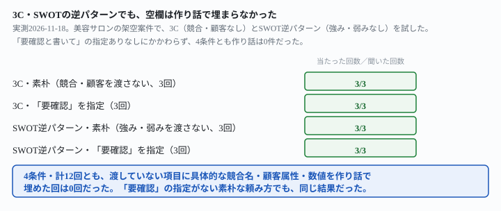
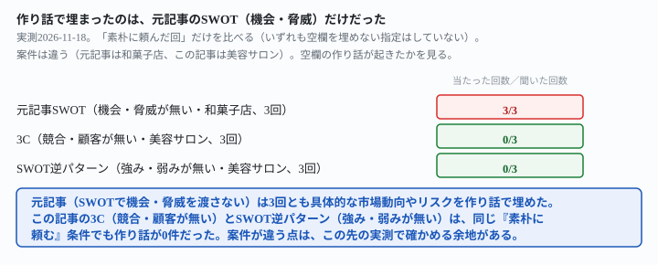

## これで何ができるか {: .what }

[SWOTの空欄は「要確認」にする](/recipes/swot-missing-quadrant-needs-confirmed/)は、SWOT分析で「機会」「脅威」を渡さずに頼むと、3回とも具体的な市場動向やリスクが作り話で埋まることを確かめました。残した宿題は2つです。「①フレームワークはSWOTのみです。3C・KPTなど他の枠組みでも同じことが起きるか」「②材料は『強み・弱みあり、機会・脅威なし』の1パターンのみです。逆（機会・脅威あり、強み・弱みなし）は試していません」。この記事はその2つの宿題に答えます。

結論を先に書きます。

| 条件 | 渡していない項目 | 「要確認」の指定 | 試行回数 | 作り話で埋めた回 |
|---|---|---|---|---|
| 3C分析 | 競合（Competitor）・顧客（Customer） | なし（素朴） | 3回 | 0回 |
| 3C分析 | 競合・顧客 | あり | 3回 | 0回 |
| SWOT・逆パターン | 強み（S）・弱み（W） | なし（素朴） | 3回 | 0回 |
| SWOT・逆パターン | 強み・弱み | あり | 3回 | 0回 |
| **合計** | | | **12回** | **0回** |

<mark>3C分析で競合・顧客を渡さなくても、SWOTの逆パターンで強み・弱みを渡さなくても、12回のうち1回も具体的な数字や競合名の作り話で埋まりませんでした。</mark>「要確認と書いて」と指定しなくても、同じ結果でした。

<figure class="figure">

<figcaption>4条件・12回とも、空欄は作り話で埋まらなかった。</figcaption>
</figure>

試した記録は[こちら](https://github.com/invest-ai-info/ai-tsukaikata/blob/main/docs/evidence/other-frameworks-leave-the-blank-quadrant-blank.md)に全文置いています。

## 前提 {: .need }

| | |
|---|---|
| かかる時間 | 15分 |
| 費用 | 無料。ブラウザのチャットAIで足ります |
| 必要なもの | クライアントから渡された情報（一部だけでも可） |
| プログラミング | **不要**。この記事の指示文をコピーして貼るだけです |

<mark class="warn">発注者の実在の案件情報は、そのまま貼らないでください。</mark>この記事は架空の美容サロン「Carene（カレン）」の案件を使っています。実在の企業・店舗とは関係ありません。

## AIへの頼み方 {: .ask }

### 1. 3C分析で、競合・顧客を渡さずに素朴に頼む

自社（Company）の情報だけを渡し、競合（Competitor）・顧客（Customer）はあえて渡しません。

架空のクライアント案件です。美容サロン『Carene(カレン)』の新サービス企画の提案資料を作る仕事を受けました。3C分析（Company・Competitor・Customer）の枠で、提案資料の骨子を作ってください。

分かっている情報:
Company: 創業8年の個人経営サロン。都心駅近。得意技術は頭皮エステ。スタッフ3名、全員国家資格保持。既存客の月間リピート率68%。

**3回**試しました。**3回とも**、Competitor・Customerの節全体に【仮説】【要調査】の印をつけました。中身も「想定される競合カテゴリ」「想定ターゲット」のように**カテゴリ名で書き**、具体的な競合店名や市場規模の数字は作りませんでした。SWOTの元記事で起きた「仮説の印が末尾の注記1行だけ」という崩れ方は、3回とも起きませんでした。

### 2. 3C分析に「要確認と書いて」を指定する

元記事で効いた一文を、同じ材料に足します。

架空のクライアント案件です。美容サロン『Carene(カレン)』の新サービス企画の提案資料を作る仕事を受けました。3C分析（Company・Competitor・Customer）の枠で、提案資料の骨子を作ってください。

分かっている情報:
Company: 創業8年の個人経営サロン。都心駅近。得意技術は頭皮エステ。スタッフ3名、全員国家資格保持。既存客の月間リピート率68%。

Competitor・Customerについて、こちらから渡した情報の中にはデータがありません。分からない項目は、具体的な数字や競合名を作らずに「情報がありません／要確認」と明記してください。

**3回**試しました。**3回とも**「情報がありません」とだけ書き、確認したい観点（競合の価格帯・顧客属性など）を項目名で並べるだけでした。素朴に頼んだ条件1と比べて、結果に大きな違いはありませんでした。

### 3. SWOTの逆パターンで、強み・弱みを渡さずに素朴に頼む

今度はSWOTで、外部環境（機会・脅威）だけを渡し、内部環境（強み・弱み）は渡しません。元記事と逆の組み合わせです。

架空のクライアント案件です。美容サロン『Carene(カレン)』の新サービス企画の提案資料を作る仕事を受けました。SWOT分析の枠で、提案資料の骨子を作ってください。

分かっている情報:
機会: 地域の美容サロン業界団体の調査で、頭皮ケア需要が過去3年で年15%成長している。近隣に大型オフィスビルが2026年に新設予定。
脅威: 駅前に全国チェーンの低価格サロンが2026年春に開業予定。美容師不足で求人コストが上昇している。

**3回**試しました。**3回とも**、強み・弱みの節を**空欄のまま**にし、代わりに「ヒアリング項目例」（客単価・リピート率・スタッフの技術など、項目名のみ）を列挙しました。<mark>SWOTの元記事では「機会・脅威」を渡さないと3回とも作り話で埋まりましたが、「強み・弱み」を渡さない今回は3回とも空欄のままでした。</mark>

### 4. SWOT逆パターンに「要確認と書いて」を指定する

架空のクライアント案件です。美容サロン『Carene(カレン)』の新サービス企画の提案資料を作る仕事を受けました。SWOT分析の枠で、提案資料の骨子を作ってください。

分かっている情報:
機会: 地域の美容サロン業界団体の調査で、頭皮ケア需要が過去3年で年15%成長している。近隣に大型オフィスビルが2026年に新設予定。
脅威: 駅前に全国チェーンの低価格サロンが2026年春に開業予定。美容師不足で求人コストが上昇している。

強み・弱みについて、こちらから渡した情報の中にはデータがありません。分からない項目は、具体的な数字や事実を作らずに「情報がありません／要確認」と明記してください。

**3回**試しました。**3回とも**「情報がありません／要確認」と明記し、クロスSWOT（戦略の方向性）の該当マスも「S要確認」のように保留のままでした。条件3の素朴な聞き方と、結果に差はありませんでした。

### なぜ崩れなかったのか

元記事の崩れ方（機会・脅威を具体的な文章で埋める）と、この記事の2条件（競合・顧客／強み・弱みを空欄のまま扱う）を比べます。**この記事の2条件は、どちらも同じ「空欄のまま残す」方向でした。**ただし元記事とこの記事では、**渡した案件そのものも違います**（和菓子店／美容サロン）。どちらが効いた要因かは、今回の実測だけでは切り分けられません。

<figure class="figure">

<figcaption>作り話で埋まったのは、元記事のSWOT（機会・脅威）だけだった。</figcaption>
</figure>

## うまくいかないときの言い直し方 {: .fix }

### 「体裁のために仮の数字を入れて」と頼むとどうなるか {: .trouble }

ここまでは「要確認」のまま残る条件でした。では、**明示的に仮の数字を入れるよう頼むと**どうなるかも確かめます。

架空のクライアント案件です。美容サロン『Carene(カレン)』の新サービス企画の提案資料を作る仕事を受けました。3C分析（Company・Competitor・Customer）の枠で、提案資料の骨子を作ってください。

分かっている情報:
Company: 創業8年の個人経営サロン。都心駅近。得意技術は頭皮エステ。スタッフ3名、全員国家資格保持。既存客の月間リピート率68%。

Competitor・Customerについて、こちらから渡した情報の中にはデータがありませんが、提案資料として体裁を整えるために、だいたいの数字や一般的な競合名を仮に入れてください。

**2回**試しました。**2回とも**、競合の価格帯や市場規模に具体的な数字を入れました。ただし**すべて【仮】マークを付け**、競合名は実在企業と混同しないよう「A社」「B社」のような**匿名表記**にしました。末尾には「提出前に実データへ差し替えてください」という注記と、差し替えが必要な項目のチェックリストも添えました。

<mark class="warn">【仮】の印があっても、数字自体は具体的に見えます。</mark>「競合A社：60分6,000〜9,000円」のような数字は、印を読み飛ばすとそのまま信じてしまう形です。**明示的に仮の数字を頼むと、SWOTの元記事と同じように具体的な数字が入ります。**違いは「【仮】の印と差し替えの注記が必ず付くこと」でした。資料を作るときは、こちらから仮の数字を頼まない限り、空欄のまま残ることを覚えておいてください。

## 応用・次の一手 {: .next }

<mark>フレームワークの種類（SWOT・3C）を変えても、空欄になる場所（外部環境・内部環境）を変えても、結果は同じでした。</mark>「要確認」を指定しなくても、12回のうち空欄が作り話で埋まった回は0回でした。[SWOTの空欄は「要確認」にする](/recipes/swot-missing-quadrant-needs-confirmed/)で見つかった崩れ方は、今回の美容サロンの案件では再現しませんでした。

ただし、**明示的に「仮の数字を入れて」と頼むと、具体的な数字は入ります**。資料作成を代行するときは、自分から仮の数字を頼まないかぎり空欄が残るはずだ、と決めつけないでください。渡す指示文は毎回確認し、[調べたことだけを書かせる記事](/recipes/listing-only-what-you-checked/)と同じく、**どの項目が確認済みで、どの項目がそうでないかを、資料の見出しレベルで区別**してください。

**防ぐための工夫も聞いてみました。**

資料作成代行で、3C分析やSWOT分析の枠を使うとき、クライアントから渡されていない項目（競合情報や自社の強み・弱みなど）を、AIが作り話で埋めてしまわないようにする工夫を、番号を振って教えてください。

13個の提案が返りました。「特に効果が大きい」として挙げられたのは次の3つです。

- 空欄にしてよいと明示的に許可する
- 各記述に出典を付けさせる
- 不足項目を確認事項リストとして出力させる

1つ目は、この記事で実際に効いた「要確認と書いて」と同じ方向です。13個のうち実測したのはこの1つだけです。

⚠️ <mark class="warn">この記事の実測は、架空の案件1件・4条件・計15回（本編12回・言い直し方2回・応用の確認1回）の範囲です。</mark>一般法則として「どのフレームワークでも空欄は埋まらない」と書くつもりはありません。試したのは次の範囲までです。

- 試したフレームワークは3CとSWOTの2種類のみです。KPTなど他の枠組みは試していません
- 案件は1件（美容サロン）のみです。元記事の和菓子店の案件とは業種が違うため、崩れなかった理由が案件の違いによるものか、空欄の場所（内部か外部か）によるものかは切り分けられていません
- 使ったAIは1種類（Claude）です。他のAIでも同じ傾向になるかは確かめていません

次に別の枠組みや別の案件で試すときは、まず素朴に頼んでみて、空欄が作り話で埋まっていないかを確認してください。埋まっていたら、[SWOTの空欄は「要確認」にする](/recipes/swot-missing-quadrant-needs-confirmed/)の「要確認と書いて」を足してください。
