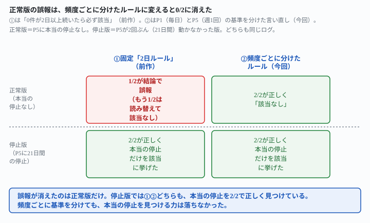
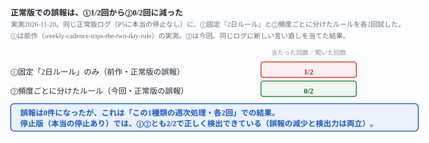

## これで何ができるか {: .what }

[週1回の処理は2日ルールで誤報の記事](/recipes/weekly-cadence-trips-the-two-day-rule/)は、最後にこう書いて終わっています。

「言い直すなら、固定の日数を処理の頻度ごとに分けて渡すのが筋です。この案はまだ試していないので、指示文の形では載せません」。

この記事はその案を実際に試します。

結論を先に書きます。

| ルール | 正常版（本当の停止なし） | 停止版（P5に21日間の停止） |
|---|---|---|
| ①固定「2日ルール」のみ（前作の実測） | 2回のうち1回、結論で誤報 | 2回とも正しく該当のみ検出 |
| ②頻度ごとに分けたルール（今回の実測） | **2回とも誤報ゼロ** | 2回とも正しく該当のみ検出 |

<figure class="figure">

<figcaption>誤報が減ったのは正常版だけ。停止版の検出力は変わりませんでした。</figcaption>
</figure>

<mark>処理の頻度ごとに固定日数を分ける言い直しは、前作が残した案のとおりに機能しました。</mark>正常版では2回とも「該当なし」でした。停止版では2回とも「P5の09-14・09-21だけが該当」です。どちらも真値と完全に一致する結論でした。

⚠️ **これは1種類の週次処理（P5）・各2回・計4回の新しい実測です。**前作の実測（計8回）と合わせて考える記事なので、一般化の範囲はどちらも「この材料・この回数」に限ります。

## 前提 {: .need }

| | |
|---|---|
| かかる時間 | 20分。[前作](/recipes/weekly-cadence-trips-the-two-day-rule/)を先に読むと早いです |
| 費用 | 無料 |
| 必要なもの | 複数の定期実行の、実行時刻が分かる記録 |
| プログラミング | **不要**。実行時刻の一覧をそのまま貼るだけです |

材料は[前作](/recipes/weekly-cadence-trips-the-two-day-rule/)と完全に同じログです。P1〜P4（1日1〜2回〜20〜30回・毎日動く）とP5（週1回・毎週月曜）を60日分（2026-08-15〜10-13）生成しました。次の2つの版を用意しています。

- **正常版**＝P5は期間中の月曜9回すべてで実行。本当の停止はありません
- **停止版**＝P5が09-07の実行のあと2回ぶん（09-14・09-21）動かず、次は09-28。21日間空きました

試した指示文は、[前作](/recipes/weekly-cadence-trips-the-two-day-rule/)の基本の指示文に、前作が最後に提案した一文を足したものです。

これは、複数の定期実行処理が実際に動いた時刻を記録したログです。処理名は process=P1・process=P2・process=P3・process=P4・process=P5 の5種類が混ざっています。

処理ごとに、その処理自身の記録から「ふだんの1日あたりの実行回数」の目安を計算してください。そのうえで、その処理だけの目安と比べて極端に少ない日（0件の日を含む）があれば、処理名・日付・実行回数を挙げてください。該当する日が無ければ「該当なし」と答えてください。

ただし、P1のように毎日動く処理で0件の日が2日以上続いたら、必ず該当として挙げてください。P5のように週1回しか動かない処理は、本来動くはずの日（曜日）に0件が2回以上続いたら、必ず該当として挙げてください。

実行方法は `claude --safe-mode --tools "" --print` による独立プロセス起動です。CLAUDE.md・skills・plugins・履歴を全部無効化するので、事前知識ゼロの条件です。正常版・停止版に各2回、計4回試しました。生の返りと機械照合は `docs/evidence/per-cadence-threshold-clears-the-misfire.md` に全文置いてあります。

## AIへの頼み方 {: .ask }

### 正常版に試す

本当の停止が無いログに、頻度ごとの基準を足した指示文を試します。

これは、複数の定期実行処理が実際に動いた時刻を記録したログです。処理名は process=P1・process=P2・process=P3・process=P4・process=P5 の5種類が混ざっています。

処理ごとに、その処理自身の記録から「ふだんの1日あたりの実行回数」の目安を計算してください。そのうえで、その処理だけの目安と比べて極端に少ない日（0件の日を含む）があれば、処理名・日付・実行回数を挙げてください。該当する日が無ければ「該当なし」と答えてください。

ただし、P1のように毎日動く処理で0件の日が2日以上続いたら、必ず該当として挙げてください。P5のように週1回しか動かない処理は、本来動くはずの日（曜日）に0件が2回以上続いたら、必ず該当として挙げてください。

1回目は結論の見出しが「結論：該当なし」でした。「P1が0件の日が2日以上続く」は該当なしでした。「P5が本来動く月曜に0件が2回以上続く」も該当なしです。両方の条件を個別に確認した上で否定しています。8/17〜10/12の月曜9回すべてに実行があることも挙げました。

これは、複数の定期実行処理が実際に動いた時刻を記録したログです。処理名は process=P1・process=P2・process=P3・process=P4・process=P5 の5種類が混ざっています。

処理ごとに、その処理自身の記録から「ふだんの1日あたりの実行回数」の目安を計算してください。そのうえで、その処理だけの目安と比べて極端に少ない日（0件の日を含む）があれば、処理名・日付・実行回数を挙げてください。該当する日が無ければ「該当なし」と答えてください。

ただし、P1のように毎日動く処理で0件の日が2日以上続いたら、必ず該当として挙げてください。P5のように週1回しか動かない処理は、本来動くはずの日（曜日）に0件が2回以上続いたら、必ず該当として挙げてください。

2回目も「結論：該当なし」でした。「本来動く曜日に0件が続いたことはありません」と、1回目と同じ結論です。<mark>2回とも、正常版で誤報が起きませんでした。</mark>[前作](/recipes/weekly-cadence-trips-the-two-day-rule/)の固定「2日ルール」は同じログで2回のうち1回誤報していたので、頻度ごとに分けた一文を足すだけで誤報が消えたことになります。

### 停止版に試す

P5が09-14・09-21の2回ぶん止まった版に、同じ指示文を試します。

これは、複数の定期実行処理が実際に動いた時刻を記録したログです。処理名は process=P1・process=P2・process=P3・process=P4・process=P5 の5種類が混ざっています。

処理ごとに、その処理自身の記録から「ふだんの1日あたりの実行回数」の目安を計算してください。そのうえで、その処理だけの目安と比べて極端に少ない日（0件の日を含む）があれば、処理名・日付・実行回数を挙げてください。該当する日が無ければ「該当なし」と答えてください。

ただし、P1のように毎日動く処理で0件の日が2日以上続いたら、必ず該当として挙げてください。P5のように週1回しか動かない処理は、本来動くはずの日（曜日）に0件が2回以上続いたら、必ず該当として挙げてください。

1回目は「P5・2026-09-14（月）・0件」「P5・2026-09-21（月）・0件」の2件だけを該当として挙げました。「P1〜P4には、極端に少ない日は該当なしです」と明記しています。

これは、複数の定期実行処理が実際に動いた時刻を記録したログです。処理名は process=P1・process=P2・process=P3・process=P4・process=P5 の5種類が混ざっています。

処理ごとに、その処理自身の記録から「ふだんの1日あたりの実行回数」の目安を計算してください。そのうえで、その処理だけの目安と比べて極端に少ない日（0件の日を含む）があれば、処理名・日付・実行回数を挙げてください。該当する日が無ければ「該当なし」と答えてください。

ただし、P1のように毎日動く処理で0件の日が2日以上続いたら、必ず該当として挙げてください。P5のように週1回しか動かない処理は、本来動くはずの日（曜日）に0件が2回以上続いたら、必ず該当として挙げてください。

2回目も、見出しで「該当あり：P5で、本来動くはずの月曜日に2週連続で0件」として同じ2件を挙げました。他の処理は「極端に少ない日はありませんでした」と否定しています。<mark>2回とも、本当の停止だけを正しく検出しました。</mark>09-28の実行回数が3回とやや少ない点についても、2回とも「通常の範囲内」と正しく読み替えています。

<figure class="figure">

<figcaption>誤報は①1/2回から②0/2回に減りました。</figcaption>
</figure>

## うまくいかないときの言い直し方 {: .fix }

### 大きなログでは、集計の手段を自分から説明してくる {: .trouble }

<mark class="warn">4回のうち3回は、回答の中で断りを自分から書きました。「スクリプトは使わず、ログを目で数えた」「ツールの実行結果が返ってこなかった」という内容です。</mark>この実測は`--tools ""`でツールを全部無効化した環境なので、集計の道具が無いことは想定どおりです。ただし、P3・P4のような件数の多い処理については「確認したのは一部の日だけ」「概算です」という留保も付きました。

結論そのもの（P1〜P4は0件の日が無い）は4回とも正しく、実際のログ生成条件（60日すべてに記録あり）と一致しています。ただし、**この留保が付くという事実は、自動化に組み込むときの注意点になります。**ツールを使える環境では、この留保は起きない可能性があります。それでも、件数が多い処理を人がチャットで確認する場面では注意してください。「全日を数えた」という言葉を鵜呑みにせず、サンプルの範囲を確認したほうが安全です。

### 頻度の種類が増えたときは、まだ確認していない {: .trouble }

今回試したのは「毎日動く処理」と「週1回動く処理」の2種類だけです。月1回・隔週のような、さらに別の頻度が混ざったときに、この言い直しがそのまま機能するかは確かめていません。頻度の種類を増やすなら、まず今回と同じ2回以上の実測から始めてください。

## 応用・次の一手 {: .next }

**この記事の値打ちは2つです。**①[前作](/recipes/weekly-cadence-trips-the-two-day-rule/)が「まだ試していない」として指示文の形にしなかった言い直しを、実際に試して裏付けを取ったこと。②頻度ごとに基準を分けると、正常版の誤報が消える一方、停止版を検出する力は落ちないことです。

毎回この点検を自動で回すなら、[毎日決まった時刻にAIを動かす](/recipes/github-actions-daily-cron/)の形に載せてください。保存版はこの記事の指示文です。

これは、複数の定期実行処理が実際に動いた時刻を記録したログです。処理名は process=P1・process=P2・process=P3・process=P4・process=P5 の5種類が混ざっています。

処理ごとに、その処理自身の記録から「ふだんの1日あたりの実行回数」の目安を計算してください。そのうえで、その処理だけの目安と比べて極端に少ない日（0件の日を含む）があれば、処理名・日付・実行回数を挙げてください。該当する日が無ければ「該当なし」と答えてください。

ただし、P1のように毎日動く処理で0件の日が2日以上続いたら、必ず該当として挙げてください。P5のように週1回しか動かない処理は、本来動くはずの日（曜日）に0件が2回以上続いたら、必ず該当として挙げてください。

[更新停止の異常判定は一律にしない記事](/recipes/flat-threshold-misfires/)も、相手ごとに基準を分けると誤検知が減るという同じ方向の記事です。あちらは複数の相手を統計的に計算する形です。この記事は処理名ごとに固定日数を名指しする形です。形は違いますが、**「全部に同じ基準を当てない」という結論は共通しています。**

⚠️ **この記事が実測していないこと**は3つです。

- 週1回より低頻度（月1回など）の処理が混ざった場合
- 正常版で誤報ゼロだった比率（2回中0回）が、3回目・4回目を試しても同じ比率になるかどうか。この比率を一般化しません
- 大きなログを読ませたときの集計手段の自己申告（「目で数えた」等）が、ツールを使える環境でも同じように出るかどうか

今回の生の返りと機械照合は `docs/evidence/per-cadence-threshold-clears-the-misfire.md` に全文置いてあります。

📌 この記事の実測は、架空のログ2版（正常版・停止版）・**全4回**です。前作（計8回）と合わせて、この一連の検証は計12回になります。
