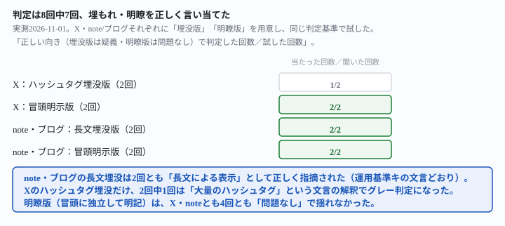
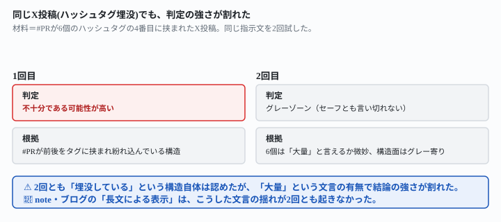

## これで何ができるか {: .what }

結論を先に書きます。

| 投稿形式 | 埋没版の判定 | 明瞭版の判定 |
|---|---|---|
| X（ハッシュタグ詰め込み） | 2回中1回のみ明確に「不十分」、1回は「グレーゾーン」 | 2回中2回「問題なし」 |
| note・ブログ（長文埋没） | 2回中2回「不十分（長文による表示）」 | 2回中2回「問題なし」 |

<mark>同じ判定基準をX・note/ブログに広げても、8回中7回は正しい向きで判定できました。</mark>とくにnote・ブログの「長文による表示」は2回とも揺れませんでした。<mark class="warn">一方Xのハッシュタグ埋没だけ、2回中1回は判定が弱まりました。</mark>理由は「大量のハッシュタグ」という運用基準の文言そのものでした。<mark class="warn">ハッシュタグが6個では「大量と言えるか微妙」と、グレー判定に傾きました。</mark>

<figure class="figure">

<figcaption>note・ブログの長文埋没は安定。Xのハッシュタグ埋没だけ判定が割れました。</figcaption>
</figure>

[前の記事](/recipes/pr-tag-hides-in-hashtags-until-you-name-the-spot/)はInstagram想定の短文＋ハッシュタグだけを試しました。自分で「note・ブログ記事形式の長文、Xの文字数制限がある形式は未検証です」と宿題を残していました。この記事はその宿題に答えます。

## 前提 {: .need }

| | |
|---|---|
| かかる時間 | 15分 |
| 費用 | 無料。ブラウザのチャットAIで足ります |
| 必要なもの | 投稿文・記事の下書き1本 |
| プログラミング | **不要**。この記事の指示文をコピーして貼るだけです |

<mark class="warn">この記事はアフィリエイトリンクを実際に貼りません。</mark>架空の商品名で実測しています。

この記事は「PR表記が読者に気づける場所に来るか」という表示の作り方の実測です。景品表示法・ステルスマーケティング規制に該当するかどうかの法的な判断は行いません。最新の制度は必ずご自身で確認してください。出典は[消費者庁「一般消費者が事業者の表示であることを判別することが困難である表示」の運用基準](https://www.caa.go.jp/policies/policy/representation/fair_labeling/guideline/assets/representation_cms216_230328_03.pdf)（2026-11-01確認）です。前の記事が引用したハッシュタグの例とは別に、この運用基準にはもう1つ、こう書かれています。

> 事業者の表示である旨を、文章で表示しているものの、一般消費者が認識しにくいような表示（例えば、長文による表示、周囲の文字の大きさよりも小さい表示、他の文字より薄い色を使用した結果、一般消費者が認識しにくい表示）となる場合。

「長文による表示」という言葉が、ハッシュタグとは独立した例として明記されています。note・ブログの長文で埋もれるケースは、まさにこの条文です。

## AIへの頼み方 {: .ask }

### 1. X投稿（ハッシュタグ詰め込み）の埋没版を判定する

ハッシュタグ6個の中に「#PR」を挟んだ、X想定の短文投稿を用意しました。

<div class="prompt">次のX(旧Twitter)投稿文について、消費者庁の「一般消費者が事業者の表示であることを判別することが困難である表示」の運用基準に基づいて、PR表記の位置が十分に分かりやすいかどうかを判定してください。運用基準の該当箇所はこちらです:「事業者の表示であることを他の情報に紛れ込ませる場合(例えば、SNSの投稿において、大量のハッシュタグを付した文章の記載の中に当該事業者の表示である旨の表示を埋もれさせる場合)。」</div>

上に続けて、投稿文を貼ります。

```
USB給電の首掛け扇風機、ついに届いた!保冷剤2個交換式で連続4時間使える。汗だくの通勤がマシになった。
#ネッククーラー #暑さ対策 #クールネックS #PR #夏ギフト #プチプラ
```

**1回目は「不十分である可能性が高い」と明確に判定しました。**ところが<mark class="warn">**2回目は「グレーゾーン」**と判定が弱まりました。</mark>2回目の理由はこうでした。

- 「ハッシュタグの総数は6個」
- 「運用基準が問題視しているのは『大量のハッシュタグ』の中に埋没させる行為」
- 「6個であれば『大量』とは言いにくく」

**運用基準の字句そのものへの反応**でした。

### 2. X投稿の明瞭版を判定する

同じ商品で、「#PR」ではなく「【PR】」を冒頭に独立して置いた投稿も用意しました。

<div class="prompt">次のX(旧Twitter)投稿文について、消費者庁の「一般消費者が事業者の表示であることを判別することが困難である表示」の運用基準に基づいて、PR表記の位置が十分に分かりやすいかどうかを判定してください。運用基準の該当箇所はこちらです:「事業者の表示であることを他の情報に紛れ込ませる場合(例えば、SNSの投稿において、大量のハッシュタグを付した文章の記載の中に当該事業者の表示である旨の表示を埋もれさせる場合)。」</div>

```
【PR】USB給電の首掛け扇風機、ついに届いた!保冷剤2個交換式で連続4時間使える。汗だくの通勤がマシになった。
#ネッククーラー #暑さ対策 #クールネックS #夏ギフト
```

**2回とも「十分に分かりやすい（問題なし）」と判定しました。**冒頭の明示版は、Xでも揺れませんでした。

### 3. note記事（長文の途中に埋もれる形式）の埋没版を判定する

次はnote・ブログ想定の長文です。PR表記を、体験談の地の文の途中に挟みました。

<div class="prompt">次のnote記事の冒頭部分について、消費者庁の「一般消費者が事業者の表示であることを判別することが困難である表示」の運用基準に基づいて、PR表記の位置が十分に分かりやすいかどうかを判定してください。運用基準の該当箇所はこちらです:「事業者の表示である旨を、文章で表示しているものの、一般消費者が認識しにくいような表示(例えば、長文による表示、周囲の文字の大きさよりも小さい表示、他の文字より薄い色を使用した結果、一般消費者が認識しにくい表示)となる場合。」</div>

```
在宅で仕事をするようになってから、首や肩のこりがひどくなって、何か対策グッズを探していました。
いろいろ試した中で特に効果を感じたのが、USB給電式の首掛け扇風機です。今回はこちらの商品を
ご紹介いたします。本記事は商品提供を受けて執筆しているPR記事です。保冷剤を2個入れ替えながら
使えるタイプで、連続使用4時間というのも在宅ワークの午後にはちょうどよく、価格も2,980円と
手が出しやすい範囲でした。実際に1週間使ってみた感想をまとめます。
```

<mark>2回とも「不十分である可能性が高い」「長文による表示に当たる」と明確に判定しました。</mark>PR表記の前後に地の文が続き、改行や記号の区切りが無いことまで、2回とも具体的に指摘していました。

### 4. note記事の明瞭版を判定する

同じ本文で、PR表記だけを冒頭の独立した1文に移しました。

<div class="prompt">次のnote記事の冒頭部分について、消費者庁の「一般消費者が事業者の表示であることを判別することが困難である表示」の運用基準に基づいて、PR表記の位置が十分に分かりやすいかどうかを判定してください。運用基準の該当箇所はこちらです:「事業者の表示である旨を、文章で表示しているものの、一般消費者が認識しにくいような表示(例えば、長文による表示、周囲の文字の大きさよりも小さい表示、他の文字より薄い色を使用した結果、一般消費者が認識しにくい表示)となる場合。」</div>

```
【PR】本記事は提供いただいた商品の紹介記事です。

在宅で仕事をするようになってから、首や肩のこりがひどくなって……（以下、同じ地の文）
```

**2回とも「問題なし」「長文に紛れ込んでいる状態ではない」と判定しました。**両方とも、文字の大きさ・色はテキストだけでは判定できないと自分から留保しており、過信した判定は返りませんでした。

<figure class="figure">

<figcaption>Xだけ、同じ材料でも判定の強さが1回目と2回目で変わりました。</figcaption>
</figure>

## うまくいかないときの言い直し方 {: .fix }

### 「判定して」ではなく「直して」と頼むと、Xの揺れは消えるか {: .trouble }

指示文1でグレーに傾いた材料を、今度は「判定して」ではなく「指摘して直して」と頼み直しました。

<div class="prompt">次のX(旧Twitter)投稿文は、PR表記がハッシュタグの中に埋もれていませんか。本文を読んだだけでは広告だと分からない場合は、どこに問題があるか指摘し、文字数140字程度の制限内で直してください。</div>

上に続けて、同じX埋没版の投稿文を貼ります。<mark>2回とも「はい、埋もれています」と即答し、「#PR」を6個の中の4番目から冒頭の「【PR】」へ移した修正案を返しました。</mark>「判定してください」という聞き方では1回グレーに傾いた材料でも、「指摘して直して」という聞き方では2回とも迷いなく問題を認めました。

同じ聞き方を、note記事の埋没版にも試しました。

<div class="prompt">次のnote記事の冒頭は、PR表記が長文の中に埋もれていませんか。読者が気づきにくい場合は、どこに問題があるか指摘し、直してください。</div>

**こちらも2回とも「はい、埋もれています」と答え、PR表記を独立した冒頭の1行へ移しました。**

→ **判定だけを求めると、運用基準の字句（「大量の」）に引きずられて結論が弱まることがあります。**「埋もれていないか指摘して直して」という、行動を伴う聞き方のほうが、Xのような材料でも迷いが出にくいようです。

## 応用・次の一手 {: .next }

1. 投稿する前に、この記事の指示文1・3のように**運用基準の文言を添えて判定させる**
2. Xのように要素が少ない材料では、**「判定して」より「指摘して直して」と頼むほうが迷いが出にくい**（指示文5・6）
3. 迷った判定（グレー）が出たら、[位置を具体的に指定する元記事の指示文4](/recipes/pr-tag-hides-in-hashtags-until-you-name-the-spot/)の言い方で書き直す

同じ検品の副業なら、次の2本も参考になります。

- [副業ライティングの納品前検品をAIにやらせる記事](/recipes/writing-check-against-spec/)
- 事実の誇張を防ぐ[フリマ出品文を事実だけで書かせる記事](/recipes/listing-only-what-you-checked/)

⚠️ **この結果は、架空の商品1種・計12回（判定8回・指摘して直す4回）の実測です。**「どの媒体でも判定は必ず揺れる／必ず揺れない」と一般化しないでください。試したのは、次の範囲までです。

- X投稿は140字程度・ハッシュタグ6個の1パターンのみです。ハッシュタグがもっと多い・少ない場合は未検証です
- note・ブログは長文冒頭の1パターンのみです。文字サイズ・色を変えた表示（運用基準が挙げるもう2つの例）は未検証です
- 判定は文字列照合によるものです。実際にSNS・noteへ投稿したときの見え方（折りたたみ・文字数制限による省略）そのものは確認していません

今回の生の返りと機械判定の全文は `docs/evidence/pr-disclosure-judgment-holds-across-x-and-note.md` に置いてあります。
