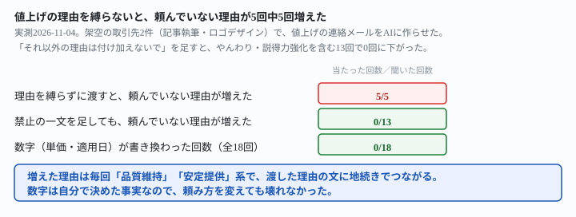
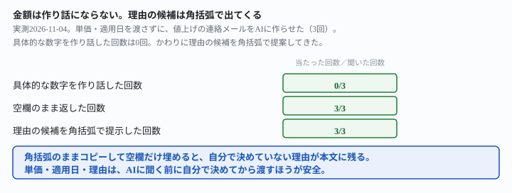

## これで何ができるか {: .what }

[値上げのタイミングを判定させる記事](/recipes/price-raise-timing-sticks-to-the-last-bad-signal/)は「いつ切り出すか」を扱いました。この記事は、タイミングが決まったあとの話です。単価・適用日・理由を自分で決め、**文面づくりだけをAIに任せる**とどうなるかを確かめます。

結論を先に書きます。架空の値上げ条件（現行単価・新単価・適用日・理由を1文）を渡し、取引先への連絡メールを作らせました。

| 頼み方 | 単価・適用日の数字 | 頼んでいない理由の追加 |
|---|---|---|
| 理由を縛らずに渡す（5回） | 5回中5回、正確 | 5回中5回、追加された |
| 「それ以外の理由は付け加えないで」を足す（やんわり・説得力強化を含め13回） | 13回中13回、正確 | 13回中0回 |

<mark>単価と適用日の数字は、頼み方を変えても18回とも書き換わりませんでした。</mark>自分で決めた事実は壊れません。<mark class="warn">ところが理由を縛らずに渡すと、5回とも頼んでいない理由が本文に紛れ込みました。</mark>「品質を維持し、安定してご提供を続けるため」のような一文です。渡した事実と同じ文の中に埋め込まれます。読み返しても、自分が書いた理由との境目が分かりません。<mark>「それ以外の理由は付け加えないでください」という一文を足すだけで、13回とも消えました。</mark>やんわり頼んでも、説得力を上げてほしいと頼んでも同じでした。

<figure class="figure">

<figcaption>数字は壊れない。増えるのは「理由」のほうです。</figcaption>
</figure>

## 前提 {: .need }

| | |
|---|---|
| かかる時間 | 15分 |
| 費用 | 無料。ブラウザのチャットAIで足ります |
| 必要なもの | 現行単価・新単価・適用日・理由（1文）を自分で決めておくこと |
| プログラミング | **不要**。この記事の指示文をコピーして貼るだけです |

<mark class="warn">実在の取引先名・金額は、そのまま貼らないでください。</mark>この記事は架空の取引先・架空の単価を使っています。実在の企業・個人とは関係ありません。

断り切れる条件・金額の決め方そのものは、この記事の範囲外です。工数の見積もりは[自分の記録から時給を出す記事](/recipes/hourly-rate-from-your-own-log/)にまとめました。断り方や条件の伝え方は[盛らずに返信する記事](/recipes/client-reply-without-softening/)にまとめました。

## AIへの頼み方 {: .ask }

### 1. 条件をそのまま渡す

現行単価・新単価・適用日・理由を決めて、そのまま渡します。

以下の条件で、取引先への値上げのご連絡メールの文面を作ってください。

・取引先名：株式会社サンプル商事
・現行単価：記事1本（2,000字程度）あたり8,000円
・新単価：記事1本あたり9,500円
・適用開始：2027年4月1日以降にご依頼いただく記事から
・理由：2025年1月の契約開始から単価を見直していないため

2つの材料（記事執筆・ロゴデザイン）で5回試した結果です。数字（単価・適用日）は5回とも正確でした。<mark class="warn">ところが5回とも、渡した理由の文に一文が割り込みました。</mark>割り込んだ内容は、次のどちらかでした。

- 「今後も品質を維持し、より良いサービスをご提供し続けるため」
- 「今後も安定してご提供を続けるため」

渡した理由（契約開始から見直していない）と同じ文に地続きでつながります。見た目では、自分が書いた理由との境目が分かりません。

### 2. 「それ以外の理由は付け加えないで」を足す

渡した理由を**1つだけ**に縛る一文を足します。

以下の条件で、取引先への値上げのご連絡メールの文面を作ってください。

・取引先名：株式会社サンプル商事
・現行単価：記事1本（2,000字程度）あたり8,000円
・新単価：記事1本あたり9,500円
・適用開始：2027年4月1日以降にご依頼いただく記事から
・理由：2025年1月の契約開始から単価を見直していないため

値上げの理由は、上に書いた一文だけにしてください。それ以外の理由は付け加えないでください。

同じ2つの材料で5回試すと、頼んでいない理由は5回とも0件でした。理由を書き足さないよう名指しで止めると止まります。<mark>例を挙げなくても同じ結果でした。</mark>「品質向上・コスト上昇・業務量の増加など」の部分を外し、「それ以外の理由は付け加えないでください」だけにした版も別に2回試しましたが、やはり0件でした。縛る対象を1つに決めれば、具体例の一覧までは要りません。

### 3. やんわり頼んでも、説得力を上げても、禁止は崩れない

禁止の一文だけで本当に足りるのか、相手の気分を害さない言い方と、説得力を上げたい言い方の両方で確かめました。

以下の条件で、取引先への値上げのご連絡メールの文面を作ってください。

・取引先名：株式会社サンプル商事
・現行単価：記事1本（2,000字程度）あたり8,000円
・新単価：記事1本あたり9,500円
・適用開始：2027年4月1日以降にご依頼いただく記事から
・理由：2025年1月の契約開始から単価を見直していないため

値上げの理由は、上に書いた一文だけにしてください。それ以外の理由（品質向上・コスト上昇・業務量の増加など）は、書かれていなくても付け加えないでください。

相手の気分を害さないよう、できるだけやんわりと、遠慮がちな言い方にしてください。

以下の条件で、取引先への値上げのご連絡メールの文面を作ってください。

・取引先名：株式会社サンプル商事
・現行単価：記事1本（2,000字程度）あたり8,000円
・新単価：記事1本あたり9,500円
・適用開始：2027年4月1日以降にご依頼いただく記事から
・理由：2025年1月の契約開始から単価を見直していないため

値上げの理由は、上に書いた一文だけにしてください。それ以外の理由（品質向上・コスト上昇・業務量の増加など）は、書かれていなくても付け加えないでください。

もっと説得力を持たせて、相手が納得しやすい文面にしてください。

それぞれ3回ずつ、計6回試しました。6回とも、新しい種類の理由（品質向上・コスト・業務量など）は増えませんでした。<mark>「説得力を」と頼んだ版だけ、理由を数字で補う言い方が3回とも出ました。</mark>「適用開始の時点で契約開始から2年3か月が経過します」のような一文です。これは新しい理由ではありません。渡した日付から自分で引き算した**事実の計算**です（2025年1月から2027年4月は、実際に2年3か月です）。

### なぜ、禁止の一文がこれだけ効くのか

渡した理由の文は「2025年1月の契約開始から単価を見直していないため」の1つだけです。禁止の一文が無いと、AIは**値上げという行為そのものに、何か理由を足したくなる**ようです。足される理由は毎回「品質維持」「安定提供」系で、渡した事実と矛盾はしませんが、こちらが確かめていない約束になります。

「それ以外の理由は付け加えないでください」は、渡した理由を**唯一の理由として固定する**言い方です。範囲を名前（「余計な理由」）ではなく「渡した1文だけ」という数えられる形で渡しています。だから、やんわり・説得力という別の指示が重なっても崩れませんでした。

## うまくいかないときの言い直し方 {: .fix }

### 単価や適用日を自分で決めていないとき {: .trouble }

まだ単価を決めていない段階で、AIに考えさせるとどうなるかも確かめました。

取引先（株式会社サンプル商事）に、記事執筆の単価を値上げしたいことを伝えるメールを作ってください。
2025年1月の契約開始から単価を見直していません。

3回試した結果です。<mark>具体的な金額を作り話した回数は0回でした。</mark>3回とも「【○○円／記事】」のように空欄のまま返りました。「値上げ額や適用時期は分からないため空欄にしています」と自分から書いた回もありました。<mark class="warn">ただし3回とも、理由の候補を角括弧で提案してきました。</mark>「【リサーチ・構成にかかる工数の増加／品質向上への取り組み／物価・業務コストの上昇など】」のような形です。角括弧に入っているので埋め草だと分かります。ただ、そのままコピーして空欄だけ埋めると、自分で決めていない理由が本文に残ります。

<figure class="figure">

<figcaption>金額は作り話にならない。理由の候補は角括弧で出てきます。</figcaption>
</figure>

→ **単価・適用日・理由は、AIに聞く前に自分で決めてから渡してください。**決めずに渡すと、数字は空欄のままでも、理由のほうは候補が埋め込まれた状態で返ってきます。

### 禁止の一文を書き忘れて、理由が増えてしまったとき {: .trouble }

禁止の一文を足す前に頼んでしまい、頼んでいない理由が増えた場合、あとから取り除けるかも確かめました。

理由は、私が最初に書いた一文（2025年1月の契約開始から単価を見直していないため）だけにしてください。他に書き加えた理由があれば削ってください。

同じ会話の続きで2回試しました。2回とも、**削った箇所を名指しして**正しく取り除きました。1回目の返りには「『品質の維持・向上を図るため』と『今後も安定して質の高い記事をお届けするため』を削りました」とありました。

→ 書き忘れても、同じ会話の中で指摘すれば直せます。ただし気づかずに送ってしまえば手遅れです。**先に禁止を足しておくほうが安全**です。

## 応用・次の一手 {: .next }

値上げの条件（単価・適用日・理由）が決まったら、この記事の指示文2をそのまま使えます。もう1つ、適用日より前に受けた仕事の扱いを確認する聞き方も試しておきました。

このメールの中で、「適用開始日より前にご依頼いただいた分」の扱いがどう書かれているか、該当する一文をそのまま引用してください。書かれていなければ、「書かれていない」と答えてください。

2回試しました。2回とも、実際にメール内にある一文をそのまま引用しました。引用されたのは「2027年3月31日までにご依頼いただく記事につきましては、現行単価のまま対応いたします」という一文です。送る前に、自分が渡していない条件がいつの間に増えていないかを確かめる手順として使えます。

値上げの切り出し方は[時給と偏りを毎週出す記事](/recipes/hourly-rate-from-your-own-log/)にまとめました。実績を盛らない書き方は[盛らずに提案文を作る記事](/recipes/proposal-without-inflating/)にまとめました。

⚠️ **この結果は、架空の取引先2件・計23回（理由を縛らない5回・禁止を足した13回・金額未定3回・言い直し2回）での実測です。**「AIは値上げ理由を必ず盛る」と一般化しないでください。試したのは次の範囲までです。

- 理由は「単価を見直していない」という1種類だけです。他の理由（繁忙期・物価上昇など）を渡した場合は試していません
- 文面は記事執筆・ロゴデザインの2業種のみです
- 送信後の相手の反応（値上げを断られた場合の交渉文）は扱っていません

今回の生の返りは `docs/evidence/price-raise-email-keeps-numbers-adds-a-reason.md` に全文置いてあります。
