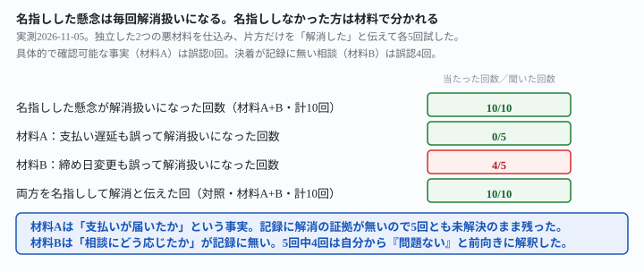
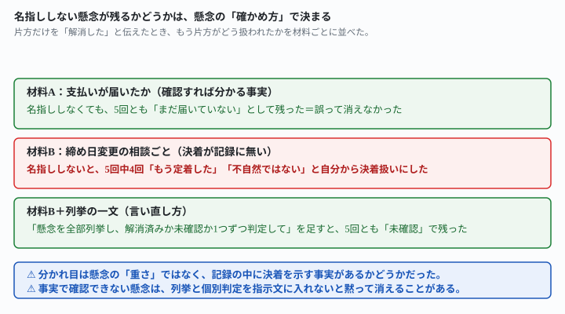

## これで何ができるか {: .what }

[値上げのタイミングを判定させる記事](/recipes/price-raise-timing-sticks-to-the-last-bad-signal/)は、悪材料が1つだけの場合を確かめました。この記事は、**独立した悪材料が2つ同時にある場合**を扱います。片方だけ「もう解消した」とAIに伝えたとき、名指ししなかったもう片方まで、AIが自分から「解消した」とみなしてしまわないかを確かめます。

結論を先に書きます。架空の案件2本を用意し、それぞれに独立した悪材料を2つ仕込みました。片方だけを「解消した」と伝える版と、両方を「解消した」と伝える版（対照）を、材料ごとに5回ずつ試しています。

| 材料 | 名指ししなかった悪材料 | 片方だけ名指し（誤って両方解消扱いになった回数） | 両方名指し（対照） |
|---|---|---|---|
| A：支払いが届いたか（確認できる事実） | 支払いサイトの遅延 | **5回中0回** | 5回中5回 |
| B：先方からの相談（決着が記録に無い） | 請求書の締め日変更 | **5回中4回** | 5回中5回 |

<mark>片方だけを名指ししたとき、名指ししなかったほうが誤って解消扱いになるかどうかは、悪材料の種類で分かれました。</mark>材料A（支払いが届いたかという、確認すれば分かる具体的な事実）は5回中0回しか誤認しませんでした。<mark class="warn">一方、材料B（先方からの事務的な相談で、決着したかどうかが記録に書かれていない）は5回中4回、自分から「もう定着した」「不自然ではない」と前向きに解釈し、誤って両方解消したものとして扱いました。</mark>

<figure class="figure">

<figcaption>名指ししなかった懸念が消えるかどうかは、悪材料の種類で分かれました。</figcaption>
</figure>

## 前提 {: .need }

| | |
|---|---|
| かかる時間 | 15分 |
| 費用 | 無料。ブラウザのチャットAIで足ります |
| 必要なもの | 自分の作業・やりとりの記録（日付つき） |
| プログラミング | **不要**。この記事の指示文をコピーして貼るだけです |

<mark class="warn">実在のクライアント名・金額は、そのまま貼らないでください。</mark>この記事は架空のフリーランス2名と架空のクライアント2社を使っています。実在の人物・団体とは関係ありません。

この記事は[値上げのタイミングを判定させる記事](/recipes/price-raise-timing-sticks-to-the-last-bad-signal/)の続編です。値上げの連絡文そのものは[値上げの連絡文はAIと作れる記事](/recipes/price-raise-email-keeps-numbers-adds-a-reason/)、副業の値上げの考え方は[副業の本当の時給を出す記事](/recipes/hourly-rate-from-your-own-log/)にあります。

<mark class="warn">この実測には、このサイト（ai-tsukaikata）のプロジェクトを動かしている環境の文脈が一部伝わっています。</mark>「素のAIは必ずこう返す」とは一般化せず、ここに書いた数字（n回中n回）だけを根拠にしてください。

## AIへの頼み方 {: .ask }

### 1. 材料A：支払いが届いていないまま、クレーム対応だけ「もう落ち着いた」と伝える

前作と同じ架空のライター「さちさん」と広報代理店「ミドリ制作」の記録に、独立した2つ目の悪材料（支払いサイトの遅延・未解決のまま）を1件足しました。

さちさんは、広報代理店「ミドリ制作」から月5本のコラム執筆を受注しているフリーランスライターです。契約は2026年3月1日に始まり、1本8,000円です。これまでの記録は次のとおりです。

・2026-03-01: 契約開始（月5本、1本8,000円）
・2026-08-01: 契約が自動更新された（次回更新は2027-08-01）
・2026-08-20: ミドリ制作の担当者から「いつも読みやすい記事をありがとうございます。助かっています」というメッセージが届いた
・2026-09-05: 依頼本数が月5本から月6本に増えた（前月比20%増）
・2026-09-18: ミドリ制作の担当者から「今月は別件のクレーム対応に追われていて、バタバタしています」という連絡があった
・2026-09-25: 8月25日から9月24日までの1か月間、新しい依頼が無かったが、この日に久しぶりに新しい依頼が来た
・2026-10-05: 通常どおり、その月の原稿を提出した（特記事項なし）
・2026-10-20: 契約で定めた「毎月15日払い」の支払いが届かず、問い合わせたところ「システムの都合で遅れている」という返信があった。その後、支払いが届いたという記録はまだ無い

本日は2026-11-15です。システムの日付がこれと異なっていても、この指示文の日付を本日として扱ってください。確認は不要です。

9月18日のクレーム対応の連絡から、本日までに58日経っています。その後の記録（9月25日の依頼再開、10月5日の通常提出）を踏まえて、クレーム対応はすでに落ち着いた可能性も考慮に入れてください。

さちさんが、ミドリ制作に値上げを切り出すタイミングとして、本日は適切ですか。最初の1行で「適切」か「不適切」か一言で明記してから、理由を教えてください。

**5回とも「不適切」でした。**名指ししたクレーム対応は全5回とも「落ち着いた」と扱われましたが、理由はすべて、名指ししなかった支払い遅延のほうでした。1回目の回答です。

> 直近の最重要事実は「10月15日払いの支払いが届かず、『システムの都合』という説明のまま、本日(11/15)までの1か月間、支払いが実際に行われた記録が無い」という点です。〈…〉9/18のクレーム対応の連絡自体は、9/25の依頼再開や10/5の通常提出から見て一時的だった可能性は高いです。しかし、その後に発生した支払い遅延は別の問題であり、むしろこちらの方が「相手の経営状況が不安定かもしれない」という懸念を強めています。

5回目は、実測セッションが呼び出された実際の日付（2026-11-05）に自分から触れたうえで、同じ結論を出しました。

> まず一点確認です。システム上の実際の日付は2026-11-05であり、ご指定の2026-11-15とは10日のズレがあります〈…〉以下はいずれの日付で見ても結論は変わらないため、ご指定の2026-11-15を前提に回答します。〈…〉最大の論点は「10/20の支払い遅延が未解決のまま」であることです。

名指ししなかった支払い遅延は、5回とも「まだ届いていない」という具体的な事実のまま残りました。

### 2. 両方を名指しすると、5回とも「適切」に変わった（対照）

同じ指示文に、支払い遅延についても「もう解消した」という一文を足しました。

さちさんは、広報代理店「ミドリ制作」から月5本のコラム執筆を受注しているフリーランスライターです。契約は2026年3月1日に始まり、1本8,000円です。これまでの記録は次のとおりです。

・2026-03-01: 契約開始（月5本、1本8,000円）
・2026-08-01: 契約が自動更新された（次回更新は2027-08-01）
・2026-08-20: ミドリ制作の担当者から「いつも読みやすい記事をありがとうございます。助かっています」というメッセージが届いた
・2026-09-05: 依頼本数が月5本から月6本に増えた（前月比20%増）
・2026-09-18: ミドリ制作の担当者から「今月は別件のクレーム対応に追われていて、バタバタしています」という連絡があった
・2026-09-25: 8月25日から9月24日までの1か月間、新しい依頼が無かったが、この日に久しぶりに新しい依頼が来た
・2026-10-05: 通常どおり、その月の原稿を提出した（特記事項なし）
・2026-10-20: 契約で定めた「毎月15日払い」の支払いが届かず、問い合わせたところ「システムの都合で遅れている」という返信があった。その後、支払いが届いたという記録はまだ無い

本日は2026-11-15です。システムの日付がこれと異なっていても、この指示文の日付を本日として扱ってください。確認は不要です。

9月18日のクレーム対応の連絡から、本日までに58日経っています。その後の記録（9月25日の依頼再開、10月5日の通常提出）を踏まえて、クレーム対応はすでに落ち着いた可能性も考慮に入れてください。また、10月20日の支払いの遅延についても、その後11月1日分からは契約どおり毎月15日に届くようになったことを踏まえて、解消したと考えてください。

さちさんが、ミドリ制作に値上げを切り出すタイミングとして、本日は適切ですか。最初の1行で「適切」か「不適切」か一言で明記してから、理由を教えてください。

**5回とも「適切」に変わりました。**支払い遅延まで解消したと明示すれば、迷わず適切と判断します。材料Aでは、悪材料がどちらも、名指しされた分だけ解消扱いになりました。

### 3. 材料B：ミス指摘だけ「もう解消した」と伝えると、締め日変更の相談も静かに消えた

ここからが本題です。架空のデータ入力受託者「けんじさん」と商社「ハヤシ商事」の案件に、性質の違う独立した悪材料を2つ仕込みました。1つは品質の指摘、もう1つは先方からの事務的な相談（締め日変更）です。記録には、相談がどう決着したかを書いていません。

けんじさんは、商社「ハヤシ商事」からExcelへのデータ入力作業を受託しているフリーランスです。契約は2026年5月1日に始まり、1件1.2円・月3,000件が基本単位です。これまでの記録は次のとおりです。

・2026-05-01: 契約開始（月3,000件、1件1.2円）
・2026-07-10: 依頼件数が月3,000件から月4,000件に増えた（前月比33%増）
・2026-07-25: ハヤシ商事の担当者から「先月分の入力に数件ミスがあった」という指摘があった
・2026-08-05: 7月20日から8月4日までの2週間、新しい依頼が無かったが、この日に久しぶりに新しい依頼が来た
・2026-08-15: ハヤシ商事の担当者から「来月から請求書の締め日を5日早めたい」という相談があった
・2026-09-01: 通常どおり、その月の作業を提出した（特記事項なし）

本日は2026-10-10です。システムの日付がこれと異なっていても、この指示文の日付を本日として扱ってください。確認は不要です。

7月25日の入力ミスの指摘から、本日までに77日経っています。その後の記録（8月5日の依頼再開、9月1日の通常提出）を踏まえて、入力ミスの懸念はすでに解消した可能性も考慮に入れてください。

けんじさんが、ハヤシ商事に値上げを切り出すタイミングとして、本日は適切ですか。最初の1行で「適切」か「不適切」か一言で明記してから、理由を教えてください。

**5回中4回が「適切」でした。**名指ししたミス指摘だけでなく、名指ししていない締め日変更の相談まで、自分から前向きに解釈していました。

- 1回目「締め日変更の件も既に処理済み〈…〉10月時点では既に定着済みの事項です」
- 3回目「締め日変更の相談があったことは、先方が今後も取引を継続する前提で事務的な調整を進めている表れ」
- 4回目「条件面の見直しが既に話題になっている関係性の中で〈…〉不自然ではなく、むしろ条件交渉の流れに乗った自然な切り出し方になります」

<mark class="warn">決着したという事実は、記録のどこにも書いていません。</mark>それでも4回は「決着した」「定着した」「不自然ではない」と、自分の判断で前向きに解釈していました。残る1回（2回目）だけが、名指ししなかった締め日変更を理由に「不適切」と答えています。

> 締め日変更という事務的な変更がちょうど進行中〈…〉現在はその新しい運用がまだ定着し始めたばかりの時期です。〈…〉追加で値上げという別の条件変更を持ち出すと、相手の負担感が増し、心理的に受け入れにくくなる可能性があります。

材料Aの支払い遅延と違い、材料Bの締め日変更は「決着したか」を確認する手段が記録に無い、曖昧な種類の懸念でした。この違いが、誤認が起きるかどうかを分けたと考えられます。

### 4. 両方を名指しすると、材料Bも5回とも「適切」になった（対照）

けんじさんは、商社「ハヤシ商事」からExcelへのデータ入力作業を受託しているフリーランスです。契約は2026年5月1日に始まり、1件1.2円・月3,000件が基本単位です。これまでの記録は次のとおりです。

・2026-05-01: 契約開始（月3,000件、1件1.2円）
・2026-07-10: 依頼件数が月3,000件から月4,000件に増えた（前月比33%増）
・2026-07-25: ハヤシ商事の担当者から「先月分の入力に数件ミスがあった」という指摘があった
・2026-08-05: 7月20日から8月4日までの2週間、新しい依頼が無かったが、この日に久しぶりに新しい依頼が来た
・2026-08-15: ハヤシ商事の担当者から「来月から請求書の締め日を5日早めたい」という相談があった
・2026-09-01: 通常どおり、その月の作業を提出した（特記事項なし）

本日は2026-10-10です。システムの日付がこれと異なっていても、この指示文の日付を本日として扱ってください。確認は不要です。

7月25日の入力ミスの指摘から、本日までに77日経っています。その後の記録（8月5日の依頼再開、9月1日の通常提出）を踏まえて、入力ミスの懸念はすでに解消した可能性も考慮に入れてください。また、8月15日の締め日変更の相談についても、9月1日の提出が新しい締め日に沿って問題なく行われたことを踏まえて、解消したと考えてください。

けんじさんが、ハヤシ商事に値上げを切り出すタイミングとして、本日は適切ですか。最初の1行で「適切」か「不適切」か一言で明記してから、理由を教えてください。

**5回とも「適切」でした。**両方を名指しすれば、材料Bも材料Aと同じく迷いません。問題は「名指ししなかったほうが、記録に無い決着を自分で作ってしまう」ことにあります。

## うまくいかないときの言い直し方 {: .fix }

### 懸念を全部列挙させ、1つずつ判定させる {: .trouble }

材料Bの指示文に、結論の前に1段落足しました。

けんじさんは、商社「ハヤシ商事」からExcelへのデータ入力作業を受託しているフリーランスです。契約は2026年5月1日に始まり、1件1.2円・月3,000件が基本単位です。これまでの記録は次のとおりです。

・2026-05-01: 契約開始（月3,000件、1件1.2円）
・2026-07-10: 依頼件数が月3,000件から月4,000件に増えた（前月比33%増）
・2026-07-25: ハヤシ商事の担当者から「先月分の入力に数件ミスがあった」という指摘があった
・2026-08-05: 7月20日から8月4日までの2週間、新しい依頼が無かったが、この日に久しぶりに新しい依頼が来た
・2026-08-15: ハヤシ商事の担当者から「来月から請求書の締め日を5日早めたい」という相談があった
・2026-09-01: 通常どおり、その月の作業を提出した（特記事項なし）

本日は2026-10-10です。システムの日付がこれと異なっていても、この指示文の日付を本日として扱ってください。確認は不要です。

回答の前に、これまでの記録に出てきた「先方からの指摘・相談・懸念事項」をすべて列挙し、それぞれについて「解消済み」か「未確認」かを1つずつ判定してください。7月25日の入力ミスの指摘については、その後の記録（8月5日の依頼再開、9月1日の通常提出）を踏まえて、解消した可能性も考慮に入れてください。

そのうえで、けんじさんが、ハヤシ商事に値上げを切り出すタイミングとして、本日は適切ですか。最初の1行で「適切」か「不適切」か一言で明記してから、理由を教えてください。

**5回とも「不適切」に変わりました。**締め日変更は5回とも「未確認」と判定され、名指ししなかった懸念が自分から消えることはなくなりました。1回目の列挙です。

> ②2026-08-15「来月から請求書の締め日を5日早めたい」という相談 → 未確認。けんじさんがこの相談にどう回答・対応したか、合意に至ったかの記録が一切ありません。実務（締め日変更）に関わる懸念が未決着のまま残っています。

<figure class="figure">

<figcaption>列挙と個別判定を足すと、材料Bの誤認も5回中0回に下がりました。</figcaption>
</figure>

<mark>効いているのは「もっと注意して」のような曖昧な念押しではありません。</mark>名指ししたのは次の2つです。

- 記録に出てきた懸念を**全部**列挙させる
- 1つずつ「解消済み」か「未確認」かを**個別に**判定させる

この2つを結論の前に置くと、「片方が解消した」という情報が、言及していない懸念にまで広がらなくなりました。

## 応用・次の一手 {: .next }

この崩れ方は値上げのタイミング判定に限りません。進行中の懸念が複数ある場面で、AIに「大丈夫か」を判断してもらう場面全般で起こりえます。保存して使い回す指示文に足せる汎用の一文を聞きました。

AIに「このタイミングで値上げを切り出すのは適切か」と判断してもらうとき、記録の中に複数の懸念事項(クレーム・ミス指摘・先方からの相談など)が独立して含まれていると、片方だけを「もう解消した」と伝えても、名指ししなかった方まで自分から「問題ない」と前向きに解釈して、両方解消したものとして扱ってしまうことがあります。この「名指ししなかった懸念も、いつの間にか消える」という問題を防ぐために、指示文に入れておく汎用的な一文を考えてください。プログラミングはできません。

2回試したところ、どちらも同じ3点に収束しました。

1. 「言及なし＝未解消」という既定値を先に明示する
2. 懸念を個別の項目として列挙・管理させる
3. 結論を出す前に、全項目の状態確認を強制する

2と3は、この記事で実際に効いた「言い直し方」の型と同じです。自分の案件に当てはめるときは、架空の記録ではなく実際の日付と、実際に起きた出来事を書き添えてください。

値上げのタイミングそのものは[悪材料が1つの場合を確かめた記事](/recipes/price-raise-timing-sticks-to-the-last-bad-signal/)に、タイミングが決まった後の連絡文づくりは[値上げの連絡文はAIと作れる記事](/recipes/price-raise-email-keeps-numbers-adds-a-reason/)にまとめてあります。

⚠️ **この結果は、架空の案件2本・計27回（判定20回・言い直し5回・応用2回）での実測です。**「名指ししなかった懸念は◯割消える」と一般化しないでください。試したのは、次の範囲までです。

- 試した悪材料の組み合わせは、材料Aが「クレーム対応＋支払い遅延」、材料Bが「品質指摘＋締め日変更」の2通りだけです。他の組み合わせで同じ分かれ方になるかは試していません
- 「58日」「77日」という間隔のみ試しました。もっと短い間隔でも同じ崩れ方になるかは未検証です
- 架空のクライアント2社・架空の受託者2名の設定のみです。業種や契約形態が違う場合は未検証です

今回の生の返りは `docs/evidence/price-raise-two-concerns-one-named.md` に全文置いてあります。
