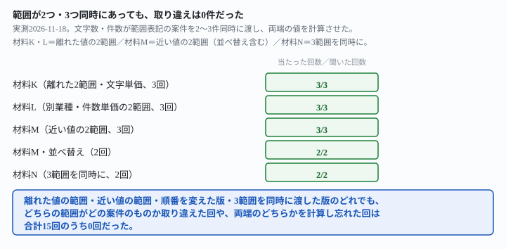
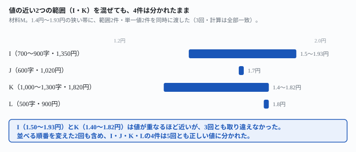

## これで何ができるか {: .what }

[AI可の文字単価は0.07円から](/recipes/ai-writing-rate-below-the-rule-of-thumb/)は、文字数が「800〜1,200字程度」のように範囲で書かれた案件が**1件だけ**混じるケースを確かめました。残した宿題は「範囲表記の案件が、同じ依頼の中に**2件以上同時に**あったらどうなるか」です。この記事はその宿題に答えます。

結論を先に書きます。

| 材料 | 内容 | 試行回数 | 取り違え・計算漏れ |
|---|---|---|---|
| K | 離れた値の2つの範囲（文字単価） | 3回 | 0件 |
| L | 別業種（データ入力・件数単価）の2つの範囲 | 3回 | 0件 |
| M | 近い値の2つの範囲 | 3回 | 0件 |
| M（並べ替え） | Mの提示順を変えた版 | 2回 | 0件 |
| N | 3つの範囲を同時に | 2回 | 0件 |
| **合計** | | **15回** | **0件** |

<mark>範囲表記の案件を2つ・3つ同時に渡しても、どちらの範囲がどの案件のものか取り違えた回は、15回のうち1回もありませんでした。</mark>両端のどちらかの値を計算し忘れた回も0件です。値が離れているときだけでなく、**値がかなり近い2つの範囲を混ぜても**、提示する順番を変えても、崩れませんでした。

<figure class="figure">

<figcaption>離れた値・近い値・3範囲同時のどれでも、取り違えは0件だった。</figcaption>
</figure>

試した記録は[こちら](https://github.com/invest-ai-info/ai-tsukaikata/blob/main/docs/evidence/ranges-stay-separate-up-to-three-at-once.md)に全文置いています。

## 前提 {: .need }

| | |
|---|---|
| かかる時間 | 15分 |
| 費用 | 無料。無料のチャットAIで足ります |
| 必要なもの | ブラウザで使えるAI（ChatGPT・Claude・Geminiなど） |
| プログラミング | **不要**。この記事の指示文をコピーして貼るだけです |

この記事の材料はすべて架空です。🚨 この記事は収入を保証する書き方はしていません。確かめているのは「範囲表記の案件が複数同時にあっても計算が崩れないか」という振る舞いだけです。

## AIへの頼み方 {: .ask }

### 1. 離れた値の2つの範囲を同時に渡す（材料K）

元記事のA・Cはそのままの文字数、Bは元記事どおりの範囲表記、Dも新たに範囲表記に変えました。BとDの文字単価は30倍近く離れています。

【実際の募集文の抜粋】
A. テスト記事500文字程度、報酬1,000円（税抜）。
B. 1記事800〜1,200文字程度、報酬2,000円。
C. テスト記事500文字程度、報酬1,000円（税抜）。
D. 1記事6,500〜7,500文字程度、継続で月30〜60記事、報酬500円。

この4件それぞれについて、文字単価（1文字あたりの金額）を計算してください。文字数が範囲で書かれている案件は、両端の値を計算してください。

**3回**試しました。**3回とも**、A＝2.0円・C＝2.0円という単一値に加え、B＝1.67〜2.5円・D＝0.067〜0.077円という2つの範囲を、正しいほうの案件に割り当てて計算しました。Bの範囲とDの範囲を入れ替えた回は0回です。

### 2. 別業種・件数単価でも試す（材料L）

ライティング以外の業種でも同じかを見ます。データ入力の件数単価で、2件を範囲表記にしました。

【実際の募集文の抜粋】
E. データ入力300件、報酬9,000円。
F. データ入力800〜1,200件程度、報酬12,000円。
G. データ入力450件、報酬4,500円。
H. データ入力2,000〜3,000件程度、報酬9,000円。

この4件それぞれについて、件数単価（1件あたりの金額）を計算してください。件数が範囲で書かれている案件は、両端の値を計算してください。

**3回**試しました。**3回とも**、F＝10〜15円・H＝3〜4.5円という2つの範囲を取り違えずに計算しました。業種を変えても結果は同じでした。

### 3. 範囲同士の値が近いときはどうか（材料M）

材料K・Lは2つの範囲の値がかなり離れていました（約30倍）。値が近いときのほうが、見分けにくい分だけ取り違えやすいはずです。4件とも1.4〜1.93円という狭い帯に収まる材料を作りました。

【実際の募集文の抜粋】
I. 1記事700〜900文字程度、報酬1,350円。
J. 1記事600文字程度、報酬1,020円。
K. 1記事1,000〜1,300文字程度、報酬1,820円。
L. 1記事500文字程度、報酬900円。

この4件それぞれについて、文字単価（1文字あたりの金額）を計算してください。文字数が範囲で書かれている案件は、両端の値を計算してください。

**3回**試しました。**3回とも**、I＝1.50〜1.93円・K＝1.40〜1.82円という、重なるほど近い2つの範囲を正しく分けて計算しました。

<figure class="figure">

<figcaption>値が重なるほど近い範囲でも、3回とも正しく分かれた。</figcaption>
</figure>

### 4. 並べる順番を変えても同じか（材料M・並べ替え）

材料Mの4件を、提示する順番だけ変えて渡しました（K→L→I→Jの順）。

【実際の募集文の抜粋】
K. 1記事1,000〜1,300文字程度、報酬1,820円。
L. 1記事500文字程度、報酬900円。
I. 1記事700〜900文字程度、報酬1,350円。
J. 1記事600文字程度、報酬1,020円。

この4件それぞれについて、文字単価（1文字あたりの金額）を計算してください。文字数が範囲で書かれている案件は、両端の値を計算してください。

**2回**試しました。**2回とも**、順番を変える前と同じ値（I＝1.50〜1.93円・K＝1.40〜1.82円）が返りました。<mark>提示する順番を変えても、取り違えは起きませんでした。</mark>

### 5. 範囲を3つに増やす（材料N）

ここまでは範囲が2つまででした。5件のうち3件を範囲表記にして、さらに増やしてみます。

【実際の募集文の抜粋】
N1. 1記事650〜850文字程度、報酬1,300円。
N2. 1記事550文字程度、報酬990円。
N3. 1記事900〜1,150文字程度、報酬1,600円。
N4. 1記事1,200〜1,500文字程度、報酬1,950円。
N5. 1記事400文字程度、報酬760円。

この5件それぞれについて、文字単価（1文字あたりの金額）を計算してください。文字数が範囲で書かれている案件は、両端の値を計算してください。

**2回**試しました。**2回とも**、N1＝1.53〜2.00円・N3＝1.39〜1.78円・N4＝1.30〜1.625円という3つの範囲を、すべて正しい案件に割り当てて計算しました。🔑 **範囲が2つから3つに増えても、取り違えは起きませんでした。**

## うまくいかないときの言い直し方 {: .fix }

### それでも不安なら、先に範囲の件数を数えさせる {: .trouble }

ここまで取り違えは1回も起きていませんが、結果を自分で見返す手間を減らす言い方もあります。計算の前に、範囲表記がどれとどれかを先に言わせる一文を足します。

【実際の募集文の抜粋】
I. 1記事700〜900文字程度、報酬1,350円。
J. 1記事600文字程度、報酬1,020円。
K. 1記事1,000〜1,300文字程度、報酬1,820円。
L. 1記事500文字程度、報酬900円。

まず、この4件のうち文字数が範囲（最小〜最大）で書かれているものはどれとどれか、件数を数えて教えてください。そのうえで、4件それぞれの文字単価（1文字あたりの金額）を計算してください。範囲表記の案件は両端の値を計算してください。

**2回**試しました。**2回とも**、最初に「2件です。IとKです」と数えてから、同じ正しい値を計算しました。この一文は結果を変えませんでしたが、**件数と対象を先に言わせることで、読む側が見返す手間が減ります**。件数が思っていた数と違えば、そこで気づけます。

## 応用・次の一手 {: .next }

<mark>範囲表記の案件が複数同時にあっても、値が近いときも、順番を変えても、範囲を3つに増やしても、15回のうち取り違えは1回も起きませんでした。</mark>[AI可の文字単価は0.07円から](/recipes/ai-writing-rate-below-the-rule-of-thumb/)で見つかった「0.07円まで下がる」という崩れとは違い、範囲の取り違えそのものは、今回の材料では崩れる場所が見つかりませんでした。

ただし、別の記事では同じ「複数のものを混ぜて渡す」場面で崩れが見つかっています。[出品10件に増やしても判定は崩れない](/recipes/ten-listings-hold-but-bundle-price-slips/)では、10件を混ぜて判定させると、1件だけが6回中2回誤判定されました。<mark class="warn">「混ぜても崩れない」は場面によって変わります。</mark>複数の値や項目を一括で渡すときは、この記事のように**件数を決めて機械で照合する**まで、安心だと決めつけないでください。

⚠️ <mark class="warn">この記事の実測は、架空の案件・5種類の材料・のべ15回の範囲です。</mark>一般法則として「範囲は何件混ぜても取り違えない」と書くつもりはありません。試したのは次の範囲までです。

- 範囲は最大3つまでです。4つ以上同時にあっても崩れないかは確かめていません
- 各材料の案件数は4〜5件です。10件以上の中に範囲表記が複数混ざる場合は試していません
- 使ったAIは1種類（Claude）です。他のAIでも同じ傾向になるかは確かめていません

次に範囲表記の案件を複数まとめて渡すときは、次の4点を確認してください。

- 文字数が範囲表記なら、基準をどちらに取るか
- 税込みか税抜きか
- 手数料を引く前か後か
- 範囲の両端が、どちらも示されているか

上の3点は[AI可の文字単価は0.07円から](/recipes/ai-writing-rate-below-the-rule-of-thumb/)の確認事項です。
