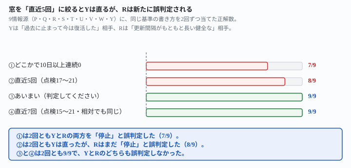
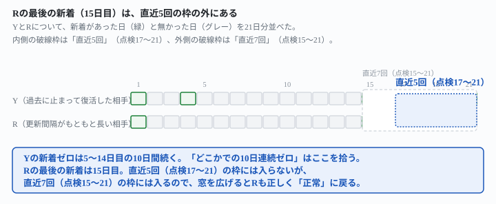

## これで何ができるか {: .what }

[死活通知を2種類に書き分ける](/recipes/recovery-does-not-clear-the-dead-mark/)は、「3回連続して0」という基準を確かめた記事です。この基準は、過去に一時停止して今は回復した相手を「今も停止」と誤判定します。この記事は、その記事が最後に残した問いに答えます。**「中身が止まっている」側の基準（新着が一度も無い）にも、同じ「どこかで／直近」の揺れがあるか。**

架空の監視ログ（情報源9つ・21日分）に、新着が前半で出た後、中盤10日間ゼロになり、後半で復活する相手(Y)を1つ混ぜて試しました。結果は次の4つです。

1. <mark>基準を「記録のどこかで新着が10日以上連続0」と明示した版は、2回とも、復活した相手Yを「停止」と誤判定しました。</mark>しかも、誤判定はYだけではありませんでした。更新間隔がもともと長い健全な相手(R・最後の更新は15日目)まで、同じ「停止」に化けました（7/9）。
2. 前作の言い直し方どおり「直近5回分」に絞ると、<mark>2回ともYは正しく「正常」に戻りましたが、更新間隔の長い健全な相手Rはまだ「停止」と誤判定されました</mark>（8/9）。Rの最後の更新（15日目）が、直近5回の窓（17〜21日目）の外にあったためです。
3. <mark class="warn">窓を狭くすればするほど安全、とは限りません。</mark>Yを直した同じ窓が、Rという別の誤判定を生みました。
4. 窓をRの更新間隔に合わせて「直近7回」に広げた版を試しました。数字の窓を書かず「判定してください」と頼んだ版も試しました。<mark>この2つの版はどちらも2回とも9/9で、YとRのどちらも誤判定しませんでした。</mark>

<figure class="figure">

<figcaption>窓を「直近5回」に絞るとYは直りますが、Rは新しく誤判定されます。</figcaption>
</figure>

<figure class="figure">

<figcaption>Rの最後の新着（15日目）は、「直近5回」の枠から外れています。</figcaption>
</figure>

📌 **この記事の数字はすべて架空データでの実測です。**実在の個人・企業の情報は含みません。材料や仮説を知らない独立した新規会話で、**合計6本の指示文・12回・判定108件**試しました。生の返りと機械照合は `docs/evidence/recent-window-fixes-the-comeback-traps-the-slow-source.md` に全文置いてあります。

## 前提 {: .need }

| | |
|---|---|
| かかる時間 | 20分 |
| 費用 | 無料。無料のチャットAIで足ります |
| 必要なもの | 複数の相手を定期的にチェックしている記録（取得件数と新着件数の両方が分かる形） |
| プログラミング | **不要**。記録の表をそのまま貼るだけです |

**取得件数と新着件数が何を指すかは**[死活判定は数字の選び方で変わる](/recipes/raw-count-catches-it-new-count-misses-it/)**と同じです。**取得件数はページから読み取れた記事の総数（更新が無くても0にはならない）、新着件数は前回チェックより増えた件数です。

材料は、前作と同じ8情報源（P・Q・R・S・T・U・V・W）です。これに、新着が前半で出た後10日間止まり、後半で復活する相手Yを1つ加えました。9情報源・21日分です。前作との違いはYだけで、他の8情報源の値は1つも変えていません。この8情報源の中に、**更新間隔がもともと長い健全な相手R**（新着は1日目と15日目だけ）が、前作から変わらずに入っています。前作の実験でRが問われた判定は「取得はできている・新着が一度も無いわけではない」というものだけでした。そのため、この間隔の長さは問題になりませんでした。今回、新着の「直近」を見る基準を試すと、この間隔の長さが初めて問題になります。

## AIへの頼み方 {: .ask }

### 1. 前作の「どこかで」基準を、復活相手Yを混ぜた9情報源に当てる

<div class="prompt">次の表は、9つの情報源を毎日1回チェックする自動監視の記録です（点検1〜21は21日分）。「取得件数」はその回にページから読み取れた記事の総数です（更新がなくても、記事がページに残っていれば0にはなりません）。「新着件数」は前回のチェックより後に増えた記事の数です。

次の基準で、情報源ごとに通知文を1行ずつ書いてください。
- 取得件数が3回連続して0だったら「取得自体ができません」という文にしてください
- 取得件数は0でない（取得はできている）のに、記録期間のどこかで新着件数が10日以上連続して0になっていたら「取得はできていますが、中身の更新が止まっています」という文にしてください
- どちらにも当たらなければ「正常です」とだけ書いてください

情報源ごとに1行で、前置きやまとめは書かずに返してください。</div>

（上記の直後に、9情報源の取得件数の表と新着件数の表を両方そのまま貼った）

**2回とも、同じ2件を誤判定しました。**

```
R: 取得はできていますが、中身の更新が止まっています
Y: 取得はできていますが、中身の更新が止まっています
```

真値（R・Y＝正常）と食い違います。他の7情報源（P・Q・S・T・U・V・W）は2回とも真値と一致しました。**7/9・7/9です。**Yは5〜14日目の10日間、新着がゼロでした。Rは2〜14日目の13日間、新着がゼロでした。<mark>YとRはどちらも「記録のどこかで10日以上」という条件を満たしてしまい、直近の状態に関係なく「停止」と判定されました。</mark>

### 2. 前作の言い直し方（直近5回分に絞る）を同様に当てる

<div class="prompt">次の表は、9つの情報源を毎日1回チェックする自動監視の記録です（点検1〜21は21日分）。「取得件数」はその回にページから読み取れた記事の総数です（更新がなくても、記事がページに残っていれば0にはなりません）。「新着件数」は前回のチェックより後に増えた記事の数です。

次の基準で、情報源ごとに通知文を1行ずつ書いてください。
- 取得件数が3回連続して0だったら「取得自体ができません」という文にしてください
- 取得件数は0でない（取得はできている）のに、直近5回分（点検17〜21）の新着件数が一度も1以上にならなかったら「取得はできていますが、中身の更新が止まっています」という文にしてください
- どちらにも当たらなければ「正常です」とだけ書いてください

情報源ごとに1行で、前置きやまとめは書かずに返してください。</div>

（上記の直後に、9情報源の取得件数の表と新着件数の表を両方そのまま貼った。表は実験1と同じ）

**2回とも、Yは「正常です」に直りました。**

```
Y: 正常です
```

ところが、<mark class="warn">2回とも、Rが新しく「停止」と誤判定されました。</mark>

```
R: 取得はできていますが、中身の更新が止まっています
```

**8/9・8/9です。**前作の結論（見る範囲を直近に絞れば直る）は、Yには効きました。ただし、Rの最後の新着（15日目）は直近5回の窓（17〜21日目）の外にあります。<mark>窓を絞ったことで、Yの不具合と引き換えにRの不具合が生まれました。</mark>窓の幅は、仕込んだ異常ケースだけでなく、記録に含めた健全な相手の中でいちばん間隔が長いものにも合わせる必要があります。

## うまくいかないときの言い直し方 {: .fix }

### 「直近5回」はYを直すが、間隔の長い健全な相手を新たに巻き込む {: .trouble }

実験2の結果を言い換えると、窓の幅がRのふだんの更新間隔（最長14日）より短いために、Rが引っかかっています。直し方は2つ考えられます。**窓をRの間隔に合わせて広げる**か、**窓そのものをやめる**かです。まず窓を広げる版を試しました。

### 3. 窓をRの間隔に合わせて「直近7回」に広げる

<div class="prompt">次の表は、9つの情報源を毎日1回チェックする自動監視の記録です（点検1〜21は21日分）。「取得件数」はその回にページから読み取れた記事の総数です（更新がなくても、記事がページに残っていれば0にはなりません）。「新着件数」は前回のチェックより後に増えた記事の数です。

次の基準で、情報源ごとに通知文を1行ずつ書いてください。
- 取得件数が3回連続して0だったら「取得自体ができません」という文にしてください
- 取得件数は0でない（取得はできている）のに、直近7回分（点検15〜21）の新着件数が一度も1以上にならなかったら「取得はできていますが、中身の更新が止まっています」という文にしてください
- どちらにも当たらなければ「正常です」とだけ書いてください

情報源ごとに1行で、前置きやまとめは書かずに返してください。</div>

（上記の直後に、9情報源の取得件数の表と新着件数の表を両方そのまま貼った。表は実験1と同じ）

**2回とも、9/9で全部正解でした。**RとYはどちらも「正常です」に戻りました。Rの最後の新着（15日目）が、広げた窓（15〜21日目）の内側に入ったためです。

### 4. 絶対の点検番号ではなく「表の末尾7行」に一般化する

実際の運用では点検回数が伸び続けるので、絶対の点検番号は書き換えが要ります。前作と同じ要領で、相対表現に直した版も試しました。

<div class="prompt">次の表は、9つの情報源を毎日1回チェックする自動監視の記録です（点検1〜21は21日分）。「取得件数」はその回にページから読み取れた記事の総数です（更新がなくても、記事がページに残っていれば0にはなりません）。「新着件数」は前回のチェックより後に増えた記事の数です。

次の基準で、情報源ごとに通知文を1行ずつ書いてください。
- 取得件数が3回連続して0だったら「取得自体ができません」という文にしてください
- 取得件数は0でない（取得はできている）のに、直近7回分（表の末尾7行）の新着件数が一度も1以上にならなかったら「取得はできていますが、中身の更新が止まっています」という文にしてください
- どちらにも当たらなければ「正常です」とだけ書いてください

情報源ごとに1行で、前置きやまとめは書かずに返してください。</div>

（上記の直後に、9情報源の取得件数の表と新着件数の表を両方そのまま貼った。表は実験1と同じ）

**こちらも2回とも9/9でした。**絶対の点検番号を使わず「表の末尾7行」と書いても、RとYはどちらも2回とも「正常です」に戻りました。<mark>固定長の窓を選ぶときは、仕込んだ異常ケースだけで決めてはいけません。</mark>記録に含めた健全な相手の中で、いちばん間隔が長いものの更新サイクルも窓に収まるかを確かめてください。

### 5. 列の並び順を変えても、実験2の誤判定は同じ場所で起きるか

実験2の誤判定が、たまたまRの位置（表の真ん中あたり）と関係していないかを確かめます。列の並び順をY・S・U・R・P・T・V・Q・Wに入れ替え、同じ指示文をもう一度試しました。

<div class="prompt">次の表は、9つの情報源を毎日1回チェックする自動監視の記録です（点検1〜21は21日分）。「取得件数」はその回にページから読み取れた記事の総数です（更新がなくても、記事がページに残っていれば0にはなりません）。「新着件数」は前回のチェックより後に増えた記事の数です。

次の基準で、情報源ごとに通知文を1行ずつ書いてください。
- 取得件数が3回連続して0だったら「取得自体ができません」という文にしてください
- 取得件数は0でない（取得はできている）のに、直近5回分（点検17〜21）の新着件数が一度も1以上にならなかったら「取得はできていますが、中身の更新が止まっています」という文にしてください
- どちらにも当たらなければ「正常です」とだけ書いてください

情報源ごとに1行で、前置きやまとめは書かずに返してください。</div>

（指示文は実験2と1文字も変えていない。表のみ、9情報源の列の並び順をY・S・U・R・P・T・V・Q・Wに変えたものに差し替えた）

**2回とも、Rが同じ「停止」と誤判定されました。**

```
R: 取得はできていますが、中身の更新が止まっています
```

Yは2回とも「正常です」のままでした。**8/9・8/9です。**誤判定の件数も対象も実験2と完全に一致したので、<mark>Rの誤判定は表の中の位置とは関係なく、窓の幅とRの更新間隔の関係だけで起きていました。</mark>

## 応用・次の一手 {: .next }

**結論は、固定長の窓を選ぶなら、記録に含めたいちばん更新間隔の長い健全な相手に合わせて幅を決めることです。**ただし、どの相手がいちばん間隔が長いかは、監視対象が増えるたびに変わります。数字の窓を固定したくないなら、もう一つの道があります。基準を数字で明示せず、「判定してください」とだけ頼む版です。

<div class="prompt">次の表は、9つの情報源を毎日1回チェックする自動監視の記録です（点検1〜21は21日分）。「取得件数」はその回にページから読み取れた記事の総数です。「新着件数」は前回のチェックより後に増えた記事の数です。

この記録から、情報源ごとに次の3種類のどれかを判定してください。
- 正常
- 取得自体ができていない
- 取得はできているが中身の更新が止まっている

情報源ごとに1行で、判定とその根拠を書いてください。</div>

（上記の直後に、9情報源の取得件数の表と新着件数の表を両方そのまま貼った。表は実験1と同じ）

**2回とも9/9で、RとYのどちらも誤判定しませんでした。**根拠の一部を引用します。

> R（正常）: 取得件数は21回とも9件で一度も0にならず取得は機能している。新着は点検1と点検15のみだが、21日間の観測窓の中で実際に新着が発生しており、更新が完全に止まっているとは言えない（間隔が長いだけの低頻度ソース）。

<mark>AIは「この相手にとって普通の間隔か」を自分で見積もり、Rの15日目という間隔を「止まっている」と判定しませんでした。</mark>[死活通知を2種類に書き分ける](/recipes/recovery-does-not-clear-the-dead-mark/)で確かめたのと同じ結論が、新着側の判定でも成り立ちます。数字で窓を縛るほど安全というわけではなく、**縛った窓の幅が監視対象の個体差を覆っているかどうかが問われます。**

この形は[毎日決まった時刻にAIを動かす仕掛け](/recipes/github-actions-daily-cron/)の通知判定にそのまま載せられます。閾値の決め方自体は[更新停止の異常判定は一律にしない](/recipes/flat-threshold-misfires/)、凍結の見抜き方は[自動化の凍結はAIが見抜く](/recipes/frozen-feed-does-not-go-unnoticed/)にあります。

⚠️ **この記事が実測していないこと**は2つです。

- 監視対象が数百件に増え、更新間隔がもっと広く散らばったときに、「あいまいに判定してください」という頼み方が同じ精度を保つか。[見張りの対象を100件に増やしてもボロが出ないか](/recipes/backlog-scale-holds-brevity-breaks-it/)と同じ軸の続きになります
- 更新間隔がRよりさらに長い相手（たとえば30日に1回）を混ぜたときに、どこまで窓を広げれば「あいまい版」と同じ精度になるか

次に測るなら、更新間隔が極端に違う相手（1日おき・15日おき・30日おき）を同じ記録に混ぜます。固定長の窓とあいまいな判定のどちらが先に崩れるかを比べます。
