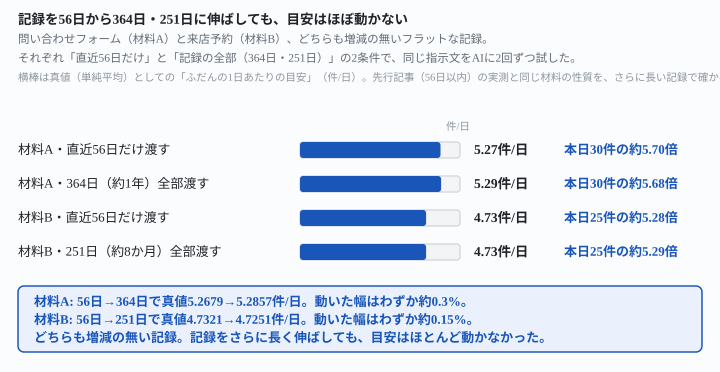
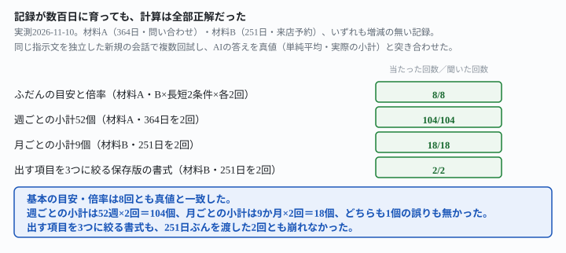

## これで何ができるか {: .what }

[いつもの目安は見せる日数で変わる——5.5倍にも7.6倍にもなる](/recipes/how-far-back-changes-the-usual-number/)、
[山も谷もない記録なら、目安は変わらない——動いたのは6%だけ](/recipes/flat-log-keeps-the-benchmark-steady/)、
[増えている記録に「同じか」と聞くと——4回とも正しく「違う」と言えた](/recipes/increasing-log-judgment-comes-out-right/)の3本は、どれも「ふだんの目安」をAIに計算させる実測でした。そして3本とも、末尾にこう書いて終わっていました——「記録が数百日まで育った場合は、この実測では測っていません」。

毎日ひとりでに追記が増える自動化なら、記録はいずれ半年・1年ぶんまで育ちます。今回はそこを埋めました。結論は3つです。

1. **目安の値そのものは、記録を56日から364日・251日に伸ばしても、ほとんど動きません。**材料A（問い合わせ・増減の無い記録）は真値で5.2679件/日→5.2857件/日、動いた幅は約0.3%。材料B（来店予約・増減の無い記録）は4.7321件/日→4.7251件/日、動いた幅は約0.15%でした
2. **計算そのものも崩れませんでした。**基本の目安・倍率の計算は8回（2材料×長短2条件×各2回）すべてが真値と一致しました
3. **「週ごとの小計を全部出して」「出す項目を3つに絞って」という、長い記録ほど崩れやすそうな頼み方も崩れませんでした。**364日ぶんの週合計52個を2回とも全部正しく出し、251日ぶんでも出す項目を3つに絞る書式が2回とも崩れませんでした

<figure class="figure">

<figcaption>記録を4.5倍・6.5倍に伸ばしても、横棒の長さはほぼ同じです。</figcaption>
</figure>

| 材料 | 直近56日だけ | 記録の全部 | 動いた幅 |
|---|---|---|---|
| 材料A（問い合わせ・364日） | 5.2679件/日 | 5.2857件/日 | 約0.3% |
| 材料B（来店予約・251日） | 4.7321件/日 | 4.7251件/日 | 約0.15% |

<figure class="figure">

<figcaption>内訳を機械で数えても、崩れた箇所は1つも見つかりませんでした。</figcaption>
</figure>

<mark>先行3本が残した「数百日まで育ったら」という宿題に、今回は増減の無い記録という条件つきで答えが出ました——目安も計算も崩れません</mark>。<mark class="warn">ただし先行記事が確かめた「増加傾向のある記録は窓の長さで約36%動く」という結果は、記録が長くなっても変わらないはずです。この記事は増減の無い記録しか試していません</mark>。

📌 **この記事の数字はすべて架空データでの実測です。**問い合わせフォームの受信件数ログ（材料A・364日＝約1年）と、来店予約の件数ログ（材料B・251日＝約8か月）の2本を使いました。実在の個人情報は1件も入れていません。どちらも増減の無い（山も谷もない）記録です。6つの指示文を、独立した新規セッション（毎回ゼロから起動・前の会話の記憶なし）で**合計12回**試しました。生の返りと機械照合は `docs/evidence/record-scaled-to-a-year-benchmark-holds.md` に全文置いてあります。

## 前提 {: .need }

| | |
|---|---|
| かかる時間 | 15分。[1本目](/recipes/how-far-back-changes-the-usual-number/)・[2本目](/recipes/flat-log-keeps-the-benchmark-steady/)を先に読むと早いです |
| 費用 | 無料。無料のチャットAIで足ります |
| 必要なもの | 半年〜1年ぶん積み上がった、毎日の件数の記録 |
| プログラミング | **不要**。記録をそのまま貼るだけです |

使う指示文は、先行3本と**一字一句同じもの**です。変えたのは**記録の長さ**だけです。

- **渡す記録の長さ**（直近56日だけ／記録の全部＝364日か251日）
- **計算のさせ方**（そのまま／週ごとに区切る／月ごとに区切る／項目を絞る）

## AIへの頼み方 {: .ask }

### 1. 材料A（問い合わせ）を364日（約1年）全部渡す

2025-11-11〜2026-11-09の364日分を、1日も欠かさず貼ります。増減の無い記録です（週合計はどの週も36〜38件の範囲に収まります）。

これは問い合わせフォームに届いた件数の記録です。この記録から、ふだんの1日あたりの件数の目安を計算してください。そのうえで、本日の件数30件が、ふだんの目安の何倍にあたるかを書いてください。

この下に364日分の記録（日付｜件数）を貼ります。**2回とも、目安は5.3件/日、倍率は約5.7倍**でした。364日の合計（1,924件）も2回とも正しく計算できています。1回目は「厳密には37/7≈5.2857件」と分数まで添えました。真値（単純平均5.2857件/日・倍率5.68倍）と一致しています。

### 2. 材料Aの直近56日だけ渡す

指示文は1番と一字一句同じです。貼る記録だけを、直近56日（2026-09-15〜2026-11-09）に絞ります。

これは問い合わせフォームに届いた件数の記録です。この記録から、ふだんの1日あたりの件数の目安を計算してください。そのうえで、本日の件数30件が、ふだんの目安の何倍にあたるかを書いてください。

**2回とも、目安は5.3件/日、倍率は約5.7倍でした。**真値は5.2679件/日・倍率5.70倍です。<mark>364日ぶん全部を渡したときと、表示上はほぼ同じ答えになりました</mark>。2回目は自発的に中央値（6件/日）も添えましたが、主役の目安・倍率は変わりませんでした。

### 3. 材料B（来店予約）を251日（約8か月）全部渡す

2026-03-04〜2026-11-09の251日分を貼ります。こちらも増減の無い記録です。

これは来店予約の件数の記録です。この記録から、ふだんの1日あたりの件数の目安を計算してください。そのうえで、本日の件数25件が、ふだんの目安の何倍にあたるかを書いてください。

**2回とも、目安は4.7件/日、倍率は約5.3倍でした。**真値（合計1,186件÷251日＝4.7251件/日・倍率5.29倍）と一致しています。2回とも、3月〜11月の**月別の合計まで自発的に書いて**検算していました。すべて実物の月合計と一致しています。

| 月 | 3月 | 4月 | 5月 | 6月 | 7月 | 8月 | 9月 | 10月 | 11月（1〜9日） |
|---|---|---|---|---|---|---|---|---|---|
| AIが書いた合計 | 133件 | 139件 | 151件 | 138件 | 145件 | 150件 | 138件 | 149件 | 43件 |

⚠️ **ここで1点、材料の作り方に注意が要ることが分かりました。**記録の最終日（11/9）の翌日を「本日」として25件を渡すつもりでした。ところが記録を作る途中で、最終日を「本日」と同じ日付に見えるようにうっかり貼った回が1回ありました。<mark class="warn">最終日が「本日」と同じ日付に見えた1回では、AIは数値を出さずに止まりました。指摘は「記録の最終行に本日分らしき記載があり、件数が質問文と一致しません」でした</mark>（1回だけの観察です）。記録の最終日と「本日」が同じ日に見えないよう、日付の切れ目をはっきりさせてから渡しています。

### 4. 材料Bの直近56日だけ渡す

同じ指示文のまま、貼る記録を直近56日（2026-09-15〜2026-11-09）だけにします。

これは来店予約の件数の記録です。この記録から、ふだんの1日あたりの件数の目安を計算してください。そのうえで、本日の件数25件が、ふだんの目安の何倍にあたるかを書いてください。

**2回とも、目安は4.7件/日、倍率は約5.3倍でした。**真値は4.7321件/日・倍率5.28倍です。251日版（指示文3）とほぼ同じ答えでした。

### 5. 364日ぶんで、週ごとの小計を先に出させる

[1本目](/recipes/how-far-back-changes-the-usual-number/)の指示文4（週ごとの小計を先に出させる）を、**52週ぶん**に増やして試します。材料は指示文1と同じ364日です。

これは問い合わせフォームに届いた件数の記録です。まず1週間ごとの合計を出し、次にそれぞれを7で割って週ごとの平均を出してください。そのうえで、全体のふだんの1日あたりの件数の目安を計算し、本日の件数30件がふだんの目安の何倍にあたるかを書いてください。

2回とも、**52週ぶんの週合計を1週も欠かさず表に出し**ました。真値（Pythonで計算した52個の週合計）と突き合わせたところ、**52週×2回＝104個、1個も違いませんでした**。最終的な目安（5.3件/日）・倍率（約5.7倍）も、指示文1とまったく同じでした。<mark>長い記録を見せても、週ごとの小計という形なら最後まで全部出ます</mark>。これは[読者がご自分の記録で増減の傾向を確かめる方法](/recipes/flat-log-keeps-the-benchmark-steady/)としても、そのまま使えます。

### 6. 251日ぶんで、出す項目を3つに絞る保存版

[1本目](/recipes/how-far-back-changes-the-usual-number/)の指示文5（急増チェックを「出す項目」の1つとして名指しする、保存版の書式）を、251日ぶんに応用します。

これは来店予約の件数の記録です。毎回この形で処理してください。

①この記録から、ふだんの1日あたりの件数の目安を計算して書く
②本日の件数25件が、ふだんの目安の何倍にあたるかを書く
③②が5倍を超えているかどうかを1行で

この3つ以外は書かないでください。

2回とも、こう返ってきました。

> ①ふだんの1日あたりの件数の目安：約4.7件（合計1186件の平均）
> ②本日の25件は、ふだんの目安（約4.7件）の約5.3倍
> ③5倍を超えています

<mark>指定した3項目（目安・倍率・5倍を超えているか）だけがそろいました（2回とも）</mark>。月別の内訳のような検算メモは、「ユーザーには出していません」という形で裏に残しただけでした。251日という長い記録でも、**出す項目を絞る書式は崩れませんでした**。

## うまくいかないときの言い直し方 {: .fix }

### 記録が長くても、本当にちゃんと全部読んでいるか不安 {: .trouble }

<mark class="warn">目安の数字だけを聞くと、本当に全部読んだのか、答えだけでは分かりません。</mark>この記事の指示文5番（週ごとの小計を先に出させる）を使うと、52週分のような長い記録でも全部の小計が出力に出ます。人間は後から数件サンプルで検算できます。この記事では52週×2回＝104個を全部突き合わせましたが、読者が毎回そこまでやる必要はありません。**数週だけ自分の記録と見比べれば、全部読んでいるかの目安になります。**

### 記録に増減の傾向があるかもしれない {: .trouble }

この記事が確かめたのは**増減の無い（フラットな）記録**だけです。[1本目](/recipes/how-far-back-changes-the-usual-number/)が確かめたとおり、**増減の傾向がある記録では、記録の長さだけで目安が約36%動きます。**この傾向は記録が長くなっても消えません（むしろ古い週をより多く含むぶん、長くするほど目安は動きやすくなるはずです）。まず[1本目](/recipes/how-far-back-changes-the-usual-number/)の指示文4（週ごとの小計を先に出させる）で、増減の傾向が無いかを確かめてください。そのうえで、この記事の結論（長くても目安は動かない）を当てはめてください。

### 記録の最終日と「本日」が同じ日に見えてしまう {: .trouble }

上の指示文3で触れたとおり、記録の最終行と「本日」の日付が重なって見えると、AIは数字を出さずに止まることがあります（1回の観察）。**記録には「本日」を含めず、記録の最終日の翌日が「本日」だと分かる形で渡してください。**自動化の中では、記録を書き出す処理と「本日」を取得する処理を分けて、両者がずれていないかを確認してから渡す形が安全です。

## 応用・次の一手 {: .next }

**「ふだんの目安」をAIに計算させる一連の実測は、これで4本そろいました。**

| 記録の性質 | 窓の長さを変えたときの動き | 記録を56日→数百日に伸ばしたときの動き |
|---|---|---|
| 増減の無い記録 | ほとんど動かない（約6%・[flat-log](/recipes/flat-log-keeps-the-benchmark-steady/)） | ほとんど動かない（約0.3%・約0.15%・この記事） |
| 増加傾向のある記録 | 大きく動く（約36%・[how-far-back](/recipes/how-far-back-changes-the-usual-number/)） | 試していない（次に測ることの1つ） |

実務ではこの手順がおすすめです。

1. この記事の指示文5番（週ごとの小計を先に出させる）で、増減の傾向の有無を確認する
2. 増減が無ければ、記録が半年・1年ぶんに育っても、窓の長さを気にしなくてよい（この記事）
3. 増減があれば、窓の長さを固定する（[1本目](/recipes/how-far-back-changes-the-usual-number/)）。記録が育つほど動きやすくなる可能性があるので、より注意が必要です

これは問い合わせフォームに届いた件数の記録です。まず1週間ごとの合計を出し、次にそれぞれを7で割って週ごとの平均を出してください。そのうえで、全体のふだんの1日あたりの件数の目安を計算し、本日の件数30件がふだんの目安の何倍にあたるかを書いてください。

この指示文は、[毎日決まった時刻にAIを動かす仕掛けを作らせる](/recipes/github-actions-daily-cron/)にそのまま組み込めます。記録が半年・1年と育っていっても、週ごとの小計さえ出力に含めておけば、増減の傾向が出ていないかを毎回の出力から確認できます。

⚠️ **この記事が実測していないこと**は3つです。

- 増加傾向・減少傾向のある記録で、記録自体を数百日まで伸ばした場合（[1本目](/recipes/how-far-back-changes-the-usual-number/)の約36%という動きが、記録が長くなるとさらに広がるか）
- 年単位の季節変動がある記録（夏に増えて冬に減る、のような周期）
- 記録が1年を超えて数年ぶんまで育った場合

次に測るなら、増加傾向のある記録をそのまま数百日に伸ばします。[1本目](/recipes/how-far-back-changes-the-usual-number/)の約36%という動きが、数百日でも同じ大きさか、記録が長くなるほど広がるかを確かめるところから始められます。
