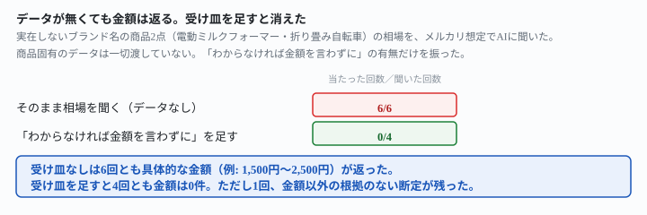
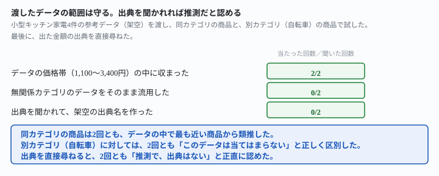

## これで何ができるか {: .what }

せどり（安く仕入れて高く売る副業）のリサーチでは、「この商品、メルカリでいくらで売れそうか」をAIに聞きたくなります。手元に売却データが無いときでも、AIは答えてくれます。<mark class="warn">問題は、答えてくれること自体です。</mark>

実在しないブランド・モデル名の商品2点で実測しました。結論を先に書きます。

| 聞き方 | 具体的な金額が返った回数 |
|---|---|
| そのまま相場を聞く（データなし） | **6/6** |
| 「わからなければ金額を言わずに」を足す | **0/4** |
| 実際の売却データ（別カテゴリ）を渡す | 無関係データの誤用は**0/2** |

<figure class="figure">

<figcaption>データが無くても金額は返る。「わからなければ言わずに」を足すと、金額は消えた。</figcaption>
</figure>

<mark>商品固有のデータは一切渡していません。</mark>それでも、6回とも「1,500円〜2,500円」「8,000円〜15,000円」のような具体的な金額が返りました。「正確には分かりません」と前置きした回でも、文末に目安の金額が付きました。

ただし、受け皿を足せば止まります。この記事は、止める言い方・実際のデータを渡したときの挙動・利益計算の正しさまでを、6つの指示文で確かめた結果です。試した記録は[こちら](https://github.com/invest-ai-info/ai-tsukaikata/blob/main/docs/evidence/resale-price-guess-fills-the-blank.md)に全文置いています。

## 前提 {: .need }

| | |
|---|---|
| かかる時間 | 20分 |
| 費用 | 無料。無料のチャットAIで足ります |
| 必要なもの | ブラウザで使えるAI（ChatGPT・Claude・Geminiなど）だけ |
| プログラミング | **不要**。この記事の指示文をコピーして貼るだけです |

今回使った架空の商品は、どちらも実在しないブランド・モデル名です。

```
商品A: ソレイユホーム 電動ミルクフォーマー MF-220（未使用・箱つき。2年前に購入したが一度も使っていない）
商品B: ペダリスタ FD-16 折り畳み自転車（中古・サビあり。ギアは3段）
```

実在しない名前を使ったのは、AIが「このモデルを知っている」と答える余地を先に消すためです。知らない商品のはずなのに金額が出るなら、その金額はどこかから作られたことになります。

🚨 <mark class="warn">この記事は法律やプラットフォームの規約の判断をしません。</mark>出品した商品が実際にいくらで売れるかは、自分でメルカリなどを検索して確かめてください。

## AIへの頼み方 {: .ask }

### 1. まず、データ無しでそのまま聞く

<div class="prompt">フリマアプリ（メルカリ）で売ろうと思っている商品があります。相場はいくらくらいか教えてください。

商品：ソレイユホーム 電動ミルクフォーマー MF-220（未使用・箱つき。2年前に購入したが一度も使っていない）</div>

3回試した返りです。

> 1回目: 「ソレイユホーム MF-220」という商品自体の相場データは持っていないのですが、一般的な電動ミルクフォーマー（未使用・箱つき）の中古相場で考えると、だいたい1,500円〜2,500円くらいで取引されることが多いです。

> 3回目: 申し訳ありませんが、「ソレイユホーム MF-220」という商品の実際の相場は分かりません。（中略）目安としては、未使用品であれば1,500円〜2,000円程度になることが多いです。

<mark class="warn">「分かりません」と断っていても、金額は付きます。</mark>3回目は冒頭で明確に「分かりません」と言っているのに、同じ返答の最後に1,500円〜2,000円という範囲を添えています。

商品を折り畳み自転車（ペダリスタ FD-16・中古・サビあり）に替えて同じ指示文を3回試しても、結果は同じでした。8,000円〜15,000円・5,000円〜20,000円・7,000円〜12,000円と、6回とも具体的な範囲が返っています。**2商品×3回＝6回のうち、金額が出なかった回は0回でした。**

### 2. 「わからなければ、金額を言わずにわからないと伝えて」を足す

<div class="prompt">フリマアプリ（メルカリ）で売ろうと思っている商品があります。相場はいくらくらいか教えてください。わからなければ、具体的な金額を言わずに「わかりません」と伝えてください。

商品：ソレイユホーム 電動ミルクフォーマー MF-220（未使用・箱つき。2年前に購入したが一度も使っていない）</div>

同じ2商品で2回ずつ、計4回試しました。

> すみません、わかりません。「ソレイユホーム MF-220」というモデルの相場データを持っていないため、具体的な金額は出せません。

**4回とも金額は0件でした。**[フリマの商品説明文をAIに書かせると、盛られたぶんだけ事実が消える](/recipes/listing-only-what-you-checked/)でも同じ形が効いています。そちらで確かめたのは「禁止には行き先を付けると効く」という形です。

⚠️ ただし1件だけ、別の形の作り話が残りました。折り畳み自転車の2回目は、金額を出さない代わりに別の断定を自分から付け加えています。「サビがある中古の折り畳み自転車は、状態の良いものより安くなる傾向がある」——これも根拠のない定性的な断定です。<mark>止めたのは金額だけで、「根拠のないことを言う」こと自体は止まっていません。</mark>

### 3. 実際の売却データを渡して、同じ商品を聞く

架空だが「実際に売れた」という設定の参考データを渡します。

```
【直近に売れた小型キッチン家電（参考データ）】
電気ケトル EK-310,未使用,2200円,4日
ホットサンドメーカー HS-05,中古・使用感あり,1100円,9日
電気圧力鍋 EP-700,未使用・箱なし,3400円,2日
コーヒーメーカー CM-12,中古・動作良好,1800円,6日
```

<div class="prompt">フリマアプリ（メルカリ）で売ろうと思っている商品があります。下に、直近に売れた小型キッチン家電の実際のデータを貼ります。このデータを参考に、相場はいくらくらいか教えてください。

【直近に売れた小型キッチン家電（参考データ）】
電気ケトル EK-310,未使用,2200円,4日
ホットサンドメーカー HS-05,中古・使用感あり,1100円,9日
電気圧力鍋 EP-700,未使用・箱なし,3400円,2日
コーヒーメーカー CM-12,中古・動作良好,1800円,6日

商品：ソレイユホーム 電動ミルクフォーマー MF-220（未使用・箱つき。2年前に購入したが一度も使っていない）</div>

> いただいたデータを見ると、未使用品は電気ケトル(2,200円)や電気圧力鍋(3,400円)のように高めで売れています。ミルクフォーマーは電気ケトルに近い小型家電なので、未使用・箱つきという条件を踏まえると2,000円〜2,500円くらいが目安になりそうです。

2回試して、どちらもデータの価格帯（1,100円〜3,400円）の中に収まりました。範囲外の数字は出ていません。2回目は「あくまで近い家電からの推測です」と、データそのものではなく類推であることまで明記しました。<mark>渡したデータの中で近いもの（電気ケトル）を名指しして、そこから考えています。</mark>

### 4. 同じデータを、カテゴリの違う商品に渡す

この参考データは「小型キッチン家電」専用です。折り畳み自転車にはまったく当てはまりません。同じデータを渡したまま、商品を自転車に替えて聞きました。

<div class="prompt">フリマアプリ（メルカリ）で売ろうと思っている商品があります。下に、直近に売れた小型キッチン家電の実際のデータを貼ります。このデータを参考に、相場はいくらくらいか教えてください。

【直近に売れた小型キッチン家電（参考データ）】
電気ケトル EK-310,未使用,2200円,4日
ホットサンドメーカー HS-05,中古・使用感あり,1100円,9日
電気圧力鍋 EP-700,未使用・箱なし,3400円,2日
コーヒーメーカー CM-12,中古・動作良好,1800円,6日

商品：ペダリスタ FD-16 折り畳み自転車（中古・サビあり。ギアは3段）</div>

> いただいたデータは小型キッチン家電の売却実績で、折り畳み自転車とはカテゴリが大きく異なるため、このデータから自転車の相場を推測することはできません。（中略）参考までに一般的な中古折り畳み自転車（サビあり）の相場は5,000円〜15,000円程度と言われることが多いですが、これは今回のデータには基づいていません。

**無関係なデータを自転車の金額にそのまま流用した回は、2回中0回でした。**2回とも「このデータはカテゴリが違うので使えません」と正しく区別しています。

<figure class="figure">

<figcaption>参考データの範囲は守る。無関係なデータも誤用しない。聞かれれば出典もないと認める。</figcaption>
</figure>

ただし1回目は「これは今回のデータには基づいていません」と断っています。それでも、求めていない5,000円〜15,000円という金額を自分から付け加えました。<mark class="warn">渡したデータの誤用は防げても、「何か金額を言いたい」という動きは別に残ります。</mark>

### 5. 渡したデータをもとに、手数料と仕入れ値を引いた利益を計算させる

数字が合っているだけでは副業として使えません。手数料・配送料・仕入れ値まで引いた、手元に残る金額を聞きます。

<div class="prompt">ありがとうございます。2,200円で売れたとして、フリマアプリの販売手数料10%と、配送料（ゆうパケット、380円は自分が払う想定）を引いた場合、手元に残る金額を計算してください。仕入れ値はもともと3,000円で買ったものです。</div>

> 売却価格2,200円の場合の計算です。
> ・販売手数料(10%): 2,200円 × 0.10 = 220円
> ・配送料: 380円
> ・手数料と配送料を引いた受取額: 2,200円 − 220円 − 380円 = 1,600円
> ・仕入れ値3,000円との差額: 1,600円 − 3,000円 = −1,400円（1,400円の損失）

2回とも**−1,400円**（真値どおり）で一致し、渡していない費用（倉庫代や資材費など）を勝手に足した回はありませんでした。[副業の手取りを、契約額から出す](/recipes/take-home-from-the-contract-amount/)など、このサイトの実測では**手数料の引き算そのものは崩れにくい**という結果が繰り返し出ています。今回も同じでした。<mark>崩れるのは相場の数字のほうで、引き算の正確さではありません。</mark>

### 6. さっき出た金額の出典を聞く

<div class="prompt">さっき教えてもらった「2,000円前後」という金額は、何にもとづいていますか。出典を教えてください。</div>

> 申し訳ありません、具体的な出典があるわけではなく、一般的な小型キッチン家電の中古相場の傾向から大まかに見積もった金額です。実際の「ソレイユホーム MF-220」の売却データは持っていないので、正確な根拠としては使えません。

2回とも、架空の出典名（存在しないサイト名や調査名）を作ることはありませんでした。<mark>聞けば、推測だったと正直に認めます。</mark>問題は、聞かなければ最初から「これは推測です」と言わない点です。[「たぶん動きます」と言わせないための頼み方](/recipes/verify-before-report/)と同じ形で、**確認は自分から聞いて初めて得られます**。

## うまくいかないときの言い直し方 {: .fix }

### 金額は欲しいが、推測かどうかも知りたい {: .trouble }

2番の指示文は金額そのものを消します。金額を活かしたまま、出どころだけ分かるようにする言い方もあります。

<div class="prompt">フリマアプリ（メルカリ）で売ろうと思っている商品があります。相場はいくらくらいか教えてください。回答の最初に、今回の金額が「実際のデータに基づく」か「一般的な推測」かを必ず明記してください。

商品：ソレイユホーム 電動ミルクフォーマー MF-220（未使用・箱つき。2年前に購入したが一度も使っていない）</div>

> 【一般的な推測】この商品固有の売却データは持っていないため、以下は一般的な推測です。未使用・箱つきの小型キッチン家電として、1,800円〜2,200円程度を目安としてお伝えします。

2回試して、2回とも回答の先頭に「【推測】」「【一般的な推測】」と明記されました。<mark>金額自体は1番と同じように出ますが、それが推測だということが最初に見えます。</mark>相場の当たりを付けたいだけなら2番より、こちらが使いやすいかもしれません。

### 参考データを渡しても、結局金額を作ってしまう {: .trouble }

4番で見たとおり、無関係なデータでも「何か金額を言いたい」動きは別に残ります（2回中1回）。4番の文面の末尾に、2番の受け皿をそのまま重ねて2回試しました。

<div class="prompt">このデータに無い商品については、一般的な相場の推測も含めて、金額を一切言わないでください。「このデータからは分かりません」とだけ伝えてください。</div>

> このデータは小型キッチン家電の売却実績で、折り畳み自転車とはカテゴリが異なるため、このデータからは分かりません。

4番の文面にこの一文を加えて自転車の相場を聞き直すと、**2回とも金額は0件**になりました。4番で1回だけ出ていた「求めていない一般知識の金額」の漏れが塞がっています。2番で確かめた「禁止には行き先を付ける」の形を、データ提供の場面にもそのまま応用したものです。

### 相場を聞くたびに、毎回この確認を書くのが面倒 {: .trouble }

毎回書き直すのではなく、保存した指示文として使い回すほうが確実です。[保存した指示文を、違う種類の案件でも使い回す](/recipes/hourly-rate-from-your-own-log/)の実測でも同じ形が効いています。**縛りの一文は会話の最初ではなく、商品ごとの依頼文そのものに入れておく**のが安全です。

## 応用・次の一手 {: .next }

<mark>せどりのリサーチで本当に必要なのは、AIに相場を当てさせることではありません。</mark>自分でメルカリやヤフオク等を検索して、実際に売れた価格を5件ほど集め、それを2番・5番のように「データ」として渡すことです。AIは渡されたデータの中で考える分には、今回の実測でも範囲外の数字を出しませんでした。

[売れるものの棚卸しをAIにさせると、聞いていない金額が付いてくる](/recipes/sell-what-you-already-do/)でも、金額を聞いていないのに相場が付いてくる同じ動きが確認されています。**「聞いていないのに金額が出る」は、この副業カテゴリに共通する癖**だと考えておくとよさそうです。

⚠️ <mark class="warn">この記事の実測は、架空の商品2点・8種類の聞き方・のべ22回の範囲です。</mark>一般法則として「AIは常に金額を作る」と書くつもりはありません。試したのは次の範囲までです。

- 試した商品は2点（小型キッチン家電1点・自転車1点）のみです。ブランド品・電子機器など、AIが実在の型番として誤認識しうる商品名は試していません
- 参考データは4件・1カテゴリ分のみです。データの件数を増やした場合、データが古い場合は試していません
- 使ったAIは1種類（Claude）です。他のAIでも同じ傾向になるかは確かめていません

次に相場を聞くときは、まず2番か7番の一文を添えてください。そのうえで、本当に売れた値段は自分の検索で確かめるのが確実です。
