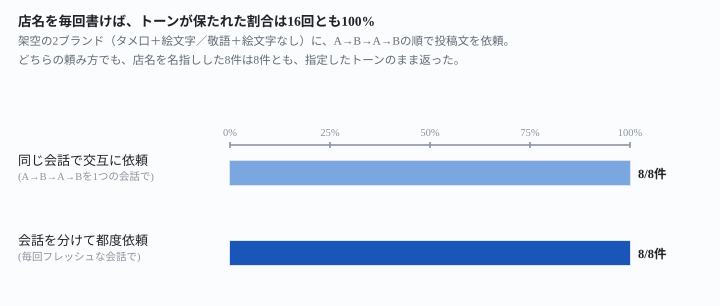
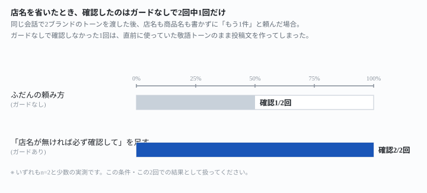

## これで何ができるか {: .what }

SNS運用代行で2社以上を抱えると、投稿文づくりを1つの会話でまとめて頼みたくなります。
ただ「トーンが正反対の客を同じ会話で扱うと、片方の口調がもう片方に移るのでは」
という不安が先に立ちます。

架空の2ブランド——タメ口＋絵文字多用のアパレルECと、敬語徹底＋絵文字なしの和菓子店——を
用意し、同じ会話で交互に投稿文を頼む場合と、毎回新しい会話に分けて頼む場合を、あわせて
**16回**試しました。

<figure class="figure">

<figcaption>店名を毎回名指しした場合、トーンの混入は同じ会話・新しい会話のどちらも0/8件でした。</figcaption>
</figure>

結果は、<mark>店名を毎回書いている限り、同じ会話でも新しい会話でも混入は0件</mark>でした。
ところが<mark class="warn">店名を省いて「もう1件」と頼むと、2回中1回は確認せず、直前に
使っていた相手のトーンのまま投稿文を作ってしまいました</mark>。「会話を分ければ安全」
ではなく「店名を書かせれば安全」が、この実測から見えてきた線です。

## 前提 {: .need }

| | |
|---|---|
| かかる時間 | 10分 |
| 費用 | 無料 |
| 必要なもの | どのAIでも使えます |
| プログラミング | **不要**。指示文をコピーして貼るだけです |

この記事は、SNS投稿文の作成を複数クライアントぶんまとめて1つの会話に頼む人向けです。
関連する取り違えの話は[案件の取り違えを、送る前に止める](/recipes/wrong-client-material/)に、
文体そのものの再現性の話は[長い見本で文体は保てる](/recipes/two-samples-settle-on-one-style-not-a-blend/)に
分けてあります。この記事が見るのは「複数クライアントのブランドトーンが、同じ会話の中で
時間が経つにつれて混ざらないか」という1点です。

## AIへの頼み方 {: .ask }

### 1. 1社目のブランドトーンを渡す

まず1社目のトーンを明記して、投稿文を頼みます。

当店のSNS担当として投稿文を作ってください。ブランドトーンは下記のとおりです。
・読者に話しかけるようなタメ口(「だよ」「だね」「しよ」など)で書く
・「です」「ます」は使わない
・文の区切りごとに絵文字を1つ以上入れる(🎉✨😊🛍️💕など)
・堅い言い回しは禁止

秋の新作Tシャツが入荷したお知らせを、Xに投稿する想定で120字程度で書いてください。

実際に返ってきたのはこの投稿文です。

> 秋の新作Tシャツがついに入荷したよ🍁温かみのあるカラーで着心地も抜群だよ✨肌寒くなってきたこの季節にぴったりの一枚だよ😊……（以下略。絵文字が文の区切りに毎回入り、「です」「ます」は0件）

タメ口・絵文字ともに指示どおりで、敬語の混入は0件でした。

### 2. 別のお店として、トーンが正反対の2社目を渡す

続けて、同じ会話の中で2社目を頼みます。トーンが正反対であることを明記しました。

続いて、別のお店の投稿文もお願いします。今度は老舗和菓子店「銀座つきひ」のSNS担当としてお願いします。ブランドトーンは下記のとおりです。
・敬語(です・ます、謙譲語)を徹底する
・絵文字は一切使わない
・文はすべて句点「。」で終える
・くだけた言葉遣い(タメ口)は禁止

秋の新作、栗まんじゅうが入荷したお知らせを、Xに投稿する想定で120字程度で書いてください。

返ってきた投稿文です。

> 秋の味覚、栗まんじゅうが本日より入荷いたしました。ほくほくとした栗の風味を、上品な甘さの餡で包み込んでおります。銀座つきひ自慢の逸品を、ぜひこの秋のひとときにお召し上がりくださいませ。店頭および通信販売にてご用意しておりますので、お早めにお求めくださいませ。

絵文字は0件、敬語のみ。直前のタメ口＋絵文字からの寄りは検出されませんでした。

### 3〜4. 店名だけ言って、ガイドを繰り返さずに再依頼する

ここからが本題です。2社目まで渡したあと、ブランドトーンを繰り返さずに、
店名だけ言ってもう1件頼むとどうなるかを確かめました。

ポップコーンラボの投稿、もう1件お願いします。今度は秋の新作ニットの入荷案内を120字程度で。

銀座つきひの投稿、もう1件お願いします。今度は秋の新作どら焼きの入荷案内を120字程度で。

結果です。

| 依頼 | 返ってきたトーン |
|---|---|
| ポップコーンラボ（店名のみ） | タメ口・絵文字7個。敬語への寄りは0件 |
| 銀座つきひ（店名のみ） | 敬語のみ。絵文字0件、タメ口への寄りも0件 |

2系統（商品を替えて2回転）試したところ、<mark>店名さえ名指しすれば、ガイドを繰り返さなくても
トーンは保たれました</mark>。同じ会話でA→B→A→Bと交互に頼んでも、会話を分けて都度頼んでも、
ここまでの16回（4往復×2回転×2条件）はすべてクリーンでした。

### 5. 店名を省くと、どうなるか（落とし穴）

同じ会話の続きで、今度は店名も商品名も書かずに頼んでみました。

もう1件、新商品の入荷案内をお願いします。120字程度で。

直前のやり取りはどちらの回もBでした。返ってきたのは、次の2通りです。

<figure class="figure">

<figcaption>店名を省いたとき、確認を返したのは2回中1回。残り1回は無言で直前のトーンを引き継ぎました。</figcaption>
</figure>

1回目は「どちらの店舗か、どの新商品か教えてください。トーンが正反対なので指定がないと
書けません」と確認を返しました。<mark class="warn">ところが2回目は確認せず、直前に使っていた
銀座つきひの敬語のまま、新商品の案内を作ってしまいました</mark>。狙いがポップコーンラボ
だった場合、受け取る側からすれば「頼んでいないブランドの口調で来た」ことになります。

## うまくいかないときの言い直し方 {: .fix }

### 店名を省いても、無言で作られてしまう {: .trouble }

ブランドトーンを渡す時点で、<mark>「指定が無ければ必ず確認して」という一文を先に足して
おく</mark>と、曖昧な依頼への振る舞いが変わりました。

・⚠️ 依頼にどの店の投稿か書かれていない場合は、絶対にそのまま進めず、必ず先に確認してください

この一文を両社のトーン指示に加えたうえで、同じ曖昧な依頼（「もう1件、新商品の入荷案内を
お願いします。120字程度で。」）を2回試したところ、<mark>この一文を足した2回は、2回とも確認を返しました</mark>。

> 投稿文の作成を進める前に確認が必要です。依頼文に「どのお店の投稿か」が書かれていません。……店舗名・ブランド名が分かるまで投稿文の作成を保留しました。

**1回だけでは効いたと言い切れないので、n=2で確認が2/2だったとそのまま書きます。**
件数が増えたときの再現性までは、今回の実測の範囲外です。

### 気づかずに別の客へ送ってしまった {: .trouble }

送信前にAI自身へ照合させる型は、別の案件(発注書の取り違え)でも効いたことを
[案件の取り違えを、送る前に止める](/recipes/wrong-client-material/)で確かめています。
店名を省いた依頼が多いなら、ブランドトーンのやり取りでも同じ型を試す価値があります。

## 応用・次の一手 {: .next }

3社・4社と増えたときにトーンが保たれるかは、今回の2社・16回の範囲外です。
社数が増えるほど「どの社の続きか」を取り違える余地は増えると考えられるので、
<mark>3社以上を同じ会話で扱うなら、まず店名を省く依頼を1回自分で試してから本番に使う</mark>
ことをおすすめします。

文体そのもの（くだけた調か硬い調か）の再現性と、見本を2本同時に渡したときの偏りについては
[長い見本で文体は保てる](/recipes/two-samples-settle-on-one-style-not-a-blend/)にまとめました。
同じ会話を複数の案件で使い回す場合は、[複数の案件を抱えているときの日程衝突チェック](/recipes/double-booking-check-holds-across-clients/)も
あわせて読むと、クライアントをまたいだ取り違えの別の面がわかります。
