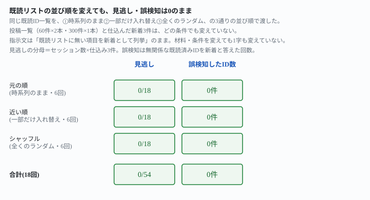
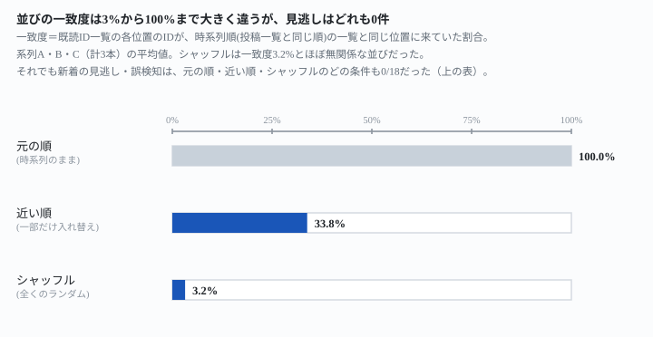

## これで何ができるか {: .what }

既読ID一覧で新着を見分ける方式は、<mark>その一覧をどんな順番で渡しても使えます。</mark>投稿一覧と同じ日付順でなくても構いません。完全にシャッフルしても、新着の見逃し・誤検知は変わりませんでした。プログラミングは要りません。

| 既読リストの並び順 | 投稿一覧との一致度（目安） | 結果（6回・新着18件） |
|---|---|---|
| ①時系列のまま | 100%（定義上） | 見逃し0・誤検知0 |
| ②一部だけ入れ替えた「近い順」 | 平均33.8% | 見逃し0・誤検知0 |
| ③全くのランダムにシャッフル | 平均3.2% | 見逃し0・誤検知0 |

<figure class="figure">

<figcaption>並び順を変えても、見逃し・誤検知はどの条件も0/18。</figcaption>
</figure>

**一致度がここまで違っても結果は同じでした。**

<figure class="figure">

<figcaption>並びの一致度は3%から100%まで動いたが、見逃しはずっと0件のまま。</figcaption>
</figure>

📌 **この記事の実測は合計18回**（3条件×3系列×各2回）です。生の返りと機械照合は `docs/evidence/seen-list-order-does-not-matter.md` に全文置いてあります。

## 前提 {: .need }

| | |
|---|---|
| かかる時間 | 20分 |
| 費用 | 無料。無料のチャットAIで足ります |
| 必要なもの | ブラウザで使えるAI（ChatGPT・Claude・Geminiなど）と、既読ID一覧・監視対象の一覧 |
| プログラミング | **不要** |

- **この記事は[IDがバラバラでも新着は見逃さない](/recipes/seen-list-catches-the-scattered-gaps/)が残した未測定事項の実測です。**同記事は既読ID一覧を投稿一覧と同じ時系列順のまま渡していました。本文でAIは「既読リストが投稿一覧と同じ時系列順に並んでいることを前提に、抜けを目視で拾った」と自己申告しています。並び順を変えた場合は確かめていないと明記されていました
- **既読リスト方式のそもそもの効き方は[古い新着も、既読リストなら見逃さない](/recipes/seen-list-catches-the-backfilled-one/)にあります。**この記事はその方式を、並び順という別の軸で確かめます

## AIへの頼み方 {: .ask }

### 1. まず元の順（時系列のまま）で渡す（対照）

今回の材料は、架空の「社内掲示板の投稿一覧」（系列A・60件）と「ナレッジベースの記事一覧」（系列B・60件）の2本です。どちらも新着3件を仕込みました。一覧のうち先頭寄り・中ほど・末尾寄りの3か所に散らしています。既読ID一覧は57件（新着3件を除いたもの）です。

<div class="prompt">既読リスト（これまでに確認済みのID一覧）は次のとおりです。

（ここに、既読ID一覧をそのまま貼ります）

投稿一覧は次のとおりです（全60件）。

（ここに、投稿一覧をそのまま貼ります）

既読リストに無い項目を新着として、該当する投稿のIDだけを列挙してください。説明や前置きは不要です。該当が無ければ「新着なし」とだけ書いてください。</div>

既読ID一覧は、投稿一覧と同じ時系列順のまま渡しました。**2系列×2回転＝4回とも、仕込んだ3件を正しく検出しました。**前作と同じ指示文のままです。

**なぜこの言い方か。**指示文は変えず、材料側（既読リストの並び順）だけを動かします。言い方を固定することで、「前作の精度が、並び順という条件に依存していたかどうか」だけを切り分けられます。

### 2. 同じ資料を完全にシャッフルして渡す

既読ID一覧のIDの並びだけを、完全にランダムな順番に入れ替えました。投稿一覧・新着の位置・指示文は1字も変えていません。一致度（元の時系列順と同じ位置に来ていたIDの割合）は次のとおりです。

- 系列A: 3.5%
- 系列B: 5.3%

ほぼ無関係な並びになったと言える低さです。

<div class="prompt">既読リスト（これまでに確認済みのID一覧）は次のとおりです。

（ここに、既読ID一覧をそのまま貼ります）

投稿一覧は次のとおりです（全60件）。

（ここに、投稿一覧をそのまま貼ります）

既読リストに無い項目を新着として、該当する投稿のIDだけを列挙してください。説明や前置きは不要です。該当が無ければ「新着なし」とだけ書いてください。</div>

**2系列×2回転＝4回とも、元の順と同じ3件を正しく検出しました。**無関係なIDを新着と誤判定した回も0件です。

### 3. 一部だけ並びを入れ替えた「近い順」でも渡す

シャッフルは分かりやすい変化です。ただ、現実の既読リストはそこまで極端に崩れないこともあります。隣り合う2件を約半分の確率で入れ替える「局所的な乱れ」を加えました。見た目は時系列に近いまま、厳密には時系列順ではない並びです。一致度は系列Aで40.4%、系列Bで29.8%でした。

<mark class="warn">この「近い順」こそ危ない条件に見えます。</mark>AIが並び順をうっかり手がかりに使い続け、見た目は揃っているつもりで新着を見落とす——という事故が起きやすそうだからです。

<div class="prompt">既読リスト（これまでに確認済みのID一覧）は次のとおりです。

（ここに、既読ID一覧をそのまま貼ります）

投稿一覧は次のとおりです（全60件）。

（ここに、投稿一覧をそのまま貼ります）

既読リストに無い項目を新着として、該当する投稿のIDだけを列挙してください。説明や前置きは不要です。該当が無ければ「新着なし」とだけ書いてください。</div>

1と2と同じ指示文です。**2系列×2回転＝4回とも、やはり3件を正しく検出しました。**誤検知も0件です。「近い順」は見逃しを誘う罠にはなりませんでした。

### 4. 規模を300件に増やしても確かめる

60件という規模なら、AIが並び順を使わずに全件を機械的に見比べても負担は少ないかもしれません。そこで前作と同じ300件規模の材料を新しく作りました（架空の「問い合わせ記録」・系列C）。同じ3条件（元の順・近い順・シャッフル）を、この300件で試します。

<div class="prompt">既読リスト（これまでに確認済みのID一覧）は次のとおりです。

（ここに、既読ID一覧をそのまま貼ります）

投稿一覧は次のとおりです（全300件）。

（ここに、投稿一覧をそのまま貼ります）

既読リストに無い項目を新着として、該当する投稿のIDだけを列挙してください。説明や前置きは不要です。該当が無ければ「新着なし」とだけ書いてください。</div>

**3条件×2回転＝6回とも、仕込んだ3件を正しく検出しました。**60件で見た結果は、規模を5倍にしても変わりません。

| 系列 | 件数 | 元の順 | 近い順 | シャッフル |
|---|---|---|---|---|
| A（社内掲示板） | 60件 | 2/2回 検出 | 2/2回 検出 | 2/2回 検出 |
| B（ナレッジベース） | 60件 | 2/2回 検出 | 2/2回 検出 | 2/2回 検出 |
| C（問い合わせ記録） | 300件 | 2/2回 検出 | 2/2回 検出 | 2/2回 検出 |

## うまくいかないときの言い直し方 {: .fix }

### 本当に並び順を手がかりにしていないか、自分で確かめたいとき {: .trouble }

シャッフル版の一括回答に続けて、同じ会話でこう聞きました。

<div class="prompt">今の判断は、日付とIDの照合のどちらを手がかりにしましたか。既読リストの並び順は投稿一覧と同じ順でしたか、違う順でしたか。教えてください。</div>

系列Aの返りはこうです。

```
手がかりにしたのは **IDの照合**です。日付は使っていません。

- **照合の方法**: 投稿一覧の60件のIDを1つずつ既読リストと突き合わせました。既読リストに無かったのは3件です。
- **日付やタイトルを使わなかった理由**: タイトルは「備品の発注ルール変更」などが何度も出てきて、同じ題でも別IDの投稿があります。日付は、既読リストに載っていないので照合に使えません。
- **件数の確認**: 既読リストは57件、投稿一覧は60件です。差の3件が、答えた3件(BBS-b496b461、BBS-1f6cb808、BBS-0ef4399d)と一致します。

**並び順は違いました。** 既読リストは日付順でも投稿一覧の順でもなく、バラバラです。先頭は BBS-f73bdbef で、これは投稿一覧では2024-07-10の項目です。そのため、順番に見比べる方法は使えませんでした。
```

**並び順が揃っていないことに自分から気づき、1件ずつの照合に切り替えていました。**前作で見た「並びが揃っていれば目視で拾う」という挙動です。並びが揃っていないと、この挙動は起きませんでした。

⚠️ **同じ質問を別の会話に3回続けたところ、3回とも返事自体が得られませんでした。**AIの安全機能が、無関係な理由でこの手の質問を止めることがあるからです。新着検出そのものの結果（見逃し・誤検知）は、別の独立した会話で測っています。この失敗には影響されません。手がかりを確かめる追加の質問は、1回でも通れば参考情報になります。ただし通らない回があることも前提にしてください。

### 新しい材料でもう一度、同じ結果か確かめたいとき {: .trouble }

<div class="prompt">既読リスト（これまでに確認済みのID一覧）は次のとおりです。

（ここに、既読ID一覧をそのまま貼ります）

投稿一覧は次のとおりです（全60件）。

（ここに、投稿一覧をそのまま貼ります）

既読リストに無い項目を新着として、該当する投稿のIDだけを列挙してください。説明や前置きは不要です。該当が無ければ「新着なし」とだけ書いてください。</div>

1〜3番と同じ指示文です。既読リストの保存の仕方を変えたときに使います。監視対象を入れ替えたときにも使えます。同じ指示文のまま結果が崩れていないかを、その都度確かめられます。

## 応用・次の一手 {: .next }

[IDがバラバラでも新着は見逃さない](/recipes/seen-list-catches-the-scattered-gaps/)が残した課題に、答えが付きました。課題は「既読リストの並び順をシャッフルした場合は未測定」でした。<mark>既読リスト方式は、並び順を時系列のまま渡しても、一部だけ入れ替えても、完全にランダムにシャッフルしても崩れませんでした。</mark>

同じ既読リスト方式のほかの崩れ方も、別の記事で確かめています。

- [監視対象を増やしても、古い記録は新着にしない](/recipes/unseen-does-not-mean-new/)
- [見張りの対象を100件に増やしてもボロが出ないか](/recipes/backlog-scale-holds-brevity-breaks-it/)

毎朝ひとりでに回すなら、[毎日決まった時刻にAIを動かす](/recipes/github-actions-daily-cron/)の形に載せるのがおすすめです。

**実務では、既読リストをデータベースの検索結果やJSONファイルの配列として保存することがよくあります。**この記事の結果どおりなら、保存のたびに並び順が入れ替わっても気にしなくてよいということです。並び順を揃えるための一手間（ソートし直す・保存形式を揃える）は要りません。

⚠️ **この記事が実測していないこと**は2つです。

- IDの桁数や形式が、今回の16進8文字より極端に短い・長い場合
- 新着が1件だけに仕込まれていて、しかも既読リストの先頭や末尾という目立つ位置にある場合。散らした3件ではなく、極端に目立たない1件の場合は未測定です
