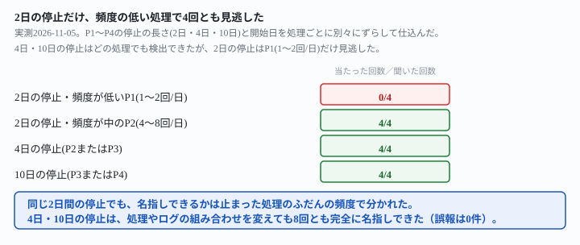
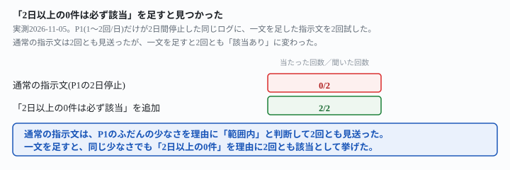

## これで何ができるか {: .what }

[監視対象を4本に増やしても](/recipes/four-process-log-keeps-each-own-baseline/)と[2つ同時に止まっても両方名指し](/recipes/simultaneous-stop-both-get-named/)は、どちらも実測の条件が同じでした。**停止は常に4日間・同じ日付（09-10〜09-13）**です。どちらの記事も、自分でこの先の宿題として「停止の長さや日付がずれる場合は試していません」と書き残しています。

<mark>この記事は、P1〜P4それぞれの停止の長さ（2日・4日・10日）と開始日を、処理ごとに別々にずらしました。</mark>1本のログに仕込み、既存の指示文のまま、各構成を2回試しています。

結論を先に書きます。

| 停止の長さ | 止まった処理の頻度 | 名指しできた回数 |
|---|---|---|
| 2日 | P1（1〜2回/日・もっとも少ない） | **0/4**（4回とも見逃し） |
| 2日 | P2（4〜8回/日） | 4/4 |
| 4日 | P2またはP3 | 4/4 |
| 10日 | P3またはP4 | 4/4 |

- **4日・10日の停止は、どの処理に仕込んでも8回とも完全に名指し**できました。長さや開始日が処理ごとに違っても、崩れませんでした
- 一方、<mark class="warn">2日の停止は、もっとも頻度の低いP1に仕込んだときだけ4回とも見逃しました</mark>。同じ2日の停止をP2に仕込むと、4回とも名指しできています。**原因は停止の長さそのものではなく、止まった処理のふだんの頻度**でした
- P1の停止が見逃された4回とも、AIは0件の日に気づいてはいました。「ふだんの範囲内」と自分で判断して、該当として挙げなかっただけです

<figure class="figure">

<figcaption>2日の停止だけ、もっとも頻度の低い処理で4回とも見逃しました。</figcaption>
</figure>

## 前提 {: .need }

| | |
|---|---|
| かかる時間 | 20分 |
| 費用 | 無料。無料のチャットAIで足ります |
| 必要なもの | 複数の定期実行の、実行時刻が分かる記録（GitHub Actionsの実行履歴・ログファイルのタイムスタンプなど） |
| プログラミング | **不要**。実行時刻の一覧をそのまま貼るだけです |

材料は、先行記事と同じ架空の処理P1〜P4の実行時刻を1本にまとめたログです。期間を60日間（2026-08-15〜10-13）に伸ばしました。これは、もっとも長い10日間の停止の前後にも、ふだんの動きを十分に残すためです。

- **P1**＝1日1〜2回（もっとも少ない）
- **P2**＝1日4〜8回
- **P3**＝1日10〜15回
- **P4**＝1日20〜30回（もっとも多い）

用意した構成は次の5つです。

- **構成A**＝P1が2日間（09-03〜）・P2が4日間（09-12〜）・P3が10日間（09-25〜）、それぞれ別の日に停止します。P4は正常です
- **構成B**＝P2が2日間（09-08〜）・P3が4日間（09-16〜）・P4が10日間（09-27〜）、それぞれ別の日に停止します。P1は正常です
- **構成C**＝全処理が正常（誤報ゼロの確認用）
- **単独構成P1**＝P1だけが2日間（09-10〜09-11）停止します。他の処理との同時停止がない、いちばん単純な形です
- **単独構成P2**＝P2だけが2日間（09-10〜09-11）停止します。単独構成P1と条件をそろえ、違いが「どの処理か」だけになるようにしました

ログを生成したあと、別のスクリプトで日付ごと・処理ごとに行数を再集計しました。確認したのは次の2点です。

- 意図した停止の日付・長さが、1日のずれもなく仕込めていること
- 他の処理・他の期間に、意図しない0件の日が無いこと

## AIへの頼み方 {: .ask }

### 1. 長さも開始日も処理ごとに違う停止（構成A・構成B）

先行記事2本で効いた頼み方を、そのまま使います。

これは、複数の定期実行処理が実際に動いた時刻を記録したログです。処理名は process=P1・process=P2・process=P3・process=P4 の4種類が混ざっています。

処理ごとに、その処理自身の記録から「ふだんの1日あたりの実行回数」の目安を計算してください。そのうえで、その処理だけの目安と比べて極端に少ない日（0件の日を含む）があれば、処理名・日付・実行回数を挙げてください。該当する日が無ければ「該当なし」と答えてください。

上に、構成A（P1=2日・P2=4日・P3=10日、それぞれ別の日に停止）の60日分のログを貼りました。2回試した結果です。

1回目は、P2の停止（09-12〜09-15の4日間）とP3の停止（09-25〜10-04の10日間）を名指ししました。日付は、どちらも1日もずれていません。P1については「ただし P1 はふだんから1日0〜2回程度と少なく、2日続けて0回でも極端とは言えないため、該当なしとしました」と書いています。2回目も同じ形でした。P2・P3は完全に名指ししつつ、P1だけ見送っています。理由は「1日1〜2回程度と元々少なく、0回の日が数日ありますが、この頻度では自然なばらつきの範囲内」でした。

構成B（P2=2日・P3=4日・P4=10日）にも、同じ指示文を使いました。

これは、複数の定期実行処理が実際に動いた時刻を記録したログです。処理名は process=P1・process=P2・process=P3・process=P4 の4種類が混ざっています。

処理ごとに、その処理自身の記録から「ふだんの1日あたりの実行回数」の目安を計算してください。そのうえで、その処理だけの目安と比べて極端に少ない日（0件の日を含む）があれば、処理名・日付・実行回数を挙げてください。該当する日が無ければ「該当なし」と答えてください。

2回試すと、こちらはP2の2日間の停止も含めて3本すべてを名指ししました。1回目は「P2 | 2026-09-08、2026-09-09 | 各0回」「P3 | 2026-09-16、09-17、09-18、09-19 | 各0回」「P4 | 2026-09-27〜10-06 | 各0回」と、3本とも日付を1日もずらさずに挙げています。2回目も同じく3本を完全に名指ししました。

**構成A・構成Bをあわせると、4日・10日の停止は8回とも完全に名指しできました。**一方、2日の停止は、P1（構成A）に仕込んだ2回は両方とも見送られ、P2（構成B）に仕込んだ2回は両方とも名指しされました。同じ2日という長さで結果が分かれたのは、止まった処理がP1かP2かの違いだけです。

### 2. P1だけ・P2だけに2日間の停止を仕込んで確かめる

構成A・構成Bは複数の処理が同時に止まっています。このため「P1の停止が見逃されたのは、他の停止に気を取られたからでは」という疑いが残ります。この疑いを切り分けるため、単独構成を作りました。**P1だけ**・**P2だけ**が、それぞれ2日間（同じ09-10〜09-11）止まる構成です。同じ指示文で2回ずつ試しました。

P1だけが止まった構成に試した指示文です。

これは、複数の定期実行処理が実際に動いた時刻を記録したログです。処理名は process=P1・process=P2・process=P3・process=P4 の4種類が混ざっています。

処理ごとに、その処理自身の記録から「ふだんの1日あたりの実行回数」の目安を計算してください。そのうえで、その処理だけの目安と比べて極端に少ない日（0件の日を含む）があれば、処理名・日付・実行回数を挙げてください。該当する日が無ければ「該当なし」と答えてください。

2回とも「該当なし」でした。1回目は「P1 は 09-10 と 09-11 が0回でした。ただ P1 は元々1日1〜2回の処理で、0回は目安の範囲内です」。2回目は「P1 は平均1.5回/日前後の処理なので、0件の日が出ても不自然ではありません」。同じ理由で見送っています。

P2だけが止まった構成にも、同じ指示文を試しました。

これは、複数の定期実行処理が実際に動いた時刻を記録したログです。処理名は process=P1・process=P2・process=P3・process=P4 の4種類が混ざっています。

処理ごとに、その処理自身の記録から「ふだんの1日あたりの実行回数」の目安を計算してください。そのうえで、その処理だけの目安と比べて極端に少ない日（0件の日を含む）があれば、処理名・日付・実行回数を挙げてください。該当する日が無ければ「該当なし」と答えてください。

2回とも「該当あり」でした。1回目は「**該当あり: process=P2 の 2026-09-10 と 2026-09-11（どちらも実行回数 0 回）**」。2回目も同じ2日間を、表に挙げて名指ししました。

**他の処理が同時に止まっていない、いちばん単純な形でも結果は同じでした。**P1単独の2日間停止は2回とも見逃され、P2単独の2日間停止は2回とも名指しされています。構成A・構成Bで見えていた差は、複数の停止が同時にあることの副作用ではなく、**止まった処理自身のふだんの頻度**で決まっていました。

### なぜ、同じ長さの停止で結果が分かれたのか

4回の見送りはすべて、**0件の日自体には気づいていました。**「P1 は 09-10 と 09-11 が0回でした」と、日付まで正確に拾っています。そのうえで「ふだんの範囲内」「自然なばらつき」「不自然ではない」と、自分の言葉で理由をつけて該当から外しました。指示文が頼んでいるのは「その処理だけの目安と比べて極端に少ない日」です。**P1はふだんの目安自体が1〜2回と小さいため、2日間の0件が「極端」と判定されにくい**ようです。4日・10日という長い停止なら、同じP1でもこの壁を越えやすくなると考えられます(本記事では試していません)。頻度が最初から低い処理ほど、短い停止だけが取り落とされやすい構造です。

## うまくいかないときの言い直し方 {: .fix }

### 「極端に少ない日」をAI自身の判断に任せると {: .trouble }

P1だけが2日間停止した単独構成に、通常の指示文をそのまま使うと、2回とも見送られることは上で見た通りです。これは指示文の書き方自体の問題で、言い直すと直りました。

これは、複数の定期実行処理が実際に動いた時刻を記録したログです。処理名は process=P1・process=P2・process=P3・process=P4 の4種類が混ざっています。

処理ごとに、その処理自身の記録から「ふだんの1日あたりの実行回数」の目安を計算してください。そのうえで、その処理だけの目安と比べて極端に少ない日（0件の日を含む）があれば、処理名・日付・実行回数を挙げてください。該当する日が無ければ「該当なし」と答えてください。

ただし、その処理がふだん1日1〜2回しか動かないような少ない回数の処理であっても、0件の日が2日以上続いたら、「ふだんの範囲内」と判断せず、必ず該当として挙げてください。

同じP1単独構成に、この指示文で2回試しました。1回目は「**該当あり: P1 のみ**」。理由は「09-10 と 09-11 は0件が2日連続しています。指定のルールどおり、ふだんの範囲内とはせず該当としました」でした。2回目も「0件が2日以上続く場合は該当とする、という条件に当たります」。2回とも正しく名指ししました。

<figure class="figure">

<figcaption>一文を足すと、2回とも「該当あり」に変わりました。</figcaption>
</figure>

→ **原因は、「極端に少ない」の判定をAI自身の相対的な感覚に任せていたことです。**元の指示文は「その処理だけの目安と比べて」とだけ頼んでいます。何日続いたら極端と見なすか、具体的には決めていません。頻度がもともと低い処理では、AIが自分で「このくらいの少なさは普通」という基準を作ってしまいます。その結果、本来は報告してほしい停止まで、範囲内に含めてしまいます。**「0件が何日続いたら必ず該当とする」という具体的な基準を指示文の側に書いておく**と、処理のふだんの頻度に関係なく同じ基準で判定されます。

## 応用・次の一手 {: .next }

| 構成 | 停止の長さ・処理 | 通常の指示文 |
|---|---|---|
| 構成A | 2日・P1(1〜2回/日) | 0/2（見送り） |
| 構成A | 4日・P2(4〜8回/日) | 2/2 |
| 構成A | 10日・P3(10〜15回/日) | 2/2 |
| 構成B | 2日・P2(4〜8回/日) | 2/2 |
| 構成B | 4日・P3(10〜15回/日) | 2/2 |
| 構成B | 10日・P4(20〜30回/日) | 2/2 |
| 単独P1 | 2日・P1(1〜2回/日) | 0/2（見送り） |
| 単独P2 | 2日・P2(4〜8回/日) | 2/2 |
| 単独P1＋「2日以上は必ず該当」 | 2日・P1(1〜2回/日) | 2/2 |

通知やIssue登録につなげるなら、頻度が低い処理を含む監視には、最初から一文を足しておくのがおすすめです。「何日続いたら必ず該当とする」という一文です。

これは、複数の定期実行処理が実際に動いた時刻を記録したログです。処理名は process=P1・process=P2・process=P3・process=P4 の4種類が混ざっています。

処理ごとに、その処理自身の記録から「ふだんの1日あたりの実行回数」の目安を計算してください。そのうえで、その処理だけの目安と比べて極端に少ない日（0件の日を含む）があれば、処理名・日付・実行回数を挙げてください。処理ごとに「該当あり」か「該当なし」のどちらかを、省略せずに書いてください。

ただし、その処理がふだん1日1〜2回しか動かないような少ない回数の処理であっても、0件の日が2日以上続いたら、「ふだんの範囲内」と判断せず、必ず該当として挙げてください。

実務に載せるなら、次の順番がおすすめです。

1. 監視対象の中に、1日1〜2回程度しか動かない処理があるかを先に確認する
2. あれば、「0件が何日続いたら必ず該当とする」という具体的な日数を指示文に書いておく（この記事では2日で検証済み）
3. 「該当あり」が返った処理だけ、[自動化が静かに壊れたのを、AIに見つけさせる記事](/recipes/auto-health-check/)と同じ要領でGitHubのIssueを立てる

⚠️ **この結果は、架空の処理4本・計12回の実測です。**「停止の長さや頻度の組み合わせがどれでも同じ結果になる」と一般化しないでください。試したのは、次の範囲までです。

- 停止の長さは2日・4日・10日の3種類のみ。1日や15日以上の停止は試していません
- 2日の停止を見逃したのはP1（1〜2回/日）だけです。他にもっと頻度の低い処理（例: 週1回）があるかは試していません
- 「2日以上は必ず該当」という一文は、2日間の停止1パターンにしか試していません。3日や5日の停止にも同じ一文が効くかは試していません

今回の生の返りと機械照合は `docs/evidence/short-stop-slips-through-on-the-quiet-process.md` に全文置いてあります。
