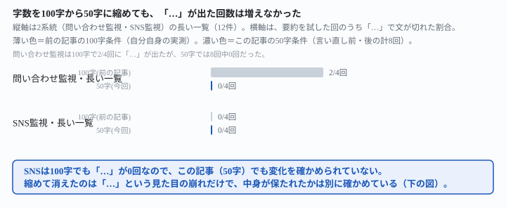
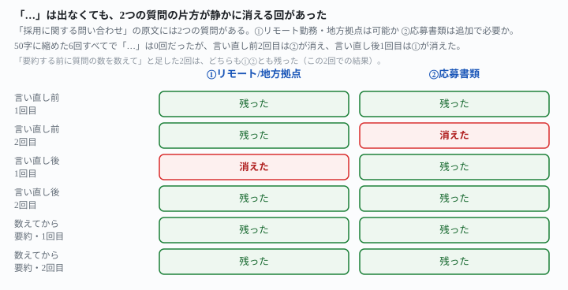

## これで何ができるか {: .what }

[前の記事](/recipes/longer-list-holds-the-limit-but-ellipsis-drops-the-ask/)は「一覧が長くなっても字数は守られる」という記事です。「1行100字以内」という指示で、要約が必要な12回のうち3回、文の途中を「…」で切る崩れを見つけました。その記事の末尾にはこう書いてあります。「字数指定を『100字』より短くした場合は試していません。短くするほど『…』の起きやすさが変わるかは、この記事では分かりません」。

測りました。**同じ2系統の監視対象（SNS監視・問い合わせ監視、ともに12件）**を使いました。**指示文の骨格は同じまま**、字数の上限だけを「100字以内」から「50字以内」に縮め、計10回試しました。結論は2つです。

1. **「…」による文の途中切れは、10回とも0回でした。**上限を半分に縮めても、「…」は増えませんでした。前の記事の100字条件（問い合わせ監視の長い一覧）では4回中2回「…」が出ていたので、これは減った側の結果です
2. **ただし、「…」が無いことは中身が保たれたことを意味しませんでした。**「採用に関する問い合わせ」という行には、原文に2つの質問があります（①リモート勤務・地方拠点での採用は可能か　②応募書類は追加で必要か）。言い直し前・後の計4回のうち2回で、どちらかの質問が「…」を使わずに言い換えの中でそのまま消えていました

<figure class="figure">

<figcaption>字数を縮めても、「…」という見た目の崩れは増えませんでした。</figcaption>
</figure>

<mark>①上限を100字から50字に縮めても、「…」で文が切れる回数は増えませんでした（10回中0回）。</mark>前の記事の100字条件（問い合わせ監視・長い一覧）では4回中2回出ていたので、むしろ減っています。

<mark class="warn">②しかし、「…」が消えたのは見た目だけでした。「採用に関する問い合わせ」の行では、6回のうち2回、原文の2つの質問のどちらかが言い換えの中で静かに消えていました。</mark>「…」という目に見える合図が無いので、読んだだけでは質問が1つ欠けていることに気づけません。

<figure class="figure">

<figcaption>「…」は出ていないのに、2つの質問の片方が消える回がありました。</figcaption>
</figure>

| 条件 | 「…」が出た回数 | 「採用に関する問い合わせ」の2点とも残った回数 |
|---|---|---|
| 言い直し前（50字のみ） | 0/2回 | 1/2回 |
| 言い直し後（「切らないで」を追加） | 0/2回 | 1/2回 |
| 数えてから要約（下の「言い直し方」） | 0/2回 | 2/2回 |

📌 **この記事の数字はすべて架空データでの実測です。**材料は[前の記事](/recipes/longer-list-holds-the-limit-but-ellipsis-drops-the-ask/)と同じ、SNS監視（公式アカウント12件）と問い合わせ監視（受付フォーム12件）です。独立した新規セッション×各2回、計10回を試しました。生の返りと機械照合は `docs/evidence/shorter-limit-swaps-ellipsis-for-a-silent-drop.md` に全文置いてあります。

## 前提 {: .need }

| | |
|---|---|
| かかる時間 | 15分。[前の記事](/recipes/longer-list-holds-the-limit-but-ellipsis-drops-the-ask/)を先に読むと早いです |
| 費用 | 無料。無料のチャットAIで足ります |
| 必要なもの | 毎朝の新着をまとめて報告させる、字数を絞った指示文 |
| プログラミング | **不要** |

⚠️ **この記事は「毎朝、この一覧を自動で作らせる仕組み」がすでにある前提です。**決まった時刻に動かす話は[毎日決まった時刻にAIを動かす仕掛けを作らせる](/recipes/github-actions-daily-cron/)にあります。

📌 **材料・条件以外は前の記事と揃えています。**字数の上限だけを100字から50字に変えました。

## AIへの頼み方 {: .ask }

### 1. SNS監視・問い合わせ監視を、50字以内で試す

[前の記事](/recipes/longer-list-holds-the-limit-but-ellipsis-drops-the-ask/)と同じ12件の一覧で、「100字以内」だった箇所だけを「50字以内」に変えました。

毎朝、監視対象の新着をまとめて報告する担当です。今日は2026-11-12です。

下は、監視中の一覧です。各行は「対象名: 新着件数件。(新着があれば)最新の件名/タイトル」の形で、すでに既読リストと比較済みの新着件数です。

1. 公式X: 新着0件
2. 公式Instagram: 新着1件。最新投稿「新作トートバッグ、販売開始しました。素材は撥水加工のキャンバスで、内側にはポケットが3つ、外側にはファスナー付きポケットが1つ、カラーは全4色展開で、数量限定のため早めのご注文をおすすめします」
3. 公式Facebook: 新着0件
4. 公式YouTube: 新着1件。最新投稿「新作紹介動画を公開しました」
5. 公式TikTok: 新着0件
6. 公式LinkedIn: 新着0件
7. 公式Pinterest: 新着0件
8. 公式LINE公式アカウント: 新着0件
9. 公式note: 新着1件。最新投稿「スタッフ日記を更新しました」
10. 公式メルマガ案内: 新着2件。最新タイトル「年末年始の配送スケジュールについてのお知らせです。12月28日から1月4日までは休業とさせていただき、その間のご注文は1月5日以降に順次発送いたします。お急ぎの方は12月20日までのご注文をおすすめします」
11. 公式Threads: 新着0件
12. 公式スタッフブログ: 新着0件

監視対象ごとに1行で、新着件数と、新着があれば最新の件名/タイトルが分かるように報告してください。1行は50字以内にしてください。

2回とも、最長行は47字（1回目・メルマガ案内）でした。「…」は2回とも0回です。Instagramの行は、1回目も2回目も「新作トートバッグ、販売開始しました」という見出しの事実だけを残していました。色・ポケット数・カラー展開といった詳細は、どちらの回も省略されています。

問い合わせ監視でも同じ変更で試しました。

毎朝、監視対象の新着をまとめて報告する担当です。今日は2026-11-12です。

下は、監視中の一覧です。各行は「対象名: 新着件数件。(新着があれば)最新の件名/タイトル」の形で、すでに既読リストと比較済みの新着件数です。

1. 配送に関する問い合わせフォーム: 新着0件
2. 返品・交換フォーム: 新着1件。最新件名「先日購入したワンピースのサイズが合わなかったため交換をお願いしたいのですが、在庫がある場合はMサイズへの交換は可能でしょうか、また交換にかかる往復の配送料はどちらが負担するのかも併せて教えてください」
3. 会員登録に関する問い合わせ: 新着0件
4. 不良品報告フォーム: 新着1件。最新件名「商品が破損していました」
5. 店舗来店予約フォーム: 新着0件
6. ギフト包装に関する問い合わせ: 新着0件
7. 定期購入の変更・解約フォーム: 新着0件
8. 法人向け見積もり窓口: 新着0件
9. メディア取材窓口: 新着1件。最新件名「取材のご依頼です」
10. 採用に関する問い合わせ: 新着2件。最新件名「中途採用のカスタマーサポート職に応募を検討しているのですが、現在掲載されている求人では勤務地が本社のみとなっており、リモート勤務や地方拠点での採用も可能かどうか、また応募書類は履歴書と職務経歴書以外に追加で必要なものがあるかを教えてください」
11. 提携・協業に関する問い合わせ: 新着0件
12. サイトの不具合報告フォーム: 新着0件

監視対象ごとに1行で、新着件数と、新着があれば最新の件名/タイトルが分かるように報告してください。1行は50字以内にしてください。

2回とも「…」は0回でした。「返品・交換フォーム」の行は、1回目が40字、2回目が38字でした。どちらもMサイズ交換・返送料負担の2点を保ったまま要約できています。

<mark>50字だけを指示した4回（SNS2回・問い合わせ2回）は、どの行も「…」を使わずに50字以内へ収まりました。</mark>100字の指示文で「…」が出ていた問い合わせ監視でも、50字では出ていません。

### 2. 「切らないでください」を足しても、同じく「…」は出ない

[前の記事](/recipes/longer-list-holds-the-limit-but-ellipsis-drops-the-ask/)で「…」対策として効いた一文を、50字の指示文にも足しました。

毎朝、監視対象の新着をまとめて報告する担当です。今日は2026-11-12です。

下は、監視中の一覧です。各行は「対象名: 新着件数件。(新着があれば)最新の件名/タイトル」の形で、すでに既読リストと比較済みの新着件数です。

1. 公式X: 新着0件
2. 公式Instagram: 新着1件。最新投稿「新作トートバッグ、販売開始しました。素材は撥水加工のキャンバスで、内側にはポケットが3つ、外側にはファスナー付きポケットが1つ、カラーは全4色展開で、数量限定のため早めのご注文をおすすめします」
3. 公式Facebook: 新着0件
4. 公式YouTube: 新着1件。最新投稿「新作紹介動画を公開しました」
5. 公式TikTok: 新着0件
6. 公式LinkedIn: 新着0件
7. 公式Pinterest: 新着0件
8. 公式LINE公式アカウント: 新着0件
9. 公式note: 新着1件。最新投稿「スタッフ日記を更新しました」
10. 公式メルマガ案内: 新着2件。最新タイトル「年末年始の配送スケジュールについてのお知らせです。12月28日から1月4日までは休業とさせていただき、その間のご注文は1月5日以降に順次発送いたします。お急ぎの方は12月20日までのご注文をおすすめします」
11. 公式Threads: 新着0件
12. 公式スタッフブログ: 新着0件

監視対象ごとに1行で、新着件数と、新着があれば最新の件名/タイトルが分かるように報告してください。1行は50字以内にしてください。ただし、文の途中で「…」のように切らないでください。全部は書けなくても、内容を要約して1文で言い切ってください。

同じ一文を問い合わせ監視にも足しました。

毎朝、監視対象の新着をまとめて報告する担当です。今日は2026-11-12です。

下は、監視中の一覧です。各行は「対象名: 新着件数件。(新着があれば)最新の件名/タイトル」の形で、すでに既読リストと比較済みの新着件数です。

1. 配送に関する問い合わせフォーム: 新着0件
2. 返品・交換フォーム: 新着1件。最新件名「先日購入したワンピースのサイズが合わなかったため交換をお願いしたいのですが、在庫がある場合はMサイズへの交換は可能でしょうか、また交換にかかる往復の配送料はどちらが負担するのかも併せて教えてください」
3. 会員登録に関する問い合わせ: 新着0件
4. 不良品報告フォーム: 新着1件。最新件名「商品が破損していました」
5. 店舗来店予約フォーム: 新着0件
6. ギフト包装に関する問い合わせ: 新着0件
7. 定期購入の変更・解約フォーム: 新着0件
8. 法人向け見積もり窓口: 新着0件
9. メディア取材窓口: 新着1件。最新件名「取材のご依頼です」
10. 採用に関する問い合わせ: 新着2件。最新件名「中途採用のカスタマーサポート職に応募を検討しているのですが、現在掲載されている求人では勤務地が本社のみとなっており、リモート勤務や地方拠点での採用も可能かどうか、また応募書類は履歴書と職務経歴書以外に追加で必要なものがあるかを教えてください」
11. 提携・協業に関する問い合わせ: 新着0件
12. サイトの不具合報告フォーム: 新着0件

監視対象ごとに1行で、新着件数と、新着があれば最新の件名/タイトルが分かるように報告してください。1行は50字以内にしてください。ただし、文の途中で「…」のように切らないでください。全部は書けなくても、内容を要約して1文で言い切ってください。

この2回も「…」は0回でした。<mark class="warn">ところが、「切らないで」を足した1回目では、「採用に関する問い合わせ」の行だけが「勤務地・応募書類についての質問」になりました。</mark><mark class="warn">原文にあった「リモート勤務や地方拠点での採用も可能か」という1つ目の質問は、言い換えの中に残っていませんでした。</mark>「…」という目印は無いので、文だけ読むと完結した1行に見えます。

同じ行を、言い直し前の2回目の結果とあわせて並べます。

| 回 | 「採用に関する問い合わせ」の要約 | ①リモート/地方拠点 | ②応募書類 |
|---|---|---|---|
| 言い直し前・1回目 | 中途採用の勤務地・リモート可否と必要書類について | 残った | 残った |
| 言い直し前・2回目 | 中途採用・勤務地とリモート可否について | 残った | **消えた** |
| 言い直し後・1回目 | 勤務地・応募書類についての質問 | **消えた** | 残った |
| 言い直し後・2回目 | リモート勤務可否と必要書類を問う中途応募の質問 | 残った | 残った |

🔑 **「切らないでください」は「…」には効きましたが、2点の脱落そのものは止めませんでした。**4回のうち2回、別々の回で、別々の点が消えています。[前の記事](/recipes/longer-list-holds-the-limit-but-ellipsis-drops-the-ask/)が直したのは「見える崩れ方（…）」で、「見えない崩れ方（言い換えでの脱落）」は別の対策が要ります。

## うまくいかないときの言い直し方 {: .fix }

### 「…」が無いのに、質問が1つ消えている {: .trouble }

「文の途中で切らないで」の代わりに、「要約する前に、元の質問や要件がいくつあるかを数え、要約した後も同じ数が残っているか確認してください」という一文を試しました。

毎朝、監視対象の新着をまとめて報告する担当です。今日は2026-11-12です。

下は、監視中の一覧です。各行は「対象名: 新着件数件。(新着があれば)最新の件名/タイトル」の形で、すでに既読リストと比較済みの新着件数です。

1. 配送に関する問い合わせフォーム: 新着0件
2. 返品・交換フォーム: 新着1件。最新件名「先日購入したワンピースのサイズが合わなかったため交換をお願いしたいのですが、在庫がある場合はMサイズへの交換は可能でしょうか、また交換にかかる往復の配送料はどちらが負担するのかも併せて教えてください」
3. 会員登録に関する問い合わせ: 新着0件
4. 不良品報告フォーム: 新着1件。最新件名「商品が破損していました」
5. 店舗来店予約フォーム: 新着0件
6. ギフト包装に関する問い合わせ: 新着0件
7. 定期購入の変更・解約フォーム: 新着0件
8. 法人向け見積もり窓口: 新着0件
9. メディア取材窓口: 新着1件。最新件名「取材のご依頼です」
10. 採用に関する問い合わせ: 新着2件。最新件名「中途採用のカスタマーサポート職に応募を検討しているのですが、現在掲載されている求人では勤務地が本社のみとなっており、リモート勤務や地方拠点での採用も可能かどうか、また応募書類は履歴書と職務経歴書以外に追加で必要なものがあるかを教えてください」
11. 提携・協業に関する問い合わせ: 新着0件
12. サイトの不具合報告フォーム: 新着0件

監視対象ごとに1行で、新着件数と、新着があれば最新の件名/タイトルが分かるように報告してください。1行は50字以内にしてください。ただし、要約する前に、その行に元々いくつの質問や要件が含まれているかを数えてください。要約した後も、その数と同じ数の要素が1行の中に残っていることを確認してください。

独立した2回の呼び出しで試しました。1回目は「勤務地(リモート/地方)可否と必要書類を質問」、2回目は「リモート勤務可否と応募書類追加要否を確認」という結果でした。<mark>「質問の数を数えて」と足した2回では、2つの質問①②がどちらも残りました。</mark>

📌 **ただし、この記事で確かめたのは2回だけです。**「数えてから要約して」という言い方が、他の行や他の材料でも同じように効くかはまだ分かりません。「切らないでください」も最初の2回は効いているように見え、問い合わせ監視の3回目で初めて崩れました。1〜2回の成功を「この言い方なら安心」と言い切らないでください。

### 件数の多い行ほど、見た目では脱落に気づけない {: .trouble }

「採用に関する問い合わせ」の原文には、質問が2つ埋め込まれていました（リモート勤務の可否・応募書類の追加要否）。質問や要件が複数ある行ほど、50字に収める言い換えで片方だけが落ちるリスクがあります。自動化の通知に組み込むなら、質問が複数ある行だけ別枠で全文を残す、という分け方が安全です。

今渡した一覧のうち、1件の新着に2つ以上の質問や要件が含まれている行はどれですか。該当する行の番号だけを挙げてください。

問い合わせ監視の一覧で1回試したところ、返ってきたのは「2, 10」。これは「返品・交換フォーム」「採用に関する問い合わせ」という、実際に2つ以上の質問を仕込んだ2行と完全に一致しました。📌 **この確認は1回だけです。**毎回当たるとは言い切れないので、別枠に移すかどうかの最終判断は人が見てから決めてください。

## 応用・次の一手 {: .next }

**この記事の結論は2つです。**①字数の上限を100字から50字に縮めても、「…」による文の途中切れは増えませんでした（10回中0回。前の記事の100字条件では問い合わせ監視で4回中2回）。②ただし「…」が消えたのは見た目の崩れだけでした。原文に複数の質問が埋め込まれた行では、6回のうち2回、片方の質問が言い換えの中で静かに消えていました。

⚠️ **①から「短くするほど安全」とは言えません。**[前の記事](/recipes/longer-list-holds-the-limit-but-ellipsis-drops-the-ask/)の「…」と、この記事の「静かな脱落」は**別の崩れ方**です。文字数の上限を縮めると、崩れ方が「見える形（…）」から「見えない形（言い換えでの脱落）」へ移っただけ、という理解のほうが実態に近いです。

📌 **②は、自分の環境で字数指定を使う人に直接関わります。**「50字以内」のような厳しい上限を使うテンプレートがあるとします。監視対象の中に、問い合わせフォームのように**複数の質問や要件が埋め込まれていそうな行**があるなら注意してください。[前の記事](/recipes/longer-list-holds-the-limit-but-ellipsis-drops-the-ask/)の「切らないでください」に加えて、この記事の「質問の数を数えてから要約して」という一文も足してください。どちらか一方だけでは、どちらの崩れ方にも対応できません。

[受信箱を毎朝仕分ける自動化](/recipes/inbox-loop-new-since-yesterday/)のように、通知の1行を自動で組んでいる人もいます。字数で縛る前に、この記事の2つの図を見てから決めてください。

⚠️ **この記事が実測していないこと**は次の3つです。

- 「質問の数を数えてから要約して」という言い方を、2回より多く試した場合。他の行や他の材料では試していません。この記事では2回とも脱落ゼロでしたが、[前の記事](/recipes/longer-list-holds-the-limit-but-ellipsis-drops-the-ask/)の「切らないでください」も最初の2回は崩れておらず、3回目以降で初めて崩れた経緯があります
- 字数の上限を50字よりさらに短く（30字など）した場合は試していません
- 1件の新着に3つ以上の質問や要件が埋め込まれた行では、どう崩れるかは試していません
