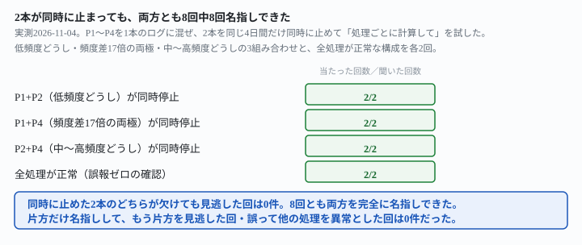
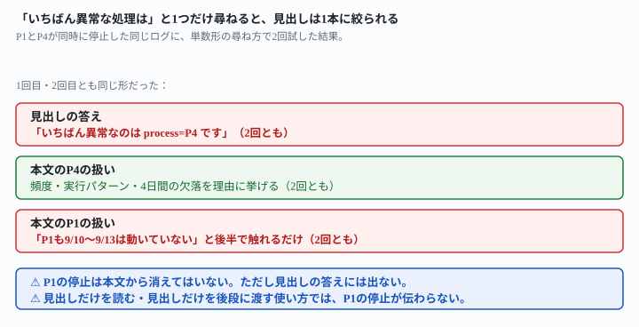

## これで何ができるか {: .what }

[監視対象を4本に増やしても](/recipes/four-process-log-keeps-each-own-baseline/)は、処理を4本（P1〜P4）に増やしました。頻度差を最大17倍に広げても、「処理ごとに計算して」と頼めば止めた1本を正しく見つけられることを確かめました。ただし、あの記事は**止まる処理が常に1本だけ**という条件でした。著者自身も「2本以上が同時に止まる場合は試していません」と書き残しています。

<mark>この記事は、頻度が違う2本の処理を、同じ4日間に同時に止めて試しました。</mark>用意した構成は次の4つで、同じ指示文で各2回試しています。

- 低頻度どうし（P1・P2）が同時に停止
- 頻度差17倍の両極（P1・P4）が同時に停止
- 中〜高頻度どうし（P2・P4）が同時に停止
- 全処理が正常（誤報ゼロの確認）

- **既存の指示文のまま、同時に止めた2本は8回中8回、両方とも名指し**できました。片方だけ見つけて、もう片方を見逃した回は0件です
- 全処理が正常な構成でも、2回とも誤報なく「該当なし」と答えました
- 一方、<mark class="warn">「いちばん異常な処理はどれですか」と1つだけ尋ねると、見出しの答えは2回とも頻度の高い処理（P4）だけ</mark>になりました。頻度の低い処理（P1）の停止は、本文の後半に補足として出るだけでした

<figure class="figure">

<figcaption>同時に止めた2本のどちらが欠けても、見逃した回は0件でした。</figcaption>
</figure>

## 前提 {: .need }

| | |
|---|---|
| かかる時間 | 20分 |
| 費用 | 無料。無料のチャットAIで足ります |
| 必要なもの | 複数の定期実行の、実行時刻が分かる記録（GitHub Actionsの実行履歴・ログファイルのタイムスタンプなど） |
| プログラミング | **不要**。実行時刻の一覧をそのまま貼るだけです |

材料は、先行記事と同じ架空の処理P1〜P4の実行時刻を1本にまとめたログです。どの構成も21日間（2026-09-01〜09-21）ぶんです。

- **P1**＝1日1〜2回（もっとも少ない）
- **P2**＝1日4〜8回
- **P3**＝1日10〜15回
- **P4**＝1日20〜30回（もっとも多い。P1の約17倍）

4つの構成を用意しました。停止させるのは常に同じ4日間（09-10〜09-13）ですが、**止める処理を2本に増やし**ました。

- **P1+P2**（低頻度どうし）が同時に停止
- **P1+P4**（頻度差17倍の両極）が同時に停止
- **P2+P4**（中〜高頻度どうし）が同時に停止
- **全処理が正常**（誤報ゼロの確認）

それぞれ、指定した2本だけ09-10〜09-13の4日間を0件にし、残りの処理は全期間正常にしています。生成後、日付ごと・処理ごとの行数を数え、意図した通りに0件になっているか、他の処理に意図しない0件の日が無いかを確認しました。

## AIへの頼み方 {: .ask }

### 1. 低頻度どうし（P1+P2）が同時に止まった場合

先行記事で効いた頼み方を、そのまま使います。

これは、複数の定期実行処理が実際に動いた時刻を記録したログです。処理名は process=P1・process=P2・process=P3・process=P4 の4種類が混ざっています。

処理ごとに、その処理自身の記録から「ふだんの1日あたりの実行回数」の目安を計算してください。そのうえで、その処理だけの目安と比べて極端に少ない日（0件の日を含む）があれば、処理名・日付・実行回数を挙げてください。該当する日が無ければ「該当なし」と答えてください。

上に、P1とP2が同時に09-10〜09-13の4日間停止した21日分のログを貼りました。2回試した結果です。

1回目は、P1・P2それぞれの目安を表で計算しました。そのうえで「P1 と P2 は、9/10〜9/13 の4日間連続でまったく記録がありません」と両方を表で名指し。P3・P4には触れず、該当なしと判断しています。2回目も同じく、P1・P2の目安を計算しました。「P1 と P2 が 2026-09-10 〜 09-13 の4日間、0回でした」と両方を名指し。「09-14 に両方とも再開しました」「共通の原因があるかもしれません」とも書いています。

### 2. 頻度差17倍の両極（P1+P4）が同時に止まった場合

今度は、もっとも少ないP1ともっとも多いP4という、頻度差が最大の組み合わせで同じ指示文を2回試しました。

これは、複数の定期実行処理が実際に動いた時刻を記録したログです。処理名は process=P1・process=P2・process=P3・process=P4 の4種類が混ざっています。

処理ごとに、その処理自身の記録から「ふだんの1日あたりの実行回数」の目安を計算してください。そのうえで、その処理だけの目安と比べて極端に少ない日（0件の日を含む）があれば、処理名・日付・実行回数を挙げてください。該当する日が無ければ「該当なし」と答えてください。

1回目は、P1「他の日には毎日1〜2回動いている」・P4「他の日には毎日20回以上動いている」と、2本それぞれの根拠をまず述べました。そのうえで「P1 と P4 だけが 09-10〜09-13 に止まり」と両方を名指し。P2・P3は該当なしでした。2回目も同じく、P1とP4の4日間をそれぞれ表に挙げました。「P1とP4が同じ4日間だけ止まっているので、同じ原因…の可能性があります」と書いています。

### 3. 中〜高頻度どうし（P2+P4）が同時に止まった場合

残りの組み合わせ（P2+P4）でも、同じ指示文で2回試しました。

これは、複数の定期実行処理が実際に動いた時刻を記録したログです。処理名は process=P1・process=P2・process=P3・process=P4 の4種類が混ざっています。

処理ごとに、その処理自身の記録から「ふだんの1日あたりの実行回数」の目安を計算してください。そのうえで、その処理だけの目安と比べて極端に少ない日（0件の日を含む）があれば、処理名・日付・実行回数を挙げてください。該当する日が無ければ「該当なし」と答えてください。

P2+P4が止まった2回は、両方とも「該当あり。P2 と P4 が…それぞれ0件でした」と両方を名指し。1回目は「共通の原因（スケジューラやホストの停止、設定変更など）があった可能性があります」。2回目は「9/14 0:00 に両方そろって再開しています」とも書いています。P1・P3への誤報は、この2回を通じて0件でした。

### 4. 全処理が正常な構成（誤報ゼロの確認）

同時停止の構成ではなく、どの処理も止まっていない構成でも、誤報が出ないかを確かめました。

これは、複数の定期実行処理が実際に動いた時刻を記録したログです。処理名は process=P1・process=P2・process=P3・process=P4 の4種類が混ざっています。

処理ごとに、その処理自身の記録から「ふだんの1日あたりの実行回数」の目安を計算してください。そのうえで、その処理だけの目安と比べて極端に少ない日（0件の日を含む）があれば、処理名・日付・実行回数を挙げてください。該当する日が無ければ「該当なし」と答えてください。

全処理が正常な構成では、2回とも「該当なし」でした。1回目は「ある日だけ止まったように見える日はありません」。2回目は「毎日0件になることはなく、目安から大きく外れた日もありませんでした」。回数の多い日と少ない日の差は「各処理が持つ実行パターンの違い」によるものだと、自分から説明しています。

**同時に止めた組み合わせが低頻度どうし・両極・中〜高頻度どうしのどれでも、8回中8回、両方を完全に名指ししました。**誤って片方だけ名指しして、もう片方を見逃した回は0件です。

### なぜ、2本が同時に止まっても取り落とされなかったのか

8回の返りはすべて、処理ごとに別々の目安を自分から計算し、P1からP4まで順番に当たっていました。指示文が「その処理自身の記録から」と名指ししているため、**計算の単位がはじめから処理名で区切られている**のです。1本が止まっていることを見つけても、その時点で判定を終わらせず、残りの処理も同じ手順で確認を続けていました。先行記事が「止まるのは1本」の条件で確かめた理屈が、「同時に2本止まる」に広げても同じ形で働いています。

## うまくいかないときの言い直し方 {: .fix }

### 「いちばん異常な処理はどれですか」と1つだけ尋ねると {: .trouble }

同じログ（P1とP4が同時に停止した構成）に、尋ね方を変えました。処理ごとの計算を頼むのではなく、「いちばん異常なもの」を1つだけ答えさせる聞き方です。

これは、複数の定期実行処理が実際に動いた時刻を記録したログです。処理名は process=P1・process=P2・process=P3・process=P4 の4種類が混ざっています。

この記録の中で、いちばん異常な処理はどれですか。処理名と、そう判断した理由を教えてください。

2回とも、見出しの答えは「いちばん異常なのは process=P4 です」でした。理由として、実行頻度の高さ・1時間に集中する実行パターン・日によって動き方が切り替わること・09-10〜09-13の4日間の欠落を挙げています。

P1の停止については、本文の後半で触れてはいました。1回目は「P1 も 9/10〜9/13 は動いておらず…ただし回数が少なく、動いた時刻自体は規則的です」。2回目は「同じ期間は P1 も 00:00 の実行が止まっています。ただし P2 と P3 は動いているので、P1・P4だけが止まった形です」。どちらも、見出しの答えには出てきません。

<figure class="figure">

<figcaption>見出しの答えは2回とも1本だけ。もう1本は本文の後半に残るだけでした。</figcaption>
</figure>

→ **原因は、質問そのものが「1つ」を求めている形だからです。**「いちばん異常な処理はどれですか」は単数を聞く文です。AIはその文の形に沿って、単数の見出しを作ります。本文を読めばP1の停止にも触れていますが、**見出しだけを読む・見出しだけを後段の処理に渡す使い方では、P1の停止が伝わりません。**同時に止まった処理を両方とも拾いたいときは、「いちばん」で1つに絞る聞き方は使わないでください。上の指示文1〜3のように、「該当すれば処理名を挙げてください」という、件数を決めない聞き方に戻してください。

## 応用・次の一手 {: .next }

| 止めた組み合わせ | 処理ごとに計算（複数形の聞き方） |
|---|---|
| P1+P2（低頻度どうし） | 2/2（両方を正しく名指し） |
| P1+P4（頻度差17倍の両極） | 2/2（両方を正しく名指し） |
| P2+P4（中〜高頻度どうし） | 2/2（両方を正しく名指し） |
| 全処理が正常 | 2/2（誤報なし） |
| P1+P4・「いちばん異常なのは」(単数形) | 見出しは2/2ともP4だけ。P1は本文の後半のみ |

通知やIssue登録につなげるなら、[先行記事](/recipes/four-process-log-keeps-each-own-baseline/)が確かめた「省略せずに」の言い直しが、同時停止でもそのまま使えます。

これは、複数の定期実行処理が実際に動いた時刻を記録したログです。処理名は process=P1・process=P2・process=P3・process=P4 の4種類が混ざっています。

処理ごとに、その処理自身の記録から「ふだんの1日あたりの実行回数」の目安を計算してください。そのうえで、その処理だけの目安と比べて極端に少ない日（0件の日を含む）があれば、処理名・日付・実行回数を挙げてください。処理ごとに「該当あり」か「該当なし」のどちらかを、省略せずに書いてください。

実務に載せるなら、次の順番がおすすめです。

1. 指示文1〜3の形で、処理ごとの判定を**省略せずに**出させる
2. 「いちばん異常な処理は」のような**単数を聞く形は、通知の文面作りだけに使い**、検出そのものには使わない
3. 「該当あり」が返った処理だけ、[自動化が静かに壊れたのを、AIに見つけさせる記事](/recipes/auto-health-check/)と同じ要領でGitHubのIssueを立てる

⚠️ **この結果は、架空の処理4本・計10回（複数形8回＋単数形2回）の実測です。**「何本同時に止まっても崩れない」と一般化しないでください。試したのは、次の範囲までです。

- 同時に止まったのは常に2本まで。3本以上が同時に止まる場合は試していません
- 停止は常に同じ4日間（09-10〜09-13）でした。2本の停止期間や開始日がずれる場合は試していません
  （[先行記事](/recipes/four-process-log-keeps-each-own-baseline/)が残した、もう1つの宿題です）
- 試した組み合わせは3組（P1+P2・P1+P4・P2+P4）のみ。P1+P3・P2+P3・P3+P4は試していません

今回の生の返りと機械照合は `docs/evidence/simultaneous-stop-both-get-named.md` に全文置いてあります。
