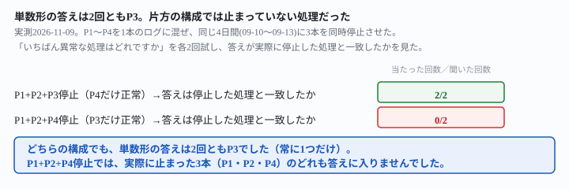
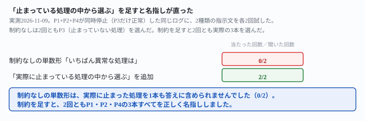

## これで何ができるか {: .what }

[監視対象を4本に増やしても](/recipes/four-process-log-keeps-each-own-baseline/)と[2つ同時に止まっても両方名指し](/recipes/simultaneous-stop-both-get-named/)は、「処理ごとに計算して」と頼む**複数形**の聞き方の実測でした。[3本同時に止めても1本だけ名指しから抜ける](/recipes/three-stop-drops-the-quiet-one/)は、同じ複数形の聞き方のまま、止まる本数を3本・4本に広げました。

どの記事も、**聞き方そのものを変える実測はしていません。**この記事は、同じ3本同時停止のログで、「いちばん異常な処理はどれですか」と1つだけ答えさせる**単数形**の聞き方を試しました。

結論を先に書きます。

| 停止させた3本 | 単数形の見出しで名指しされた処理 |
|---|---|
| P1+P2+P3が停止（P4だけ正常） | **P3のみ**（2/2）。実際に止まった処理の1本 |
| P1+P2+P4が停止（P3だけ正常） | **P3のみ**（2/2）。**止まっていない処理** |

<mark>低頻度のP1を含む3本停止（P1+P2+P3）では、単数形の答えは2回とも、実際に止まっていたP3でした。</mark>P1とP2はこのとき見出しから落ちています。一方、<mark class="warn">最高頻度のP4を含む3本停止（P1+P2+P4）では、単数形の答えは2回とも、まったく止まっていないP3でした。</mark>この回だけ、本当に止まった3本（P1・P2・P4）は1本も見出しに出てきません。

<figure class="figure">

<figcaption>見出しの答えは常に1つ。しかし、その1つが止まっていない処理のこともありました。</figcaption>
</figure>

## 前提 {: .need }

| | |
|---|---|
| かかる時間 | 20分 |
| 費用 | 無料。無料のチャットAIで足ります |
| 必要なもの | 複数の定期実行の、実行時刻が分かる記録（GitHub Actionsの実行履歴・ログファイルのタイムスタンプなど） |
| プログラミング | **不要**。実行時刻の一覧をそのまま貼るだけです |

材料は、先行記事と同じ架空の処理P1〜P4の実行時刻を1本にまとめたログです。どちらの構成も21日間（2026-09-01〜09-21）ぶんです。

- **P1**＝1日1〜2回（もっとも少ない）
- **P2**＝1日4〜8回
- **P3**＝1日10〜15回
- **P4**＝1日20〜30回（もっとも多い。P1の約17倍）

停止させるのは常に同じ4日間（09-10〜09-13）です。止める3本の組み合わせを2通り用意しました。

- **P1+P2+P3が停止**（低頻度のP1を含む）。正常に動くのはP4だけ
- **P1+P2+P4が停止**（最高頻度のP4を含む）。正常に動くのはP3だけ

生成後、日付ごと・処理ごとの行数を数え直し、意図した処理だけが停止4日間に0件になっていること、他の処理に意図しない0件の日が無いことを確認しました。

## AIへの頼み方 {: .ask }

### 1. P1+P2+P3が停止した場合（P4だけ正常）

これは、複数の定期実行処理が実際に動いた時刻を記録したログです。処理名は process=P1・process=P2・process=P3・process=P4 の4種類が混ざっています。

この記録の中で、いちばん異常な処理はどれですか。処理名と、そう判断した理由を教えてください。

上に、P1・P2・P3が同時に09-10〜09-13の4日間停止した21日分のログを貼りました。2回試した結果です。

1回目と2回目の答えです。

- **1回目**：「1つの処理だけが異常というより、P1・P2・P3が同時に止まっている期間があります」と前置きしました。そのうえで「どれか1つを挙げるなら、停止の不自然さが最も大きいP3です」と答えています。理由はP3のふだんの目安（約10件/日）。4日間の空白は、P2（約5〜6件/日）やP1（約1件/日）より「通常のばらつきでは説明しにくい」としています
- **2回目**：同じくP3を単独の答えにしました。「P1はいちばん少ないですが、元々そういう頻度なので異常とは言えません」と、P1を明確に格下げしています

**2回とも、単数形の答えはP3でした。**P1とP2も本文では触れられていますが、どちらの回も最終的な1つの答えには入っていません。

### 2. P1+P2+P4が停止した場合（P3だけ正常）

止める3本を入れ替え、もっとも頻度の高いP4を含む組み合わせで同じ指示文を2回試しました。

これは、複数の定期実行処理が実際に動いた時刻を記録したログです。処理名は process=P1・process=P2・process=P3・process=P4 の4種類が混ざっています。

この記録の中で、いちばん異常な処理はどれですか。処理名と、そう判断した理由を教えてください。

- **1回目**：「最も異常なのはprocess=P3です」と答えました。理由は「09-10〜09-13の4日間だけ、ログにP3しか出てきません」。さらに「この期間のP3は実行頻度が上がっています（1日あたり約9〜12回。他の日は3〜6回程度）」とも書いています。注意点として「P1・P2・P4が止まったのは、P3が原因ではなく、ログ収集の欠落やスケジューラ側の障害だった可能性もあります」とも添えていますが、見出しの答えはP3のまま変えていません
- **2回目**：同じくP3を単独の答えにしました。「他の処理が止まっていた間、P3だけが異常に動き続けていたことになります」としています

**2回とも、単数形の答えはP3でした。**ところが、この構成で実際に止まっていたのはP1・P2・P4の3本で、P3は止まっていません。

### 3. 同じ2つの構成を、複数形の指示文で確認し直す

単数形がP3を選んだのは指示文の形のせいか、材料のせいかを切り分けます。[先行記事](/recipes/three-stop-drops-the-quiet-one/)と同じ複数形の指示文を、同じ2つのログに対してもう一度自分で試しました。

これは、複数の定期実行処理が実際に動いた時刻を記録したログです。処理名は process=P1・process=P2・process=P3・process=P4 の4種類が混ざっています。

処理ごとに、その処理自身の記録から「ふだんの1日あたりの実行回数」の目安を計算してください。そのうえで、その処理だけの目安と比べて極端に少ない日（0件の日を含む）があれば、処理名・日付・実行回数を挙げてください。該当する日が無ければ「該当なし」と答えてください。

P1+P2+P3が停止した構成に2回試した結果です。

- **1回目**：P2・P3の目安を計算して4日間を正しく名指ししました。P1は「0件が極端に少ないとまでは言えない」として、名指しの一覧から外しています
- **2回目**：P1・P2・P3の3本すべてを表で名指ししました

### 4. もう一方の構成（P1+P2+P4停止）でも複数形を確認する

これは、複数の定期実行処理が実際に動いた時刻を記録したログです。処理名は process=P1・process=P2・process=P3・process=P4 の4種類が混ざっています。

処理ごとに、その処理自身の記録から「ふだんの1日あたりの実行回数」の目安を計算してください。そのうえで、その処理だけの目安と比べて極端に少ない日（0件の日を含む）があれば、処理名・日付・実行回数を挙げてください。該当する日が無ければ「該当なし」と答えてください。

P1+P2+P4が停止した構成にも2回試しました。

- **1回目**：「P4とP2に極端に少ない日があります。P1とP3は該当なしです」とP1を外しました
- **2回目**：P1・P2・P4の3本すべてを表に挙げました。「P3以外の処理は、この4日間に1件も記録がありません」と明記しています

**複数形の指示文では、4回とも「止まっていない処理」が答えに混ざることは一度もありませんでした。**半分の回でP1（頻度がもっとも低い処理）が名指しから漏れています。これは[先行記事](/recipes/three-stop-drops-the-quiet-one/)が確かめた「ふだんが少ない処理は見落とされやすい」という傾向の再現です。止まっていないP3やP4を誤って挙げた回はありませんでした。

### なぜ、単数形だけが止まっていない処理を名指ししたのか

材料は同じで、崩れたのは単数形の問いだけでした。4日間、停止していない処理以外はログから消えます。そのため**ログ全体に対する「正常に動いている側」の相対的な割合が一時的に増えます。**「いちばん異常な処理はどれですか」という単数形の問いは、処理ごとの自分の目安と比べていません。**ログ全体の中で目立つものを探す**答え方に寄っていました。本来止まった3本は、どれも「記録が0件になった」という意味で同じように異常です。しかし、その3本を比べる視点そのものが、単数形の問いには入っていません。複数形の指示文は「処理ごとに」という一言で、最初から比べる単位を処理名で区切っています。だから、この崩れ方が起きていません。

## うまくいかないときの言い直し方 {: .fix }

### 「いちばん異常」が、止まっていない処理を指すとき {: .trouble }

P1+P2+P4が停止した同じログに、「実際に止まっている処理の中から選ぶ」という制約を足して2回試しました。

これは、複数の定期実行処理が実際に動いた時刻を記録したログです。処理名は process=P1・process=P2・process=P3・process=P4 の4種類が混ざっています。

この記録の中で、いちばん異常な処理はどれですか。処理名と、そう判断した理由を教えてください。

⚠️ 「いちばん異常な処理」は、実際に記録が止まっている（0件が複数日続いている）処理の中から選んでください。複数該当する場合は、該当する処理を全部挙げてください。

1回目は「該当する処理はP1・P2・P4の3つです」と、実際に止まった3本すべてを名指ししました。表で各処理の最後の記録・再開時刻・空白期間を示しています。「P3は期間を通して継続的に記録されており、停止していません」と、止まっていない処理も明確に除外しました。2回目も同じく「該当するのはP1、P2、P4の3つです。P3は止まっていません」と、3本すべてを名指ししています。

<figure class="figure">

<figcaption>制約なしは2回ともP3を誤って名指し。制約を足すと2回とも実際の3本を正しく名指ししました。</figcaption>
</figure>

→ **原因は「いちばん異常」という言葉です。**どの処理が止まっているかではなく、ログの中で何が目立つかを答えさせていました。P3が目立ったのは、他の3本が消えたことで相対的に浮き上がっただけです。P3自身は何も異常な動きをしていません。直すときは、「もっと詳しく」のような言い方では直りません。AIは言われたとおり「目立つもの」を探しているだけで、指示文のどこにも誤っていないからです。**「実際に記録が止まっている処理の中から選ぶ」と、選ぶ対象そのものを先に絞る**一文が必要です。

## 応用・次の一手 {: .next }

| 構成 | 単数形（制約なし） | 単数形＋「止まっている処理の中から」 |
|---|---|---|
| P1+P2+P3停止（P4だけ正常） | P3のみ（2/2。実際に停止） | 未実施 |
| P1+P2+P4停止（P3だけ正常） | **P3のみ（2/2。止まっていない処理）** | **P1・P2・P4の3本すべて（2/2）** |

通知の文面や監視の一次判定には、単数形の聞き方そのものを使わないのが安全です。検出には、[先行記事](/recipes/three-stop-drops-the-quiet-one/)が確かめている複数形の指示文（「処理ごとに計算して」＋「省略せずに」）を使い、単数形は使うとしても人が読む要約の文面作りだけに留めてください。

これは、複数の定期実行処理が実際に動いた時刻を記録したログです。処理名は process=P1・process=P2・process=P3・process=P4 の4種類が混ざっています。

処理ごとに、その処理自身の記録から「ふだんの1日あたりの実行回数」の目安を計算してください。そのうえで、その処理だけの目安と比べて極端に少ない日（0件の日を含む）があれば、処理名・日付・実行回数を挙げてください。処理ごとに「該当あり」か「該当なし」のどちらかを、省略せずに書いてください。

この指示文を同じ2つの構成に対して、自分でも2回ずつ試し直しました。P1+P2+P3では2回とも「ふだんが少ない」としてP1を名指しから外しています。P1+P2+P4では1回がP1を外し、もう1回はP1を含めた3本すべてを名指ししました。**止まっていない処理（P3やP4）を答えに混ぜた回は、4回とも0件でした。**[先行記事](/recipes/three-stop-drops-the-quiet-one/)が確かめたP1の見落としは、今回の実測でも4回中3回に残っています。「省略せずに」だけでは直りきりません。必要なら、同記事の「頻度が低くても除外しない」という一文も重ねてください。

⚠️ **この結果は、架空の処理4本・計14回（単数形4回＋単数形＋制約2回＋複数形〈通常〉4回＋複数形〈省略せずに〉4回）の実測です。**「止まっていない処理を名指しする」と一般化しないでください。試したのは、次の範囲までです。

- 試した3本停止の組み合わせは2組（P1+P2+P3・P1+P2+P4）のみです。P1+P3+P4・P2+P3+P4は試していません
- 正常に残る処理が、どちらの回も1本（P4またはP3）でした。正常な処理が0本（全部停止）・2本以上残る場合は試していません
- 停止は常に同じ4日間（09-10〜09-13）でした。長さを変えた場合は、[停止の長さを変えた記事](/recipes/short-stop-slips-through-on-the-quiet-process/)の範囲を参照してください

今回の生の返りと機械照合は `docs/evidence/single-answer-can-name-the-normal-one.md` に全文置いてあります。
