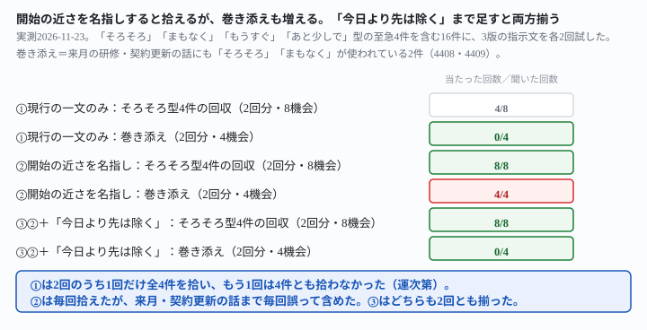

## これで何ができるか {: .what }

[工程1を広げると巻き添えは消える、の記事](/recipes/widen-stage1-clears-the-collateral/)は、最後にこう書いて終わっています。

「直す案はまだ試していません。候補は『そろそろ』『まもなく』のように、開始が近いことを示す言い方も含めてください、と**開始の近さを別枠で名指しする**ことです。この一文は今回の実測では試していません」。

この記事はその案を実際に試します。「そろそろ」「まもなく」「もうすぐ」「あと少しで」の4種類を仕込んだ新しい材料で、**①現行の一文のみ②開始の近さを名指し③②に『今日より先は除く』を足したもの**、の3版を比べました。

結論を先に書きます。

| 版 | そろそろ型4件の回収（2回分・8機会） | 巻き添え（2回分・4機会） |
|---|---|---|
| ①現行の一文のみ | 4/8（2回のうち1回だけ全4件・もう1回は0件） | **0/4** |
| ②開始の近さを名指し | **8/8** | **4/4**（毎回2件を誤って含めた） |
| ③②＋「今日より先は除く」 | **8/8** | **0/4** |

<figure class="figure">

<figcaption>名指しすると拾えるが、巻き添えも増えます。両方揃うのは③だけでした。</figcaption>
</figure>

<mark>現行の一文のまま「そろそろ」型を聞くと、2回のうち1回は全4件を回収し、もう1回は1件も回収しませんでした。</mark>同じ指示文・同じ材料でも、結果は運次第でした。「開始の近さ」を別枠で名指しすると、2回とも4件を回収しました。<mark class="warn">ただし、来月の研修・契約更新のような今日の話ではない2件も、2回とも誤って含めました。</mark>この巻き添えが消えたのは、「今日より先の出来事は含めない」を足した③だけでした。

📌 **数字はすべて架空データでの実測です。**独立の新規プロセス（CLAUDE.mdや履歴を共有しない状態）で、材料・各版とも2回ずつ試しました。

## 前提 {: .need }

| | |
|---|---|
| かかる時間 | 20分。[前作](/recipes/widen-stage1-clears-the-collateral/)を先に読むと早いです |
| 費用 | 無料。無料のチャットAIで足ります |
| 必要なもの | ブラウザで使えるAI（ChatGPT・Claude・Geminiなど）と、毎日処理したいテキスト |
| プログラミング | **不要**。工程1の指示文に一文を足すだけです |

材料は社内ヘルプデスクへの架空の問い合わせ16件です。[前作](/recipes/widen-stage1-clears-the-collateral/)の材料A・Bと同じ場面設定ですが、今回は「そろそろ」「まもなく」「もうすぐ」「あと少しで」の4種類をすべて1本の材料に仕込み直しました。

- **至急7件のうち4件**（HD-4401〜4404）＝4種類の言い換えで「今日中に始まる」と分かる問い合わせです
- **至急7件のうち3件**（HD-4405〜4407）＝「至急」「今すぐ」「本日◯時まで」のように明示された問い合わせです
- **至急ではない9件のうち2件**（HD-4408・HD-4409）＝「そろそろ」「まもなく」を含みますが、始まるのは**来月の研修**や**契約更新の時期**です。巻き添えを確かめるための仕込みです
- **至急ではない9件のうち残り7件**（HD-4410〜4416）＝解決済み・来週以降・明示的に急いでいない、など通常の非至急です

試すのは、[前作](/recipes/widen-stage1-clears-the-collateral/)の工程1の指示文に、「開始の近さ」を名指しする一文を足したものです。

## AIへの頼み方 {: .ask }

### 1. 現行の一文のみ（①）

[前作](/recipes/widen-stage1-clears-the-collateral/)の指示文をそのまま使います。

下の16件の社内ヘルプデスクへの問い合わせについて、本文に「至急」「今すぐ」「本日中」のように今日中の対応が必要だと明記されているもの、または、本文に至急という語が無くても、明日の予定に間に合わせるために今日中に必要な作業も含めて抜き出してください。書いていないものは入れないでください。抜き出したものは、そのままの文面で出してください。

**独立の新規会話で2回**試しました。1回目は、至急7件に加えて「そろそろ」「まもなく」「もうすぐ」「あと少しで」の4件も含めて、7件すべてを正しく抜き出しました。理由として「『至急』という語ははっきり書かれていないが、会議などが直後に始まる状況での不具合報告なので、今日中、それも今すぐの対応が必要だと読み取れる」と書いています。

下の16件の社内ヘルプデスクへの問い合わせについて、本文に「至急」「今すぐ」「本日中」のように今日中の対応が必要だと明記されているもの、または、本文に至急という語が無くても、明日の予定に間に合わせるために今日中に必要な作業も含めて抜き出してください。書いていないものは入れないでください。抜き出したものは、そのままの文面で出してください。

2回目は、明示された3件（HD-4405〜4407）だけを抜き出しました。4種類の言い換え（HD-4401〜4404）は除外されました。理由は「実際には対応が必要と読めますが、至急・今すぐ・本日中という語が本文にないため…」です。<mark class="warn">同じ指示文・同じ材料なのに、2回のうち1回は4件すべて拾い、もう1回は1件も拾いませんでした。</mark>巻き添え（HD-4408・4409）は2回とも0件でした。

### 2. 開始の近さを別枠で名指し（②）

[前作](/recipes/widen-stage1-clears-the-collateral/)が「試していない」として挙げていた案をそのまま実行します。

下の16件の社内ヘルプデスクへの問い合わせについて、本文に「至急」「今すぐ」「本日中」のように今日中の対応が必要だと明記されているもの、または、本文に至急という語が無くても、明日の予定に間に合わせるために今日中に必要な作業も含めて抜き出してください。また、「そろそろ」「まもなく」「もうすぐ」「あと少しで」のように、何かが始まるタイミングが近いことを示す言い方も、今日中に対応が必要な根拠として含めてください。書いていないものは入れないでください。抜き出したものは、そのままの文面で出してください。

2回とも、至急7件に加えてHD-4408・HD-4409も含む9件を抜き出しました。1回目は「『そろそろ』『まもなく』があるため含めましたが、実際は来月の研修と契約更新の時期です…」と自分で書いています。

下の16件の社内ヘルプデスクへの問い合わせについて、本文に「至急」「今すぐ」「本日中」のように今日中の対応が必要だと明記されているもの、または、本文に至急という語が無くても、明日の予定に間に合わせるために今日中に必要な作業も含めて抜き出してください。また、「そろそろ」「まもなく」「もうすぐ」「あと少しで」のように、何かが始まるタイミングが近いことを示す言い方も、今日中に対応が必要な根拠として含めてください。書いていないものは入れないでください。抜き出したものは、そのままの文面で出してください。

2回目も同じ9件でした。<mark>名指しすると、そろそろ型4件の回収は2回とも100%に上がりました。</mark><mark class="warn">ただし、来月・契約更新という今日の話ではない2件も、2回とも誤って含めました。</mark>この指示文は「そろそろ」「まもなく」という語そのものを基準にしています。それが「今日」始まることかどうかは確認していません。

### 3. 名指しに「今日より先は除く」を足す（③）

下の16件の社内ヘルプデスクへの問い合わせについて、本文に「至急」「今すぐ」「本日中」のように今日中の対応が必要だと明記されているもの、または、本文に至急という語が無くても、明日の予定に間に合わせるために今日中に必要な作業も含めて抜き出してください。また、「そろそろ」「まもなく」「もうすぐ」「あと少しで」のように、何かが始まるタイミングが近いことを示す言い方も、それが今日中に始まることであれば今日中に対応が必要な根拠として含めてください。ただし、始まるのが来月や契約更新のような、今日より先の出来事である場合は含めないでください。書いていないものは入れないでください。抜き出したものは、そのままの文面で出してください。

1回目は至急7件だけを正しく抜き出しました。理由は「『そろそろ』『まもなく』はありますが、始まるのは来月の研修と契約更新です」です。

下の16件の社内ヘルプデスクへの問い合わせについて、本文に「至急」「今すぐ」「本日中」のように今日中の対応が必要だと明記されているもの、または、本文に至急という語が無くても、明日の予定に間に合わせるために今日中に必要な作業も含めて抜き出してください。また、「そろそろ」「まもなく」「もうすぐ」「あと少しで」のように、何かが始まるタイミングが近いことを示す言い方も、それが今日中に始まることであれば今日中に対応が必要な根拠として含めてください。ただし、始まるのが来月や契約更新のような、今日より先の出来事である場合は含めないでください。書いていないものは入れないでください。抜き出したものは、そのままの文面で出してください。

2回目も同じ7件でした。<mark>2回とも、そろそろ型4件は全部回収し、巻き添え（HD-4408・4409）は0件でした。</mark>名指しした語（そろそろ・まもなく・もうすぐ・あと少しで）はそのまま残しました。そこに「今日中であれば」という条件と「今日より先は除く」という除外を両方足しました。回収と巻き添えの両方が、これで揃いました。

## うまくいかないときの言い直し方 {: .fix }

### 語を名指しするだけでは、語の存在だけで判定される {: .trouble }

<mark class="warn">「そろそろ」「まもなく」という語そのものを名指しすると、AIはその語の有無で判定するようになります。</mark>何が始まるのかまでは確認しなくなることがあります。これは台帳が繰り返し指摘している「禁止語・対象語の一覧より、範囲・形の指定のほうが効く」という構図の裏返しです。語を**許可する**一覧を渡すときも、同じ落とし穴があります。

直し方は語の一覧を変えないことでした。足したのは、その語が指す範囲（今日中かどうか）を別に指定する一文だけです。語を削ったり増やしたりするより、こちらのほうが早く直りました。

### 現行の一文のままだと、運次第になる {: .trouble }

①の2回の結果（全4件／0件）を見ると、「現行の一文で足りている」とも「足りていない」とも言い切れません。同じ指示文・同じ材料でも、新規の会話を起動するたびに判定が割れました。**自動化に組み込むなら、「拾えた日もあった」という1回の成功を根拠にしないでください。**複数回試して、割れるかどうかを先に確認してください。

## 応用・次の一手 {: .next }

**この記事の値打ちは2つです。**

1. [前作](/recipes/widen-stage1-clears-the-collateral/)が「まだ試していない」としていた案（開始の近さを別枠で名指し）を試しました。「そろそろ」型4件の回収が、2回とも100%に上がることを確かめました
2. 名指しするだけでは、今日の話ではない予定まで誤って含める巻き添えが生まれます。「今日より先は除く」を足すと、両方揃うことを確かめました

保存版はこの指示文です。

下の16件の社内ヘルプデスクへの問い合わせについて、本文に「至急」「今すぐ」「本日中」のように今日中の対応が必要だと明記されているもの、または、本文に至急という語が無くても、明日の予定に間に合わせるために今日中に必要な作業も含めて抜き出してください。また、「そろそろ」「まもなく」「もうすぐ」「あと少しで」のように、何かが始まるタイミングが近いことを示す言い方も、それが今日中に始まることであれば今日中に対応が必要な根拠として含めてください。ただし、始まるのが来月や契約更新のような、今日より先の出来事である場合は含めないでください。書いていないものは入れないでください。抜き出したものは、そのままの文面で出してください。

この記事は、工程を分けて頼む系列の5本目です。

1. [「AIには工程を分けて頼め」を測った記事](/recipes/split-into-stages-what-breaks/)
2. [工程2への確認を足す実測](/recipes/doubt-fixes-added-not-dropped/)
3. [確認の基準を固定する実測](/recipes/narrowed-criteria-fixes-dirty-not-clean/)
4. [工程1の基準を広げる実測](/recipes/widen-stage1-clears-the-collateral/)

今回は、広げた基準の中に残っていた1種類の言い換え（開始の近さ）を名指しすると何が起きるかを測りました。

**基準を広げるたびに、新しく巻き添えが生まれないかを確かめることが大事です。**今回は語を名指ししたことで回収は上がりましたが、同時に新しい巻き添えが生まれました。「直った」で終わらせず、次の実測で巻き込んだものを数えてください。

⚠️ **測っていないことも書いておきます。**「もうすぐ」「あと少しで」が巻き添えの側（今日の話ではない文脈）でも同じ問題を起こすかは、確かめていません。巻き添えの仕込みは「そろそろ」「まもなく」の2種類だけです。英語混じりの文面や、5種類以上の言い換えが混ざる場合も未測定です。[2回ぶんの出力を自分で見比べる](/recipes/compare-two-runs-yourself/)の要領で、自分の材料でも複数回は突き合わせてください。

今回の生の返りと機械照合は`docs/evidence/soon-wording-stage1-still-catches-it.md`に全文置いてあります。
